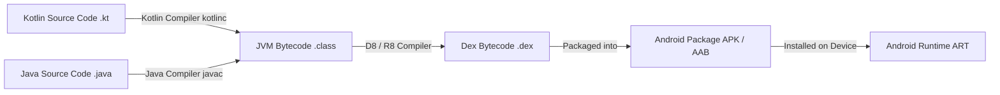
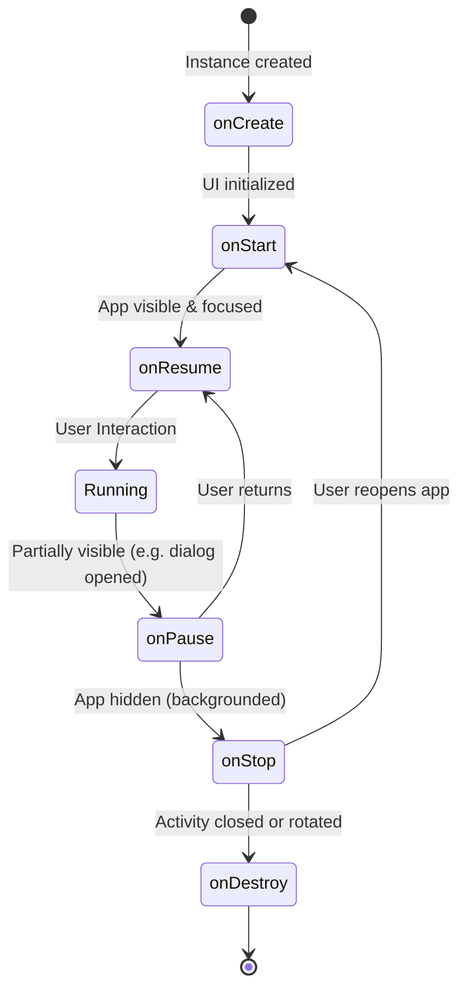

### 1\. Kotlin & Android: Core Philosophy & Compilation Internals

Imagine building a modern modular house. Java is like building it with brick and mortar—it is sturdy and reliable, but it requires massive amounts of repetitive physical labor (boilerplate) and a single loose pipe can completely flood the entire basement (the dreaded `NullPointerException`). **Kotlin**, on the other hand, is like using pre-fabricated structural insulated panels and modern smart home systems. It is concise, safe by design, has built-in safety valves for leaks (null safety), and handles high-intensity chores effortlessly using automated assistants (coroutines).

Kotlin is a **cross-platform, statically typed, general-purpose programming language** developed by JetBrains. In 2017, Google announced first-class support for Kotlin on Android, and in 2019, declared a **Kotlin-First** development approach. Today, modern Jetpack libraries and Jetpack Compose are written exclusively in Kotlin.

#### The Android Compilation Pipeline

Kotlin code runs on the Android Runtime (ART) or the Dalvik Virtual Machine (on older devices). The compilation pipeline consists of several stages:



1. **Front-end Compilation**: The Kotlin compiler (`kotlinc`) translates Kotlin source code (`.kt`) into Java Virtual Machine (JVM) bytecode (`.class` files). During this phase, Kotlin resolves extension functions, properties, smart casts, and compiles lambdas.
2. **Dexing (D8)**: The D8 compiler converts JVM bytecode `.class` files into Dalvik Executable (`.dex`) files. Dalvik bytecode is optimized for low-memory, battery-constrained mobile systems.
3. **Shrinking & Optimization (R8)**: R8 replaces ProGuard in modern pipelines. It inspects `.dex` files to perform tree-shaking (removing unused code), optimization (inlining methods, simplifying control flows), and obfuscation (renaming classes and variables to shorten paths).
4. **Execution (ART)**: The Android Runtime (ART) compiles dex code into machine code using Ahead-of-Time (AOT) compilation during installation and Just-in-Time (JIT) compilation during runtime, optimizing performance based on actual device usage.

#### Gradle Build Configuration (Kotlin DSL)

Modern Android projects use Kotlin Script (`.gradle.kts`) for build configurations. Compared to Groovy, Kotlin DSL provides type safety, autocompletion, and compile-time verification within your build files.

```kotlin
// build.gradle.kts (Module-level configuration)
plugins {
    alias(libs.plugins.android.application)
    alias(libs.plugins.kotlin.android)
    alias(libs.plugins.kotlin.serialization)
    alias(libs.plugins.ksp) // Kotlin Symbol Processing
}

android {
    namespace = "com.example.notesapp"
    compileSdk = 35

    defaultConfig {
        applicationId = "com.example.notesapp"
        minSdk = 26
        targetSdk = 35
        versionCode = 1
        versionName = "1.0.0"
    }

    compileOptions {
        sourceCompatibility = JavaVersion.VERSION_17
        targetCompatibility = JavaVersion.VERSION_17
    }
    
    kotlinOptions {
        jvmTarget = "17"
        freeCompilerArgs += listOf(
            "-opt-in=kotlinx.coroutines.ExperimentalCoroutinesApi",
            "-opt-in=androidx.compose.material3.ExperimentalMaterial3Api"
        )
    }
}
```

<Callout type="info" title="💡 Why Java Compatibility Matters">
Kotlin compiles to JVM-compatible bytecode. This allows 100% interoperability: a Kotlin class can extend a Java class, implement a Java interface, and call Java methods directly without performance penalties.
</Callout>

<Quiz question={"Which compilation tool in the modern Android pipeline converts JVM bytecode (.class) into Dalvik Executable (.dex) code?"} options={["`kotlinc`", "`javac`", "`D8`", "`R8`"]} answerIndex={2}>
The `D8` compiler is responsible for converting Java/Kotlin bytecode `.class` files into `.dex` files suitable for execution on the Android Runtime (ART). `R8` runs after or during this process to shrink and optimize the code.
</Quiz>

---

### 2\. Basic Syntax & Control Flow

To build a solid foundation, let's explore Kotlin's basic syntax elements, variable configurations, and control flow mechanics.

#### Variables: Val vs Var & Constants

Kotlin enforces explicit decisions about mutability:
- **`val` (Value)**: Read-only reference. It cannot be reassigned once initialized. However, if it points to a mutable object (like a mutable list), the object's contents can change.
- **`var` (Variable)**: Mutable reference. It can be reassigned to a different value of the same type.
- **`const val`**: Compile-time constant. It must be declared at the top level or inside a companion object, must be initialized with a primitive or String, and is inlined at compile time.

```kotlin
val list = mutableListOf("A", "B") // Reference is read-only
// list = mutableListOf("C") // Compilation Error: Reassignment
list.add("C") // Valid: Object contents modified

const val API_TIMEOUT_MS = 5000L // Compiled as raw literal value in bytecode
```

#### Basic Data Types & Type Inference

Kotlin features standard primitive-equivalent types (which are represented as native JVM primitives in generated bytecode whenever possible to save memory):
- **Numbers**: `Byte` (8-bit), `Short` (16-bit), `Int` (32-bit), `Long` (64-bit), `Float` (32-bit), `Double` (64-bit).
- **Textual**: `Char` (character literals), `String` (string values).
- **Boolean**: `true` or `false`.

```kotlin
val count = 10L // Inferred as Long
val pi = 3.14159 // Inferred as Double
val message = "Hello, $count items" // String template expression
```

#### Expressions vs Statements

In Kotlin, most control structures are **expressions**, meaning they return a value. In contrast, Java structures are mostly **statements** (they execute an action but return nothing).

1. **`if` as an Expression** (replacing Java's ternary operator `? :`):
   ```kotlin
   val score = 85
   val grade = if (score >= 90) "A" else "B" // Returns the evaluated branch
   ```

2. **`when` Expression** (representing an advanced, type-safe replacement for `switch`):
   ```kotlin
   val result: Any = "Success"
   val statusMessage = when (result) {
       is String -> "String value of length ${result.length}"
       1, 2, 3 -> "Numeric status ID"
       in 4..10 -> "Range check status"
       else -> "Unknown status" // Mandatory if when is used as expression and not exhaustive
   }
   ```

#### Loops & Ranges

Kotlin provides structured ways to iterate:

```kotlin
// Closed Range (1, 2, 3, 4, 5)
for (i in 1..5) { print(i) }

// Half-open Range (1, 2, 3, 4)
for (i in 1 until 5) { print(i) }

// Decrementing Range with custom step (5, 3, 1)
for (i in 5 downTo 1 step 2) { print(i) }

// Iterating over collections with indices
val items = listOf("Apple", "Banana")
for ((index, item) in items.withIndex()) {
    println("Item $index is $item")
}
```

#### Structural vs Referential Equality

- **`==` (Structural)**: Compares the values of two objects (translates to `.equals()` in Java).
- **`===` (Referential)**: Compares the memory addresses of two references to check if they point to the exact same object.

```kotlin
val str1 = String(charArrayOf('h', 'e', 'l', 'l', 'o'))
val str2 = String(charArrayOf('h', 'e', 'l', 'l', 'o'))

println(str1 == str2)  // true: values are structurally identical
println(str1 === str2) // false: different objects in heap memory
```

<Quiz question={"Which variable declaration should you use for a value that is resolved at compile-time and inlined directly in the bytecode?"} options={["`val`", "`var`", "`const val`", "`lateinit val`"]} answerIndex={2}>
`const val` declarations are resolved at compile-time and inlined everywhere they are referenced, removing the overhead of runtime property retrieval. They can only be primitive types or Strings.
</Quiz>

---

### 3\. Null Safety in Depth & Platform Interoperability

In Java, any object reference can be `null`, which causes runtime crashes via `NullPointerException` (NPE) when accessed. Kotlin mitigates this by integrating nullability definitions directly into its compiler type systems.

#### Nullable vs Non-Nullable Types

A variable in Kotlin cannot hold a null reference unless it is explicitly declared as a nullable type by appending a `?` suffix to the type declaration:

```kotlin
var name: String = "Kamran"
// name = null // Compilation Error!

var nullableName: String? = "Kamran"
nullableName = null // Compiles successfully
```

#### Under the Hood: Compiling Nullability

At the JVM bytecode level, there is no primitive difference between `String` and `String?`. The Kotlin compiler enforces null safety by injecting metadata annotations (`@NotNull` and `@Nullable`) and generating checks:
- Non-nullable method parameters compile with synthetic validation calls: `Intrinsics.checkNotNullParameter(param, "paramName")`. If Java code calls a Kotlin method with a null argument, it throws an `IllegalArgumentException` instantly, preventing propagation of corrupted state.

#### Handling Nulls Safely

Kotlin provides operators to work with nullable values:

```kotlin
val name: String? = getNullableName()

// 1. Safe Call Operator (?.): returns null if receiver is null
val length: Int? = name?.length

// 2. Elvis Operator (?:): evaluates right expression if left is null
val lengthOrZero: Int = name?.length ?: 0

// 3. Not-Null Assertion (!!): throws NullPointerException if null
val forcedLength: Int = name!!.length

// 4. Safe Cast (as?): returns null if casting fails
val text: TextView? = view as? TextView
```

#### Platform Types (`T!`)

When interacting with Java libraries (like standard Android SDKs), Kotlin has no way of knowing whether a return type is nullable unless the Java code has explicit annotations (e.g., `@NonNull` or `@Nullable`). 

These unannotated Java types are imported into Kotlin as **Platform Types** (notated as `T!`, such as `String!`). 
- You cannot declare platform types manually in Kotlin code.
- The compiler allows you to treat them as either nullable or non-nullable.
- If you treat a platform type as non-nullable and it returns null at runtime, it throws an NPE immediately when accessed.

```java
// Java Method
public class UserJava {
    public String getName() { return null; } // No nullability annotations!
}
```

```kotlin
// Kotlin Interop
val user = UserJava()
val name: String = user.name // Compiles, but throws NullPointerException at runtime!
```

#### Late-Initialization vs Lazy Initialization

Kotlin provides two mechanisms for delaying property initialization:

| Feature | `lateinit var` | `by lazy` |
| --- | --- | --- |
| **Mutability** | Must be `var` | Must be `val` |
| **Nullability** | Must be non-nullable | Can be nullable or non-nullable |
| **Types Allowed** | Cannot be primitives (Int, Double, etc.) | Any type |
| **Thread Safety** | Not thread-safe | Thread-safe by default (configurable) |
| **Underlying Mechanism** | Direct backing field reference | Property Delegate wrapper |
| **Error when accessed uninitialized** | Throws `UninitializedPropertyAccessException` | Cannot be accessed uninitialized (initialized on access) |

```kotlin
// Example of lateinit in Android UI
class MyActivity : Activity() {
    private lateinit var binding: ActivityMainBinding

    override fun onCreate(savedInstanceState: Bundle?) {
        super.onCreate(savedInstanceState)
        binding = ActivityMainBinding.inflate(layoutInflater) // Initialized here
        setContentView(binding.root)
    }
}

// Example of lazy initialization
class Repository {
    // Database connection only created when first read
    private val database: AppDatabase by lazy {
        Room.databaseBuilder(context, AppDatabase::class.java, "db").build()
    }
}
```

<Quiz question={"What happens if a Kotlin variable of type 'String' receives a null value from a Java method at runtime?"} options={["It returns a default empty string automatically", "It compiles successfully but throws a NullPointerException as soon as the variable is accessed in Kotlin", "The compiler blocks compilation of the Java library call", "It triggers a memory leak"]} answerIndex={1}>
Because the Java method lacks nullability annotations, Kotlin imports it as a platform type (`String!`). The compiler allows assigning it to a non-nullable `String` variable, but at runtime, accessing it results in a NullPointerException due to the unexpected null reference.
</Quiz>

---

### 4\. Object-Oriented Programming (OOP) in Kotlin

Kotlin modernizes class creation, interfaces, and inheritance while maintaining familiar object-oriented principles.

#### Constructors & Initialization Blocks

Kotlin classes feature a **Primary Constructor** defined directly in the class header, and one or more **Initialization Blocks** (`init`) that run sequentially when the instance is created.

```kotlin
class Customer(val name: String, val age: Int) {
    // Primary constructor variables declared with val/var become properties
    val isAdult: Boolean

    init {
        // Runs immediately after the primary constructor
        println("Initializing Customer: $name")
        isAdult = age >= 18
    }

    // Secondary Constructor
    constructor(name: String) : this(name, 0) {
        println("Secondary constructor called")
    }
}
```

#### Inheritance and Open Classes

In Kotlin, all classes and methods are **`final` by default** to prevent fragile base-class problems. To allow inheritance or overrides, you must explicitly mark a class or method as `open`:

```kotlin
open class Vehicle {
    open fun startEngine() {
        println("Engine started")
    }
}

class SportsCar : Vehicle() {
    override fun startEngine() {
        super.startEngine()
        println("Turbocharger activated")
    }
}
```

#### Companion Objects

Kotlin does not have static members. Instead, static-like behavior is achieved via **Companion Objects**. A companion object is a singleton instance bound to the class scope.

```kotlin
class ApiClient private constructor() {
    companion object {
        const val BASE_URL = "https://api.example.com"
        
        fun create(): ApiClient {
            return ApiClient()
        }
    }
}

// Usage: looks like static invocation in Java
val client = ApiClient.create()
val url = ApiClient.BASE_URL
```

#### Nested vs Inner Classes

- **Nested Class** (Default): Equivalent to a static nested class in Java. It does not hold a reference to its outer class, protecting against memory leaks.
- **Inner Class**: Marked with the `inner` keyword. It retains a reference to the outer class instance and can access its members.

```kotlin
class Outer {
    val outerValue = "Outer Value"

    class Nested {
        // Cannot access outerValue
    }

    inner class Inner {
        fun printValue() {
            println(outerValue) // Valid: holds outer class reference
        }
    }
}
```

<Callout type="error" title="⚠️ Inner Classes & Memory Leaks">
In Android, inner classes that survive beyond the lifecycle of their outer class (e.g., an inner class running a long background task inside an Activity) will prevent the outer class from being garbage collected, causing a memory leak. Use static nested classes instead.
</Callout>

#### Sealed Classes and Interfaces

Sealed classes represent restricted class hierarchies. They are direct abstract classes that can only be subclassed within the same file/module. This makes them ideal for defining state machines or representing UI States:

```kotlin
sealed interface UiState {
    data object Loading : UiState
    data class Success(val data: List<String>) : UiState
    data class Error(val exception: Throwable) : UiState
}

// Exhaustive compile-time checks in when expressions
fun renderState(state: UiState) {
    when (state) {
        is UiState.Loading -> showSpinner()
        is UiState.Success -> showList(state.data)
        is UiState.Error -> showError(state.exception.message)
        // No 'else' branch required! The compiler knows all options are covered.
    }
}
```

<Quiz question={"Which modifier must be used to allow other classes to inherit from a Kotlin class?"} options={["`public`", "`abstract`", "`open`", "`virtual`"]} answerIndex={2}>
All classes in Kotlin are final by default to prevent unintended subclassing. You must explicitly mark a class as `open` to allow other classes to extend it.
</Quiz>

---

### 5\. Functional Programming & Scope Functions

Kotlin supports functional programming paradigms, allowing you to treat functions as first-class citizens, pass them as variables, and use lambda expressions.

#### High-Order Functions & Lambdas

A **High-Order Function** is a function that takes another function as a parameter or returns a function.

```kotlin
// Function accepting a function parameter: (Int, Int) -> Int
fun calculateResult(a: Int, b: Int, operation: (Int, Int) -> Int): Int {
    return operation(a, b)
}

// 1. Lambda passed inside arguments
val sum = calculateResult(5, 10, { x, y -> x + y })

// 2. Trailing Lambda Syntax: If the last parameter is a function, 
// the lambda can be placed outside the parentheses
val product = calculateResult(5, 10) { x, y -> x * y }
```

#### Inline Functions & Under-the-Hood Overhead

Passing lambdas in Kotlin creates instance objects of the `Function` interface behind the scenes. This causes runtime memory overhead, especially when executed inside intensive loops.

To solve this, mark the function as `inline`. The compiler will copy the bytecode of both the inline function and the passed lambda directly into the call site during compilation, eliminating object allocation.

```kotlin
inline fun transaction(db: Database, action: () -> Unit) {
    db.beginTransaction()
    try {
        action()
        db.commit()
    } finally {
        db.endTransaction()
    }
}
```

#### Reified Type Parameters

In normal generics, type information is erased at runtime (type erasure). If you need to access the type directly (e.g. `T::class.java`), you must pass the class object as a parameter. 

By combining `inline` with the `reified` keyword, the compiler injects the actual class type directly into the compiled code:

```kotlin
// Without reified
fun <T> navigateTo(context: Context, clazz: Class<T>) {
    context.startActivity(Intent(context, clazz))
}

// With reified: cleaner API calling syntax
inline fun <reified T : Activity> navigateTo(context: Context) {
    context.startActivity(Intent(context, T::class.java))
}

// Calling syntax:
navigateTo<DetailsActivity>(context)
```

#### Scope Functions: let, run, with, apply, also

Kotlin provides five utility functions that execute a block of code on a context object. They differ in two ways: how they reference the context object (`this` or `it`) and their return value.

| Function | Reference | Return Value | Common Use Case |
| --- | --- | --- | --- |
| **`let`** | `it` (implicit argument) | Lambda result | Null checks (`?.let`) or mapping transformations. |
| **`run`** | `this` (receiver) | Lambda result | Object configuration followed by computing a result. |
| **`with`** | `this` (receiver) | Lambda result | Grouping multiple method calls on a single object. |
| **`apply`** | `this` (receiver) | Context object | Configuring properties on an object. Returns the object itself. |
| **`also`** | `it` (implicit argument) | Context object | Side actions, such as logging, debugging, or caching. |

```kotlin
// Example configurations

// apply: configures object, returns it
val intent = Intent(context, TargetActivity::class.java).apply {
    putExtra("KEY_ID", 100)
    flags = Intent.FLAG_ACTIVITY_NEW_TASK
}

// let: safe execution and variable scoping
val userName = apiResponse?.user?.let {
    println("Received user: ${it.name}")
    it.name.uppercase() // returns uppercase string
}

// also: side effects
val updatedUser = userRepository.save(user).also {
    logger.info("Saved user: ${it.id}")
}
```

<Quiz question={"Which scope function is best suited to configure properties of an object and return the object itself?"} options={["`let`", "`also`", "`apply`", "`run`"]} answerIndex={2}>
`apply` passes the context object as `this` (receiver) and returns the same object. This makes it perfect for builder-like initialization patterns.
</Quiz>

---

### 6\. Advanced Language Concepts: Generics & Delegation

To build modular, clean architectures, developers must master advanced type systems and delegation design patterns.

#### Generics: Covariance & Contravariance

Generics ensure compile-time type safety. Kotlin replaces Java's wildcards (`? extends T` and `? super T`) with declaration-site variance using `out` and `in`.

```
Declaration-Site Variance:
   out T (Covariant)      -> Producer (Read-only)  -> Equivalent to: ? extends T
   in T  (Contravariant)  -> Consumer (Write-only) -> Equivalent to: ? super T
```

1. **Covariance (`out T`)**: Tells the compiler that the class is a **producer** of `T`. It can only return `T` and cannot accept it.
   ```kotlin
   interface ReadOnlyRepository<out T> {
       fun getById(id: String): T // Allowed: T is in 'out' position
       // fun save(item: T) // Error: T is in 'in' position!
   }
   ```
2. **Contravariance (`in T`)**: Tells the compiler that the class is a **consumer** of `T`. It can only accept `T` as a parameter and cannot return it.
   ```kotlin
   interface Consumer<in T> {
       fun consume(item: T) // Allowed: T is in 'in' position
       // fun produce(): T // Error: T is in 'out' position!
   }
   ```

#### Property Delegation

Delegation is a design pattern where an object forwards a property request to another helper class. Defined using the `by` keyword:

```kotlin
import kotlin.properties.Delegates

class UserProfile {
    // 1. Observable Delegate: Runs callback whenever value changes
    var nickname: String by Delegates.observable("Guest") { prop, old, new ->
        println("Profile changed: $old -> $new")
    }

    // 2. Vetoable Delegate: Can reject modifications based on criteria
    var age: Int by Delegates.vetoable(0) { prop, old, new ->
        new >= 0 // Rejects value if negative
    }
}
```

#### Custom Delegation

You can build custom delegates by implementing `ReadOnlyProperty` or `ReadWriteProperty` interfaces:

```kotlin
import kotlin.properties.ReadWriteProperty
import kotlin.reflect.KProperty

class TrimmedStringDelegate : ReadWriteProperty<Any?, String> {
    private var value: String = ""

    override fun getValue(thisRef: Any?, property: KProperty<*>): String = value

    override fun setValue(thisRef: Any?, property: KProperty<*>, value: String) {
        this.value = value.trim() // Trims whitespace automatically
    }
}

class Registration {
    var email: String by TrimmedStringDelegate()
}
```

<Quiz question={"What does declaring a generic type parameter as '<out T>' restrict the class to do?"} options={["It can only consume instances of T and never return them", "It can only return (produce) instances of T and never accept them", "It restricts T to be of primitive types only", "It hides the type representation from JVM class loaders"]} answerIndex={1}>
Declaring `<out T>` (covariance) makes it a producer-only type, meaning classes can return `T` but cannot accept `T` as parameter arguments, ensuring type safety when casting up hierarchies.
</Quiz>

---

### 7\. Android Lifecycle & Component Architecture

An Android application runs within a sandboxed environment where components are continuously instantiated, paused, stopped, and destroyed by the operating system.

#### Deep Dive into Activity States



- **`onCreate()`**: Fired when the OS first creates the Activity. Place one-time initialization here (e.g. inflating layouts, Hilt injection).
- **`onStart()`**: The Activity becomes visible to the user but is not yet interactive.
- **`onResume()`**: Enters the foreground. The activity is visible, focused, and accepts user input. This is where you should resume UI animations or start sensor integrations.
- **`onPause()`**: Fired when a transient event partially covers the activity (such as a system permission dialog). The activity remains visible but loses focus.
- **`onStop()`**: The activity is no longer visible to the user. Save progress/draft state and stop tracking GPS coordinates here.
- **`onDestroy()`**: The activity is being destroyed. Clear memory references, close database connections, and ensure coroutine scopes are cancelled.

#### Process Death & Saving State

When your app is in the background (`onStop`), the OS can silently kill the host process to reclaim memory for other tasks. To prevent losing the user's progress:
- **`SavedStateHandle`**: ViewModels can inject `SavedStateHandle` to preserve small amounts of state (less than 50KB) across process death.
- **Persistent Storage**: Save larger data structures to a local Room Database or DataStore immediately when modified.

```kotlin
@HiltViewModel
class SearchViewModel @Inject constructor(
    private val savedStateHandle: SavedStateHandle
) : ViewModel() {
    
    // Auto-restored if the OS kills the process in the background
    var searchQuery = savedStateHandle.getStateFlow(key = "QUERY", initialValue = "")

    fun updateSearchQuery(query: String) {
        savedStateHandle["QUERY"] = query
    }
}
```

<Quiz question={"Which lifecycle callback is called when an Activity is no longer visible to the user?"} options={["`onPause()`", "`onStop()`", "`onDestroy()`", "`onStart()`"]} answerIndex={1}>
`onStop()` is invoked when the Activity becomes fully hidden from the user, signifying that it is safe to release heavy resources and pause UI synchronization.
</Quiz>

---

### 8\. Jetpack Compose Deep Dive

Jetpack Compose replaces the traditional View rendering pipeline with a compiler-driven layout system.

#### The Three Phases of Compose

Compose converts data into pixels through three distinct steps:

```
Composition (What to show) -> Layout (Where to place) -> Drawing (How to render)
```

1. **Composition**: The runtime executes your `@Composable` functions. It builds a structural tree representation (the **Slot Table**) of all the elements to show.
2. **Layout**: Measure and position each element. Every Composable node measures its child nodes, determines its size, and places the children on a 2D coordinate grid.
3. **Drawing**: Renders the elements onto the device screen canvas.

#### Under the Hood: Slot Table

Compose uses a **Slot Table** (implemented as a gap buffer) to store the layout state of your Composables. When recomposition occurs:
- The compiler compares the new parameters against the cached slots in the table.
- If the parameters are unchanged, the compiler skips the node's recomposition completely.

#### Stability: Stable vs Immutable

Compose classifies parameter types as either **Stable** or **Unstable** to determine if they can be skipped during recomposition:
- **Stable (`@Stable`)**: Properties can change, but Compose will be notified when they do (e.g. `State` types).
- **Immutable (`@Immutable`)**: Properties cannot change after creation (e.g. data classes with only `val` primitive fields).
- **Unstable**: Types that might change without notifying Compose (e.g. Standard Java Collections like `List`, `Set`, `Map`, or classes with `var` variables).

```kotlin
import androidx.compose.runtime.Immutable

// If this list contains Unstable List<String>, Compose will always recompose this
@Immutable
data class UnstableWrapper(
    val items: List<String> // Mark as Immutable to prevent unnecessary recomposition
)
```

#### Side-Effect APIs

Because recompositions can run on every single frame, asynchronous operations or side effects must be wrapped in specialized APIs:

1. **`LaunchedEffect`**: Runs a suspend block when the Composable enters the composition. If a specified `key` parameter changes, it cancels the running coroutine and launches a new one.
   ```kotlin
   @Composable
   fun ProfileScreen(userId: String) {
       LaunchedEffect(userId) { // Re-runs whenever userId changes
           viewModel.fetchUserData(userId)
       }
   }
   ```
2. **`rememberUpdatedState`**: References a changing parameter inside a long-running effect without restarting the effect.
   ```kotlin
   @Composable
   fun TimeoutBanner(onTimeout: () -> Unit) {
       val currentOnTimeout by rememberUpdatedState(onTimeout)
       LaunchedEffect(Unit) {
           delay(3000)
           currentOnTimeout() // Calls the latest lambda without restarting delay
       }
   }
   ```
3. **`DisposableEffect`**: Runs an effect that requires cleanup (like registering/unregistering sensor event listeners or broadcast receivers).
   ```kotlin
   @Composable
   fun LocationTracker(locationManager: LocationManager) {
       DisposableEffect(locationManager) {
           val listener = LocationListener { /* ... */ }
           locationManager.requestLocationUpdates(listener)
           
           onDispose {
               // Cleanup runs when key changes or Composable leaves composition
               locationManager.removeUpdates(listener)
           }
       }
   }
   ```
4. **`derivedStateOf`**: Computes a state based on other state inputs. It only triggers recompositions when the computed output value actually changes, preventing layout bottlenecks during frequent updates (e.g. tracking scroll offsets).
   ```kotlin
   val lazyListState = rememberLazyListState()
   // Only recalculates when the Boolean value shifts from true to false
   val showScrollToTopButton by remember {
       derivedStateOf { lazyListState.firstVisibleItemIndex > 0 }
   }
   ```

<Quiz question={"Which Side-Effect API should be used to register a BroadcastReceiver in Compose and ensure it is cleaned up when leaving the screen?"} options={["`LaunchedEffect`", "`SideEffect`", "`DisposableEffect`", "`derivedStateOf`"]} answerIndex={2}>
`DisposableEffect` is designed for side effects that need to run when a Composable enters the screen and require a corresponding `onDispose` cleanup block to execute when leaving or when keys change.
</Quiz>

---

### 9\. Asynchronous Kotlin: Coroutines & Structured Concurrency

Modern Android apps require intensive asynchronous operations. Coroutines provide cooperative, structured concurrency to handle these tasks safely.

#### How Suspension Works (CPS)

Kotlin implements suspend functions via **Continuation-Passing Style (CPS)** translation. 
- During compilation, the compiler adds a hidden parameter of type `Continuation<T>` to every `suspend` function.
- The function is compiled into a state machine. When the suspend function is paused, it returns a special marker (`COROUTINE_SUSPENDED`). Once the background job finishes, it calls `continuation.resumeWith(result)`, passing control back to the state machine.

```kotlin
// How we write it:
suspend fun getUser(): User

// How compiler translates it:
fun getUser(continuation: Continuation<User>): Any?
```

#### Structured Concurrency & Job Hierarchies

Coroutines are launched inside scopes, which define parent-child hierarchies.

```
       CoroutineScope (e.g. viewModelScope)
                |
           Parent Job
          /          \
     Child Job 1    Child Job 2
```

- **Cancellation Propagation**: If a parent scope is cancelled, all of its child coroutines are automatically cancelled.
- **Failure Propagation**: If a child coroutine encounters an uncaught exception, it immediately cancels itself, alerts its parent, and cancels all sibling coroutines.

#### SupervisorJob vs Job

To prevent a single child failure from cancelling the entire hierarchy, use `SupervisorJob` or wrap the execution inside a `supervisorScope`:

```kotlin
// Job vs SupervisorJob
val scope = CoroutineScope(Dispatchers.Main + SupervisorJob())

fun loadDashboard() {
    scope.launch {
        // Child 1 fails, but since parent uses SupervisorJob, 
        // Sibling child 2 remains running!
        launch { fetchAds() } // Fails
        launch { fetchUserFeed() } // Continues
    }
}
```

#### Cooperative Cancellation

Cancellation in Kotlin is cooperative. A coroutine does not stop instantly when cancelled. It must actively check its cancellation status.

```kotlin
viewModelScope.launch(Dispatchers.Default) {
    var i = 0
    while (i < 1000) {
        // 1. Cooperative Check
        ensureActive() // Or check if (!isActive)
        
        // Do heavy math calculations...
        i++
    }
}
```

<Quiz question={"What happens to running siblings in a standard 'CoroutineScope' if one of the children throws an unhandled exception?"} options={["All siblings continue running unaffected", "The failed child is restarted automatically", "All sibling coroutines are cancelled and the scope is invalidated", "The application memory is instantly cleared"]} answerIndex={2}>
By default, coroutines use structured concurrency. If a child fails, the error propagates upwards, cancelling the parent job and all other active child coroutines under that scope.
</Quiz>

---

### 10\. Reactive Data Streams: Flow & Channels

To stream continuous sequences of data asynchronously, Kotlin provides **Flow** (reactive streams) and **Channels** (queuing communications).

#### Cold Flows vs Hot Flows vs Channels

- **Flow (Cold)**: Producer block runs from the beginning for each collector. There is no shared buffer.
- **StateFlow (Hot)**: A state-holder stream. It caches the latest value and broadcasts it to multiple collectors. Equivalent to RxJS `BehaviorSubject`.
- **SharedFlow (Hot)**: A broadcast event channel. It emits events (like UI actions, error triggers) to multiple collectors. It does not cache state unless configured with a replay buffer. Equivalent to RxJS `Subject`.
- **Channel**: A hot queue that implements the Producer-Consumer pattern. Unlike Flows, **channel items are consumed once**. If multiple listeners collect from a Channel, each item is delivered to exactly one collector (round-robin distribution).

```kotlin
import kotlinx.coroutines.channels.Channel
import kotlinx.coroutines.flow.receiveAsFlow

class ProfileViewModel : ViewModel() {
    // Channel for one-time navigation events
    private val _navigationEvents = Channel<NavigationEvent>()
    val navigationEvents = _navigationEvents.receiveAsFlow()

    fun onSettingsClicked() {
        viewModelScope.launch {
            _navigationEvents.send(NavigationEvent.ToSettings) // Consumed only once by UI
        }
    }
}
```

#### Flow Lifecycle-Aware Collection

Collecting flows in Android must respect the Activity/Fragment lifecycle state to avoid consuming resources when the app is backgrounded.

```kotlin
class HomeFragment : Fragment(R.layout.fragment_home) {
    override fun onViewCreated(view: View, savedInstanceState: Bundle?) {
        super.onViewCreated(view, savedInstanceState)

        viewLifecycleOwner.lifecycleScope.launch {
            // Suspends when app is backgrounded, resumes when app returns to started state
            viewLifecycleOwner.repeatOnLifecycle(Lifecycle.State.STARTED) {
                viewModel.uiState.collect { state ->
                    renderUi(state)
                }
            }
        }
    }
}
```

<Quiz question={"Which stream construct is best suited to handle one-time UI events like showing a SnackBar or navigating to a new screen?"} options={["`StateFlow`", "`Channel`", "`Cold Flow`", "`SharedFlow` with replay=1"]} answerIndex={1}>
`Channel` (exposed as a flow via `receiveAsFlow()`) is ideal for one-time events. Unlike `StateFlow`, once the UI collects and displays a channel event, that event is removed from the queue, preventing it from firing again if the configuration changes (like screen rotation).
</Quiz>

---

### 11\. Local & Remote Data Management

Modern applications should support offline-first capabilities by syncing remote REST API data with a local SQLite database.


#### Room Persistence with Relationships

Room abstracts SQLite operations and handles object relationships:

```kotlin
import androidx.room.*

// 1. Parent Entity
@Entity(tableName = "users")
data class UserEntity(
    @PrimaryKey val userId: String,
    val name: String
)

// 2. Child Entity
@Entity(tableName = "posts")
data class PostEntity(
    @PrimaryKey val postId: String,
    val userOwnerId: String, // Foreign key link
    val content: String
)

// 3. Relational representation (One-to-Many)
data class UserWithPosts(
    @Embedded val user: UserEntity,
    @Relation(
        parentColumn = "userId",
        entityColumn = "userOwnerId"
    )
    val posts: List<PostEntity>
)

// 4. DAO interface
@Dao
interface UserPostDao {
    @Transaction // Requires transaction because it queries multiple tables
    @Query("SELECT * FROM users WHERE userId = :id")
    suspend fun getUserAndTheirPosts(id: String): List<UserWithPosts>
}
```

#### Retrofit Client with Authentication Interceptor

Retrofit manages network requests. Use **OkHttp Interceptors** to attach headers, log details, or handle authentication tokens.

```kotlin
import okhttp3.Interceptor
import okhttp3.OkHttpClient
import okhttp3.Response
import retrofit2.Retrofit

// Custom Interceptor to inject Auth Header
class AuthInterceptor(private val tokenProvider: () -> String) : Interceptor {
    override fun intercept(chain: Interceptor.Chain): Response {
        val originalRequest = chain.request()
        val authenticatedRequest = originalRequest.newBuilder()
            .header("Authorization", "Bearer ${tokenProvider()}")
            .build()
        return chain.proceed(authenticatedRequest)
    }
}

// Client Setup
val okHttpClient = OkHttpClient.Builder()
    .addInterceptor(AuthInterceptor { "my_secret_jwt_token" })
    .build()

val retrofit = Retrofit.Builder()
    .baseUrl("https://api.example.com/")
    .client(okHttpClient)
    .build()
```

<Quiz question={"Why is the '@Transaction' annotation required on DAO methods that query relational structures like '@Relation'?"} options={["It speeds up internet connection times", "It ensures Room queries both tables atomically, preventing inconsistent data if another thread writes to the DB during retrieval", "It converts SQL tables into JSON schemas", "It forces the query to run on the Main UI thread"]} answerIndex={1}>
Queries returning `@Relation` types perform multiple select statements behind the scenes. The `@Transaction` annotation guarantees that these queries run as a single atomic operation, preventing database updates between calls from causing data inconsistencies.
</Quiz>

---

### 12\. Professional Dependency Injection: Hilt

Dependency Injection (DI) decouples code by delegating object creation to a centralized provider framework.

#### Hilt Setup & Scope Hierarchies

Hilt manages DI by automatically binding dependencies to Android lifecycle scopes:

| Hilt Component | Android Lifecycle Owner | Injection Availability Scope |
| --- | --- | --- |
| **`SingletonComponent`** | Application | Application-wide (Singleton) |
| **`ActivityRetainedComponent`**| Activity | Survives orientation changes |
| **`ActivityComponent`** | Activity | Bound to standard Activity instance |
| **`ViewModelComponent`** | ViewModel | Bound to specific ViewModel |
| **`FragmentComponent`** | Fragment | Bound to specific Fragment |

#### Injecting Interfaces: `@Binds` vs `@Provides`

- **`@Provides`**: Used when the dependency is created using a builder, requires setup logic, or belongs to an external library.
- **`@Binds`**: An optimization used when binding an implementation class directly to an interface. It is defined as an abstract function, preventing Hilt from instantiating unnecessary wrapper classes in generated code.

```kotlin
import dagger.Binds
import dagger.Module
import dagger.Provides
import dagger.hilt.InstallIn
import dagger.hilt.components.SingletonComponent
import javax.inject.Singleton

interface AnalyticsService {
    fun trackEvent(name: String)
}

class MixpanelAnalytics @Inject constructor() : AnalyticsService {
    override fun trackEvent(name: String) { /* Track details */ }
}

@Module
@InstallIn(SingletonComponent::class)
abstract class AnalyticsModule {

    // Binds optimization: binds implementation to interface
    @Binds
    @Singleton
    abstract fun bindAnalytics(impl: MixpanelAnalytics): AnalyticsService
}
```

#### Custom Qualifiers for Multiple Implementations

If you need to inject different configurations of the same class (e.g., an authenticated OkHttpClient and an anonymous OkHttpClient), define custom annotations using `@Qualifier`:

```kotlin
@Qualifier
@Retention(AnnotationRetention.BINARY)
annotation class AuthenticatedClient

@Qualifier
@Retention(AnnotationRetention.BINARY)
annotation class AnonymousClient

@Module
@InstallIn(SingletonComponent::class)
object NetworkModule {

    @Provides
    @AuthenticatedClient
    fun provideAuthOkHttp(): OkHttpClient = OkHttpClient.Builder().build()

    @Provides
    @AnonymousClient
    fun provideAnonymousOkHttp(): OkHttpClient = OkHttpClient.Builder().build()
}
```

<Quiz question={"Which annotation should you use in Hilt modules to bind an implementation class directly to an interface in a memory-efficient way?"} options={["`@Provides`", "`@Binds`", "`@Inject`", "`@InstallIn`"]} answerIndex={1}>
`@Binds` is preferred when binding a class implementation to an interface. Because it is declared as an abstract method, Hilt compiles it without generating helper class instances, saving memory.
</Quiz>

---

### 13\. Professional Production Architectures & Multi-Module Layouts

As an application scales, modularizing the codebase improves build caching, prevents dependency coupling, and enables team isolation.

#### Clean Architecture Module Structure

A scalable Android project is split into three distinct conceptual layers:

```
                  +-------------------------------------------------+
                  |               Presentation Layer                |
                  |     Compose UI, ViewModels, Hilt Modules        |
                  +-------------------------------------------------+
                                           |
                                           v
                  +-------------------------------------------------+
                  |                  Domain Layer                   |
                  |   UseCases, Domain Entities, Repo Interfaces    |
                  +-------------------------------------------------+
                                           ^
                                           |
                  +-------------------------------------------------+
                  |                   Data Layer                    |
                  |     DB (Room), API (Retrofit), Repo Impls       |
                  +-------------------------------------------------+
```

1. **Domain Layer**: The core of the app. It must be a **pure Kotlin module** containing zero Android framework dependencies. It holds business rules, entities, and repository interfaces.
2. **Data Layer**: Implements repository interfaces. Handles Room database persistence, Retrofit API network calls, and data caching.
3. **Presentation Layer**: Handles user interactions. Includes Composable views, activities, fragments, and ViewModels.

#### Scalable Multi-Module Project Structure

Rather than using a single monolithic `:app` module, partition your code by features:

```
:app                 (Application entry point, Hilt module bindings)
├─ :core:database    (Room DB configuration and DAOs)
├─ :core:network     (Retrofit configuration, interceptors, serialization)
├─ :core:model       (Shared business domain entities)
├─ :core:designsystem(Shared Jetpack Compose design components)
├─ :feature:login    (Login flows, ViewModels, Composables)
└─ :feature:dashboard(Dashboard feed flows, ViewModels, Composables)
```

In this setup, feature modules depend on `:core` modules but remain completely isolated from each other. The `:app` module combines all feature modules together.

<Quiz question={"Which layer in Clean Architecture should remain a pure Kotlin module, entirely free of Android SDK dependencies?"} options={["The Presentation Layer", "The Data Layer", "The Domain Layer", "The Network Layer"]} answerIndex={2}>
The Domain layer contains core business logic, entities, and use cases. Keeping it free of Android framework dependencies ensures it is easily testable and decoupled from changes in the underlying OS or UI toolkit.
</Quiz>

---

### 14\. Testing Android & Kotlin Apps

Testing validates that your code functions correctly under various conditions. A robust suite contains Unit, Integration, and UI tests.

#### Unit Testing with MockK

MockK is the industry-standard library for mocking dependencies in Kotlin unit tests:

```kotlin
import io.mockk.*
import kotlinx.coroutines.runBlocking
import org.junit.Assert.assertEquals
import org.junit.Test

class UserRepositoryTest {
    // 1. Mock dependencies
    private val api: GithubService = mockk()
    private val db: TodoDao = mockk(relaxed = true) // relaxed: auto-mocks internal calls

    private val repository = UserRepository(api, db)

    @Test
    fun getRepositories_success_returnsData() = runBlocking {
        val mockResponse = listOf(RepositoryResponse(1L, "Notes", "Description"))
        
        // 2. Define mock behavior (coEvery for suspend functions)
        coEvery { api.getRepositories("kamran") } returns mockResponse

        // 3. Execute method under test
        val result = repository.getRepositories("kamran")

        // 4. Assert results
        assertEquals(1, result.size)
        assertEquals("Notes", result[0].name)
        
        // 5. Verify API method was invoked
        coVerify(exactly = 1) { api.getRepositories("kamran") }
    }
}
```

#### Testing Coroutines with standard Test Dispatcher

Testing coroutines requires overriding time delays to make tests run instantly:

```kotlin
import kotlinx.coroutines.ExperimentalCoroutinesApi
import kotlinx.coroutines.test.runTest
import kotlinx.coroutines.test.StandardTestDispatcher
import kotlinx.coroutines.test.setMain
import kotlinx.coroutines.test.resetMain
import org.junit.After
import org.junit.Before
import org.junit.Test

@OptIn(ExperimentalCoroutinesApi::class)
class MainViewModelTest {
    private val testDispatcher = StandardTestDispatcher()

    @Before
    fun setUp() {
        // Redirect Dispatchers.Main to our test dispatcher
        Dispatchers.setMain(testDispatcher)
    }

    @After
    fun tearDown() {
        Dispatchers.resetMain()
    }

    @Test
    fun loadData_updatesUiState() = runTest(testDispatcher) {
        val viewModel = MainViewModel(mockRepository)
        viewModel.loadData()
        
        // Advance virtual clock to trigger background executions
        testScheduler.advanceUntilIdle()

        assertEquals(UiState.Success, viewModel.uiState.value)
    }
}
```

#### Jetpack Compose UI Testing

Use Compose test rules to find components, perform interactions, and verify state changes:

```kotlin
import androidx.compose.ui.test.junit4.createComposeRule
import androidx.compose.ui.test.onNodeWithText
import androidx.compose.ui.test.performClick
import androidx.compose.ui.test.assertIsDisplayed
import org.junit.Rule
import org.junit.Test

class CounterScreenTest {

    @get:Rule
    val composeTestRule = createComposeRule()

    @Test
    fun clickingButton_incrementsCounter() {
        // Start UI component in isolation
        composeTestRule.setContent {
            Counter()
        }

        // Verify initial state
        composeTestRule.onNodeWithText("Value: 0").assertIsDisplayed()

        // Perform click interaction
        composeTestRule.onNodeWithText("Value: 0").performClick()

        // Verify updated state
        composeTestRule.onNodeWithText("Value: 1").assertIsDisplayed()
    }
}
```

<Quiz question={"Which dispatcher rule configuration is required when running unit tests for code that uses Coroutines' Dispatchers.Main?"} options={["Redirect Dispatchers.Main to a mock database", "Set the Main dispatcher to a test dispatcher before the test runs, and reset it after", "Run the tests on a physical device", "Use runBlocking without dispatchers"]} answerIndex={1}>
Because unit tests run in a pure JVM environment (not on a device), accessing `Dispatchers.Main` throws an exception. You must replace it with a test dispatcher (e.g. `StandardTestDispatcher`) using `Dispatchers.setMain` before the test execution.
</Quiz>

---

### 15\. Advanced Performance Tuning & Diagnostics

Building high-performance Android applications requires proactive optimization of CPU cycles, memory consumption, and frame rendering.

#### Identifying Memory Leaks with LeakCanary

Memory leaks occur when a garbage-collected object holds references to objects that have finished their lifecycle (e.g., destroyed Activities).
- **LeakCanary**: A library that monitors your app's memory in debug builds. It automatically detects destroyed Activities, analyzes the heap dump, and outputs the reference chain causing the leak.
- **Common leak cause**: Static variables holding `Context` references, or active observers on data streams that are not removed when a View is destroyed.

#### Layout Inspector & Recomposition Auditing

In Jetpack Compose, unnecessary recompositions cause skipped frames and battery drain. Use the **Layout Inspector** in Android Studio to audit your Composables:
- **Blue highlight**: Node is recomposed.
- **Green highlight**: Node is skipped (cached).
- **Audit count**: Keep track of the recomposition and skip counts for each Composable. If a Composable recomposes repeatedly without any state changes, inspect its parameter types to ensure they are stable or immutable.

#### R8 Shrinking Rules (`proguard-rules.pro`)

R8 optimizes code by removing unused classes. If your code uses Reflection (e.g. JSON serialization libraries like Gson or Moshi), R8 might strip fields it thinks are unused. Use keep rules to preserve these classes:

```text
# proguard-rules.pro

# Prevent shrinking of serialized network data models
-keepclassmembers class * {
    @com.google.gson.annotations.SerializedName <fields>;
}

# Keep specific package structures intact
-keep class com.example.notesapp.data.model.** { *; }
```

<Callout type="warn" title="💡 Core Performance Checklist">
1. Never block the main thread.
2. Use stable/immutable types for Composable parameters.
3. Unsubscribe from flow collections when the UI is hidden (`collectAsStateWithLifecycle`).
4. Avoid using `lateinit` variables for resources that must be cleared when a View is destroyed.
5. Use R8 shrinking and optimization configurations for production builds.
</Callout>