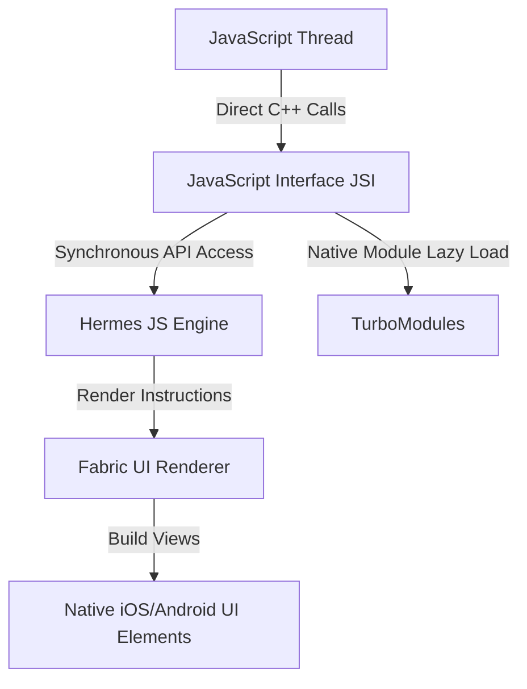

### 1\. Expo Core Philosophy & The Evolution

Imagine you want to build a custom electric car. You could buy raw motors, batteries, chassis rails, and write your own battery management firmware from scratch (that is raw **React Native**). Or, you could buy a Tesla skateboard platform that already has the motors, brakes, wiring, and software configured, allowing you to focus entirely on building the body and interior (that is **Expo**).

Expo is an open-source framework and platform for universal React applications. It runs on Android, iOS, and Web, wrapping React Native with a suite of tools, libraries, and cloud services (EAS) that dramatically simplify mobile development.

#### The Workflow Evolution: Managed vs Bare vs Development Builds

Historically, React Native developers were divided into two workflows. Modern Expo has introduced a third workflow that combines the best of both:

| Feature | Legacy Managed (Expo Go) | Legacy Bare Workflow | Modern Development Builds |
| --- | --- | --- | --- |
| **Native Folders (`/ios`, `/android`)** | Hidden; managed entirely by Expo | Exposed; modified manually by developer | Generated on-the-fly via **Prebuild** |
| **Custom Native Code** | Forbidden; restricted to Expo SDK | Allowed; link libraries manually | Allowed; configured using **Config Plugins** |
| **Testing Client** | Expo Go app from App Store | Custom compilation on developer Mac/PC | Custom development binary (`expo-dev-client`) |
| **Build Machine** | Expo Cloud | Local Mac (for iOS) or PC (for Android) | Local machine or **EAS Build** in cloud |

```
Modern Workflow:
  Configure app.json + package.json ──> Run Prebuild ──> Generate Native Folders ──> Compile Binary
```

<Callout type="warn" title="📋 The Death of 'Ejecting'">
In the past, if you needed a custom native library not included in the Expo SDK, you had to permanentely "eject" to the Bare Workflow, losing all Expo convenience. Today, **ejecting is obsolete**. You use **Config Plugins** inside `app.json` and run `npx expo prebuild` to generate and configure native folders dynamically.
</Callout>

<Quiz question={"Which modern Expo concept replaces the legacy practice of 'ejecting' when custom native dependencies are needed?"} options={["EAS Update", "Config Plugins combined with Prebuild and Development Builds", "Re-linking files in Xcode manually", "Switching back to standard React Web code"]} answerIndex={1}>
Modern Expo uses Prebuild to generate the `/ios` and `/android` directories dynamically from config files. Custom native libraries are configured via JS-based Config Plugins, allowing you to add native code without manually editing native project files.
</Quiz>

---

### 2\. Getting Started & Directory Structure

To start building with Expo, you initialize a new application using the official template:

```bash
npx create-expo-app@latest my-app --template tabs
```

#### File Structure of a Modern Expo App (with Router)

A standard Expo project using file-based routing (`expo-router`) follows this directory structure:

```
my-app/
├── app/                  # Application screens and routing layouts
│   ├── _layout.tsx       # Root layout containing providers and navigation themes
│   ├── index.tsx         # Root screen (accessible at '/')
│   ├── details.tsx       # Details screen (accessible at '/details')
│   └── (tabs)/           # Group layout representing a Tab bar navigation structure
│       ├── _layout.tsx
│       ├── home.tsx
│       └── settings.tsx
├── assets/               # Local static images, fonts, and icons
├── components/           # Shared reusable UI elements
├── app.json              # Central configuration file for Expo & Config Plugins
├── package.json          # JavaScript dependencies and script definitions
└── metro.config.js       # Metro bundler customization file
```

#### Running the Development Server

To launch your project in development mode:

```bash
npx expo start
```

This starts the **Metro Bundler** (the tool that packages your Javascript code) and displays a QR code in the terminal. You can:
- Scan the QR code with the camera app (iOS) or Expo Go app (Android) to test on a physical device.
- Press `i` to open the app in the iOS Simulator (requires Xcode on macOS).
- Press `a` to open the app in the Android Emulator (requires Android Studio).

<Quiz question={"Which tool in the React Native ecosystem compiles and packages your JavaScript files into a bundle for the mobile client?"} options={["Webpack", "Vite", "Metro Bundler", "Gradle"]} answerIndex={2}>
The Metro Bundler is the specialized JavaScript bundler built specifically for React Native. It resolves file paths, compiles assets, and streams updates to the dev client during development.
</Quiz>

---

### 3\. File-based Routing with Expo Router

**Expo Router** brings file-based routing to React Native, mapping your project's directory structure directly to app navigation routes, similar to Next.js. It is built on top of the industry-standard **React Navigation** library.

#### Navigating the app Folder

Inside the `app/` directory, file structures correspond directly to navigation paths:

```
app/index.tsx          --> Route: / (Home Screen)
app/details.tsx        --> Route: /details
app/user/[id].tsx      --> Route: /user/42 (Dynamic parameter id = 42)
app/(auth)/login.tsx   --> Route: /login (Group folder, parenthesis hides path segment)
```

#### Routing Layout Configuration (`_layout.tsx`)

Layout files define the navigation wrapping (such as Tab bars or Navigation Headers) for all files in the same directory:

```tsx
// app/_layout.tsx
import { Stack } from 'expo-router';
import { ThemeProvider, DarkTheme, DefaultTheme } from '@react-navigation/native';
import { useColorScheme } from 'react-native';

export default function RootLayout() {
  const colorScheme = useColorScheme();

  return (
    <ThemeProvider value={colorScheme === 'dark' ? DarkTheme : DefaultTheme}>
      <Stack>
        {/* Set screen options globally or individually */}
        <Stack.Screen name="index" options={{ title: 'Home Feed' }} />
        <Stack.Screen name="details" options={{ title: 'Task Details', presentation: 'modal' }} />
      </Stack>
    </ThemeProvider>
  );
}
```

#### Navigation Actions & Parameters

To transition between screens, use the `Link` component or the `useRouter` hook:

```tsx
// app/index.tsx
import { View, Text, StyleSheet } from 'react-native';
import { Link, useRouter } from 'expo-router';
import { Pressable } from 'react-native';

export default function HomeScreen() {
  const router = useRouter();

  return (
    <View style={styles.container}>
      <Text style={styles.title}>Home Screen</Text>
      
      {/* Declarative Navigation */}
      <Link href="/details" asChild>
        <Pressable style={styles.button}>
          <Text style={styles.buttonText}>Go to Details (Link)</Text>
        </Pressable>
      </Link>

      {/* Programmatic Navigation with Parameters */}
      <Pressable 
        style={styles.button}
        onPress={() => router.push({ pathname: '/user/[id]', params: { id: 'admin123' } })}
      >
        <Text style={styles.buttonText}>Go to Admin Profile</Text>
      </Pressable>
    </View>
  );
}

const styles = StyleSheet.create({
  container: { flex: 1, justifyContent: 'center', alignItems: 'center' },
  title: { fontSize: 24, fontWeight: 'bold', marginBottom: 20 },
  button: { backgroundColor: '#007AFF', padding: 12, borderRadius: 8, marginTop: 10 },
  buttonText: { color: 'white', fontWeight: '600' }
});
```

#### Retrieving Dynamic Parameters

To read the query parameters on a dynamic screen:

```tsx
// app/user/[id].tsx
import { useLocalSearchParams } from 'expo-router';
import { View, Text } from 'react-native';

export default function UserProfile() {
  const { id } = useLocalSearchParams<{ id: string }>();

  return (
    <View style={{ flex: 1, justifyContent: 'center', alignItems: 'center' }}>
      <Text>User ID: {id}</Text>
    </View>
  );
}
```

<Quiz question={"Which folder name syntax hides the folder name from the route path while creating a separate navigation group?"} options={["`[name]`", "`{name}`", "`(name)`", "`*name`"]} answerIndex={2}>
Parentheses (e.g. `(auth)`) group files together for shared layouts (like navigation tabs) without adding that folder name segment to the URL/navigation path.
</Quiz>

---

### 4\. Modern UI with React Native & Expo Components

React Native does not compile to HTML. Instead, it compiles to the host device's native UI elements.

#### Core Layout Components

- **`<View>`**: Evaluates directly to a native UI view (`UIView` on iOS, `android.view.View` on Android). It is the structural equivalent of `<div>` on web.
- **`<Text>`**: The equivalent of `<span>` or `<p>`. All text must be explicitly wrapped in this component.
- **`<ScrollView>`**: A scrollable box. Unlike web, layouts do not scroll automatically when overflowing; you must wrap them in a ScrollView.
- **`<FlatList>`**: A high-performance list renderer. It only mounts elements currently visible on the screen, recycling cells to conserve memory.

#### Flexbox Differences: Web vs Mobile

Mobile layout uses **Flexbox**, but with a few critical differences from CSS web layouts:
1. The default `flexDirection` is **`column`** (vertical), not `row`.
2. All layout units are unitless density-independent pixels. You cannot use `em`, `rem`, or `vh`.
3. Properties do not inherit. Setting `fontSize` on a parent `<View>` does not format child `<Text>` elements. You must apply styles directly to `<Text>` components.

```tsx
const styles = StyleSheet.create({
  card: {
    flexDirection: 'row', // Horizontal arrangement
    padding: 16,
    borderRadius: 12,
    backgroundColor: '#fff',
    shadowColor: '#000',
    shadowOpacity: 0.1,
    shadowRadius: 4,
    elevation: 3 // Android equivalent for shadow properties
  }
});
```

#### Expo Image Component

Standard React Native `<Image>` components lack caching features. The Expo SDK includes `expo-image`, a high-performance image component that supports disk caching, progressive loading, and blurhashes:

```tsx
import { Image } from 'expo-image';

const blurhash = '|rF?hV%2WCj[ayj[a|j[az_NaeWBj@ayfRayfQfQM{M|azj[azf6fQWBwcocY2wPLNs.ocY2JnocnyRj';

export function LazyImage() {
  return (
    <Image
      source="https://picsum.photos/seed/600/400"
      placeholder={{ blurhash }}
      contentFit="cover"
      transition={1000} // Smooth 1-second fade-in
      style={{ width: '100%', height: 200, borderRadius: 8 }}
    />
  );
}
```

<Quiz question={"Which component is recommended in React Native to render massive lists of items efficiently?"} options={["`<ScrollView>`", "`<Div>`", "`<FlatList>`", "`<List>`"]} answerIndex={2}>
`<FlatList>` is designed for long lists. It only renders items currently visible on screen, destroying or recycling off-screen nodes to prevent the application from running out of memory.
</Quiz>

---

### 5\. State Management & Lifecycle in Mobile

Unlike web pages which remain active in single tabs, mobile screens are layered on a navigation stack. When you push a new screen, the previous screen remains mounted but becomes inactive.

#### The `useFocusEffect` Hook

Standard React `useEffect` hooks run on mount and do not fire again when the user navigates back to the screen. To execute code (such as refreshing page data) every time the screen becomes active:

```tsx
import { useCallback } from 'react';
import { useFocusEffect } from 'expo-router';

export default function ProfileScreen() {
  useFocusEffect(
    useCallback(() => {
      // Runs when this screen gains focus
      console.log('Profile screen focused!');
      viewModel.fetchFreshData();

      return () => {
        // Runs when this screen loses focus
        console.log('Profile screen unfocused!');
      };
    }, [])
  );
  
  return ( /* ... */ );
}
```

#### Global State with Zustand

Zustand is a lightweight, hook-based state management store that is highly popular in React Native for its simplicity and small bundle size:

```typescript
import { create } from 'zustand';

interface TaskState {
  tasks: string[];
  addTask: (task: string) => void;
}

export const useTaskStore = create<TaskState>((set) => ({
  tasks: [],
  addTask: (task) => set((state) => ({ tasks: [...state.tasks, task] })),
}));
```

<Quiz question={"Why is 'useFocusEffect' preferred over standard 'useEffect' for refreshing data on mobile screens?"} options={["`useEffect` causes Android builds to crash immediately", "Mobile screens stay mounted on the navigation stack, meaning `useEffect` won't run when a user navigates back to a screen", "`useFocusEffect` compiles the database queries faster", "It tracks hardware GPS coordinates automatically"]} answerIndex={1}>
Because mobile navigation overlays screens on a stack, returning to a previous screen does not trigger a component remount. Standard `useEffect` won't run again, whereas `useFocusEffect` intercepts focus changes and executes every time the screen is active.
</Quiz>

---

### 6\. Accessing Device Hardware & Sensors

The Expo SDK contains a library of modular, verified packages to access device native layers.

#### Fetching Location Coordinates

Use `expo-location` to handle permission dialogues and fetch hardware GPS data:

```tsx
import React, { useState, useEffect } from 'react';
import { Text, View, StyleSheet, Button } from 'react-native';
import * as Location from 'expo-location';

export default function GetLocation() {
  const [location, setLocation] = useState<Location.LocationObject | null>(null);
  const [errorMsg, setErrorMsg] = useState<string | null>(null);

  const requestLocation = async () => {
    // 1. Request OS permission
    const { status } = await Location.requestForegroundPermissionsAsync();
    if (status !== 'granted') {
      setErrorMsg('Permission to access location was denied');
      return;
    }

    // 2. Fetch coordinates
    const currentLocation = await Location.getCurrentPositionAsync({});
    setLocation(currentLocation);
  };

  return (
    <View style={styles.container}>
      <Button title="Get Current Location" onPress={requestLocation} />
      {errorMsg && <Text style={styles.error}>{errorMsg}</Text>}
      {location && (
        <Text>Coords: {location.coords.latitude}, {location.coords.longitude}</Text>
      )}
    </View>
  );
}

const styles = StyleSheet.create({
  container: { flex: 1, justifyContent: 'center', alignItems: 'center', padding: 20 },
  error: { color: 'red', marginTop: 10 }
});
```

#### Other Essential Hardware SDK Packages

- **`expo-camera`**: Accesses the device camera feeds, takes photos, and parses QR codes.
- **`expo-secure-store`**: Encrypts and saves sensitive data on the device keychain/keystore.
- **`expo-sensors`**: Reads high-frequency sensors like the accelerometer and gyroscope.

<Quiz question={"What must be called before attempting to retrieve coordinate values from 'expo-location'?"} options={["`Location.requestForegroundPermissionsAsync()`", "`Location.connectToGps()`", "`npx expo prebuild`", "`AppState.addEventListener()`"]} answerIndex={0}>
Modern mobile operating systems block access to hardware sensors until permission is granted by the user. You must call request permissions and verify the status is 'granted' before accessing the GPS api.
</Quiz>

---

### 7\. Under the Hood: The React Native Runtime

To write high-performance mobile apps, you must understand the architecture running behind the scenes.

#### Legacy Bridge Architecture vs. New Architecture

Historically, React Native ran on a **Bridge** model:

```
+--------------------+   JSON Messages over Bridge   +-----------------+
| JavaScript Thread  | <===========================> | Native UI (C++) |
| (Logic Execution)  |       (Asynchronous)          | (Main Render)   |
+--------------------+                               +-----------------+
```

- **The Problem**: All communication was asynchronous, serialized into JSON objects, and sent across a single queue. This caused rendering bottlenecks during fast animations or list scrolling.
- **The Solution (The New Architecture)**: Uses **JSI (JavaScript Interface)**, which exposes native C++ APIs directly to the JavaScript engine, allowing synchronous execution.

#### Core Engine Elements



1. **JSI (JavaScript Interface)**: An abstraction layer that lets JavaScript hold references to C++ host objects and execute methods synchronously.
2. **Hermes Engine**: A lightweight JavaScript engine optimized by Meta for running React Native. Hermes pre-compiles JS code into bytecode during build time, leading to faster startup times and lower memory usage.
3. **Fabric**: The modern UI rendering engine that replaces the legacy view manager, enabling UI components to render synchronously.
4. **TurboModules**: The new native modules framework that loads native APIs (e.g. camera, contacts) lazily on-demand, reducing initial bundle load times.

<Quiz question={"How does JSI (JavaScript Interface) improve communication between JavaScript and Native code?"} options={["It compiles JS into SQL commands", "It replaces the slow, asynchronous JSON bridge with direct, synchronous C++ bindings", "It eliminates the need for any iOS build compilation", "It runs all calculations on the cloud"]} answerIndex={1}>
JSI replaces the old asynchronous bridge. By enabling direct C++ method bindings, the JS thread can trigger native hardware or rendering APIs instantly and synchronously, eliminating JSON parsing overhead.
</Quiz>

---

### 8\. The Prebuild System & Config Plugins

Modern Expo apps do not require developers to manually edit raw Objective-C, Swift, Java, or C++ files. Instead, you configure your project settings inside `app.json`, and Expo generates the native project folders dynamically.

#### The `prebuild` Pipeline

When you run `npx expo prebuild`:
1. Expo creates temporary `/ios` and `/android` directories.
2. It reads the configurations inside `app.json`.
3. It applies custom **Config Plugins** to modify files like `Info.plist`, `AndroidManifest.xml`, and Gradle build files automatically.

#### Config Plugin Example (`app.json`)

To add camera and microphone permissions to your iOS build, you configure the `expo-camera` plugin:

```json
{
  "expo": {
    "name": "My App",
    "slug": "my-app",
    "version": "1.0.0",
    "orientation": "portrait",
    "plugins": [
      [
        "expo-camera",
        {
          "cameraPermission": "Allow this app to access the camera to capture profile photos."
        }
      ]
    ]
  }
}
```

Whenever you run a build, Expo reads this JSON and automatically updates the native iOS plist key `NSCameraUsageDescription` and the Android manifest permission tag.

<Quiz question={"Which file contains the configuration definitions that Expo uses to build native configuration files during prebuild?"} options={["`package.json`", "`app.json`", "`metro.config.js`", "`tsconfig.json`"]} answerIndex={1}>
`app.json` serves as the central configuration manifest for Expo, housing metadata, plugin rules, asset bindings, and build configurations.
</Quiz>

---

### 9\. Custom Development Builds

While testing with the standard **Expo Go** app on your phone is convenient, it has a major limitation: it only contains the pre-compiled native modules of the Expo SDK. If you install a third-party library that contains custom native code (e.g., Bluetooth plugins, customized security frameworks, or analytical SDKs), **Expo Go will crash**.

To resolve this, you must run a **Development Build**.

#### What is a Development Build?

A development build is a custom-compiled binary of your app containing the `expo-dev-client` library. It includes your specific native modules while maintaining Metro's fast-refresh connection.

```
                  +----------------------------------------------+
                  |              Developer Metro                 |
                  +----------------------------------------------+
                                         |
                                (JavaScript updates)
                                         v
+---------------------------------------------------------------------------------+
|                               Development Build                                 |
|   Custom Binary = Native iOS/Android Code + Custom Plugins + expo-dev-client    |
+---------------------------------------------------------------------------------+
```

#### Compiling Development Builds Locally

To build and run a custom development client on your local computer (requires Xcode on macOS for iOS, or Android SDK for Android):

```bash
# 1. Install the dev client package
npx expo install expo-dev-client

# 2. Prebuild and compile for simulator/emulator
npx expo run:ios
npx expo run:android
```

Once the local native compilation completes, the app will launch, connecting back to your Metro bundler for hot-reloads.

<Quiz question={"Why would you need to transition from using Expo Go to a custom Development Build?"} options={["To deploy your app to the Web", "To run calculations on the CPU instead of the GPU", "When you introduce custom native libraries or dependencies that are not part of the standard Expo SDK", "To convert your Javascript files into Swift files"]} answerIndex={2}>
Expo Go only includes standard pre-compiled SDK APIs. If your app imports custom native packages (like custom analytics or hardware SDKs), you must compile a custom development build containing those specific native code bundles.
</Quiz>

---

### 10\. Local Database Storage: SQLite

For local data persistence, standard key-value storage (like `AsyncStorage`) is only suited for small tokens. If your app requires fast, complex queries or offline-first features, use `expo-sqlite`.

#### Implementing SQLite Database Operations

```tsx
import * as SQLite from 'expo-sqlite';
import React, { useEffect, useState } from 'react';
import { View, Text, FlatList } from 'react-native';

interface Todo {
  id: number;
  value: string;
}

export function TodoDatabase() {
  const [todos, setTodos] = useState<Todo[]>([]);

  useEffect(() => {
    async function initDb() {
      // 1. Open or create database
      const db = await SQLite.openDatabaseAsync('todos.db');
      
      // 2. Initialize table
      await db.execAsync(`
        PRAGMA journal_mode = WAL;
        CREATE TABLE IF NOT EXISTS todos (id INTEGER PRIMARY KEY NOT NULL, value TEXT NOT NULL);
      `);

      // 3. Write data
      await db.runAsync('INSERT INTO todos (value) VALUES (?)', 'Learn Expo SQLite');

      // 4. Query data
      const allRows = await db.getAllAsync<Todo>('SELECT * FROM todos');
      setTodos(allRows);
    }
    
    initDb();
  }, []);

  return (
    <FlatList
      data={todos}
      keyExtractor={(item) => item.id.toString()}
      renderItem={({ item }) => <Text>{item.value}</Text>}
    />
  );
}
```

<Quiz question={"Which tool or library is recommended in the Expo SDK to query and store relational data structures locally?"} options={["`expo-secure-store`", "`AsyncStorage`", "`expo-sqlite`", "`Redis`"]} answerIndex={2}>
`expo-sqlite` provides an asynchronous connection to a local SQLite database, allowing structured sql schema creations, writes, and relational data queries directly on the client device.
</Quiz>

---

### 11\. Push Notifications in Expo

Mobile notifications require coordination between Apple's APNs and Google's FCM messaging servers. Expo simplifies this by managing these channels through the **Expo Notifications Service**.

```
+-----------+                   +--------------+                   +-------------+
| Your App  | -Push Token->     | Your Server  | -Send Message->   | Expo Push   |
| (Client)  |                   | (Backend)    |                   | Server API  |
+-----------+                   +--------------+                   +-------------+
                                                                          |
                                                                   (Forwards to)
                                                                          v
                                                                   +-------------+
                                                                   | APNs / FCM  |
                                                                   +-------------+
```

#### Fetching the Expo Push Token

To send push notifications, you must retrieve a unique token from the Expo service:

```typescript
import * as Notifications from 'expo-notifications';
import * as Device from 'expo-device';
import Constants from 'expo-constants';
import { Platform } from 'react-native';

export async function registerForPushNotificationsAsync() {
  let token;

  if (Platform.OS === 'android') {
    await Notifications.setNotificationChannelAsync('default', {
      name: 'default',
      importance: Notifications.AndroidImportance.MAX,
    });
  }

  if (Device.isDevice) {
    const { status: existingStatus } = await Notifications.getPermissionsAsync();
    let finalStatus = existingStatus;
    if (existingStatus !== 'granted') {
      const { status } = await Notifications.requestPermissionsAsync();
      finalStatus = status;
    }
    if (finalStatus !== 'granted') {
      alert('Failed to get push token for push notification!');
      return;
    }
    
    // Retrieve the token
    const projectId = Constants.expoConfig?.extra?.eas?.projectId;
    token = (await Notifications.getExpoPushTokenAsync({ projectId })).data;
    console.log("Expo Push Token:", token);
  } else {
    alert('Must use physical device for Push Notifications');
  }

  return token;
}
```

You send this token to your backend. When your backend wants to alert a user, it sends a JSON payload to `https://exp.host/--/api/v2/push/send`, and Expo handles forwarding it to APNs or FCM.

<Quiz question={"What is the destination API where your backend sends notification payloads to target devices using Expo Push Tokens?"} options={["Directly to Apple's APNs server", "To Google's Firebase Console", "To Expo's Push Server API", "To a local SQLite database"]} answerIndex={2}>
Expo hosts a unified push receiver API. Your backend sends the payload and token to Expo's push service, which automatically maps and forwards the request to the correct native OS system (APNs or FCM).
</Quiz>

---

### 12\. Performance Profiling & Optimization

Mobile systems have limited memory, CPU capability, and thermal headroom. Writing slow JavaScript will cause dropped frames (laggy animations) and heat up the device.

#### Core Optimization Rules

1. **Avoid Inline Objects in Styles**:
   Creating style objects inline (e.g. `style={{ padding: 10 }}`) forces JavaScript to allocate a new object in memory on every render, triggering garbage collection cycles. Always use `StyleSheet.create`.
2. **Shopify's FlashList**:
   Replace standard `<FlatList>` with Shopify’s **`<FlashList>`**. FlashList is built on top of recyclerview concepts, recycling cells completely rather than destroying and rebuilding them. It is up to 10x faster.
3. **Optimizing Animations**:
   Always use **`react-native-reanimated`** for animations. It runs animations directly on the native UI thread, bypassing JavaScript thread bottlenecks.
4. **Use `useCallback` on event listeners**:
   Prevent redraw triggers on child components by wrapping function parameters in `useCallback`.

```tsx
// Using Reanimated for UI-thread animations
import Animated, { useSharedValue, useAnimatedStyle, withSpring } from 'react-native-reanimated';

export function AnimatedBox() {
  const width = useSharedValue(100);

  const animatedStyle = useAnimatedStyle(() => ({
    width: withSpring(width.value),
  }));

  return (
    <Animated.View style={[{ height: 100, backgroundColor: 'blue' }, animatedStyle]} />
  );
}
```

<Quiz question={"Which library should you use in Expo to run complex layout animations smoothly on the native UI thread?"} options={["`StyleSheet`", "`react-native-reanimated`", "`useFocusEffect`", "`expo-dev-client`"]} answerIndex={1}>
`react-native-reanimated` runs calculations directly on the native UI thread. This ensures animations remain smooth (60/120fps) even if the main JavaScript thread is blocked by heavy computations.
</Quiz>

---

### 13\. EAS (Expo Application Services)

**EAS** is a suite of cloud services designed for Expo and React Native apps, managing the building, submitting, and updating of app binaries.

```
       Developer Code
             |
       [ EAS Build ]  (Compiles iOS IPA & Android AAB in the cloud)
             |
      [ EAS Submit ]  (Deploys automatically to App Store & Google Play)
             |
      [ EAS Update ]  (Pushes instant JS hotfixes directly to devices)
```

1. **EAS Build**: Compiles your app binaries (`.ipa` and `.aab`) in the cloud. This allows you to compile iOS builds without owning a Mac, or build Android packages without local Android SDK installations.
2. **EAS Submit**: Automatically signs, uploads, and registers your compiled binaries with the App Store Connect and Google Play Console.
3. **EAS Update**: Enables **Over-The-Air (OTA)** updates. When you modify JavaScript or asset files (without introducing new native code libraries), EAS Update pushes these updates directly to users' devices, bypassing App Store review pipelines.

```bash
# EAS CLI Commands
npm install -g eas-cli

eas login
eas build --platform all      # Triggers cloud build
eas update --message "Hotfix" # Trushes instant OTA update
```

<Quiz question={"Which EAS service allows you to push hotfixes and updates to users' devices without going through the App Store or Google Play Store review process?"} options={["EAS Build", "EAS Submit", "EAS Update", "EAS Credentials"]} answerIndex={2}>
`EAS Update` sends updated JavaScript bundles and assets directly to client devices OTA (Over-The-Air), allowing you to deploy bug fixes instantly as long as no new native libraries have been added.
</Quiz>

---

### 14\. Key Facts to Remember

- **Prebuild** generates the iOS and Android directories dynamically from config files.
- **Config Plugins** apply native configurations to files like AndroidManifest.xml and Info.plist during prebuild.
- **Expo Go** is for basic testing; custom native libraries require a **Development Build**.
- **Expo Router** brings file-based routing to React Native.
- **Hermes** pre-compiles JavaScript into bytecode for faster startup times.
- **EAS Build** compiles binaries in the cloud, removing the need for a local Mac to build iOS apps.
- **FlashList** recycles cells, offering significantly faster rendering speeds than standard FlatLists.
