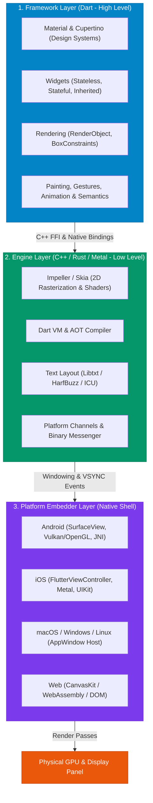
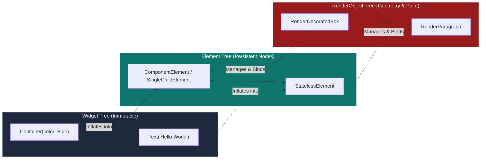

## 1. The Three Layers of Flutter

Flutter is engineered as an extensible, layered system where each layer is strictly decoupled and has a distinct operational responsibility.



### Layer Breakdown

1. **Flutter Framework (Dart)**:
   - Everything developers directly code against lives here.
   - Contains high-level UI controls (`Material`, `Cupertino`), reactive component composition (`Widgets`), layout contracts (`Rendering`), and low-level canvas primitives (`Painting`, `Gestures`).
   - Fully open-source and inspectable in your IDE.
2. **Flutter Engine (C++)**:
   - The core runtime engine providing rasterization via **Impeller** (or legacy **Skia**).
   - Hosts the **Dart VM runtime** (for JIT development execution) and handles ahead-of-time (AOT) machine code compilation for production releases.
   - Manages text typography engines (**HarfBuzz**, **Libtxt**) and file/network I/O pipelines.
3. **Platform Embedder (Native Host Shell)**:
   - A lightweight platform-specific wrapper written in Swift/Obj-C (iOS), Kotlin/Java (Android), or C++ (Desktop).
   - Responsible for bootstrapping the Flutter Engine, acquiring a GPU surface (e.g., `CAMetalLayer` on iOS or `Vulkan/SurfaceView` on Android), and relaying touch, mouse, keyboard, and accessibility events.

---

## 2. The Three Trees Architecture

In many reactive UI frameworks, rebuilding UI means throwing away the previous tree and computing a heavy virtual DOM diff. Flutter avoids this bottleneck by splitting the UI representation into **Three Distinct Trees**:

```text
┌───────────────────────────┐      ┌───────────────────────────┐      ┌───────────────────────────┐
│        WIDGET TREE        │      │       ELEMENT TREE        │      │     RENDEROBJECT TREE     │
│   (Configuration Plan)    │ ───> │  (Lifecycle & Structure)  │ ───> │ (Geometry, Layout, Paint) │
│    Lightweight, Immutable │      │    Persistent State Node  │      │     Heavy, Mutable State  │
└───────────────────────────┘      └───────────────────────────┘      └───────────────────────────┘
```

### Architectural Analogy: Construction Project

| Tree | Real-World Equivalent | Responsibility | Lifecycle Characteristics |
| :--- | :--- | :--- | :--- |
| **Widget Tree** | **Architect's Blueprint** | Declarative configuration describing what the UI should look like. | Extremely cheap to instantiate; created and discarded by the thousands per second. |
| **Element Tree** | **Construction Site Manager** | Holds the persistent structural relationship, manages lifecycle, and links blueprints to physical workers. | Long-lived; updates in-place when blueprints change. |
| **RenderObject Tree** | **Physical Steel & Concrete Building** | Computes actual bounding box dimensions, hits tests, and paints pixels to the graphics buffer. | Heavyweight, persistent, and expensive to create; modified mutably during frame updates. |



---

## 3. How Inflation & Reconciliation Work

When `runApp(const MyApp())` executes:
1. Flutter instantiates the root `Widget`.
2. The framework calls `widget.createElement()` to create an **Element** node.
3. The Element calls `element.mount()`, which registers the element into the hierarchy and asks its underlying widget for a `RenderObject` (via `createRenderObject()`).
4. On subsequent `setState()` calls, the widget's `build()` method produces a **new Widget instance**.
5. The existing Element checks whether the new Widget can replace the old one using `Widget.canUpdate()`:

```dart
// Core reconciliation logic inside Flutter Framework (Widget.dart)
static bool canUpdate(Widget oldWidget, Widget newWidget) {
  return oldWidget.runtimeType == newWidget.runtimeType
      && oldWidget.key == newWidget.key;
}
```

### The Reconciliation Decision Tree

```text
                     New Widget arrived at Element node
                                      │
                      ┌───────────────┴───────────────┐
                      ▼                               ▼
      Same runtimeType & Same Key?          Different Type or Key?
                      │                               │
             [ TRUE - FAST PATH ]            [ FALSE - FULL RECREATE ]
                      │                               │
          Element updates its reference      Element unmounts old child
          to the new Widget.                 and disposes RenderObject.
                      │                               │
          Updates RenderObject mutably       Instantiates fresh Element
          (e.g., renderObject.color = red).  and fresh RenderObject.
          NO heavy recreation!
```

---

## 4. Keys: Guiding Element Reconciliation

When collections of stateful widgets move, reorder, or filter, Flutter relies on `Key` identifiers to ensure that `State` objects in the Element tree remain attached to the correct logical items.

```dart
// BAD: Reordering without keys causes state to remain in old slot
ListView(
  children: items.map((item) => ItemTile(item: item)).toList(), // ⚠️ State mismatch bug
);

// GOOD: ValueKey preserves State binding across sorting and deletion
ListView(
  children: items.map((item) => ItemTile(
    key: ValueKey(item.id), // ✅ Explicit unique identity
    item: item,
  )).toList(),
);
```

### Types of Keys in Flutter

| Key Type | Usage Scenario | Operational Mechanism |
| :--- | :--- | :--- |
| `ValueKey<T>` | List reordering, row deletion | Compares identity based on primitive or object value (e.g. `ValueKey(user.id)`). |
| `ObjectKey` | Complex object identity | Compares object instance identity (`identical()`). |
| `UniqueKey` | Forcing full recreation | Guarantees a globally unique non-matching key every instantiation. |
| `GlobalKey<T>` | Accessing State across subtrees | Provides cross-tree access to `State` and `BuildContext` (expensive; use sparingly). |

---

## 5. Impeller vs. Skia: The Modern Rendering Engine

In Flutter 3.x+, Google transitioned from the legacy **Skia** rendering engine to **Impeller**:

```text
Traditional Skia Pipeline (JIT Shader Compilation):
User Scroll -> New Shape Encountered -> Compile GLSL Shader -> 🚨 100ms Jank Spike!

Next-Gen Impeller Pipeline (AOT Shader Pre-compilation):
App Build Time -> All Shaders Compiled to Metal / SPIR-V -> 60/120 FPS Fluid Motion!
```

* **Zero Shader Compilation Jank**: Shaders are compiled Ahead-Of-Time during `flutter build`.
* **Explicit Resource Management**: Leverages modern GPU APIs (**Vulkan** on Android, **Metal** on iOS/macOS) with multithreaded command recording.
* **Modern Tessellation**: Efficient GPU path geometry tessellation rather than CPU-bound rasterization.

---

## ❓ Knowledge Check

<Quiz question="Why does Flutter separate the Widget tree from the Element and RenderObject trees?" options={["To make Flutter compatible with web HTML elements", "Because Widgets are immutable and frequently recreated, whereas Elements and RenderObjects are mutable and expensive to allocate, so Flutter reuses them across rebuilds", "Because Dart does not support single-tree memory allocation", "To enforce Java-style object-oriented encapsulation"]} answerIndex={1}>
**Widgets** are lightweight, declarative configurations created and discarded rapidly during rebuilds. **Elements** and **RenderObjects** represent persistent lifecycle state and heavy GPU rendering structures. By decoupling them, Flutter only mutates the existing RenderObject properties instead of reallocating memory on every frame.
</Quiz>

<Quiz question="What condition must be satisfied for an existing Element to update its reference to a new Widget without recreating its RenderObject?" options={["The widget must be marked with the const keyword", "Both widgets must share the exact same runtimeType and key", "The widget must be wrapped in a RepaintBoundary", "The widget must implement InheritedWidget"]} answerIndex={1}>
According to `Widget.canUpdate()`, Flutter reuses an Element and its underlying RenderObject if and only if the new widget has the **same `runtimeType`** and the **same `key`** as the previous widget.
</Quiz>
