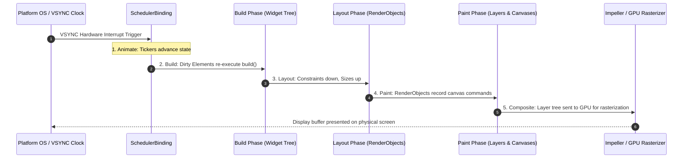

## 1. The Frame Lifecycle & VSYNC Signal

To achieve smooth 60 FPS (frames per second) or 120 FPS (ProMotion / high refresh rate displays), Flutter must complete all UI computations within a strict **frame budget**:
* **60 Hz Display**: $\frac{1000\text{ ms}}{60} \approx \mathbf{16.6\text{ ms}}$ per frame.
* **120 Hz Display**: $\frac{1000\text{ ms}}{120} \approx \mathbf{8.3\text{ ms}}$ per frame.



---

## 2. The 4-Stage Rendering Pipeline

When state changes or an animation advances, Flutter executes four strict sequential phases:

```text
┌──────────────┐     ┌──────────────┐     ┌──────────────┐     ┌──────────────┐
│ 1. ANIMATE   │ ──> │   2. BUILD   │ ──> │  3. LAYOUT   │ ──> │   4. PAINT   │ ──> [ 5. COMPOSITE ]
│ Tickers tick │     │ build() runs │     │  Sizes calc  │     │ Canvas draw  │     GPU merges layers
└──────────────┘     └──────────────┘     └──────────────┘     └──────────────┘
```

### 1. Animate Phase
- Triggered by `Ticker` objects tied to the device's hardware VSYNC refresh rate.
- `AnimationController` interpolates `Tween` values and calls registered listeners.

### 2. Build Phase
- All `Element` instances marked as **dirty** (via `setState()`, `InheritedWidget` updates, or hot reload) re-invoke their associated `Widget.build()` methods.
- Produces the updated declarative widget tree and reconciles changes against the persistent Element tree.

### 3. Layout Phase ($O(N)$ Single-Pass)
- The framework walks the `RenderObject` hierarchy.
- **Constraints go down**: Parents pass min/max width and height constraints down to children.
- **Sizes go up**: Children determine their exact size within those constraints and report their dimensions back to the parent.
- Flutter strictly enforces **single-pass layout** ($O(N)$ linear complexity). Unlike traditional web browsers that may perform costly multi-pass recursive layouts, a RenderObject in Flutter is visited only once during standard layout.

### 4. Paint Phase
- RenderObjects record drawing operations onto a `PictureRecorder` (e.g., `canvas.drawRect()`, `canvas.drawParagraph()`).
- Drawing calls are not immediately rasterized to physical pixels; instead, they generate a tree of display list commands grouped into **Layers**.

### 5. Compositing Phase
- The `Layer` tree is packaged and transferred across the C++ boundary to the **Flutter Engine**.
- The GPU backend (**Impeller**) rasterizes the layers into display memory.

---

## 3. The Single-Pass Layout Protocol in Action

In Flutter, layout negotiation between parent and child follows a strict contract defined on `RenderBox`:

```dart
// Conceptual layout execution inside Flutter's RenderBox
@override
void performLayout() {
  // 1. Parent inspects incoming constraints (BoxConstraints)
  // 2. Parent lays out child with modified constraints
  if (child != null) {
    child!.layout(
      BoxConstraints(
        minWidth: 0.0,
        maxWidth: constraints.maxWidth,
        minHeight: 0.0,
        maxHeight: constraints.maxHeight,
      ),
      parentUsesSize: true, // Tells parent to track child's computed size
    );

    // 3. Parent sets its own size based on child's size
    size = constraints.constrain(Size(child!.size.width + 20, child!.size.height + 20));

    // 4. Parent positions child using BoxParentData
    final BoxParentData childParentData = child!.parentData! as BoxParentData;
    childParentData.offset = const Offset(10.0, 10.0);
  } else {
    size = constraints.smallest;
  }
}
```

```text
Constraint flow:
Parent BoxConstraints(minW: 0, maxW: 400, minH: 0, maxH: 800)
    │
    ▼ (Passed down)
Child determines size -> Size(250, 100)
    │
    ▲ (Returned up)
Parent receives Size(250, 100) -> Positions child at Offset(75, 350)
```

---

## 4. Repaint Boundaries: Isolating Render Subtrees

When a widget frequently animates (e.g., a progress spinner, pulse animation, or scrolling list), painting the entire screen on every frame wastes valuable GPU time. A `RepaintBoundary` creates an isolated visual layer that prevents repaint cascading.

```dart
// Without RepaintBoundary: Animating the spinner repaints the entire complex dashboard!
Column(
  children: [
    CircularProgressIndicator(),
    ExpensiveToPaintChart(), // ⚠️ Repainted every 16ms unnecessarily
  ],
);

// With RepaintBoundary: Only the spinner's isolated layer repaints
Column(
  children: [
    const RepaintBoundary(
      child: CircularProgressIndicator(), // ✅ Isolated onto its own GPU layer
    ),
    const RepaintBoundary(
      child: ExpensiveToPaintChart(),     // ✅ Cached layer; zero CPU paint calls
    ),
  ],
);
```

### When to Use `RepaintBoundary`

| Scenario | Recommended Action | Performance Impact |
| :--- | :--- | :--- |
| **High-frequency animation widget** | Wrap in `RepaintBoundary` | Isolates frequent repaints to a single small texture. |
| **Complex static canvas or vector graphic** | Wrap in `RepaintBoundary` | Rasterized once and cached on GPU memory. |
| **Trivial text labels / simple buttons** | Do NOT wrap | Extra layers introduce memory overhead and compositing cost. |

---

## ❓ Knowledge Check

<Quiz question="What is the primary advantage of Flutter's single-pass layout algorithm compared to traditional web layout engines?" options={["It runs entirely on the GPU shader pipeline", "It guarantees O(N) linear time complexity by requiring each RenderObject to be visited once during layout, preventing multi-pass layout thrashing", "It automatically resizes fonts to fit any screen size without CSS", "It eliminates the need for box constraints"]} answerIndex={1}>
Flutter's layout protocol guarantees **$O(N)$ linear time complexity** by passing constraints strictly downwards and receiving sizes upwards in a single traversal. This eliminates the recursive, multi-pass layout re-computations that often cause performance bottlenecks on the web.
</Quiz>

<Quiz question="What does a RepaintBoundary widget do to improve rendering performance during animations?" options={["It skips the build phase of all ancestor widgets", "It creates an isolated GPU layer for its subtree, preventing paint invalidations from propagating to siblings or parent RenderObjects", "It disables anti-aliasing to render faster", "It converts Dart code into C++ machine instructions"]} answerIndex={1}>
A `RepaintBoundary` inserts a dedicated `Layer` into the render tree. When children inside the boundary repaint, Flutter only re-records the isolated layer, leaving sibling and ancestor layers cached on the GPU.
</Quiz>
