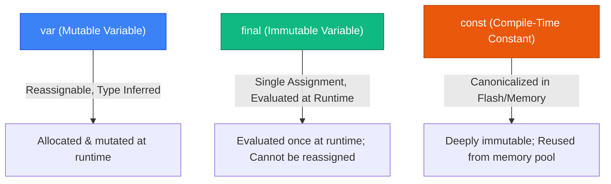

## 1. The Dart Type System & Soundness

Dart is a **strongly typed, statically checked** programming language featuring **sound null safety**. 

* **Soundness Guarantee**: If the compiler determines that an expression has a non-nullable type (e.g. `String`), the runtime environment guarantees that this expression **can never evaluate to `null` under any execution path**.
* This eliminates the entire category of runtime `NullPointerException` / `NullReferenceException` crashes common in languages without sound null safety.

```dart
// Non-nullable by default:
String title = "Flutter in Action";
// title = null; // ❌ Compile-time Error: A value of type 'Null' can't be assigned to 'String'

// Nullable opt-in using the '?' suffix:
String? subtitle; // ✅ Holds null by default or a valid String
subtitle = "Advanced Architecture";
subtitle = null; // ✅ Valid assignment
```

---

## 2. Variables: `var`, `final`, and `const`

Understanding variable mutability and memory allocation is critical for writing efficient Flutter applications.



| Keyword | Reassignable? | Value Mutable? | Evaluation Time | Canonicalized in Memory? |
| :--- | :---: | :---: | :--- | :---: |
| `var` | **Yes** | **Yes** | Runtime | No |
| `final` | **No** | Yes (if object is mutable) | Runtime (e.g., `final now = DateTime.now()`) | No |
| `const` | **No** | **No** (Deeply immutable) | **Compile-Time** (e.g., `const EdgeInsets.all(16)`) | **Yes** (Shared memory address) |

### Why `const` Widgets Matter in Flutter
When you declare a widget as `const`, Flutter reuses the **exact same in-memory object instance** across widget rebuilds. The Element tree recognizes identical object references (`identical(oldWidget, newWidget) == true`) and skips calling `build()` for that subtree entirely!

---

## 3. Null-Aware Operators Reference

Dart provides an expressive suite of operators to handle nullable references safely and concisely:

| Operator | Syntax | Description | Real-World Analogy |
| :--- | :--- | :--- | :--- |
| **`?.`** | `user?.profile?.avatarUrl` | **Null-aware navigation**: Short-circuits and returns `null` if target is null. | Safe door handle that doesn't turn if room is empty. |
| **`??`** | `name ?? "Guest"` | **Null coalescing**: Evaluates to left side if non-null, else fallback right side. | Default backup generator when main power is out. |
| **`??=`** | `theme ??= DarkTheme()` | **Null-aware assignment**: Assigns value only if variable is currently `null`. | Fill the empty glass only if it has nothing inside. |
| **`!`** | `user!.email` | **Null assertion**: Force unwrap; throws runtime error if target is `null`. | Forcing a locked door open assuming someone is inside. |
| **`late`** | `late final Database db;` | **Late initialization**: Defers initialization until first access; enforces non-null. | Promissory note guaranteeing payment upon delivery. |

```dart
// Comprehensive Null-Safety Demonstration
class UserRepository {
  String? _cachedToken;

  void authenticate(String? incomingToken) {
    // 1. Null-aware assignment: only assign if _cachedToken is null
    _cachedToken ??= incomingToken;

    // 2. Null coalescing fallback
    final String activeToken = _cachedToken ?? "GUEST_SESSION";

    // 3. Safe navigation with null check
    final int tokenLength = _cachedToken?.length ?? 0;

    print("Authenticated with token: $activeToken (Length: $tokenLength)");
  }
}
```

---

## 4. Flow Analysis & Type Promotion

Dart's compiler incorporates sophisticated **Control Flow Analysis**. When you check a nullable variable against `null`, the compiler automatically **promotes** the variable from `T?` to `T` within that scope:

```dart
void displayUserInfo(String? username, List<int>? scores) {
  // Before check: username is String?
  if (username != null) {
    // Inside this block: username is promoted to non-nullable String!
    print("User: ${username.toUpperCase()} (Length: ${username.length})");
  }

  // Type promotion with early return:
  if (scores == null || scores.isEmpty) {
    return;
  }

  // scores is promoted to non-nullable List<int> here
  print("Highest score: ${scores.first}");
}
```

> [!WARNING]
> **Field Promotion Limitation**: Class member fields (e.g. `this.user`) cannot always be automatically promoted because getter methods or subclass overrides might return `null` between accesses. To promote a class field, assign it to a local variable:
> ```dart
> final localUser = this.user;
> if (localUser != null) {
>   print(localUser.name); // ✅ Promoted safely!
> }
> ```

---

## 5. The `late` Keyword: Rules and Anti-Patterns

The `late` keyword informs the compiler: *"Trust me, this variable will be initialized before I ever read it."*

```dart
class ProfileScreenState extends State<ProfileScreen> {
  // Valid use-case: Initialized in initState() where BuildContext or configuration is ready
  late final AnimationController _controller;
  late final String _userIdentifier;

  @override
  void initState() {
    super.initState();
    _userIdentifier = widget.userId;
    _controller = AnimationController(vsync: this, duration: const Duration(seconds: 1));
  }

  @override
  void dispose() {
    _controller.dispose();
    super.dispose();
  }
}
```

> [!CAUTION]
> If you access an uninitialized `late` variable, Dart throws a runtime `LateInitializationError`. Never use `late` as a lazy workaround for nullable API responses—use nullable types (`String?`) for values that might truly be missing.

---

## ❓ Knowledge Check

<Quiz question="What happens at the framework level when a widget is declared using the const constructor (e.g., const SizedBox(height: 16))?" options={["The widget is rendered using C++ instead of Dart", "The widget instance is canonicalized at compile time and reused across all rebuilds, allowing the framework to skip rebuilding that subtree", "The widget cannot accept any child widgets", "The widget is permanently pinned to the GPU raster cache"]} answerIndex={1}>
Declaring a widget with `const` **canonicalizes** it at compile time. Whenever parent widgets rebuild, Flutter checks `identical(oldWidget, newWidget)`, detects that the instance reference has not changed, and completely skips re-invoking `build()` on that widget branch.
</Quiz>

<Quiz question="Why can local variables undergo type promotion after a null check, while public class instance fields sometimes cannot?" options={["Local variables are stored on the GPU stack", "Class fields could be overridden by getters in subclasses or mutated by another method between the null check and the usage", "Local variables are always final by default", "Flow analysis is disabled for class bodies"]} answerIndex={1}>
Because public class fields could be implemented via a custom **getter** that returns different values on subsequent calls, or another thread/method could mutate the field, the compiler cannot guarantee the field remains non-null after the initial check unless copied to a local variable.
</Quiz>
