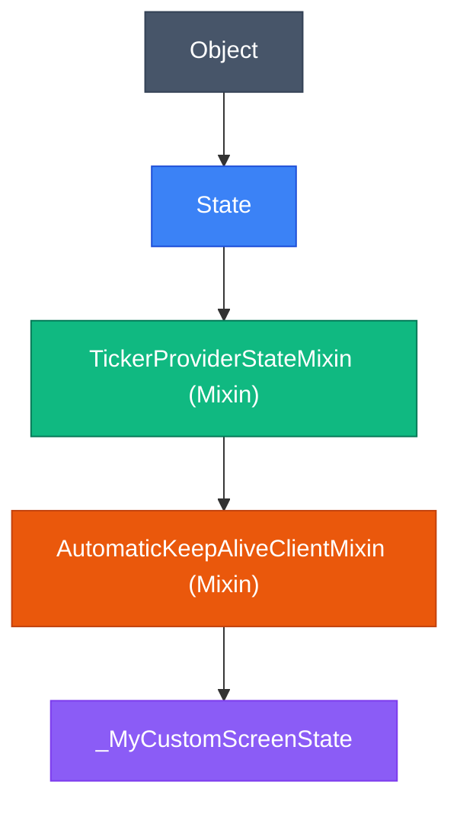

## 1. Advanced Constructors in Dart

Dart classes provide specialized constructor mechanisms designed to optimize object initialization, factory caching, and dependency injection.

```dart
class NetworkClient {
  final String baseUrl;
  final Duration timeout;
  final Map<String, String> defaultHeaders;

  // 1. Generative Constructor with Initializer List & Default Values
  NetworkClient({
    required this.baseUrl,
    this.timeout = const Duration(seconds: 30),
    Map<String, String>? headers,
  }) : defaultHeaders = headers ?? const {'Accept': 'application/json'} {
    assert(baseUrl.isNotEmpty, "Base URL cannot be empty");
  }

  // 2. Named Constructor
  NetworkClient.staging()
      : baseUrl = "https://staging-api.example.com/v1",
        timeout = const Duration(seconds: 15),
        defaultHeaders = const {'X-Environment': 'Staging'};

  // 3. Factory Constructor (Can return cached instances or subtypes)
  static final Map<String, NetworkClient> _instances = {};

  factory NetworkClient.cached(String baseUrl) {
    return _instances.putIfAbsent(
      baseUrl,
      () => NetworkClient(baseUrl: baseUrl),
    );
  }
}
```

---

## 2. Mixins & Linear Inheritance

Dart does not support multiple class inheritance to prevent the infamous "Diamond Problem". Instead, Dart uses **Mixins**—a mechanism for reusing class code in multiple class hierarchies via **linearized composition**.



### Writing & Constraining Mixins

```dart
// Use 'on' keyword to restrict mixin application to specific base classes
mixin AutoLoggingMixin<T extends StatefulWidget> on State<T> {
  @override
  void initState() {
    super.initState();
    print("🚀 [Lifecycle] Entered screen: ${widget.runtimeType}");
  }

  @override
  void dispose() {
    print("🛑 [Lifecycle] Disposed screen: ${widget.runtimeType}");
    super.dispose();
  }
}

// Usage in Flutter StatefulWidget
class UserListScreen extends StatefulWidget {
  const UserListScreen({super.key});
  @override
  State<UserListScreen> createState() => _UserListScreenState();
}

class _UserListScreenState extends State<UserListScreen> 
    with AutoLoggingMixin<UserListScreen> {
  @override
  Widget build(BuildContext context) {
    return Scaffold(body: Center(child: Text("User List")));
  }
}
```

---

## 3. Extension Methods

Extension methods allow you to attach new utility functions and getters to third-party or framework classes without subclassing or modifying original source code.

```dart
// Extending BuildContext with Responsive and Theme shortcuts
extension ContextExtensions on BuildContext {
  // Theme shortcut: context.theme
  ThemeData get theme => Theme.of(this);
  
  // ColorScheme shortcut: context.colors
  ColorScheme get colors => Theme.of(this).colorScheme;

  // Media query shortcuts:
  double get screenWidth => MediaQuery.sizeOf(this).width;
  double get screenHeight => MediaQuery.sizeOf(this).height;
  bool get isTablet => screenWidth >= 600;

  // SnackBar helper
  void showSnack(String message) {
    ScaffoldMessenger.of(this).showSnackBar(
      SnackBar(content: Text(message)),
    );
  }
}

// Clean usage in any widget build() method:
class ResponsiveCard extends StatelessWidget {
  const ResponsiveCard({super.key});

  @override
  Widget build(BuildContext context) {
    return Container(
      width: context.isTablet ? 500 : context.screenWidth * 0.9,
      color: context.colors.primaryContainer,
      child: ElevatedButton(
        onPressed: () => context.showSnack("Action Completed!"),
        child: Text("Submit", style: context.theme.textTheme.labelLarge),
      ),
    );
  }
}
```

---

## 4. Modern Dart 3: Records & Exhaustive Pattern Matching

Dart 3.x introduced **Records** (anonymous, aggregate values) and **Sealed Class Hierarchies** with exhaustive compile-time pattern matching.

### Records: Multiple Return Values
```dart
// Returning multiple typed values without creating a throwaway class
(double lat, double lng, {String address}) getLocation() {
  return (37.7749, -122.4194, address: "San Francisco, CA");
}

void useLocation() {
  final (lat, lng, address: street) = getLocation(); // Destructuring
  print("Coordinates: $lat, $lng | Address: $street");
}
```

### Sealed Classes: Type-Safe State Architecture
When a class is marked as `sealed`, the compiler enforces that all possible subclasses are known at compile time. This makes `switch` expressions **100% exhaustive** without needing a fallback `default` case!

```dart
// 1. Sealed State Hierarchy
sealed class AuthState {}

class AuthInitial extends AuthState {}
class AuthLoading extends AuthState {}
class AuthSuccess extends AuthState {
  final String userId;
  final String email;
  AuthSuccess({required this.userId, required this.email});
}
class AuthFailure extends AuthState {
  final String errorMessage;
  AuthFailure(this.errorMessage);
}

// 2. Exhaustive Pattern Matching in Flutter UI
Widget buildAuthView(AuthState state) {
  return switch (state) {
    AuthInitial() => const Text("Please sign in"),
    AuthLoading() => const CircularProgressIndicator(),
    AuthSuccess(userId: var id, email: var mail) => Text("Welcome $mail ($id)!"),
    AuthFailure(errorMessage: var msg) => Text("Error: $msg", style: const TextStyle(color: Colors.red)),
  }; // ⚡ Compiler errors if any AuthState subtype is unhandled!
}
```

---

## ❓ Knowledge Check

<Quiz question="What is the key benefit of using sealed class hierarchies with switch expressions in Dart 3?" options={["It automatically caches instances in Redis", "The compiler performs exhaustive checking, ensuring all possible state subtypes are handled without needing a default case", "It converts object state directly into JSON", "It enables multiple inheritance across separate libraries"]} answerIndex={1}>
When a class is marked `sealed`, all subclasses must be defined in the same library. Dart 3's compiler uses this constraint to enforce **exhaustiveness checking** in `switch` expressions, alerting you at compile time if a new state is added without being handled.
</Quiz>

<Quiz question="How does Dart prevent the Diamond Problem when multiple mixins implement the same method name?" options={["Dart throws a compile-time collision exception", "Dart linearizes the mixin hierarchy from right to left, executing the implementation from the last-applied mixin first (LIFO order)", "The compiler randomly selects one implementation", "Mixins cannot declare methods with parameters"]} answerIndex={1}>
Dart resolves mixin method calls through **linearization**. When a class applies `with MixinA, MixinB`, Dart creates a linear inheritance chain where `MixinB` sits on top of `MixinA`. Calling `super` resolves to the mixin declared immediately to the left.
</Quiz>
