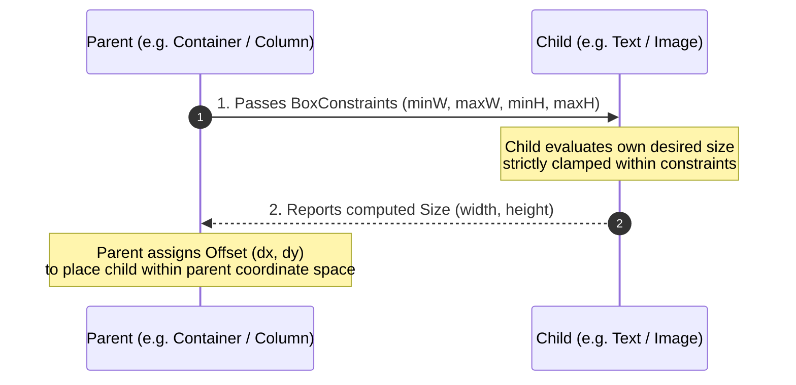
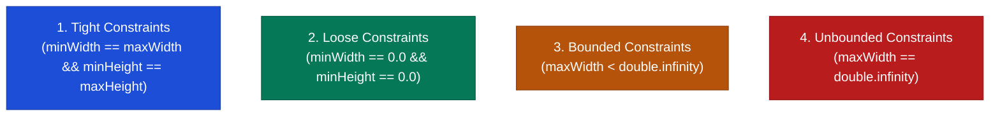

## 1. The Core Layout Axiom

Every layout computation in Flutter operates on three strict rules:

```text
┌────────────────────────────────────────────────────────┐
│  1. Constraints go DOWN from Parent to Child.          │
│  2. Sizes go UP from Child to Parent.                  │
│  3. The Parent POSITIONS the Child.                    │
└────────────────────────────────────────────────────────┘
```



---

## 2. BoxConstraints Taxonomy

`BoxConstraints` defines a rectangular envelope of allowable dimensions:

```dart
class BoxConstraints {
  final double minWidth;
  final double maxWidth;
  final double minHeight;
  final double maxHeight;
}
```



### Constraints Categories

| Category | Characteristic | Example Widgets | Child Behavior |
| :--- | :--- | :--- | :--- |
| **Tight** | Exact width and height enforced (`min == max`). | `SizedBox(width: 100, height: 100)`, root screen window. | Child is forced to have the exact specified dimensions regardless of its own wishes. |
| **Loose** | Maximum boundary specified, but minimum is `0.0`. | `Center`, `Align`, `Padding`. | Child is free to choose any size up to `max`. |
| **Bounded** | Has finite upper limits (`maxWidth < ∞`). | `Scaffold` body, `Container` inside finite screen. | Child cannot exceed upper bounds. |
| **Unbounded** | One or both axes are infinite (`double.infinity`). | Main axis of `ListView`, `Row` width, `Column` height. | Child can expand indefinitely unless constrained. |

---

## 3. The Infamous RenderFlex Overflow Error

The yellow-and-black striped hazard banner appears when a child in a `Row` or `Column` asks for more pixels than the parent flex container can provide:

```text
┌────────────────────────────────────────────────────────┐
│  A RenderFlex overflowed by 48 pixels on the right.   │
│  ◢◤◢◤◢◤◢◤◢◤◢◤◢◤◢◤◢◤◢◤◢◤◢◤◢◤◢◤◢◤◢◤◢◤◢◤◢◤◢◤◢◤◢◤◢◤◢◤◢◤◢◤  │
└────────────────────────────────────────────────────────┘
```

```dart
// ❌ BROKEN: The long Text exceeds remaining Row width, causing overflow
Row(
  children: [
    const Icon(Icons.person),
    Text("A very long user status message that definitely overflows the horizontal screen boundary!"), // ⚠️ 48px Overflow!
  ],
)

// ✅ FIX 1: Wrap in Expanded to force child to fit remaining available width
Row(
  children: [
    const Icon(Icons.person),
    Expanded(
      child: Text(
        "A very long user status message that wraps cleanly across multiple lines!",
        overflow: TextOverflow.ellipsis,
      ),
    ),
  ],
)
```

---

## 4. `Expanded` vs. `Flexible`

Both `Expanded` and `Flexible` must be direct descendants of a `Row`, `Column`, or `Flex`:

```dart
// Expanded = Flexible(fit: FlexFit.tight)
// Forces the child to greedily take ALL remaining flex space
Expanded(
  flex: 2, // Gets 2/3 of remaining space
  child: Container(color: Colors.blue),
)

// Flexible defaults to FlexFit.loose
// Allows child to take UP TO its flex share, but can be SMALLER if child desires
Flexible(
  flex: 1, // Gets at most 1/3 of remaining space
  fit: FlexFit.loose,
  child: Container(width: 50, color: Colors.green), // Uses 50px, does not stretch
)
```

---

## 5. Responsive Inspection: `LayoutBuilder`

When building responsive layouts that adapt between mobile phones, tablets, and desktop windows, use `LayoutBuilder` to inspect parent constraints:

```dart
class AdaptiveMasterDetailLayout extends StatelessWidget {
  const AdaptiveMasterDetailLayout({super.key});

  @override
  Widget build(BuildContext context) {
    return LayoutBuilder(
      builder: (BuildContext context, BoxConstraints constraints) {
        // Inspect maxWidth granted by parent
        if (constraints.maxWidth >= 720) {
          // Wide Screen / Tablet / Desktop: Two-column layout
          return Row(
            children: const [
              SizedBox(width: 300, child: MasterList()),
              Expanded(child: DetailView()),
            ],
          );
        } else {
          // Narrow Screen / Mobile Phone: Single-column layout
          return const MasterList();
        }
      },
    );
  }
}
```

---

## ❓ Knowledge Check

<Quiz question="What is the difference between Expanded and Flexible with FlexFit.loose inside a Row?" options={["Expanded only works inside Columns, whereas Flexible works inside Rows", "Expanded forces its child to occupy the exact remaining available flex space (tight fit), while Flexible allows the child to shrink to its natural size if smaller (loose fit)", "Expanded increases CPU frame rate", "Flexible disables text wrapping"]} answerIndex={1}>
`Expanded` is an alias for `Flexible(fit: FlexFit.tight)`, forcing the child to take **all** remaining flex space. `Flexible` with `FlexFit.loose` establishes a maximum upper limit but allows the child to remain smaller than the allocated flex budget.
</Quiz>

<Quiz question="What error occurs when a Column is placed directly inside a vertical ListView without height constraints?" options={["A dead lock occurs on the Dart VM", "An unbounded height exception (RenderFlex children have non-zero flex but incoming height constraints are unbounded)", "The ListView automatically switches to horizontal scrolling", "Memory leaks occur on the GPU buffer"]} answerIndex={1}>
`ListView` provides **unbounded vertical constraints** (`maxHeight: double.infinity`). If a child inside the list tries to expand or use flex without explicit constraints, Flutter cannot resolve infinite space and throws an **Unbounded Constraint Exception**.
</Quiz>
