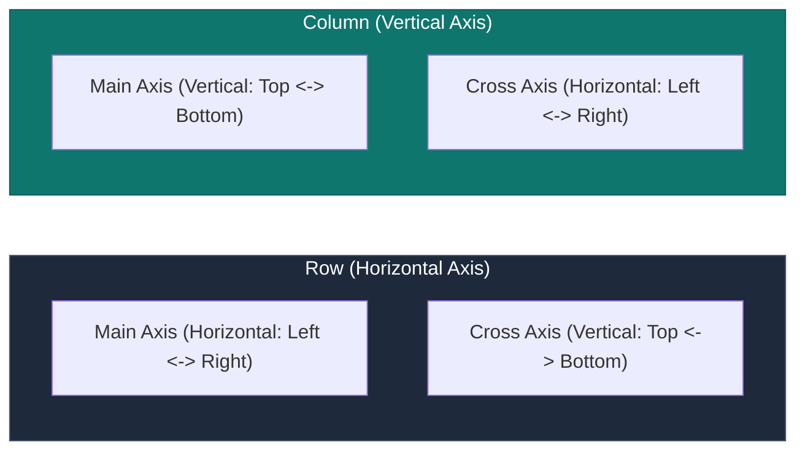
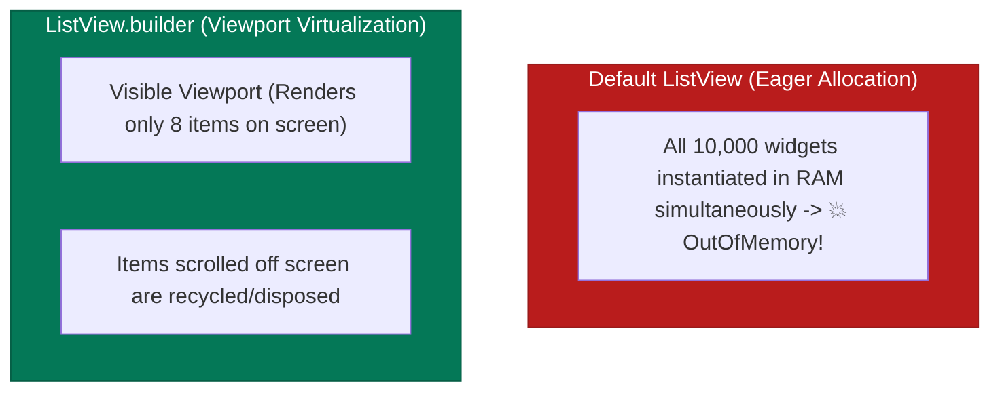
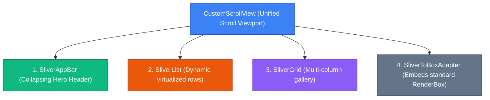

## 1. Multi-Child Layout Mechanics: Row & Column

`Row` and `Column` are built on top of the `Flex` render object. They arrange children linearly along a primary axis:



### Alignment Attributes

| Attribute | Options | Visual Behavior |
| :--- | :--- | :--- |
| `mainAxisAlignment` | `start`, `center`, `end`, `spaceBetween`, `spaceAround`, `spaceEvenly` | Positions children along the primary scrolling/flow direction. |
| `crossAxisAlignment` | `start`, `center`, `end`, `stretch`, `baseline` | Positions children perpendicular to the primary axis (`stretch` forces children to full cross width/height). |
| `mainAxisSize` | `MainAxisSize.max` (default), `MainAxisSize.min` | `max` expands to fill all parent space; `min` shrink-wraps tightly around its children. |

---

## 2. Layering UIs: Stack & Positioned

`Stack` enables overlapping layouts (analogous to CSS `position: absolute` with `z-index` determined by child order in the array).

```dart
Stack(
  alignment: Alignment.center,
  children: [
    // Bottom Layer: Background Image
    Image.asset('assets/images/card_bg.png', fit: BoxFit.cover),

    // Middle Layer: Semi-transparent Overlay
    Container(color: Colors.black45),

    // Top Layer: Pinned to specific coordinates
    Positioned(
      bottom: 16.0,
      right: 16.0,
      child: FloatingActionButton.small(
        onPressed: () {},
        child: const Icon(Icons.bookmark),
      ),
    ),
  ],
)
```

---

## 3. Virtualized Lists: `ListView.builder` vs. `ListView`

When rendering long collections, never instantiate widgets directly inside a default `ListView(children: [...])`.



```dart
// Production-grade Virtualized ListView with itemExtent optimization
ListView.builder(
  itemCount: 10000,
  itemExtent: 72.0, // ⚡ Performance optimization: skips child layout measurement pass!
  itemBuilder: (BuildContext context, int index) {
    return ListTile(
      leading: CircleAvatar(child: Text("$index")),
      title: Text("Transaction #$index"),
    );
  },
)
```

---

## 4. Slivers & CustomScrollView Architecture

Standard scrollable widgets (`ListView`, `GridView`) scroll independently. **Slivers** are portions of a scrollable area that coordinate together under a single unified **`CustomScrollView`** and **`Viewport`**.



### Complete Sliver Implementation

```dart
class AdvancedProfileFeedScreen extends StatelessWidget {
  const AdvancedProfileFeedScreen({super.key});

  @override
  Widget build(BuildContext context) {
    return Scaffold(
      body: CustomScrollView(
        slivers: [
          // 1. Collapsing Parallax App Bar
          SliverAppBar(
            expandedHeight: 200.0,
            floating: false,
            pinned: true, // Remains visible at top when scrolled
            flexibleSpace: FlexibleSpaceBar(
              title: const Text("Alex Mercer"),
              background: Image.network(
                "https://images.unsplash.com/photo-1579546929518-9e396f3cc809",
                fit: BoxFit.cover,
              ),
            ),
          ),

          // 2. Non-sliver widget adapted into the sliver stream
          SliverToBoxAdapter(
            child: Padding(
              padding: const EdgeInsets.all(16.0),
              child: Text(
                "Activity Overview",
                style: Theme.of(context).textTheme.headlineSmall,
              ),
            ),
          ),

          // 3. Virtualized Sliver Grid
          SliverGrid(
            gridDelegate: const SliverGridDelegateWithFixedCrossAxisCount(
              crossAxisCount: 2,
              mainAxisSpacing: 8,
              crossAxisSpacing: 8,
            ),
            delegate: SliverChildBuilderDelegate(
              (context, index) => Card(child: Center(child: Text("Stat $index"))),
              childCount: 4,
            ),
          ),

          // 4. Virtualized Infinite List
          SliverList(
            delegate: SliverChildBuilderDelegate(
              (context, index) => ListTile(title: Text("Feed Item #$index")),
              childCount: 50,
            ),
          ),
        ],
      ),
    );
  }
}
```

---

## ❓ Knowledge Check

<Quiz question="What is the performance advantage of specifying itemExtent on a ListView.builder?" options={["It renders all items using WebGL shaders", "It allows the scrolling engine to calculate total scrollable geometry and child offsets using simple arithmetic, avoiding layout measurement of unseen children", "It prevents memory garbage collection", "It makes list tiles clickable"]} answerIndex={1}>
When `itemExtent` is provided, the scroll viewport knows that every child has the exact same fixed dimension along the scroll axis. The engine can calculate scroll positions and virtualized child offsets via **simple multiplication ($O(1)$)** without needing to measure children.
</Quiz>

<Quiz question="Why can you not place a regular Container directly as a child of a CustomScrollView?" options={["Containers do not support colors inside scroll views", "CustomScrollView only accepts RenderSliver objects in its slivers list; standard RenderBox widgets must be wrapped inside a SliverToBoxAdapter", "Containers are deprecated in Flutter 3.x", "CustomScrollView requires all children to be StatefulWidgets"]} answerIndex={1}>
`CustomScrollView` communicates layout constraints using **`SliverConstraints`** rather than standard `BoxConstraints`. To place a standard `RenderBox` widget (like `Container`, `Card`, or `Padding`) inside a sliver stream, it must be wrapped in a **`SliverToBoxAdapter`**.
</Quiz>
