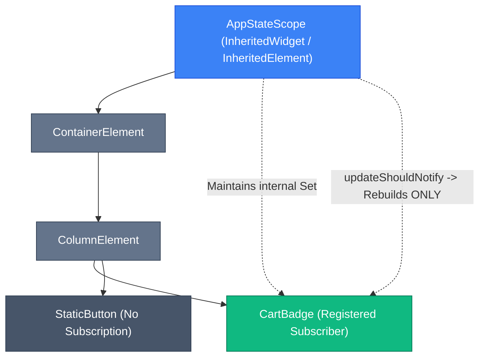

## 1. The Prop Drilling Dilemma

In deep widget hierarchies, passing shared data and callbacks through dozens of intermediate constructors is known as **prop drilling**:

```text
┌────────────────────────────────────────────────────────┐
│  MyApp                                                 │
│   └── DashboardScreen (doesn't care about Cart)        │
│        └── MainContent (doesn't care about Cart)       │
│             └── HeaderRow (doesn't care about Cart)    │
│                  └── CartBadge (NEEDS Cart Count!)     │
└────────────────────────────────────────────────────────┘
```

Flutter solves this problem natively at the engine level through **`InheritedWidget`**.

---

## 2. Low-Level `InheritedWidget` Architecture

An `InheritedWidget` acts as an ambient broadcasting node in the Element tree. Any descendant element can look up the nearest ancestor `InheritedWidget` in **$O(1)$ time** and register itself to be rebuilt whenever that data mutates.



### Complete Custom InheritedWidget Implementation

```dart
class CartData {
  final List<String> items;
  const CartData(this.items);
}

// 1. InheritedWidget Definition
class CartScope extends InheritedWidget {
  final CartData data;

  const CartScope({
    required this.data,
    required super.child,
    super.key,
  });

  // 2. Convenience accessor with dependency registration
  static CartScope of(BuildContext context) {
    final CartScope? result = context.dependOnInheritedWidgetOfExactType<CartScope>();
    assert(result != null, 'No CartScope found in current BuildContext hierarchy');
    return result!;
  }

  // 3. Selective rebuild filter
  @override
  bool updateShouldNotify(covariant CartScope oldWidget) {
    // Rebuild subscribers ONLY if the data reference or contents changed
    return data != oldWidget.data;
  }
}
```

---

## 3. `dependOnInheritedWidget` vs. `getInheritedWidget`

Understanding the difference between these two context lookup methods is essential to preventing redundant UI rebuilds:

```dart
// 1. Subscribes the caller Element to rebuilds whenever updateShouldNotify returns true
final cart = context.dependOnInheritedWidgetOfExactType<CartScope>()!.data;

// 2. Reads the current value ONCE without registering a subscription
// Useful inside button callbacks (onPressed) where UI rebuild is not needed
final cart = context.getInheritedWidgetOfExactType<CartScope>()!.data;
```

---

## 4. `ValueNotifier` & `ValueListenableBuilder`

For lightweight reactive state without third-party dependencies, Flutter provides `ValueNotifier<T>`:

```dart
// 1. Reactive State Holder
class CounterController {
  final ValueNotifier<int> count = ValueNotifier<int>(0);

  void increment() => count.value++;
  void dispose() => count.dispose();
}

// 2. Granular UI Rebuilding using ValueListenableBuilder
class CounterDisplayWidget extends StatelessWidget {
  final CounterController controller;
  const CounterDisplayWidget({required this.controller, super.key});

  @override
  Widget build(BuildContext context) {
    return Column(
      children: [
        const Text("Static Header - Never Rebuilds!"),
        
        // Only this specific text subtree rebuilds when count changes!
        ValueListenableBuilder<int>(
          valueListenable: controller.count,
          builder: (BuildContext context, int value, Widget? child) {
            return Text("Current Value: $value", style: const TextStyle(fontSize: 24));
          },
        ),

        ElevatedButton(
          onPressed: controller.increment,
          child: const Text("Increment"),
        ),
      ],
    );
  }
}
```

---

## ❓ Knowledge Check

<Quiz question="What does the updateShouldNotify method in an InheritedWidget return?" options={["A new Widget instance to replace the old tree", "A boolean indicating whether descendant widgets that subscribed via dependOnInheritedWidgetOfExactType should be marked dirty and rebuilt", "A Future representing the async data stream", "The index of the selected tab"]} answerIndex={1}>
`updateShouldNotify(oldWidget)` returns a **boolean**. If it returns `true`, Flutter walks the `InheritedElement`'s internal set of dependent elements and marks each subscribed dependent as **dirty**, scheduling them for a rebuild during the next frame.
</Quiz>

<Quiz question="Why should you avoid calling context.dependOnInheritedWidgetOfExactType inside a button's onPressed callback?" options={["It causes an infinite recursion crash", "Because callbacks are executed outside the build phase, and registering a dependency inside an event handler does not associate a rebuild with that specific build method", "It deletes the database cache", "It disables touch gestures"]} answerIndex={1}>
Dependency subscriptions must be registered during the **`build()` phase** so that Flutter knows which `Element` to invalidate. Inside callbacks, you should use `getInheritedWidgetOfExactType` (or `context.read<T>()` in Provider) to read data without creating accidental rebuild registrations.
</Quiz>
