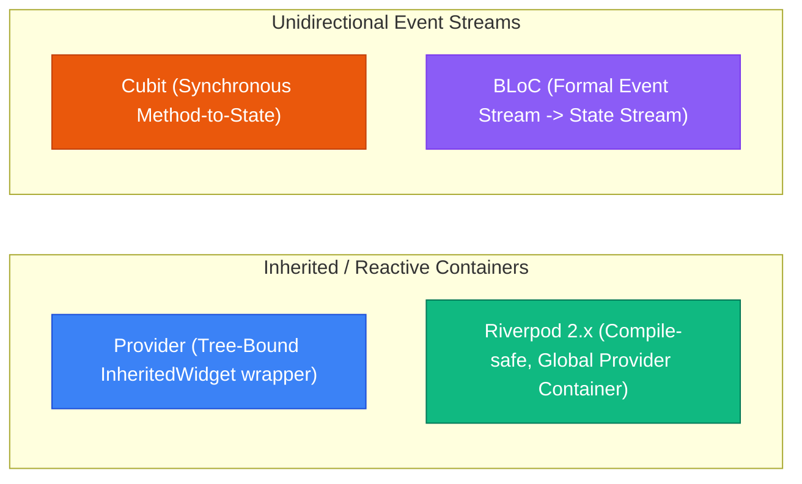
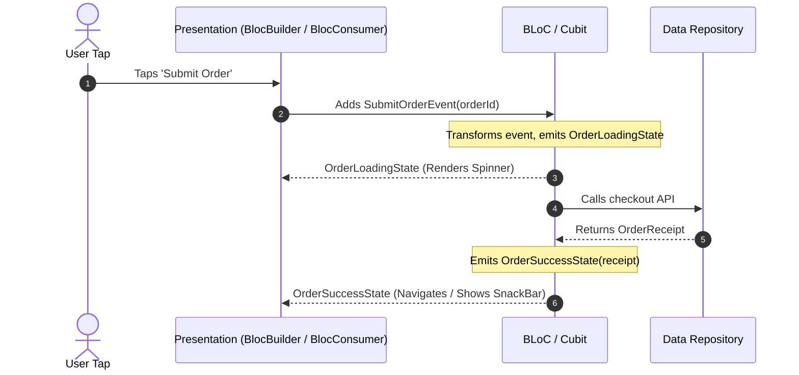

## 1. State Management Architectural Spectrum

Modern Flutter applications choose state management patterns based on scale, team size, testability, and strictness requirements:



---

## 2. Provider: The Community Classic

`Provider` provides ergonomic wrappers around Flutter's `InheritedWidget` system.

```dart
// 1. Model class extending ChangeNotifier
class AuthNotifier extends ChangeNotifier {
  String? _username;
  bool _isLoading = false;

  String? get username => _username;
  bool get isLoading => _isLoading;
  bool get isAuthenticated => _username != null;

  Future<void> login(String user) async {
    _isLoading = true;
    notifyListeners(); // 📢 Rebuilds listeners

    await Future.delayed(const Duration(seconds: 1));
    _username = user;
    _isLoading = false;
    notifyListeners();
  }
}

// 2. Application Registration via MultiProvider
void main() {
  runApp(
    MultiProvider(
      providers: [
        ChangeNotifierProvider(create: (_) => AuthNotifier()),
      ],
      child: const MainApp(),
    ),
  );
}
```

### Provider Context Extension Methods

| Method | Context Usage Location | Rebuild Behavior |
| :--- | :--- | :--- |
| **`context.watch<T>()`** | **`build()` method only** | Subscribes to changes; rebuilds widget whenever `notifyListeners()` fires. |
| **`context.read<T>()`** | **Callbacks / `onPressed` only** | Reads current value once; **never** subscribes to rebuilds. |
| **`context.select<T, R>((m) => m.field)`** | **`build()` method only** | Rebuilds widget **only when the selected field changes**. |

---

## 3. Riverpod 2.x: Compile-Safe Reactive Architecture

Riverpod redesigns Provider from scratch to eliminate runtime exceptions, allow out-of-tree provider definitions, and provide native asynchronous data handling (`AsyncValue`).

```mermaid
graph TD
    Scope["ProviderScope (Root Container)"]
    RiverpodRef["WidgetRef / Ref System"]
    Providers["Global Providers (AsyncNotifier, StateProvider)"]
    Consumers["ConsumerWidget / Consumer (Subscribers)"]

    Scope --> RiverpodRef
    RiverpodRef --> Providers
    Providers -->|ref.watch()| Consumers

    style Scope fill:#1e293b,color:#fff,stroke:#475569
    style RiverpodRef fill:#0284c7,color:#fff,stroke:#0369a1
    style Providers fill:#059669,color:#fff,stroke:#047857
    style Consumers fill:#7c3aed,color:#fff,stroke:#6d28d9
```

### Riverpod 2.x Modern Implementation

```dart
import 'package:flutter_riverpod/flutter_riverpod.dart';

// 1. Declare provider globally (No BuildContext required!)
final userProfileProvider = FutureProvider.family<UserProfile, String>((ref, userId) async {
  final api = ref.watch(apiClientProvider);
  return api.fetchUserProfile(userId);
});

// 2. Consume reactive state inside a ConsumerWidget
class ProfileCard extends ConsumerWidget {
  final String userId;
  const ProfileCard({required this.userId, super.key});

  @override
  Widget build(BuildContext context, WidgetRef ref) {
    // AsyncValue handles Loading, Error, and Data states declaratively
    final AsyncValue<UserProfile> profileAsync = ref.watch(userProfileProvider(userId));

    return profileAsync.when(
      loading: () => const Center(child: CircularProgressIndicator()),
      error: (err, stack) => Text("Error loading profile: $err"),
      data: (profile) => Column(
        children: [
          Text(profile.name, style: Theme.of(context).textTheme.headlineMedium),
          Text(profile.email),
        ],
      ),
    );
  }
}
```

---

## 4. BLoC & Cubit: Enterprise Unidirectional Architecture

The **BLoC (Business Logic Component)** pattern enforces strict separation between presentation and business logic using reactive Dart Streams.



### Cubit vs. BLoC Code Comparison

```dart
// 1. CUBIT: Direct method invocation (Simpler, lower boilerplate)
class CounterCubit extends Cubit<int> {
  CounterCubit() : super(0); // Initial state
  void increment() => emit(state + 1);
  void decrement() => emit(state - 1);
}

// 2. BLOC: Event-driven transformation (High auditability & traceability)
sealed class CounterEvent {}
class CounterIncrementPressed extends CounterEvent {}
class CounterDecrementPressed extends CounterEvent {}

class CounterBloc extends Bloc<CounterEvent, int> {
  CounterBloc() : super(0) {
    on<CounterIncrementPressed>((event, emit) => emit(state + 1));
    on<CounterDecrementPressed>((event, emit) => emit(state - 1));
  }
}
```

### BLoC Presentation Widgets

| Widget | Purpose | Typical Use Case |
| :--- | :--- | :--- |
| **`BlocBuilder<B, S>`** | Rebuilds UI widgets on state emissions. | Rendering lists, text labels, badges. |
| **`BlocListener<B, S>`** | Executes one-time side-effects (no widget rebuilding). | Showing SnackBars, dialogs, or triggering navigation. |
| **`BlocConsumer<B, S>`** | Combines `builder` and `listener` into one node. | Forms that show a spinner AND navigate on success. |

---

## ❓ Knowledge Check

<Quiz question="What is the key advantage of Riverpod over traditional Provider?" options={["Riverpod compiles directly to Objective-C", "Riverpod providers are declared globally without requiring BuildContext, catching provider lookup errors at compile time instead of throwing runtime ProviderNotFoundExceptions", "Riverpod eliminates the need for any build() methods", "Riverpod only works with Firebase backends"]} answerIndex={1}>
Traditional `Provider` relies on runtime tree lookups (`BuildContext`), meaning missing providers trigger runtime crashes (`ProviderNotFoundException`). **Riverpod** providers are top-level immutable declarations evaluated inside a compile-safe container, eliminating runtime lookup failures.
</Quiz>

<Quiz question="When should you use BlocListener instead of BlocBuilder?" options={["When you want to display an image on screen", "When you need to execute one-off side-effects (such as navigating to a new route, showing a SnackBar, or opening a dialog) in response to a state change without rebuilding the UI", "When you want to run animations at 120 FPS", "When reading SQLite data"]} answerIndex={1}>
`BlocBuilder` is designed purely for returning widgets during the build phase. For one-time actions (side-effects like `Navigator.push` or `ScaffoldMessenger.showSnackBar`), you must use **`BlocListener`** to ensure the side-effect executes exactly once per state transition.
</Quiz>
