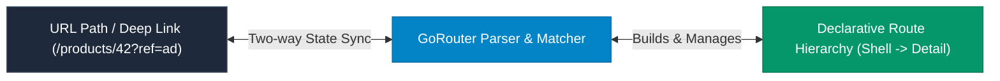

## 1. Navigator 2.0 & Declarative Routing Philosophy

While Navigator 1.0 worked well for simple mobile stacks, it struggled with **deep linking, web browser URLs, and nested tab navigation**. 

In **Navigator 2.0**, the navigation state is modeled declaratively: **The URL is state**. When the URL changes, the router updates the screen hierarchy; when the user taps in the UI, the state updates the URL.



---

## 2. Setting Up GoRouter

```dart
import 'package:flutter/material.dart';
import 'package:go_router/go_router.dart';

// 1. Central Router Configuration
final GoRouter appRouter = GoRouter(
  initialLocation: '/',
  routes: [
    GoRoute(
      path: '/',
      name: 'home',
      builder: (context, state) => const HomeScreen(),
      routes: [
        // Sub-route: /products/:id
        GoRoute(
          path: 'products/:id',
          name: 'productDetail',
          builder: (context, state) {
            // Extract Path Parameter (:id)
            final String productId = state.pathParameters['id']!;
            // Extract Query Parameter (?discount=true)
            final String? discount = state.uri.queryParameters['discount'];
            return ProductDetailScreen(id: productId, hasDiscount: discount == 'true');
          },
        ),
      ],
    ),
    GoRoute(
      path: '/login',
      name: 'login',
      builder: (context, state) => const LoginScreen(),
    ),
  ],
);

// 2. Wire into MaterialApp.router
void main() {
  runApp(
    MaterialApp.router(
      routerConfig: appRouter,
      title: 'Production Store',
    ),
  );
}
```

---

## 3. Navigation Semantics: `context.go()` vs. `context.push()`

| Method | Stack Behavior | URL State | Typical Use Case |
| :--- | :--- | :--- | :--- |
| **`context.go('/products/42')`** | Reconstructs the route stack based strictly on route hierarchy. | Matches exact path. | Top-level section switches, deep links, tab switches. |
| **`context.push('/products/42')`** | Pushes a route on top of the current stack as a new card. | Appends route. | Modal details, full-screen dialogs where back button must return. |
| **`context.pop()`** | Pops current top route from stack. | Reverts URL. | Back button actions. |

---

## 4. Authentication Redirection Guards

Redirect logic protects private routes and routes unauthenticated users directly to `/login`:

```dart
final GoRouter secureRouter = GoRouter(
  initialLocation: '/dashboard',
  refreshListenable: authStateNotifier, // ⚡ Re-evaluates redirect whenever auth state changes!
  redirect: (BuildContext context, GoRouterState state) {
    final bool isLoggedIn = authStateNotifier.isAuthenticated;
    final bool isLoggingIn = state.matchedLocation == '/login';

    // 1. If not logged in and not on login page, send to login
    if (!isLoggedIn && !isLoggingIn) {
      return '/login';
    }

    // 2. If logged in and trying to access login page, send to dashboard
    if (isLoggedIn && isLoggingIn) {
      return '/dashboard';
    }

    // 3. No redirect needed; proceed to target route
    return null;
  },
  routes: [ /* Route definitions */ ],
);
```

---

## 5. Persistent Bottom Navigation with `StatefulShellRoute`

To maintain scroll positions and state across bottom navigation tabs, use **`StatefulShellRoute.indexedStack`**:

```dart
final GoRouter tabRouter = GoRouter(
  initialLocation: '/feed',
  routes: [
    StatefulShellRoute.indexedStack(
      builder: (context, state, navigationShell) {
        return Scaffold(
          body: navigationShell, // Houses the active branch screen
          bottomNavigationBar: BottomNavigationBar(
            currentIndex: navigationShell.currentIndex,
            onTap: (index) => navigationShell.goBranch(index),
            items: const [
              BottomNavigationBarItem(icon: Icon(Icons.feed), label: 'Feed'),
              BottomNavigationBarItem(icon: Icon(Icons.person), label: 'Profile'),
            ],
          ),
        );
      },
      branches: [
        // Tab 1: Feed Branch
        StatefulShellBranch(
          routes: [
            GoRoute(path: '/feed', builder: (_, __) => const FeedScreen()),
          ],
        ),
        // Tab 2: Profile Branch
        StatefulShellBranch(
          routes: [
            GoRoute(path: '/profile', builder: (_, __) => const ProfileScreen()),
          ],
        ),
      ],
    ),
  ],
);
```

---

## ❓ Knowledge Check

<Quiz question="What is the critical behavioral difference between context.go('/details') and context.push('/details') in GoRouter?" options={["context.push runs on Web while context.go only runs on mobile", "context.go navigates to the target by restructuring the route tree according to the route configuration, whereas context.push simply pushes a new route onto the current navigator stack", "context.go deletes the local database cache", "context.push disables route animations"]} answerIndex={1}>
`context.go()` changes the declarative URI location and constructs the exact path hierarchy defined in your route tree. `context.push()` pushes a new page directly onto the current stack without modifying parent route branches, preserving imperative back-stack behavior.
</Quiz>

<Quiz question="Why is StatefulShellRoute.indexedStack preferred over standard routing for bottom navigation tabs?" options={["It speeds up device CPU clock speed", "It maintains separate navigation state and keeps alive widget subtrees (preserving scroll positions and form inputs) for each individual tab", "It compiles routes into native Swift storyboards", "It bypasses the Flutter layout pipeline"]} answerIndex={1}>
`StatefulShellRoute.indexedStack` assigns a persistent branch to each bottom navigation tab. When users switch tabs, the underlying `IndexedStack` preserves the exact scroll offset, text input values, and internal navigation history of inactive tabs without destroying their state.
</Quiz>
