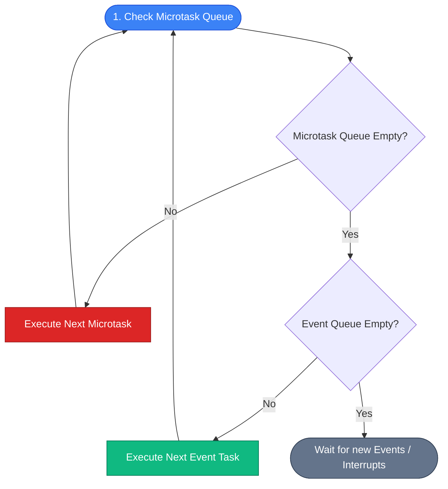
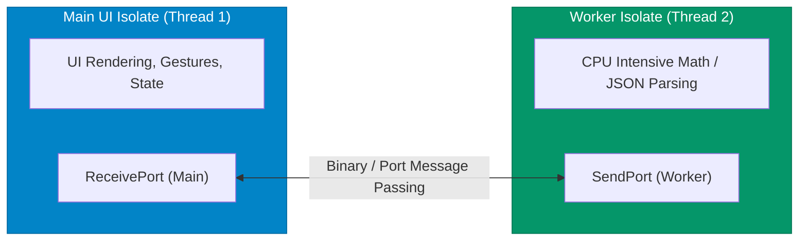

## 1. The Dart Event Loop Architecture

Dart executes code inside a **single thread of execution** powered by an **Event Loop**. The event loop continuously processes tasks from two separate queues:



### Queue Priority Breakdown

1. **Microtask Queue (Higher Priority)**:
   - Contains short, internal framework callbacks that must execute *immediately* before giving control back to the event queue (e.g. `scheduleMicrotask()`).
   - The event loop **drains the microtask queue completely** before picking up the next event.
2. **Event Queue (Standard Priority)**:
   - Handles external events: user taps, paint repaints, network responses, file I/O completions, and timer callbacks (`Timer()`, `Future.delayed()`).

```dart
import 'dart:async';

void demonstrateQueueExecution() {
  print("1. Synchronous Code");

  // Enqueue in standard Event Queue
  Timer.run(() => print("5. Event Queue (Timer)"));
  Future(() => print("4. Event Queue (Future)"));

  // Enqueue in high-priority Microtask Queue
  scheduleMicrotask(() => print("3. Microtask Queue"));

  print("2. Synchronous Code End");
}

// Console Output:
// 1. Synchronous Code
// 2. Synchronous Code End
// 3. Microtask Queue
// 4. Event Queue (Future)
// 5. Event Queue (Timer)
```

---

## 2. Why Heavy Computation Blocks the UI

Because the UI rendering pipeline (Build, Layout, Paint) runs on the **Main UI Thread**, running expensive CPU algorithms (e.g., image filters, massive JSON parsing, cryptography) directly in Dart blocks the Event Loop, freezing the screen and causing dropped frames (jank).

```text
Main Thread Timeline (JANK SCENARIO):
[ Frame 1 ] ──> [ ⚠️ Heavy Synchronous Calculation (150ms) ] ──> [ Frame 2 (Dropped 9 frames!) ]
```

---

## 3. Isolates: True Multi-Threaded Concurrency

To run intensive CPU tasks without freezing the UI, Dart provides **Isolates**.

> [!IMPORTANT]
> **Isolates have completely isolated memory heaps**. Unlike threads in Java or C++ that share memory and require locks/mutexes, Dart Isolates share **zero memory**. Communication occurs strictly via serialized **message passing** through `SendPort` and `ReceivePort`.



---

## 4. Modern Isolate Execution: `Isolate.run()`

In Dart 3.x+, running a one-off computation on a background thread is as simple as calling **`Isolate.run()`**:

```dart
import 'dart:convert';
import 'dart:isolate';

// Background CPU task: Parsing a massive 50MB JSON array
List<Product> parseLargeJsonPayload(String rawJson) {
  final List<dynamic> parsedList = jsonDecode(rawJson);
  return parsedList.map((item) => Product.fromJson(item)).toList();
}

// Invocation from Main UI thread without freezing UI:
Future<List<Product>> loadProductsInBackground(String rawJson) async {
  // Spawns background isolate, executes function, returns result, and disposes isolate
  final List<Product> products = await Isolate.run(() => parseLargeJsonPayload(rawJson));
  return products;
}
```

---

## 5. Long-Lived Bidirectional Isolates (`SendPort` / `ReceivePort`)

For continuous worker operations (e.g., continuous background audio processing, WebSocket encryption pipeline):

```dart
import 'dart:isolate';

void workerEntryPoint(SendPort sendPortToMain) {
  // 1. Create a ReceivePort for worker
  final workerReceivePort = ReceivePort();
  
  // 2. Send worker's SendPort back to main isolate
  sendPortToMain.send(workerReceivePort.sendPort);

  // 3. Listen for incoming tasks
  workerReceivePort.listen((message) {
    if (message is int) {
      final int result = message * message; // Do compute
      sendPortToMain.send("Processed: $result");
    }
  });
}

Future<void> setupLongLivedWorker() async {
  final mainReceivePort = ReceivePort();
  
  // Spawn background isolate
  await Isolate.spawn(workerEntryPoint, mainReceivePort.sendPort);

  // Read worker's SendPort
  final SendPort workerSendPort = await mainReceivePort.first as SendPort;

  // Send message to worker
  workerSendPort.send(42);
}
```

---

## ❓ Knowledge Check

<Quiz question="How do Dart Isolates communicate data between each other?" options={["By writing to shared static class variables with synchronized locks", "By passing messages across SendPort and ReceivePort channels, where objects are copied across isolated memory heaps", "Through native C++ memory pointers", "By writing temporary files to the device flash storage"]} answerIndex={1}>
Dart Isolates maintain **completely separate, private memory heaps**. They never share memory addresses. Inter-isolate communication is conducted exclusively by passing messages through **`SendPort` and `ReceivePort`** handles.
</Quiz>

<Quiz question="What happens if a task in the Microtask queue schedules another microtask in an infinite loop?" options={["The event queue takes over automatically after 10ms", "The Event Loop is starved and never processes the Event Queue, freezing all UI animations, taps, and timers", "Dart allocates a new CPU thread to handle the event queue", "The app is converted into a service worker"]} answerIndex={1}>
Because the Event Loop **prioritizes draining the Microtask Queue completely** before servicing any tasks from the Event Queue, an infinite microtask chain will **starve the event queue**, completely halting UI rendering, timers, and gesture handling.
</Quiz>
