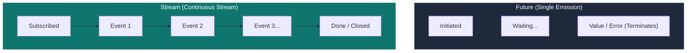

## 1. Asynchronous Primitives: `Future` vs. `Stream`

| Primitive | Emission Frequency | Analogy | Key Methods & Keywords |
| :--- | :--- | :--- | :--- |
| **`Future<T>`** | **Single value** delivered once in the future (or error). | A sealed parcel delivered once by mail. | `async`, `await`, `then()`, `catchError()`, `Future.wait()` |
| **`Stream<T>`** | **Continuous sequence** of asynchronous events emitted over time. | A live radio broadcast emitting audio packets continuously. | `async*`, `yield`, `listen()`, `StreamController`, `rxdart` |



---

## 2. Rendering Asynchronous Data: `FutureBuilder`

`FutureBuilder<T>` listens to a `Future` and calls its `builder` function across distinct `ConnectionState` transitions:

```dart
class UserProfileView extends StatefulWidget {
  final String userId;
  const UserProfileView({required this.userId, super.key});

  @override
  State<UserProfileView> createState() => _UserProfileViewState();
}

class _UserProfileViewState extends State<UserProfileView> {
  late Future<UserProfile> _profileFuture;

  @override
  void initState() {
    super.initState();
    // ⚡ CRITICAL: Assign Future ONCE in initState, NOT inside build()!
    _profileFuture = ApiService.fetchUserProfile(widget.userId);
  }

  @override
  Widget build(BuildContext context) {
    return FutureBuilder<UserProfile>(
      future: _profileFuture,
      builder: (BuildContext context, AsyncSnapshot<UserProfile> snapshot) {
        // 1. Connection State: Waiting for response
        if (snapshot.connectionState == ConnectionState.waiting) {
          return const Center(child: CircularProgressIndicator());
        }

        // 2. Error State: Network failure or 500 exception
        if (snapshot.hasError) {
          return Center(
            child: Text("Failed to load: ${snapshot.error}", style: const TextStyle(color: Colors.red)),
          );
        }

        // 3. Success State: Data received
        if (snapshot.hasData) {
          final profile = snapshot.data!;
          return Column(
            children: [
              Text(profile.fullName, style: Theme.of(context).textTheme.headlineMedium),
              Text(profile.bio),
            ],
          );
        }

        return const Center(child: Text("No profile data available"));
      },
    );
  }
}
```

> [!CAUTION]
> **The Fatal FutureBuilder Rebuild Bug**:
> Never call `future: ApiService.fetchUserProfile()` directly inside `build()`. Every time Flutter rebuilds the widget (e.g. keyboard opens, parent tab switches), a **brand new Future is created**, triggering a duplicate HTTP request and resetting the UI back to a loading spinner!

---

## 3. Real-Time UI with `StreamBuilder`

For live real-time feeds (e.g. chat messages, GPS coordinates, WebSockets):

```dart
// 1. Stream Generator using async* and yield
Stream<int> countdownTimer(int start) async* {
  for (int i = start; i >= 0; i--) {
    await Future.delayed(const Duration(seconds: 1));
    yield i; // Emits integer to stream listeners
  }
}

// 2. Reactive UI Rendering via StreamBuilder
class LiveTimerWidget extends StatelessWidget {
  const LiveTimerWidget({super.key});

  @override
  Widget build(BuildContext context) {
    return StreamBuilder<int>(
      stream: countdownTimer(10),
      initialData: 10,
      builder: (BuildContext context, AsyncSnapshot<int> snapshot) {
        if (snapshot.connectionState == ConnectionState.done) {
          return const Text("🚀 Blast off!", style: TextStyle(fontSize: 24, fontWeight: FontWeight.bold));
        }

        return Text(
          "T-Minus: ${snapshot.data}s",
          style: const TextStyle(fontSize: 28),
        );
      },
    );
  }
}
```

---

## 4. Single-Subscription vs. Broadcast Streams

```dart
// 1. Single-Subscription Stream (Default)
// Allows only ONE listener. Ideal for sequential file reading or HTTP streams.
final controller = StreamController<String>();
controller.stream.listen((data) => print("Listener 1: $data"));
// controller.stream.listen((data) => print("Listener 2")); // ❌ Throws StateError!

// 2. Broadcast Stream
// Allows MULTIPLE concurrent listeners. Ideal for UI event buses or chat rooms.
final broadcastController = StreamController<String>.broadcast();
broadcastController.stream.listen((data) => print("Listener 1: $data"));
broadcastController.stream.listen((data) => print("Listener 2: $data")); // ✅ Allowed!
```

---

## ❓ Knowledge Check

<Quiz question="Why must a Future passed to FutureBuilder be instantiated in initState() rather than inside the build() method?" options={["Because Dart cannot allocate Futures on the UI thread", "Because instantiating the Future in build() creates a new Future on every frame rebuild, causing redundant network requests and persistent UI flickering", "Because FutureBuilder only accepts static constants", "Because BuildContext is not available in FutureBuilder"]} answerIndex={1}>
If a `Future` is instantiated directly inside `build()`, any ancestor rebuild triggers the creation of a **brand-new Future instance**. `FutureBuilder` detects a changed Future parameter, cancels previous state, and restarts the async operation, causing infinite network request loops.
</Quiz>

<Quiz question="What is the difference between a single-subscription stream and a broadcast stream in Dart?" options={["Single-subscription streams only run on Android", "A single-subscription stream allows only one active listener over its entire lifetime, whereas a broadcast stream allows multiple listeners to subscribe simultaneously at any point", "Broadcast streams cannot emit errors", "Single-subscription streams are synchronous"]} answerIndex={1}>
By default, Dart streams are **single-subscription**—they allow only a single listener and buffer events until listened to. A **broadcast stream** supports multiple independent listeners simultaneously, broadcasting events to all active listeners in real time.
</Quiz>
