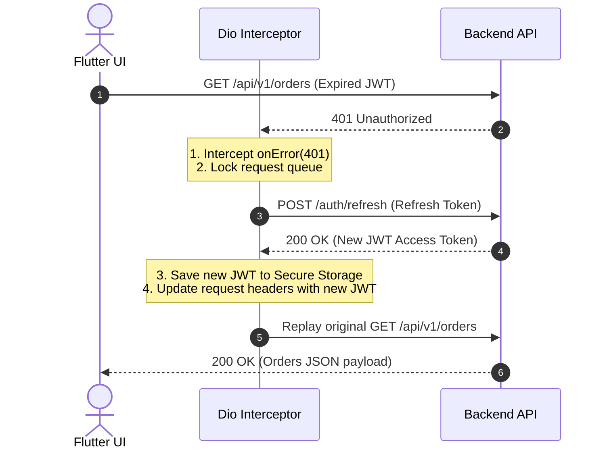

## 1. Mobile HTTP Networking: `package:http` vs. `Dio`

| Feature Capability | `package:http` (Official) | `Dio` (Enterprise Standard) |
| :--- | :--- | :--- |
| **Philosophy** | Minimalist, low-level HTTP wrapper | Feature-rich, production-oriented client |
| **Interceptors** | ❌ Manual wrapping required | ✅ Built-in (`onRequest`, `onResponse`, `onError`) |
| **Global Base URL & Config** | ❌ Per-request setup | ✅ Centralized `BaseOptions` |
| **Token Refresh & Replay** | ❌ Complex custom logic | ✅ Native request queuing & locking |
| **File Upload / Download Progress**| ❌ Manual stream calculation | ✅ Built-in `onSendProgress` & `onReceiveProgress` |
| **Request Cancellation** | ❌ Not supported | ✅ `CancelToken` support |

---

## 2. Setting Up a Production Dio Client

```dart
import 'package:dio/dio.dart';

class ApiClient {
  late final Dio dio;

  ApiClient({required String baseUrl}) {
    dio = Dio(
      BaseOptions(
        baseUrl: baseUrl,
        connectTimeout: const Duration(seconds: 10),
        receiveTimeout: const Duration(seconds: 15),
        headers: {
          'Accept': 'application/json',
          'Content-Type': 'application/json',
        },
      ),
    );

    // Register interceptor chain
    dio.interceptors.addAll([
      AuthInterceptor(dio: dio),
      LogInterceptor(requestBody: true, responseBody: true),
    ]);
  }
}
```

---

## 3. JWT Token Refresh Interceptor with Request Replay

When an access token expires, a mobile app receives an `HTTP 401 Unauthorized`. The networking layer should **pause outgoing requests, refresh the token once, update the authorization header, and transparently replay the original request**:



### Complete Token Refresh Interceptor Code

```dart
class AuthInterceptor extends QueuedInterceptor {
  final Dio dio;
  AuthInterceptor({required this.dio});

  @override
  void onRequest(RequestOptions options, RequestInterceptorHandler handler) async {
    final token = await SecureTokenStore.getAccessToken();
    if (token != null) {
      options.headers['Authorization'] = 'Bearer $token';
    }
    handler.next(options); // Continue request
  }

  @override
  void onError(DioException err, ErrorInterceptorHandler handler) async {
    // Check if error is 401 Unauthorized
    if (err.response?.statusCode == 401) {
      try {
        final refreshToken = await SecureTokenStore.getRefreshToken();
        if (refreshToken == null) {
          return handler.next(err);
        }

        // Call auth endpoint with a raw, non-intercepted Dio instance
        final refreshResponse = await Dio().post(
          'https://api.example.com/v1/auth/refresh',
          data: {'refreshToken': refreshToken},
        );

        final newAccessToken = refreshResponse.data['accessToken'];
        await SecureTokenStore.saveAccessToken(newAccessToken);

        // Update original request headers and replay request
        final options = err.requestOptions;
        options.headers['Authorization'] = 'Bearer $newAccessToken';

        final clonedResponse = await dio.fetch(options);
        return handler.resolve(clonedResponse); // Return successful replay to caller!
      } catch (e) {
        // Refresh failed: Force user logout
        await SecureTokenStore.clearAll();
        return handler.next(err);
      }
    }
    handler.next(err);
  }
}
```

---

## 4. File Uploads with Progress Tracking

```dart
Future<void> uploadAvatar(String filePath, void Function(int, int) onProgress) async {
  final formData = FormData.fromMap({
    'avatar': await MultipartFile.fromFile(filePath, filename: 'profile.jpg'),
    'userId': 'usr_9021',
  });

  await dio.post(
    '/users/avatar',
    data: formData,
    onSendProgress: (int sentBytes, int totalBytes) {
      final double progress = sentBytes / totalBytes;
      print("Upload progress: ${(progress * 100).toStringAsFixed(1)}%");
      onProgress(sentBytes, totalBytes);
    },
  );
}
```

---

## ❓ Knowledge Check

<Quiz question="Why does AuthInterceptor extend QueuedInterceptor rather than standard Interceptor in Dio?" options={["QueuedInterceptor encrypts data with RSA keys", "QueuedInterceptor automatically buffers and serializes concurrent incoming requests during async token refresh operations, preventing multiple redundant token refresh API calls", "QueuedInterceptor forces HTTP 2.0 protocol support", "QueuedInterceptor disables SSL certificate checks"]} answerIndex={1}>
When an access token expires, multiple parallel network calls might fail with 401 simultaneously. **`QueuedInterceptor`** puts all subsequent requests into a queue, pauses them while a single refresh call executes, and then releases and replays all queued requests with the updated token.
</Quiz>

<Quiz question="What is the purpose of CancelToken in Dio?" options={["To delete saved local database files", "To cancel pending asynchronous HTTP requests (e.g. when a user navigates away from a screen before a large download or query completes)", "To reject incoming push notifications", "To restart the Flutter engine"]} answerIndex={1}>
A **`CancelToken`** allows you to abort in-flight network requests on demand. When a user exits a screen before an API response or download finishes, cancelling the token closes the HTTP socket, saving device bandwidth and battery life.
</Quiz>
