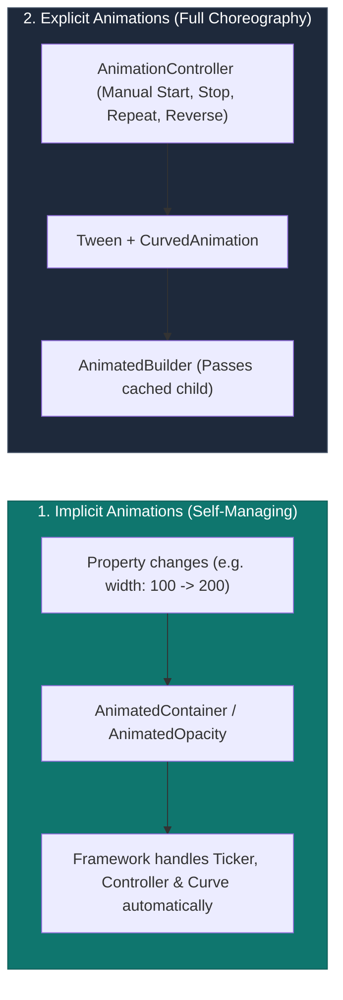

## 1. Animation Spectrum: Implicit vs. Explicit

Flutter divides animation architectures into two primary categories based on control requirements:



| Dimension | Implicit Animations | Explicit Animations |
| :--- | :--- | :--- |
| **Complexity** | Extremely Low (Drop-in replacement) | Medium to High |
| **Controller Required?** | ❌ No controller needed | ✅ `AnimationController` mandatory |
| **StatefulWidget Required?** | ❌ Works in `StatelessWidget` | ✅ Requires `TickerProviderStateMixin` |
| **Capabilities** | Animate forward to target value | Loop, reverse, repeat, stagger, scrub, pause |
| **Primary Widgets** | `AnimatedContainer`, `AnimatedOpacity`, `AnimatedPadding` | `AnimatedBuilder`, `SlideTransition`, `ScaleTransition` |

---

## 2. Implicit Animations in Action

Whenever a property changes on an implicit animation widget, Flutter smoothly interpolates between the previous value and the new value over the specified `duration`:

```dart
class ExpandableCard extends StatefulWidget {
  const ExpandableCard({super.key});
  @override
  State<ExpandableCard> createState() => _ExpandableCardState();
}

class _ExpandableCardState extends State<ExpandableCard> {
  bool _isExpanded = false;

  @override
  Widget build(BuildContext context) {
    return GestureDetector(
      onTap: () => setState(() => _isExpanded = !_isExpanded),
      child: AnimatedContainer(
        duration: const Duration(milliseconds: 350),
        curve: Curves.easeInOutCubic,
        width: _isExpanded ? 320.0 : 160.0,
        height: _isExpanded ? 200.0 : 80.0,
        decoration: BoxDecoration(
          color: _isExpanded ? Colors.indigo : Colors.blueGrey,
          borderRadius: BorderRadius.circular(_isExpanded ? 24.0 : 12.0),
          boxShadow: [
            BoxShadow(
              color: Colors.black.withOpacity(_isExpanded ? 0.3 : 0.1),
              blurRadius: _isExpanded ? 16.0 : 4.0,
            ),
          ],
        ),
        alignment: Alignment.center,
        child: AnimatedOpacity(
          duration: const Duration(milliseconds: 200),
          opacity: _isExpanded ? 1.0 : 0.7,
          child: Text(
            _isExpanded ? "Expanded Details" : "Tap to Expand",
            style: const TextStyle(color: Colors.white, fontWeight: FontWeight.bold),
          ),
        ),
      ),
    );
  }
}
```

---

## 3. Custom One-Off Implicit Transitions: `TweenAnimationBuilder`

When you need an implicit animation for a custom property without writing a full `StatefulWidget` or controller:

```dart
// Smoothly animate counting up a bank balance
TweenAnimationBuilder<double>(
  tween: Tween<double>(begin: 0.0, end: 1250.75),
  duration: const Duration(seconds: 2),
  curve: Curves.easeOutExpo,
  builder: (BuildContext context, double value, Widget? child) {
    return Text(
      "\$${value.toStringAsFixed(2)}",
      style: Theme.of(context).textTheme.displaySmall,
    );
  },
)
```

---

## 4. Explicit Animations: `AnimationController` & `AnimatedBuilder`

When building choreographies, loops, or complex transformations, explicit animations provide complete control.

```dart
class PulseSpinner extends StatefulWidget {
  const PulseSpinner({super.key});
  @override
  State<PulseSpinner> createState() => _PulseSpinnerState();
}

class _PulseSpinnerState extends State<PulseSpinner>
    with SingleTickerProviderStateMixin {
  late final AnimationController _controller;
  late final Animation<double> _scaleAnimation;
  late final Animation<double> _rotationAnimation;

  @override
  void initState() {
    super.initState();
    // 1. Initialize AnimationController tied to device VSYNC
    _controller = AnimationController(
      vsync: this,
      duration: const Duration(seconds: 2),
    )..repeat(reverse: true); // Loops forward and reverse continuously

    // 2. Define non-linear curves and output ranges
    _scaleAnimation = Tween<double>(begin: 0.8, end: 1.2).animate(
      CurvedAnimation(parent: _controller, curve: Curves.easeInOut),
    );

    _rotationAnimation = Tween<double>(begin: 0.0, end: 2 * 3.14159).animate(
      CurvedAnimation(parent: _controller, curve: Curves.linear),
    );
  }

  @override
  void dispose() {
    _controller.dispose(); // Mandatory cleanup
    super.dispose();
  }

  @override
  Widget build(BuildContext context) {
    // ⚡ PERFORMANCE CRITICAL: AnimatedBuilder passes the static child
    // The FlutterLogo child is instantiated ONCE and cached across 60/120 FPS frame ticks!
    return AnimatedBuilder(
      animation: _controller,
      child: const FlutterLogo(size: 80), // Cached node!
      builder: (BuildContext context, Widget? cachedChild) {
        return Transform.scale(
          scale: _scaleAnimation.value,
          child: Transform.rotate(
            angle: _rotationAnimation.value,
            child: cachedChild, // Reused without calling child's build()!
          ),
        );
      },
    );
  }
}
```

---

## ❓ Knowledge Check

<Quiz question="Why is the child parameter in AnimatedBuilder critical for rendering performance during high-speed animations?" options={["It bypasses the VSYNC hardware clock", "It allows expensive subtrees to be instantiated once and cached, ensuring that during 60/120 FPS animation ticks, only the lightweight Transform/Builder node rebuilds rather than the entire child widget subtree", "It automatically saves the animation as an MP4 video", "It allows animations to run inside background Isolates"]} answerIndex={1}>
Passing a pre-built widget to the `child` parameter of `AnimatedBuilder` **caches the child subtree**. When the `AnimationController` ticks every 8.3ms/16.6ms, Flutter only executes the small `builder` transformation function, avoiding re-executing `build()` on the child.
</Quiz>

<Quiz question="What is the role of SingleTickerProviderStateMixin when creating an AnimationController?" options={["It compiles animations to native OpenGL shaders", "It provides a Ticker that binds the animation to the device's physical VSYNC refresh signal, preventing off-screen animations from wasting CPU/GPU cycles", "It allows the animation to respond to touch gestures", "It encrypts the animation keyframes"]} answerIndex={1}>
`TickerProviderStateMixin` provides a **Ticker** synchronized with the display's hardware **VSYNC** refresh rate. It ensures that the controller ticks only when a new frame is about to be drawn, and automatically pauses ticking when the widget is hidden or off-screen.
</Quiz>
