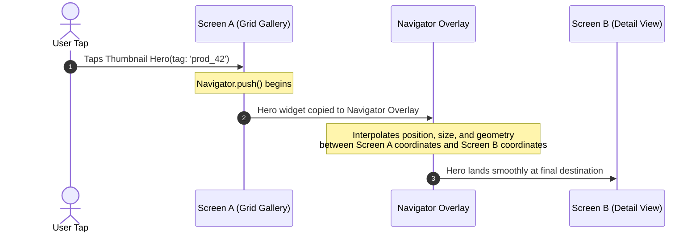

## 1. Physics-Based Motion Simulations

Unlike time-based animations that run on fixed durations, **physics simulations** calculate motion dynamically based on physical forces (mass, stiffness, damping, velocity):

```dart
import 'package:flutter/physics.dart';

void launchSpringAnimation(AnimationController controller) {
  // Define spring mechanics: mass, stiffness (k), damping ratio (zeta)
  const spring = SpringDescription(
    mass: 1.0,
    stiffness: 100.0,
    damping: 10.0,
  );

  // Create spring simulation moving from current value (0.0) to target (1.0) with initial velocity
  final simulation = SpringSimulation(spring, 0.0, 1.0, 0.5);

  // Run simulation directly on the controller
  controller.animateWith(simulation);
}
```

---

## 2. Shared Element Transitions: `Hero`

`Hero` animations create the visual illusion of a widget "flying" smoothly from one screen to another during route navigation:



```dart
// Screen A: Origin Thumbnail
class ProductThumbnail extends StatelessWidget {
  final Product product;
  const ProductThumbnail({required this.product, super.key});

  @override
  Widget build(BuildContext context) {
    return GestureDetector(
      onTap: () => Navigator.push(context, MaterialPageRoute(builder: (_) => ProductDetail(product: product))),
      child: Hero(
        tag: 'product_image_${product.id}', // ⚡ Identical unique tag!
        child: Image.network(product.imageUrl, width: 100, height: 100, fit: BoxFit.cover),
      ),
    );
  }
}

// Screen B: Destination Full Screen View
class ProductDetail extends StatelessWidget {
  final Product product;
  const ProductDetail({required this.product, super.key});

  @override
  Widget build(BuildContext context) {
    return Scaffold(
      appBar: AppBar(title: Text(product.title)),
      body: Hero(
        tag: 'product_image_${product.id}', // ⚡ Matches origin tag!
        child: Image.network(product.imageUrl, width: double.infinity, height: 350, fit: BoxFit.cover),
      ),
    );
  }
}
```

---

## 3. Low-Level 2D Graphics: `CustomPainter`

When existing widgets cannot achieve a desired custom visual effect (e.g. wave shapes, circular audio visualizers, charts), `CustomPainter` grants direct access to the Skia/Impeller **`Canvas`**.

```dart
class DonutChartPainter extends CustomPainter {
  final double progressPercent; // 0.0 to 1.0
  final Color trackColor;
  final Color progressColor;

  const DonutChartPainter({
    required this.progressPercent,
    this.trackColor = const Color(0xFFE2E8F0),
    this.progressColor = const Color(0xFF3B82F6),
  });

  @override
  void paint(Canvas canvas, Size size) {
    final center = Offset(size.width / 2, size.height / 2);
    final radius = (size.width / 2) - 10.0;
    final strokeWidth = 14.0;

    // 1. Draw Background Ring
    final trackPaint = Paint()
      ..color = trackColor
      ..style = PaintingStyle.stroke
      ..strokeWidth = strokeWidth;

    canvas.drawCircle(center, radius, trackPaint);

    // 2. Draw Active Progress Arc
    final progressPaint = Paint()
      ..color = progressColor
      ..style = PaintingStyle.stroke
      ..strokeCap = StrokeCap.round // Smooth rounded ends
      ..strokeWidth = strokeWidth;

    const startAngle = -3.14159 / 2; // Start from top (12 o'clock)
    final sweepAngle = 2 * 3.14159 * progressPercent;

    canvas.drawArc(
      Rect.fromCircle(center: center, radius: radius),
      startAngle,
      sweepAngle,
      false,
      progressPaint,
    );
  }

  // ⚡ CRITICAL: Avoid unnecessary repaints when inputs have not changed
  @override
  bool shouldRepaint(covariant DonutChartPainter oldDelegate) {
    return oldDelegate.progressPercent != progressPercent ||
        oldDelegate.progressColor != progressColor ||
        oldDelegate.trackColor != trackColor;
  }
}

// Widget integration:
class ProgressGauge extends StatelessWidget {
  final double progress;
  const ProgressGauge({required this.progress, super.key});

  @override
  Widget build(BuildContext context) {
    return CustomPaint(
      size: const Size(180, 180),
      painter: DonutChartPainter(progressPercent: progress),
      child: Center(
        child: Text("${(progress * 100).toInt()}%", style: const TextStyle(fontSize: 28, fontWeight: FontWeight.bold)),
      ),
    );
  }
}
```

---

## 4. `CustomPainter` Performance Best Practices

1. **Never Allocate Objects Inside `paint()`**:
   - The `paint()` method can execute 60–120 times per second during interactions. Allocating new `Paint()` or `Path()` objects inside `paint()` triggers high garbage collection pressure.
   - Cache reusable paint objects in the painter instance.
2. **Implement `shouldRepaint()` Diligently**:
   - Always compare fields between `oldDelegate` and `this`. Returning `true` unconditionally forces unnecessary CPU rasterization passes.
3. **Wrap in `RepaintBoundary`**:
   - Isolate custom canvas drawing into a dedicated GPU layer.

---

## ❓ Knowledge Check

<Quiz question="What is the significance of the tag property on a Hero widget?" options={["It determines the CSS class name when exported to Web", "It serves as the unique identifier that connects the origin Hero widget with the destination Hero widget across route transitions", "It sets the database primary key", "It controls the font weight"]} answerIndex={1}>
The **`tag`** must be a unique, matching identifier present on both the origin screen's `Hero` and the destination screen's `Hero`. The framework uses this tag to identify paired endpoints, copy the element to the `NavigatorOverlay`, and compute the flight interpolation path.
</Quiz>

<Quiz question="Why should you never allocate new Paint or Path objects directly inside the paint() method of a CustomPainter?" options={["Because Paint objects are not supported in Dart", "Because paint() is invoked on every single frame tick (up to 120 times per second), and allocating objects inside it creates massive memory churn, leading to frequent Garbage Collection pauses and UI jank", "Because Canvas only allows const values", "Because CustomPainter runs in WebAssembly"]} answerIndex={1}>
The `paint()` method is invoked on every single frame during animations. Allocating objects inside `paint()` causes high **Heap allocation churn**, forcing the Dart Garbage Collector to run frequently and interrupt the rendering pipeline, causing noticeable **frame drops (jank)**.
</Quiz>
