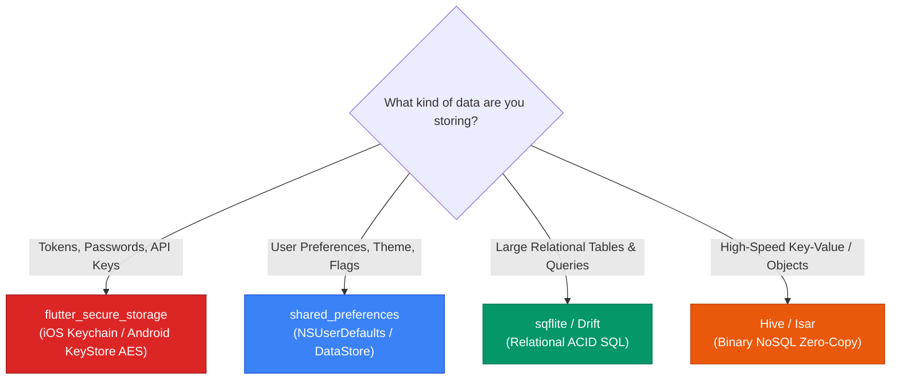

## 1. The Mobile Persistence Hierarchy

Choosing the appropriate on-device persistence technology depends on **data sensitivity, volume, and query complexity**:



---

## 2. `shared_preferences`: Lightweight App Preferences

`shared_preferences` wraps platform-native key-value stores: **`NSUserDefaults`** on iOS and **`SharedPreferences`** on Android.

### Internal Mechanics
* **In-Memory Caching**: On startup, `SharedPreferences.getInstance()` loads the entire key-value store into Dart memory. Subsequent reads (`getString()`, `getBool()`) execute synchronously in **$O(1)$ constant time** from RAM.
* **Asynchronous Disk Flushing**: Writes (`setString()`, `setBool()`) update memory immediately and asynchronously serialize the changes to disk.

```dart
import 'package:shared_preferences/shared_preferences.dart';

class SettingsPreferencesService {
  static const String _keyThemeMode = 'app_theme_mode';
  static const String _keyNotifications = 'push_notifications_enabled';

  // Save Settings
  Future<void> saveSettings({required String theme, required bool notifications}) async {
    final prefs = await SharedPreferences.getInstance();
    await prefs.setString(_keyThemeMode, theme);
    await prefs.setBool(_keyNotifications, notifications);
  }

  // Load Settings with Fallback Defaults
  Future<(String theme, bool notifications)> loadSettings() async {
    final prefs = await SharedPreferences.getInstance();
    final theme = prefs.getString(_keyThemeMode) ?? 'SYSTEM';
    final notifications = prefs.getBool(_keyNotifications) ?? true;
    return (theme, notifications);
  }

  // Clear on Logout
  Future<void> clearPreferences() async {
    final prefs = await SharedPreferences.getInstance();
    await prefs.remove(_keyThemeMode);
  }
}
```

> [!WARNING]
> **Never store sensitive data in `shared_preferences`!** 
> SharedPreferences writes data in **unencrypted plaintext** XML/plist files on the filesystem. Anyone with root/jailbreak access or backup extraction tools can read plain text passwords, credit card numbers, or session tokens.

---

## 3. Hardware-Encrypted Security: `flutter_secure_storage`

For security-sensitive information (JWT access tokens, refresh tokens, biometric keys, user credentials), use **`flutter_secure_storage`**:
* **iOS**: Stored in the encrypted **iOS Keychain** (`kSecClassGenericPassword`), protected by the Secure Enclave processor.
* **Android**: Encrypted with **AES-256 GCM** using keys generated in the **Android KeyStore** provider.

```dart
import 'package:flutter_secure_storage/flutter_secure_storage.dart';

class SecureVaultService {
  static const _storage = FlutterSecureStorage(
    aOptions: AndroidOptions(
      encryptedSharedPreferences: true, // Uses Android KeyStore AES-256 GCM
    ),
    iOptions: IOSOptions(
      accessibility: KeychainAccessibility.first_unlock, // Accessible only after first device unlock
    ),
  );

  static const String _jwtAccessTokenKey = 'auth_jwt_access_token';
  static const String _jwtRefreshTokenKey = 'auth_jwt_refresh_token';

  // Secure Write
  static Future<void> saveTokens({required String accessToken, required String refreshToken}) async {
    await _storage.write(key: _jwtAccessTokenKey, value: accessToken);
    await _storage.write(key: _jwtRefreshTokenKey, value: refreshToken);
  }

  // Secure Read
  static Future<String?> getAccessToken() async {
    return await _storage.read(key: _jwtAccessTokenKey);
  }

  // Secure Delete
  static Future<void> purgeTokens() async {
    await _storage.delete(key: _jwtAccessTokenKey);
    await _storage.delete(key: _jwtRefreshTokenKey);
  }
}
```

---

## 4. File System Navigation: `path_provider` & `dart:io`

When saving raw files, downloaded PDFs, or cached images, use **`path_provider`** to resolve standard OS sandbox directories:

```dart
import 'dart:io';
import 'package:path_provider/path_provider.dart';

class LocalFileStorage {
  // 1. Application Documents Directory (Persistent, backed up by iCloud / Google Backup)
  Future<File> saveUserReport(String reportName, String content) async {
    final Directory docDir = await getApplicationDocumentsDirectory();
    final File file = File('${docDir.path}/$reportName.txt');
    return await file.writeAsString(content);
  }

  // 2. Temporary / Cache Directory (Purged automatically by OS under memory pressure)
  Future<File> createTemporaryCacheFile(String filename, List<int> bytes) async {
    final Directory tempDir = await getTemporaryDirectory();
    final File tempFile = File('${tempDir.path}/$filename');
    return await tempFile.writeAsBytes(bytes);
  }
}
```

---

## ❓ Knowledge Check

<Quiz question="Why should user authentication tokens and passwords NEVER be saved in SharedPreferences?" options={["Because SharedPreferences only supports integer types", "Because SharedPreferences stores data as unencrypted plaintext on disk, making sensitive credentials vulnerable to extraction on rooted, jailbroken, or backed-up devices", "Because SharedPreferences is cleared whenever the app restarts", "Because SharedPreferences requires an active internet connection"]} answerIndex={1}>
`SharedPreferences` and `NSUserDefaults` write data in **unencrypted plaintext** directly to the app's filesystem sandboxes. Any tool with root/jailbreak access can inspect the XML/plist files directly. Sensitive tokens must be stored in hardware-backed encrypted vaults via **`flutter_secure_storage`**.
</Quiz>

<Quiz question="What happens when the operating system encounters low storage disk pressure regarding files saved in getTemporaryDirectory() vs getApplicationDocumentsDirectory()?" options={["Both directories are permanently encrypted", "Files in getTemporaryDirectory() can be purged automatically by the OS at any time to free space, whereas files in getApplicationDocumentsDirectory() are protected and persistent", "Files in the documents directory are uploaded to Google Drive", "The app is uninstalled"]} answerIndex={1}>
Files stored in the **Temporary / Cache directory** (`getTemporaryDirectory()`) are explicitly marked as disposable and may be purged by the OS without notice when disk space is constrained. Files in **Application Documents** (`getApplicationDocumentsDirectory()`) are permanent and backed up by OS cloud backup routines.
</Quiz>
