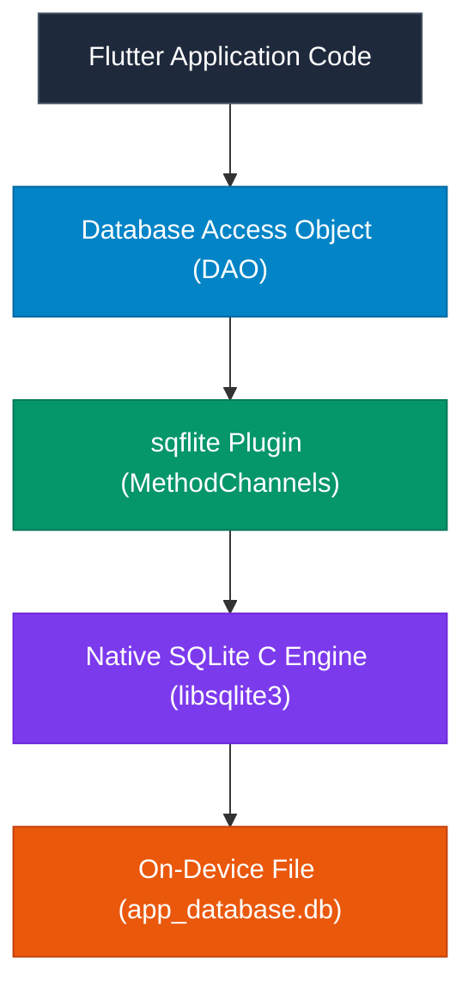

## 1. Relational vs. Embedded NoSQL Comparison

| Metric / Dimension | SQLite (`sqflite` / Drift) | Embedded NoSQL (`Hive` / Isar) |
| :--- | :--- | :--- |
| **Data Paradigm** | Structured Relational Tables (SQL) | Key-Value / Document Object Store |
| **Query Engine** | Complex `JOIN`, `GROUP BY`, Aggregate SQL | Index-based queries / Predicates |
| **ACID Compliance** | Full ACID (Atomicity, Consistency, Isolation, Durability) | Lightweight transaction support |
| **Serialization Overhead**| Relational Row Mapping (`Map<String, dynamic>`) | Zero-Copy Binary format |
| **Read Speed** | Very Fast (~1,000–5,000 ops/sec) | Blazing Fast (~50,000–100,000 ops/sec) |
| **Best For** | Complex multi-table enterprise data, foreign keys | Offline caching, rapid reads, document stores |

---

## 2. Relational Database Engineering with `sqflite`

`sqflite` connects Flutter directly to the embedded SQLite C library built into iOS and Android:



### Complete Database Manager with Migrations & CRUD

```dart
import 'package:sqflite/sqflite.dart';
import 'package:path/path.dart';

class LocalDatabaseManager {
  static const String _dbName = "production_commerce.db";
  static const int _dbVersion = 2; // Incremented schema version
  static Database? _database;

  Future<Database> get database async {
    if (_database != null) return _database!;
    _database = await _initDatabase();
    return _database!;
  }

  Future<Database> _initDatabase() async {
    final String dbPath = await getDatabasesPath();
    final String path = join(dbPath, _dbName);

    return await openDatabase(
      path,
      version: _dbVersion,
      onCreate: (Database db, int version) async {
        // Version 1 Schema
        await db.execute('''
          CREATE TABLE orders (
            id TEXT PRIMARY KEY,
            customer_email TEXT NOT NULL,
            total_amount REAL NOT NULL,
            status TEXT NOT NULL,
            created_at INTEGER NOT NULL
          )
        ''');
        await db.execute('CREATE INDEX idx_orders_status ON orders(status)');
      },
      onUpgrade: (Database db, int oldVersion, int newVersion) async {
        // Version 2 Schema Migration: Add discount column
        if (oldVersion < 2) {
          await db.execute('ALTER TABLE orders ADD COLUMN discount_amount REAL DEFAULT 0.0');
        }
      },
    );
  }

  // Parameterized Query (Prevents SQL Injection attacks!)
  Future<List<Map<String, dynamic>>> getOrdersByStatus(String status) async {
    final db = await database;
    return await db.query(
      'orders',
      where: 'status = ?',
      whereArgs: [status], // ⚡ Always use whereArgs to sanitize inputs!
      orderBy: 'created_at DESC',
      limit: 50,
    );
  }

  // ACID Transaction Example
  Future<void> executeBatchOrderCheckout(List<Map<String, dynamic>> orderItems) async {
    final db = await database;
    // Transactions automatically rollback on unhandled errors
    await db.transaction((txn) async {
      for (final item in orderItems) {
        await txn.insert(
          'orders',
          item,
          conflictAlgorithm: ConflictAlgorithm.replace,
        );
      }
    });
  }
}
```

---

## 3. High-Speed NoSQL with `Hive`

**Hive** is a lightweight, blazing-fast key-value/object database written in pure Dart with **zero native C++ dependencies**.

```dart
import 'package:hive_flutter/hive_flutter.dart';

// 1. Define Model and TypeAdapter
@HiveType(typeId: 0)
class CachedArticle extends HiveObject {
  @HiveField(0)
  late String id;

  @HiveField(1)
  late String title;

  @HiveField(2)
  late String content;
}

// 2. Initialize and Open Box
Future<void> setupHiveDatabase() async {
  await Hive.initFlutter();
  Hive.registerAdapter(CachedArticleAdapter()); // Generated TypeAdapter
  
  // Open named Box (analogous to a table/collection)
  final Box<CachedArticle> articleBox = await Hive.openBox<CachedArticle>('articles_cache');

  // Insert Object
  final article = CachedArticle()
    ..id = 'art_101'
    ..title = 'Flutter 3.x Deep Dive'
    ..content = 'Complete architectural analysis...';

  await articleBox.put(article.id, article);

  // Fast O(1) Read from Memory
  final CachedArticle? fetched = articleBox.get('art_101');
  print("Loaded: ${fetched?.title}");
}
```

---

## ❓ Knowledge Check

<Quiz question="Why should SQL queries in sqflite always use whereArgs (e.g., where: 'id = ?', whereArgs: [id]) rather than string interpolation (e.g., where: 'id = $id')?" options={["Because string interpolation makes the database run slower", "To prevent SQL Injection vulnerabilities and properly escape strings, special characters, and quotes", "Because SQLite only allows question marks in queries", "Because string interpolation uses more GPU memory"]} answerIndex={1}>
Passing parameters via **`whereArgs`** uses prepared statements where values are sanitized and bound separately by the SQLite engine, completely preventing **SQL Injection attacks** and syntax errors caused by unescaped quotation marks in user input.
</Quiz>

<Quiz question="What is the behavior of db.transaction((txn) async { ... }) in sqflite when an unhandled exception is thrown inside the callback block?" options={["The database file is deleted", "The transaction automatically rolls back all mutations executed during that block, leaving the database in its previous valid state", "The app is forced to restart", "The remaining operations are skipped but previous operations persist"]} answerIndex={1}>
In accordance with **ACID Atomicity**, if an exception is thrown inside a `db.transaction()` block, `sqflite` immediately issues a `ROLLBACK` command, discarding all uncommitted insertions, updates, and deletions performed during that transaction.
</Quiz>
