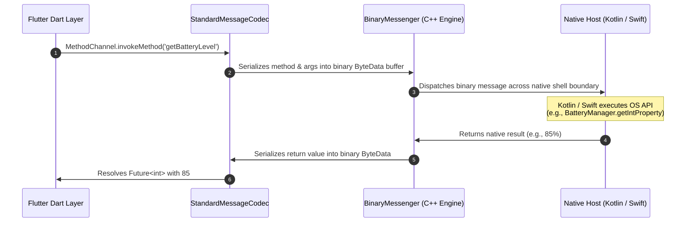

## 1. Platform Channels Architecture

When Flutter needs to access native hardware APIs (e.g. Battery Manager, Bluetooth, NFC, Camera, HealthKit), it communicates across the **Platform Channel** pipeline:



---

## 2. Standard Type Serialization Table

The `StandardMessageCodec` automatically translates standard data types across language boundaries without manual JSON encoding:

| Dart Type | Android (Kotlin / Java) | iOS (Swift / Objective-C) |
| :--- | :--- | :--- |
| `null` | `null` | `nil` (`NSNull`) |
| `bool` | `java.lang.Boolean` / `Boolean` | `NSNumber numberWithBool:` / `Bool` |
| `int` | `java.lang.Integer` (32-bit) / `Long` (64-bit)| `NSNumber numberWithInt:` / `Int` |
| `double` | `java.lang.Double` / `Double` | `NSNumber numberWithDouble:` / `Double` |
| `String` | `java.lang.String` / `String` | `NSString` / `String` |
| `Uint8List` | `byte[]` / `ByteArray` | `FlutterStandardTypedData` / `Data` |
| `List<dynamic>` | `java.util.ArrayList` / `List` | `NSArray` / `Array` |
| `Map<dynamic, dynamic>`| `java.util.HashMap` / `Map` | `NSDictionary` / `Dictionary` |

---

## 3. End-to-End MethodChannel Implementation

### 1. Dart Client Implementation
```dart
import 'package:flutter/services.dart';

class DeviceBatteryService {
  static const MethodChannel _channel = MethodChannel('com.example.app/battery');

  static Future<int> fetchBatteryLevel() async {
    try {
      final int? batteryLevel = await _channel.invokeMethod<int>('getBatteryLevel');
      return batteryLevel ?? -1;
    } on PlatformException catch (e) {
      print("⚠️ Platform error: ${e.code} - ${e.message}");
      return -1;
    }
  }
}
```

### 2. Android Kotlin Implementation (`MainActivity.kt`)
```kotlin
package com.example.app

import android.content.Context
import android.os.BatteryManager
import io.flutter.embedding.android.FlutterActivity
import io.flutter.embedding.engine.FlutterEngine
import io.flutter.plugin.common.MethodChannel

class MainActivity : FlutterActivity() {
    private val CHANNEL = "com.example.app/battery"

    override fun configureFlutterEngine(flutterEngine: FlutterEngine) {
        super.configureFlutterEngine(flutterEngine)

        MethodChannel(flutterEngine.dartExecutor.binaryMessenger, CHANNEL).setMethodCallHandler { call, result ->
            if (call.method == "getBatteryLevel") {
                val batteryManager = getSystemService(Context.BATTERY_SERVICE) as BatteryManager
                val level = batteryManager.getIntProperty(BatteryManager.BATTERY_PROPERTY_CAPACITY)

                if (level != -1) {
                    result.success(level) // Return integer to Dart
                } else {
                    result.error("UNAVAILABLE", "Battery level not available.", null)
                }
            } else {
                result.notImplemented()
            }
        }
    }
}
```

### 3. iOS Swift Implementation (`AppDelegate.swift`)
```swift
import Flutter
import UIKit

@main
@objc class AppDelegate: FlutterAppDelegate {
  override func application(
    _ application: UIApplication,
    didFinishLaunchingWithOptions launchOptions: [UIApplication.LaunchOptionsKey: Any]?
  ) -> Bool {
    let controller : FlutterViewController = window?.rootViewController as! FlutterViewController
    let batteryChannel = FlutterMethodChannel(name: "com.example.app/battery",
                                              binaryMessenger: controller.binaryMessenger)

    batteryChannel.setMethodCallHandler({
      (call: FlutterMethodCall, result: @escaping FlutterResult) -> Void in
      guard call.method == "getBatteryLevel" else {
        result(FlutterMethodNotImplemented)
        return
      }
      
      UIDevice.current.isBatteryMonitoringEnabled = true
      let level = Int(UIDevice.current.batteryLevel * 100)
      if level >= 0 {
        result(level) // Return integer to Dart
      } else {
        result(FlutterError(code: "UNAVAILABLE", message: "Battery level unavailable", details: nil))
      }
    })

    GeneratedPluginRegistrant.register(with: self)
    return super.application(application, didFinishLaunchingWithOptions: launchOptions)
  }
}
```

---

## 4. Continuous Streaming: `EventChannel`

When the native OS pushes continuous sensor readings or location updates:

```dart
// Dart Side: Listen to native sensor stream
class AccelerometerService {
  static const EventChannel _eventChannel = EventChannel('com.example.app/accelerometer');

  static Stream<List<double>> get sensorStream {
    return _eventChannel.receiveBroadcastStream().map((dynamic event) {
      final List<dynamic> raw = event as List<dynamic>;
      return raw.map((e) => (e as num).toDouble()).toList();
    });
  }
}
```

---

## ❓ Knowledge Check

<Quiz question="What is the role of BinaryMessenger in Flutter's platform channel architecture?" options={["It compresses JPEG images before display", "It acts as the low-level asynchronous communication bridge that transfers raw binary byte buffers between Dart and the platform host (Kotlin/Swift)", "It compiles Dart code into ARM machine instructions", "It manages Firebase push notifications"]} answerIndex={1}>
**`BinaryMessenger`** is the lowest-level communication abstraction in the Flutter Engine. It transports raw binary byte buffers asynchronously between the Dart VM and the native platform shell. Higher-level abstractions (`MethodChannel`, `EventChannel`) encode and decode messages on top of `BinaryMessenger`.
</Quiz>

<Quiz question="What happens if a MethodChannel on the native side calls result.notImplemented()?" options={["The app immediately crashes with an OutOfMemoryError", "Flutter throws a MissingPluginException on the Dart side", "The device reboots into recovery mode", "Dart retries the method every 500ms"]} answerIndex={1}>
Calling `result.notImplemented()` on the native handler informs the Flutter Framework that no handler was registered for that method name, causing Dart to throw a **`MissingPluginException`**.
</Quiz>
