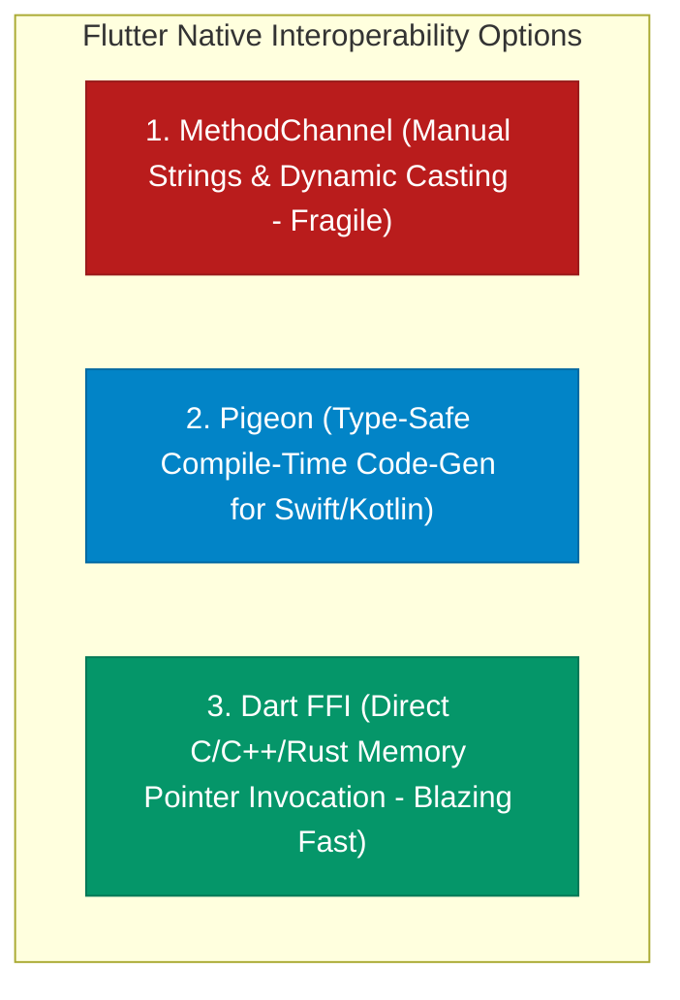
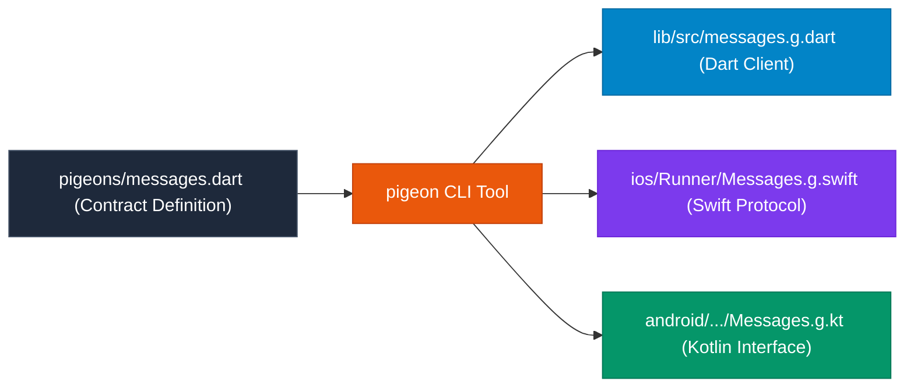

## 1. The Pitfalls of Manual MethodChannels

While basic `MethodChannel` calls work for simple tasks, enterprise codebases encounter significant fragility:
1. **Stringly-Typed Method Names**: Typos in method strings fail at runtime with `MissingPluginException`.
2. **Untyped Argument Dictionaries**: Extracting parameters requires fragile dynamic casting (`args['userId'] as String`).
3. **Serialization Latency**: Marshaling complex nested structures across `StandardMessageCodec` incurs CPU serialization overhead.

Two modern alternatives solve these limitations: **Pigeon** and **Dart FFI**.



---

## 2. Type-Safe Interop with Pigeon

**Pigeon** is a code-generation tool that consumes an interface contract written in Dart and generates **100% type-safe binding code** for Dart, Kotlin, Swift, and C++.



### 1. Define Pigeon Contract (`pigeons/crypto_api.dart`)
```dart
import 'package:pigeon/pigeon.dart';

class EncryptedPayload {
  String? cipherText;
  String? algorithm;
}

@HostApi()
abstract class NativeCryptoApi {
  EncryptedPayload encryptString(String plainText, String keyAlias);
  bool verifyBiometricSignature(String payload);
}
```

### 2. Generated Swift Protocol (`Messages.g.swift`)
```swift
// Swift implementation generated by Pigeon:
class CryptoApiImplementation: NativeCryptoApi {
  func encryptString(plainText: String, keyAlias: String) throws -> EncryptedPayload {
    // Concrete native Swift crypto implementation with full type safety!
    return EncryptedPayload(cipherText: "...", algorithm: "AES256")
  }

  func verifyBiometricSignature(payload: String) throws -> Bool {
    return true
  }
}
```

### 3. Type-Safe Invocation in Dart
```dart
final NativeCryptoApi api = NativeCryptoApi();
// ⚡ Zero dynamic casting! 100% type-safe at compile time!
final EncryptedPayload payload = await api.encryptString("Secret Data", "master_key");
print("Encrypted: ${payload.cipherText}");
```

---

## 3. High-Performance C/C++/Rust Interop: `dart:ffi`

When integrating existing C/C++ audio engines (e.g. SQLite, OpenCV, TensorFlow Lite, game physics) or Rust libraries, **`dart:ffi` (Foreign Function Interface)** provides direct native pointer access with **zero serialization overhead**.

```dart
import 'dart:ffi' as ffi;
import 'dart:io';
import 'package:ffi/ffi.dart';

// 1. C Function Signature: int32_t calculate_hash(const char* input);
typedef NativeHashFunc = ffi.Int32 Function(ffi.Pointer<Utf8> input);
typedef DartHashFunc = int Function(ffi.Pointer<Utf8> input);

class NativeHasher {
  late final DartHashFunc _calculateHash;

  NativeHasher() {
    // 2. Open dynamic shared library (.so on Android, .dylib on macOS, framework on iOS)
    final ffi.DynamicLibrary lib = Platform.isAndroid
        ? ffi.DynamicLibrary.open("libnative_crypto.so")
        : ffi.DynamicLibrary.process();

    // 3. Lookup and bind C function symbol
    _calculateHash = lib
        .lookup<ffi.NativeFunction<NativeHashFunc>>('calculate_hash')
        .asFunction<DartHashFunc>();
  }

  int computeHash(String message) {
    // 4. Allocate C memory buffer using calloc/malloc
    final ffi.Pointer<Utf8> nativeString = message.toNativeUtf8();
    try {
      // 5. Execute native C machine instructions directly
      return _calculateHash(nativeString);
    } finally {
      // 6. MANDATORY: Free allocated native C memory to prevent memory leaks!
      calloc.free(nativeString);
    }
  }
}
```

---

## 4. Native Interoperability Comparison Matrix

| Feature Dimension | MethodChannel | Pigeon | Dart FFI |
| :--- | :--- | :--- | :--- |
| **Primary Target** | Ad-hoc platform calls | Structured mobile platform APIs | High-performance C / C++ / Rust code |
| **Type Safety** | ❌ Dynamic casting | ✅ 100% Compile-Time Safe | ✅ Static C-type Bindings |
| **Serialization Latency** | Moderate (MessageCodec) | Moderate (Optimized Codec) | **Zero (Direct Memory Pointers)** |
| **Synchronous Calls?** | ❌ Asynchronous only | ❌ Asynchronous only | ✅ **Synchronous & Asynchronous** |
| **Thread Context** | Platform UI Main Thread | Platform UI Main Thread | Same Thread or Worker Isolates |

---

## ❓ Knowledge Check

<Quiz question="What is the primary advantage of using Pigeon over manual MethodChannels?" options={["Pigeon compiles Dart code directly to x86 assembly", "Pigeon generates type-safe Dart, Kotlin, and Swift interfaces from a single contract, catching API signature mismatches at compile time instead of failing at runtime", "Pigeon removes the need for Xcode and Android Studio", "Pigeon encrypts all app traffic with TLS 1.3"]} answerIndex={1}>
**Pigeon** generates strongly-typed wrapper classes for Dart, Swift/Obj-C, and Kotlin/Java from a single unified contract file. This completely eliminates manual string method matching and error-prone `Map<String, dynamic>` casting, catching API bugs at compile time.
</Quiz>

<Quiz question="Why must you explicitly call calloc.free(pointer) when allocating memory via dart:ffi (e.g. string.toNativeUtf8())?" options={["Because the GPU requires free memory blocks", "Because native memory allocated outside the Dart VM heap is NOT managed by Dart's automated Garbage Collector and will cause permanent native memory leaks if not freed manually", "Because Flutter crashes if pointers are held for more than 5 seconds", "Because Android requires memory to be released before sleep mode"]} answerIndex={1}>
Memory allocated via `calloc` or `malloc` in `dart:ffi` is allocated on the **system heap outside the Dart VM**. Because the Dart Garbage Collector cannot track or manage native memory allocations, failing to call `calloc.free()` will result in **irreversible native memory leaks**.
</Quiz>
