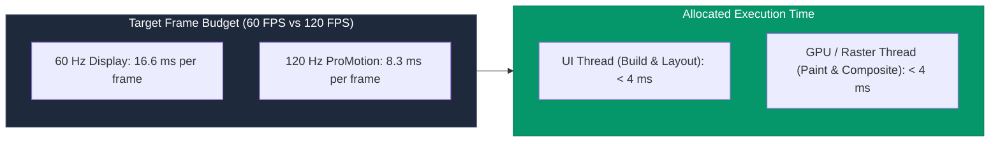
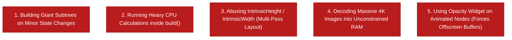

## 1. The 16.6ms & 8.3ms Frame Budget

To maintain fluid 60 FPS or 120 FPS display rates, the Flutter rendering pipeline must execute all phases within a fixed hardware window:



**Jank** occurs when either the UI Thread or the Raster/GPU Thread takes longer than the allotted budget, causing the operating system to miss the VSYNC deadline and drop the frame.

---

## 2. The 5 Cardinal Sins of Flutter Performance



---

## 3. High-Impact Optimization Strategies

### 1. Granular Subtree Rebuilding
Never call `setState()` at the root of a massive screen when only a single counter or icon needs updating:

```dart
// ❌ BAD: Rebuilds the entire screen, including heavy charts and lists
void _toggleFavorite() {
  setState(() { // ⚠️ Calls build() on entire 500-line screen!
    _isFavorited = !_isFavorited;
  });
}

// ✅ GOOD: Scope the rebuild strictly to a micro-widget using ValueNotifier
class FavoriteButton extends StatelessWidget {
  final ValueNotifier<bool> isFavorited;
  const FavoriteButton({required this.isFavorited, super.key});

  @override
  Widget build(BuildContext context) {
    return ValueListenableBuilder<bool>(
      valueListenable: isFavorited,
      builder: (context, favorited, _) => IconButton(
        icon: Icon(favorited ? Icons.favorite : Icons.favorite_border),
        onPressed: () => isFavorited.value = !isFavorited.value,
      ),
    );
  }
}
```

### 2. Image Memory Optimization with `cacheWidth` & `cacheHeight`
Decoding a 4000x3000 pixel camera image directly into memory consumes ~48 MB of uncompressed bitmap RAM ($4000 \times 3000 \times 4\text{ bytes}$). Downsample images at decode time:

```dart
// ❌ BAD: Decodes 48MB raw bitmap into memory for a 50x50 avatar!
Image.network(user.highResAvatarUrl, width: 50, height: 50);

// ✅ GOOD: Decodes only 50x50 pixels into RAM (~10 KB memory footprint!)
Image.network(
  user.highResAvatarUrl,
  width: 50,
  height: 50,
  cacheWidth: 100, // Account for 2x device pixel ratio
  cacheHeight: 100,
);
```

### 3. Avoid `Opacity` Widget on Animated Nodes
The `Opacity` widget forces Flutter to allocate an expensive **offscreen rendering buffer** to composite the transparency:

```dart
// ❌ EXPENSIVE: Creates offscreen GPU composite layer on every frame!
Opacity(
  opacity: 0.5,
  child: Container(color: Colors.blue),
)

// ✅ FAST: Draws semi-transparent color directly onto main canvas!
Container(
  color: Colors.blue.withValues(alpha: 0.5),
)
```

---

## 4. Beware of `IntrinsicHeight` & `IntrinsicWidth`

Flutter's layout is $O(N)$ single-pass by default. Using `IntrinsicHeight` forces Flutter to run a **speculative measurement pre-pass** on all children before the actual layout pass, creating potential $O(N^2)$ exponential layout costs in nested trees.

| Widget Pattern | Layout Complexity | Recommendation |
| :--- | :---: | :--- |
| Standard `Row` / `Column` / `Flex` | **$O(N)$ (Linear Single-Pass)** | Default choice. |
| `ListView.builder` with `itemExtent` | **$O(1)$ Arithmetic** | Optimal for long lists. |
| `IntrinsicHeight` / `IntrinsicWidth` | **$O(N^2)$ (Multi-Pass Speculative)** | Use only on isolated, small leaf rows (e.g. vertical dividers). |

---

## ❓ Knowledge Check

<Quiz question="Why does decoding a large 4K image without cacheWidth/cacheHeight cause high memory pressure in Flutter?" options={["Because Flutter converts all images into SVG vector XML", "Because image files are uncompressed in RAM as raw RGBA bitmaps (width × height × 4 bytes), consuming tens of megabytes of heap memory regardless of the widget's displayed layout size on screen", "Because image network calls block the Dart VM garbage collector", "Because Flutter only supports WebP format"]} answerIndex={1}>
Regardless of whether an image is displayed at 50x50 on screen, without `cacheWidth` or `cacheHeight`, the image decoding engine decompresses the full original resolution into an uncompressed **raw RGBA bitmap buffer** in memory, quickly exhausting device RAM.
</Quiz>

<Quiz question="What is the performance consequence of using the Opacity widget inside an active 60 FPS animation loop?" options={["It speeds up GPU rendering by 20%", "It forces the GPU to allocate a separate offscreen rendering buffer on every frame to composite the transparency, creating severe GPU raster thread overhead", "It converts the widget into a StatelessWidget", "It prevents touch events from reaching children"]} answerIndex={1}>
The `Opacity` widget requires an **offscreen rendering pass** to composite its subtree before blending it into the main scene. During continuous animations, allocating and rendering offscreen buffers on every frame creates heavy GPU overhead and dropped frames.
</Quiz>
