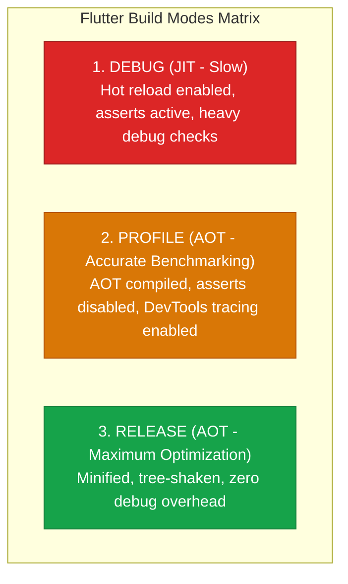
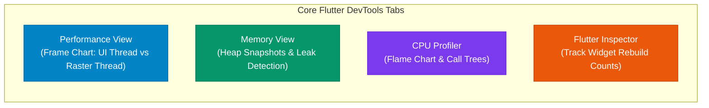
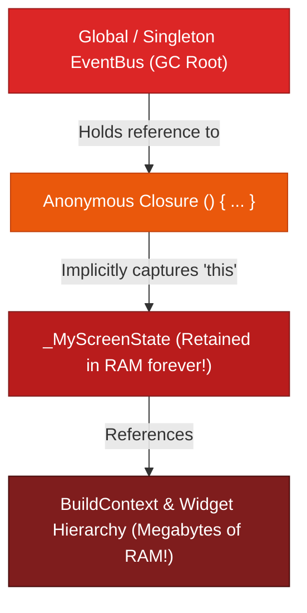

## 1. Flutter Build Modes: Debug vs. Profile vs. Release

Never evaluate frame rates, startup speed, or memory usage in **Debug mode**!



| Dimension | Debug Mode | Profile Mode | Release Mode |
| :--- | :--- | :--- | :--- |
| **Compilation** | Just-In-Time (JIT) via Dart VM | Ahead-Of-Time (AOT) to Machine Code | Ahead-Of-Time (AOT) to Machine Code |
| **Hot Reload & Restart** | ✅ Enabled | ❌ Disabled | ❌ Disabled |
| **Assert Statements** | ✅ Executed | ❌ Stripped out | ❌ Stripped out |
| **DevTools Tracing** | ✅ Basic | ✅ Full Tracing & CPU Sampling | ❌ Disabled |
| **Performance Fidelity** | ❌ Highly distorted / unoptimized | ✅ **Identical to Production** | ✅ Maximum Real-World Speed |
| **CLI Command** | `flutter run` | `flutter run --profile` | `flutter run --release` |

---

## 2. Profiling with Flutter DevTools

Launch DevTools during a profile run via `flutter run --profile` or through your IDE:



### Decoding the Frame Chart

The DevTools Performance view displays vertical bars for every frame rendered:
* **Blue Bar (UI Thread Time)**: Time spent executing Dart code, `build()` methods, layout measurements, and painting display lists.
* **Orange Bar (Raster / GPU Thread Time)**: Time spent in C++ / Impeller converting display lists into GPU commands.
* **Red Overlays**: Identifies frames that exceeded the 16.6ms frame budget (dropped frames).

---

## 3. Detecting & Eliminating Memory Leaks

A **memory leak** occurs when an object that is no longer needed by the user is still referenced by an active GC root (e.g., a static variable, long-lived global singleton, or un-canceled stream subscription), preventing the Dart Garbage Collector from reclaiming its RAM.



### The Top 3 Memory Leak Culprits & Fixes

```dart
// 1. CULPRIT: Un-canceled Stream Subscription
// ❌ LEAK: Global stream retains reference to state even after navigating away!
class LeakyScreenState extends State<LeakyScreen> {
  @override
  void initState() {
    super.initState();
    GlobalEventBus.stream.listen((event) {
      setState(() {}); // Captures 'this' in closure!
    });
  }
}

// ✅ FIX: Store subscription and cancel in dispose()
class SafeScreenState extends State<SafeScreen> {
  StreamSubscription<dynamic>? _subscription;

  @override
  void initState() {
    super.initState();
    _subscription = GlobalEventBus.stream.listen((event) {
      if (mounted) setState(() {});
    });
  }

  @override
  void dispose() {
    _subscription?.cancel(); // ✅ Unlinks closure from GC Root!
    super.dispose();
  }
}
```

```dart
// 2. CULPRIT: Un-disposed Animation / Text / Scroll Controllers
// ❌ LEAK: Tickers and OS text listeners remain registered in framework bindings
class LeakyFormState extends State<LeakyForm> {
  final TextEditingController _nameController = TextEditingController();
  // Missing dispose()!
}

// ✅ FIX: Always dispose all controllers
class SafeFormState extends State<SafeForm> {
  final TextEditingController _nameController = TextEditingController();

  @override
  void dispose() {
    _nameController.dispose(); // ✅ Disposes internal ValueNotifier
    super.dispose();
  }
}
```

---

## ❓ Knowledge Check

<Quiz question="Why must performance profiling and frame rate analysis always be conducted in Profile Mode (--profile) rather than Debug Mode?" options={["Debug mode disables the GPU completely", "Debug mode runs unoptimized JIT compilation, enables assertions, and runs extensive runtime safety checks that artificially degrade performance, whereas Profile mode runs AOT-compiled machine code matching production speed", "Profile mode is required to upload the app to Google Play", "Debug mode only runs on web browsers"]} answerIndex={1}>
**Debug mode** prioritizes developer productivity features like Hot Reload by using the Just-In-Time (JIT) Dart VM and executing heavy runtime assertions. **Profile mode** compiles to Ahead-Of-Time (AOT) machine code with optimizations identical to Release mode while maintaining DevTools tracing connections.
</Quiz>

<Quiz question="How does an un-canceled stream subscription on a global singleton cause a memory leak when navigating away from a screen?" options={["It deletes the app's cache directory", "The anonymous closure passed to listen() implicitly captures a reference to the State instance ('this'), preventing the Dart Garbage Collector from reclaiming the State, its BuildContext, and the entire widget tree", "It disables the device's battery saver mode", "It restarts the Flutter engine"]} answerIndex={1}>
When a closure references instance members (or calls `setState()`), it **implicitly captures a reference to the `State` object**. Because the global singleton holds the closure, a live path exists from a Garbage Collection Root to the `State` instance, retaining the entire screen and its widget tree in memory indefinitely.
</Quiz>
