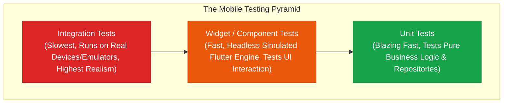
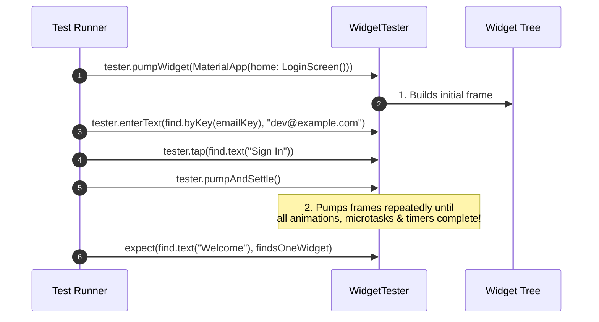

## 1. The Flutter Testing Pyramid



| Test Type | Execution Environment | Speed | Primary Objective |
| :--- | :--- | :--- | :--- |
| **Unit Test** | Standard Dart VM (Headless) | Milliseconds | Validate algorithms, state notifiers, DTO parsing, math logic. |
| **Widget Test** | Simulated Flutter Test Environment | Tens of milliseconds | Validate UI rendering, button taps, form inputs, visibility transitions. |
| **Integration Test** | Physical Device / Android Emulator / iOS Simulator | Seconds / Minutes | Verify end-to-end user journeys, database commits, network flows. |

---

## 2. Unit Testing with `mocktail`

Unit tests verify business logic in total isolation from UI and network dependencies:

```dart
import 'package:flutter_test/flutter_test.dart';
import 'package:mocktail/mocktail.dart';

// 1. Contract & Mock Definition
abstract class OrderRepository {
  Future<bool> submitOrder(String orderId, double amount);
}

class MockOrderRepository extends Mock implements OrderRepository {}

// 2. Unit Test Suite
void main() {
  late MockOrderRepository mockRepo;
  late OrderCheckoutNotifier checkoutNotifier;

  setUp(() {
    mockRepo = MockOrderRepository();
    checkoutNotifier = OrderCheckoutNotifier(repository: mockRepo);
  });

  test('checkout sets state to success when repository returns true', () async {
    // Arrange: Stub mock repository behavior
    when(() => mockRepo.submitOrder(any(), any())).thenAnswer((_) async => true);

    // Act: Invoke business logic
    await checkoutNotifier.processPayment('ORD_99', 150.0);

    // Assert: Verify state transitions and method calls
    expect(checkoutNotifier.isSuccess, isTrue);
    verify(() => mockRepo.submitOrder('ORD_99', 150.0)).called(1);
  });
}
```

---

## 3. Widget Testing: `WidgetTester` Mechanics

Widget tests render isolated UI components in a headless simulated environment without booting an actual mobile simulator:



### Complete Widget Test Example

```dart
import 'package:flutter/material.dart';
import 'package:flutter_test/flutter_test.dart';

void main() {
  testWidgets('Counter button increments counter text', (WidgetTester tester) async {
    // 1. Inflate the widget tree
    await tester.pumpWidget(
      const MaterialApp(
        home: CounterScreen(),
      ),
    );

    // 2. Verify initial state (shows 0)
    expect(find.text('Count: 0'), findsOneWidget);
    expect(find.text('Count: 1'), findsNothing);

    // 3. Find button by Key and simulate user tap
    final incrementButtonFinder = find.byKey(const ValueKey('btn_increment'));
    await tester.tap(incrementButtonFinder);

    // 4. Trigger frame rebuild (pump)
    await tester.pump();

    // 5. Verify state updated to 1
    expect(find.text('Count: 1'), findsOneWidget);
    expect(find.text('Count: 0'), findsNothing);
  });
}
```

### `pump()` vs. `pumpAndSettle()`

| Method | Execution Behavior | Typical Usage |
| :--- | :--- | :--- |
| **`tester.pump()`** | Triggers a **single frame** rebuild (advances clock by 0ms or specified `Duration`). | Testing synchronous state updates, stepping through animations frame-by-frame. |
| **`tester.pumpAndSettle()`** | Repeatedly pumps frames until **no more frames are scheduled** (all animations finish). | Navigating between routes, waiting for Hero transitions or dialog animations to complete. |

---

## 4. End-to-End Integration Testing

Integration tests run on real devices using `package:integration_test`:

```dart
// integration_test/app_e2e_test.dart
import 'package:flutter_test/flutter_test.dart';
import 'package:integration_test/integration_test.dart';
import 'package:my_app/main.dart' as app;

void main() {
  IntegrationTestWidgetsFlutterBinding.ensureInitialized();

  testWidgets('Complete user checkout E2E journey', (WidgetTester tester) async {
    app.main(); // Boot real app
    await tester.pumpAndSettle();

    // Tap on first product
    await tester.tap(find.text('Sneakers'));
    await tester.pumpAndSettle();

    // Add to cart
    await tester.tap(find.text('Add to Cart'));
    await tester.pumpAndSettle();

    // Verify cart count updated
    expect(find.text('Cart (1)'), findsOneWidget);
  });
}
```

---

## ❓ Knowledge Check

<Quiz question="What is the difference between tester.pump() and tester.pumpAndSettle() in Flutter widget tests?" options={["pump() runs on Android, whereas pumpAndSettle() runs on iOS", "tester.pump() renders a single frame, whereas tester.pumpAndSettle() repeatedly renders frames until all active animations and microtasks have settled completely", "pump() is deprecated in modern Flutter", "pumpAndSettle() disables memory leak checks"]} answerIndex={1}>
`tester.pump()` triggers a **single frame draw**. In contrast, **`tester.pumpAndSettle()`** continuously simulates frames until no more work is scheduled on the event loop or animation ticker queue, ensuring multi-frame transitions (like route transitions or fade animations) are 100% complete.
</Quiz>

<Quiz question="Why do Widget tests execute significantly faster than full emulator Integration tests?" options={["Widget tests skip CSS compilation", "Widget tests execute on a simulated headless Flutter test engine on the local workstation CPU without booting the full operating system, GPU graphics driver, or mobile emulator", "Widget tests do not compile Dart code", "Widget tests mock all widgets automatically"]} answerIndex={1}>
**Widget tests** execute on the desktop machine's local Dart VM using a **lightweight, headless mock engine**. They do not spin up an Android emulator or iOS simulator, allowing dozens of UI interaction tests to run in seconds.
</Quiz>
