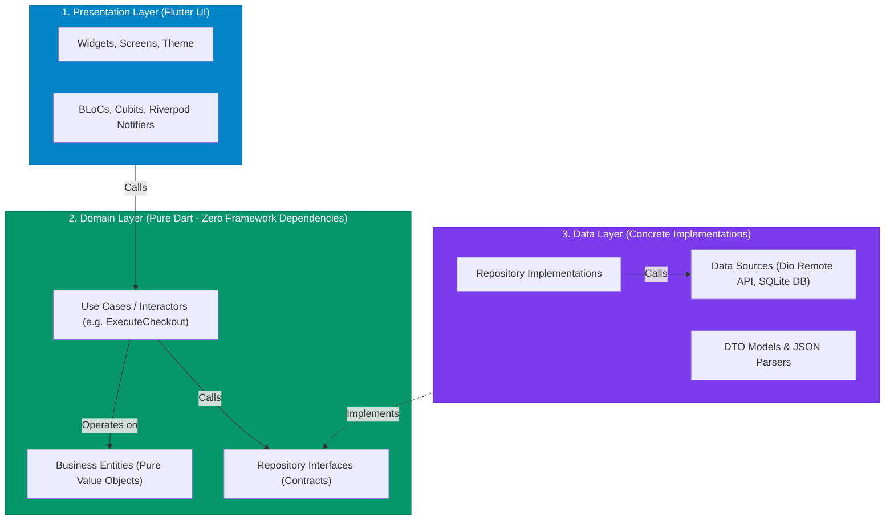
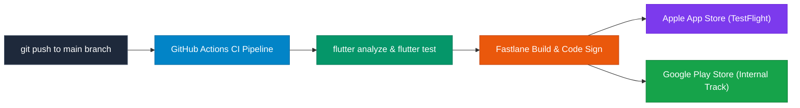

## 1. Feature-First Clean Architecture

Enterprise Flutter codebases maintain long-term maintainability by enforcing the **Dependency Inversion Principle**: business logic must never depend directly on UI widgets or external database packages.



---

## 2. Canonical Directory Structure: Feature-First

```text
lib/
├── app/
│   ├── app.dart
│   └── router.dart
├── core/
│   ├── constants/
│   ├── network/ (Dio client, Interceptors)
│   ├── theme/
│   └── utils/
└── features/
    └── authentication/
        ├── data/
        │   ├── datasources/
        │   │   ├── auth_remote_datasource.dart
        │   │   └── auth_local_secure_storage.dart
        │   ├── models/ (auth_dto.dart, auth_dto.g.dart)
        │   └── repositories/
        │       └── auth_repository_impl.dart
        ├── domain/
        │   ├── entities/ (user_entity.dart)
        │   ├── repositories/ (auth_repository.dart - Interface!)
        │   └── usecases/ (login_usecase.dart, logout_usecase.dart)
        └── presentation/
            ├── controllers/ (auth_notifier.dart / auth_bloc.dart)
            ├── screens/ (login_screen.dart, register_screen.dart)
            └── widgets/ (auth_text_field.dart, social_signin_button.dart)
```

---

## 3. Multi-Environment Flavor Configuration

Never hardcode development and production backend URLs directly into your codebase. Use **`--dart-define`** or **`--dart-define-from-file`** for compile-time environment injection:

```dart
// lib/core/config/app_environment.dart
enum AppFlavor { dev, staging, prod }

class AppEnvironment {
  static const AppFlavor flavor = AppFlavor.values.byName(
    String.fromEnvironment('FLAVOR', defaultValue: 'dev'),
  );

  static const String apiBaseUrl = String.fromEnvironment(
    'API_BASE_URL',
    defaultValue: 'https://dev-api.example.com/v1',
  );

  static const bool enableLogging = bool.fromEnvironment(
    'ENABLE_LOGGING',
    defaultValue: true,
  );
}
```

### CLI Build Commands
```bash
# Run Development Flavor
flutter run --dart-define=FLAVOR=dev --dart-define=API_BASE_URL=https://dev.api.com

# Build Production Release Bundle
flutter run --release --dart-define=FLAVOR=prod --dart-define=API_BASE_URL=https://api.example.com
```

---

## 4. Automated CI/CD Deployment with Fastlane & GitHub Actions

Automate linting, testing, and store deployment using **Fastlane**:



### Fastlane `Fastfile` Configuration
```ruby
# android/fastlane/Fastfile
default_platform(:android)

platform :android do
  desc "Deploy production App Bundle to Google Play Internal track"
  lane :deploy_internal do
    sh("flutter build appbundle --release --dart-define=FLAVOR=prod")
    upload_to_play_store(
      track: 'internal',
      aab: '../build/app/outputs/bundle/release/app-release.aab'
    )
  end
end
```

---

## ❓ Knowledge Check

<Quiz question="Why does the Domain Layer in Clean Architecture contain zero imports from package:flutter/material.dart?" options={["Because Material design is incompatible with Domain entities", "To keep core business logic and rules 100% platform-agnostic, decoupled from UI rendering frameworks, and easily testable using pure Dart VM unit tests", "Because the domain layer runs in Rust", "To decrease internet bandwidth"]} answerIndex={1}>
The **Domain Layer** contains enterprise business entities and use cases. By ensuring it imports **zero UI packages (`package:flutter`)**, business rules remain completely decoupled from UI rendering changes, platform migrations, or third-party packages, allowing instantaneous test execution on the pure Dart VM.
</Quiz>

<Quiz question="What is the advantage of using --dart-define over writing hardcoded environment variables in Dart files?" options={["It speeds up Wi-Fi download speed", "Environment variables injected via --dart-define are evaluated at compile time and tree-shaken, ensuring unused configuration values are not bundled into the binary and preventing sensitive keys from being checked into Git", "It removes the need for signing keys in Android", "It automatically generates unit tests"]} answerIndex={1}>
**`--dart-define`** injects configuration values at **compile time**. This prevents credentials from being hardcoded in Git repositories, enables dynamic builds for `dev`, `staging`, and `prod` from a single codebase, and allows the compiler to tree-shake code conditioned on compile-time booleans.
</Quiz>
