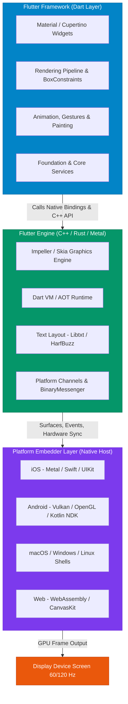

# Flutter Engineering Hub

Flutter is Google's open-source, multi-platform UI engineering toolkit designed to build natively compiled, visually consistent applications across **iOS, Android, Web, macOS, Windows, and Linux** from a single Dart codebase. Unlike traditional hybrid frameworks that bridge commands to native OS controls, Flutter ships with its own high-performance rendering engine (**Impeller / Skia**), drawing every button, animation, and pixel directly onto the GPU canvas at 60fps to 120fps.

* **Analogy**: *The Master Muralist with a Portable Canvas & Custom Paint Studio.*
  - **Native Development (Swift / Kotlin)**: Hiring local construction contractors in every city. Each follows local building codes (iOS UIKit / Android Views). They produce authentic local buildings, but you must draw blueprints and supervise two completely separate construction teams.
  - **React Native (Bridge Model)**: A traveling architect who gives English instructions to a local translator on site. The translator commands local native workers. It's fast, but communication lags across the translator's bridge during heavy traffic.
  - **Flutter (Direct Canvas Rendering)**: A master painter who travels to every city carrying their own studio canvas, custom brushes, and standardized acrylic paints. The painter paints the entire canvas directly with sub-millimeter precision. The finished masterpiece looks 100% identical whether displayed in Tokyo, New York, or Paris.

---

## 🗺️ Flutter Digital Textbook Modules & Navigation Roadmap

Explore our 13 structured, analogy-driven Flutter modules below. Organized like a comprehensive digital textbook, each module dives deep into architectural mechanics, lifecycle pipelines, memory layouts, state paradigms, networking, and production optimization.

| Module | Core Topics | Key Focus & Engineering Concepts | Read Time |
| :--- | :--- | :--- | :--- |
| **[1. Architecture & Rendering](./01-architecture-and-rendering-pipeline/01-flutter-engine-and-three-tree-architecture)** | Three Layers, Impeller vs Skia, Three Trees (Widget, Element, RenderObject) | Layer decoupling, Widget inflation, Element reconciliation, 4-stage pipeline (Build, Layout, Paint, Composite) | ~20 mins |
| **[2. Dart Deep Dive & Runtime](./02-dart-deep-dive-and-runtime/01-dart-type-system-and-sound-null-safety)** | Sound Null Safety, Flow Analysis, Mixins, Dart 3 Records & Sealed Classes | Null operators (`?`, `!`, `??`, `?.`), constructor tear-offs, pattern matching, type promotion | ~25 mins |
| **[3. Widgets & Lifecycle](./03-widgets-and-lifecycle-mechanics/01-stateless-vs-stateful-and-buildcontext)** | `StatelessWidget`, `StatefulWidget`, `BuildContext`, 7-Stage State Lifecycle | Immutable widgets vs mutable state, Element tree handles, `initState`/`dispose`, AppLifecycle | ~20 mins |
| **[4. Layout Engine & BoxConstraints](./04-layout-engine-and-box-constraints/01-constraints-go-down-sizes-go-up)** | BoxConstraints Protocol, Tight vs Loose vs Unbounded, Flex, Slivers | "Constraints go down, sizes go up, parent positions child", viewport virtualization, CustomScrollView | ~25 mins |
| **[5. State Management Architecture](./05-state-management-architecture/01-inheritedwidget-and-changenotifier)** | `InheritedWidget`, `ChangeNotifier`, Provider, Riverpod 2.x, BLoC / Cubit | Low-level $O(1)$ context lookups, reactive dependency trees, unidirectional event streams | ~30 mins |
| **[6. Navigation & Routing Systems](./06-navigation-and-routing-systems/01-navigator-1-imperative-stack)** | Navigator 1.0 Stack, Navigator 2.0 RouterDelegate, GoRouter, Deep Linking | Push/pop stack mechanics, declarative URL routing, auth guards, sub-routes, StatefulShellRoute | ~25 mins |
| **[7. Asynchronous Dart & Reactive UI](./07-asynchronous-dart-and-reactive-ui/01-event-loop-microtasks-and-isolates)** | Event Loop, Microtask Queue, Background Isolates, `FutureBuilder`, Streams | Single-threaded event dispatching, `compute()` threads, two-way `SendPort` messaging, rebuild prevention | ~25 mins |
| **[8. Networking & Serialization](./08-networking-rest-and-serialization/01-http-client-dio-and-interceptors)** | HTTP Client, Dio, Request Interceptors, Token Refresh, Freezed & JSON | Connection pooling, interceptor chains, automated code-gen, immutable data transfer objects | ~25 mins |
| **[9. Animations & Motion Graphics](./09-animations-and-motion-graphics/01-implicit-vs-explicit-animations)** | Implicit Animations, `AnimationController`, Tweens, Hero Flights, CustomPainter | VSYNC tick synchronization, CurvedAnimation, shared element transitions, low-level canvas painting | ~25 mins |
| **[10. Local Storage & Persistence](./10-local-storage-and-persistence/01-key-value-and-secure-storage)** | SharedPreferences, Keychain/Keystore Secure Storage, SQLite (sqflite), Hive | Memory vs disk caching, AES hardware encryption, ACID relational queries, binary NoSQL databases | ~20 mins |
| **[11. Platform Channels & Native Interop](./11-platform-channels-and-native-interop/01-methodchannels-and-eventchannels)** | BinaryMessenger, MethodChannel, EventChannel, Dart FFI, Pigeon | Two-way cross-language messaging, C/Rust direct pointer execution, type-safe API code generation | ~25 mins |
| **[12. Performance & Profiling](./12-performance-optimization-and-profiling/01-rendering-optimization-and-jank-elimination)** | 16.6ms Frame Budget, RepaintBoundary, DevTools Timeline, Memory Leaks | Jank elimination, const widget caching, layout pass optimization, heap memory snapshotting | ~25 mins |
| **[13. Testing, CI/CD & Architecture](./13-testing-ci-cd-and-architecture/01-unit-widget-and-integration-testing)** | Unit, Widget (`WidgetTester`), Integration Tests, Clean Architecture | Mockito/mocktail mocking, `pumpAndSettle`, Feature-first folder structure, CI/CD deployment | ~25 mins |

---

## ⚡ Technical Comparison Matrices

### 1. Cross-Platform Architectural Paradigms

| Technical Dimension | Native (Swift / Kotlin) | React Native (Bridge / JSI) | Flutter (Impeller / Skia) |
| :--- | :--- | :--- | :--- |
| **Programming Language** | Swift (iOS), Kotlin (Android) | TypeScript / JavaScript | Dart |
| **Rendering Strategy** | Native OS View Hierarchies | OEM Widgets via JSI / Bridge | Direct GPU Canvas Rasterization |
| **UI Consistency** | Platform-specific look & feel | Native look, OS version divergence | 100% pixel-identical across all platforms |
| **Startup Overhead** | Minimal (Direct binary execution) | Moderate (JS Engine boot + bundle load) | Low (AOT compiled native binary) |
| **Framework Control** | Full OS integration | Dependent on native bridge modules | Full control from pixels to gestures |
| **Compilation Targets** | Native ARM / x86 machine code | Hermes bytecode + Native C++ | AOT Machine Code (Mobile), Wasm (Web) |

---

### 2. State Management Decision Matrix

| Solution | Primary Paradigm | Boilerplate | Learning Curve | Recommended Application Scale |
| :--- | :--- | :--- | :--- | :--- |
| **`setState()`** | Ephemeral Local State | Zero | Very Low | Isolated forms, toggles, tab bars |
| **`Provider`** | InheritedWidget Wrapper | Low | Low to Medium | Small to medium applications |
| **`Riverpod 2.x`** | Compile-Safe Reactive Container | Low (with code-gen) | Medium | Medium to enterprise multi-team apps |
| **`BLoC / Cubit`** | Event-Driven Unidirectional Streams | Medium to High | Medium to High | High-compliance, complex enterprise workflows |
| **`GetX`** | Service Locator & Micro-State | Minimal | Low | Rapid prototyping / quick turnaround |

---

### 3. Graphics Engine: Skia vs. Impeller

| Architectural Attribute | Legacy Skia Engine | Next-Gen Impeller Engine (Flutter 3.x+) |
| :--- | :--- | :--- |
| **Shader Compilation** | Just-In-Time (JIT) during user interaction | Ahead-Of-Time (AOT) during app build time |
| **Early Frame Jank** | Suffers from initial shader compilation jank | **Zero shader compilation jank** on first animation run |
| **Graphics API Backend** | OpenGL, Vulkan, Metal | Metal (iOS/macOS), Vulkan (Android) |
| **Tessellation Model** | CPU-heavy Path Tessellation | GPU-driven geometry & shader pipelines |
| **Default Availability** | Default on legacy targets | Default on iOS/macOS, rolling default on Android |

---

## ❓ Self-Assessment Knowledge Check

<Quiz question="Why does Flutter's Impeller graphics engine eliminate the shader compilation jank experienced in early Flutter versions using Skia?" options={["Impeller runs all rendering on the background CPU thread", "Impeller pre-compiles all shaders Ahead-Of-Time (AOT) at app build time rather than Just-In-Time (JIT) during user animations", "Impeller converts all vector graphics into low-resolution PNG images", "Impeller delegates all drawing to Android and iOS native UI views"]} answerIndex={1}>
**Impeller** solves the infamous "first-run animation jank" by compiling all shaders **Ahead-Of-Time (AOT)** into a dedicated graphics pipeline during application build time. Under Skia, shaders were compiled **Just-In-Time (JIT)** on the main rendering thread the first time an animation played, causing dropped frames (jank).
</Quiz>

<Quiz question="In Flutter's layout protocol, how is sizing and positioning communicated between parent and child widgets?" options={["Parents send absolute pixel coordinates; children position themselves", "Children calculate arbitrary sizes; parents are forced to expand", "Constraints go down from parent to child, sizes go up from child to parent, and the parent positions the child", "The graphics card calculates layout constraints during the compositing pass"]} answerIndex={2}>
Flutter follows the fundamental layout axiom: **"Constraints go down, sizes go up, parent positions child."** Parents pass minimum and maximum width/height constraints down to their children. Children choose their own concrete dimensions within those boundaries and return their size up. Finally, the parent determines the child's coordinate offset.
</Quiz>

---

## 🚀 Get Started

Jump directly into **[Module 1: Architecture & Rendering Pipeline](./01-architecture-and-rendering-pipeline/01-flutter-engine-and-three-tree-architecture)** to master how Flutter coordinates the Widget, Element, and RenderObject trees to draw 120fps interfaces!
