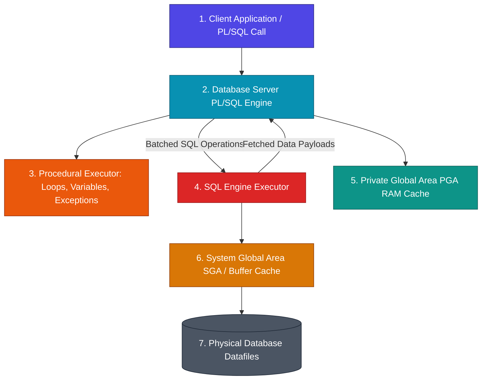

Procedural Language / SQL (PL/SQL) is Oracle's high-performance procedural extension to standard SQL. While standard SQL is declarative (instructing the database *what* data to retrieve query-by-query), PL/SQL allows software engineers to seamlessly blend procedural control logic (loops, `IF-THEN-ELSE` branching, exception handling, custom data structures) with database SQL queries directly inside the database server kernel.

* **Analogy**: *An Automated Robotic Assembly Line inside a Secure Bank Vault.* Standard SQL queries are individual courier trips carrying single document folders back and forth across the street to an office worker. PL/SQL installs a high-speed automated robotic assembly line inside the secure vault itself. The robot processes logic, loops through thousands of document records in RAM, handles unexpected errors on the spot, and only sends final compiled results back to the client application.

---

## 🗺️ 12-Module PL/SQL Learning Roadmap

Explore our 12 structured, bite-sized PL/SQL engineering modules below. Each module provides technical insights, engine context switch diagrams, performance optimization benchmarks, and production-grade Oracle practices.

| Module | Core Topics | Key Focus & Engineering Concepts | Read Time |
| :--- | :--- | :--- | :--- |
| **[1. Engine Architecture](./01-engine-architecture-and-compilation/plsql-architecture-and-context-switches)** | Dual-Engine Model, Context Switches, Anonymous vs Stored Blocks, P-Code vs Native C | Execution engine boundaries, context switch bottlenecks, and compilation targets | ~10 mins |
| **[2. Core Blocks & Control Flow](./02-blocks-variables-and-control-flow/block-structure-variables-and-anchors)** | Block Anatomy, `%TYPE` & `%ROWTYPE` Anchors, Control Loops, `CASE` Statements | Dynamic variable anchoring, defensive type coupling, and procedural control loops | ~12 mins |
| **[3. Collections & Records](./03-collections-and-records/collections-and-records)** | Associative Arrays, Nested Tables, Varrays, Record Types, Collection Methods | In-memory data structures, PGA memory footprint, constructors, and `MULTISET` operators | ~15 mins |
| **[4. Cursors & Streaming](./04-cursors-and-ref-cursors/cursors-and-ref-cursors)** | Implicit Cursors, Explicit Cursor Lifecycle, Parameterized Cursors, `REF CURSOR` | Memory pointers, cursor `FOR` loops, dynamic SQL cursor variables, and client streaming | ~15 mins |
| **[5. Bulk Processing](./05-bulk-processing-and-optimization/bulk-collect-and-forall)** | `BULK COLLECT INTO`, `LIMIT` Clause, `FORALL` Batch DML, `SAVE EXCEPTIONS` | Context switch elimination, array batching, PGA RAM protection, and bulk error traps | ~15 mins |
| **[6. Exception Handling](./06-exception-handling-and-diagnostics/exception-handling-and-pragma)** | Predefined Exceptions, User-Defined Errors, `PRAGMA EXCEPTION_INIT`, `SQLCODE`/`SQLERRM` | Error propagation, custom error codes, defensive exception handlers, and stack traces | ~12 mins |
| **[7. Database Triggers](./07-triggers-and-compound-triggers/triggers-and-mutating-errors)** | Trigger Timing/Scope, `:NEW`/`:OLD` Pseudorecords, Mutating Table (`ORA-04091`), Compound Triggers | Event-driven automation, mutating table error mechanics, and 4-phase compound triggers | ~15 mins |
| **[8. Package Architecture](./08-packages-and-state-management/packages-and-state)** | Package Specification vs Body, Package Instantiation, `PRAGMA SERIALLY_REUSABLE` | Public API encapsulation, private state hiding, and package memory initialization | ~15 mins |
| **[9. Autonomous Transactions](./09-transactions-and-autonomous-logging/autonomous-transactions)** | `PRAGMA AUTONOMOUS_TRANSACTION`, Sub-transactions, Independent Logging | Off-the-record audit logging without main transaction `ROLLBACK` interference | ~12 mins |
| **[10. Dynamic SQL & Security](./10-dynamic-sql-and-security/dynamic-sql-and-security)** | `EXECUTE IMMEDIATE`, Bind Variables (`USING`), SQL Injection, `AUTHID DEFINER`/`CURRENT_USER` | Dynamic SQL execution, SQL injection defense, and security privileges architecture | ~15 mins |
| **[11. Performance Tuning](./11-performance-tuning-and-caching/performance-tuning-and-caching)** | `PLSQL_OPTIMIZE_LEVEL`, `IN OUT NOCOPY`, `DETERMINISTIC`, `RESULT_CACHE` | Compiler optimization, pass-by-reference hints, and function result cache vaults | ~15 mins |
| **[12. Pipelined Functions & Objects](./12-pipelined-functions-and-object-types/pipelined-functions-and-object-types)** | Pipelined Functions (`PIPE ROW`), Object Types (`CREATE TYPE`), Inheritance | High-throughput streaming ETL transformations and object-oriented PL/SQL design | ~15 mins |

---

## ⚡ Quick Reference & Comparison Matrices

### 1. PL/SQL Collection Types Comparison

| Collection Type | Index Type | Storage Location | Initialization | Resizing Method | Optimal Use Case |
| :--- | :--- | :--- | :--- | :--- | :--- |
| **Associative Array (Index-By)** | Integer or String (`VARCHAR2`) | In-Memory (PGA Only) | Automatic (No constructor) | Dynamic insertion | Fast in-memory key-value lookup maps & internal caches |
| **Nested Table** | Sequential Integer (`1..N`) | PGA RAM or Stored in DB Column | Requires Constructor `TYPE()` | `.EXTEND()` | Dynamic array sets, bulk collect operations, DB columns |
| **Varray (Variable-Size Array)** | Bounded Integer (`1..Limit`) | PGA RAM or Stored in DB Column | Requires Constructor `TYPE()` | `.EXTEND()` up to Limit | Fixed-capacity lists (e.g. max 5 phone numbers per user) |

---

### 2. Context Switching Benchmark Impact

| Processing Method | Engine Execution Mechanics | Context Switches (100,000 Rows) | Average Execution Time |
| :--- | :--- | :--- | :--- |
| **Row-by-Row Cursor Loop** | Switches control between PL/SQL and SQL engine for *every single row* | **100,000 Switches** | ~45.0 seconds (Slow) |
| **BULK COLLECT + FORALL** | Transfers entire datasets in single array batches | **1 Switch** | ~0.35 seconds (Ultra-Fast) |

---

### 3. Procedure Security Rights Comparison

| Security Mode | Declared Keyword | Privilege Context | Table Resolution Context | Best For |
| :--- | :--- | :--- | :--- | :--- |
| **Definer's Rights (Default)** | `AUTHID DEFINER` | Executes using **Package Owner's** privileges | Resolves tables in owner's schema | Centralized API wrappers hiding underlying tables |
| **Invoker's Rights** | `AUTHID CURRENT_USER` | Executes using **Active Caller's** privileges | Resolves tables in caller's schema | Generic multi-tenant utility packages & shared tools |

---

## ❓ Self-Assessment Knowledge Check

<Quiz question="What is an Engine Context Switch in PL/SQL and why does it degrade execution speed?" options={["A switch between Linux and Windows servers.", "The transfer of execution control and memory buffers between the PL/SQL engine and the SQL engine during query execution inside loops.", "A memory crash caused by allocating too many variables.", "The compilation of PL/SQL bytecode into C executable files."]} answerIndex={1}>
Every time a PL/SQL block executes a SQL statement inside a loop, control passes between the **PL/SQL Engine** and the **SQL Engine**. Executing this row-by-row creates massive CPU context switch overhead.
</Quiz>

<Quiz question="How does PRAGMA AUTONOMOUS_TRANSACTION enable error logging during a failed main transaction?" options={["By converting all DML statements into DDL statements.", "By creating an independent sub-transaction that can COMMIT log records to disk without being affected by a ROLLBACK in the main transaction.", "By disabling foreign key constraints automatically.", "By caching log records in CPU L1 cache."]} answerIndex={1}>
`PRAGMA AUTONOMOUS_TRANSACTION` spins off an independent sub-transaction branch. You can `INSERT` audit log records and issue an explicit `COMMIT` inside the autonomous block, persisting logs to disk even if the parent transaction subsequently issues a `ROLLBACK`.
</Quiz>

---

## 🚀 Get Started

Jump directly into **[Module 1: Engine Architecture](./01-engine-architecture-and-compilation/plsql-architecture-and-context-switches)** to explore PL/SQL dual-engine mechanics and context switch bottlenecks!
