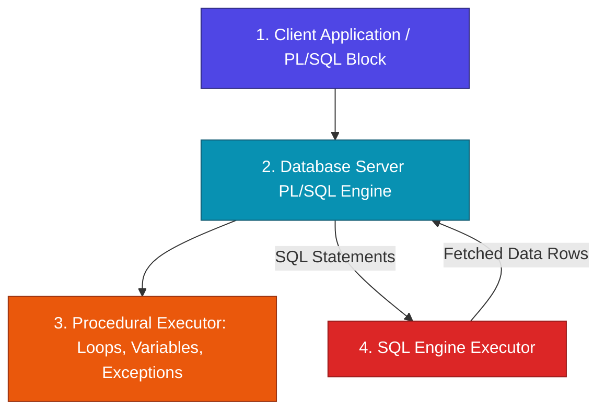

Procedural Language / SQL (PL/SQL) is Oracle's high-performance procedural extension to SQL. While SQL is a declarative language executed query-by-query, PL/SQL allows software engineers to seamlessly blend procedural control logic (loops, conditions, exception handling) with database SQL queries directly inside the database server.

---

## 🗺️ PL/SQL Learning Modules & Navigation Roadmap

Explore our structured PL/SQL engineering modules below. Each module provides technical insights, engine context switch diagrams, performance optimization benchmarks, and production-grade Oracle PL/SQL practices.

| Module | Core Topics | Key Focus & Engineering Concepts | Read Time |
| :--- | :--- | :--- | :--- |
| **[1. Architecture & Blocks](./01-core-architecture-and-blocks/plsql-architecture-and-context-switches)** | PL/SQL Engine vs SQL Engine, Context Switch Bottlenecks, Block Syntax, `%TYPE` & `%ROWTYPE` Anchors, Exceptions | Engine context switches, scalar & record anchoring, and exception handling blocks | ~15 mins |
| **[2. Collections & Cursors](./02-collections-and-cursors/collections-and-records)** | Associative Arrays, Nested Tables, Varrays, Record Types, Explicit Cursors, `REF CURSOR` pointers | In-memory datastructures, collection constructors, cursor loops, and dynamic cursor pointers | ~20 mins |
| **[3. Bulk Ops & Triggers](./03-bulk-processing-and-triggers/bulk-collect-and-forall)** | `BULK COLLECT INTO`, Batch `LIMIT` clause, `FORALL` DML, Mutating Table Error (ORA-04091), Compound Triggers | Eliminating context switches, PGA memory protection, and compound trigger timing blocks | ~25 mins |
| **[4. Packages & Advanced](./04-packages-transactions-and-tuning/autonomous-transactions-and-packages)** | `PRAGMA AUTONOMOUS_TRANSACTION`, Package Specs & Bodies, Dynamic SQL (`EXECUTE IMMEDIATE`), `NOCOPY` | Independent transactional logging, package encapsulation, and PL/SQL performance tuning | ~20 mins |

---

## ⚡ Quick Reference & Comparison Matrices

### 1. PL/SQL Collection Types Comparison

| Feature | Associative Array (Index-By) | Nested Table | Varray (Variable-Size Array) |
| :--- | :--- | :--- | :--- |
| **Storage Location** | In-Memory (PGA Only) | In-Memory or Stored in DB Table | In-Memory or Stored in DB Table |
| **Initialization** | Auto-instantiated (No constructor) | Requires Constructor (`TYPE()`) | Requires Constructor (`TYPE()`) |
| **Subscript Index** | Integer or String (`VARCHAR2`) | Dense Sequential Integer (1..N) | Bounded Sequential Integer (1..N) |
| **Capacity Limit** | Unbounded | Unbounded | Fixed Maximum Capacity Limit |
| **Use Case** | Fast internal key-value lookup maps | Dynamic sets & bulk collect operations | Fixed-size lists (e.g. up to 5 phone numbers) |

---

### 2. Context Switching Performance Impact

| Approach | Mechanics | Context Switches (10,000 Rows) | Performance Time |
| :--- | :--- | :--- | :--- |
| **Row-by-Row Cursor Loop** | Switches context between PL/SQL and SQL engine for *every single row* | **10,000 Context Switches** | ~12.5 seconds (Slow) |
| **BULK COLLECT + FORALL** | Fetches and updates entire datasets in batched array transfers | **1 Context Switch** | ~0.15 seconds (Ultra-Fast) |

---

## ❓ Self-Assessment Knowledge Check

<Quiz question="What is an Engine Context Switch in PL/SQL and why does it impact performance?" options={["A switch between Windows and Linux operating systems.", "The transfer of execution control and memory buffer between the PL/SQL engine and the SQL engine when running SQL inside a loop.", "A hardware crash caused by insufficient PGA memory.", "The compilation of PL/SQL bytecode into C executable files."]} answerIndex={1}>
Every time a PL/SQL block executes a SQL query or DML statement inside a loop, execution control passes between the **PL/SQL Engine** and the **SQL Engine**. Doing this row-by-row creates massive context switch overhead.
</Quiz>

<Quiz question="How does a Compound Trigger resolve the Mutating Table Error (ORA-04091) in Oracle?" options={["By converting all table columns into VARCHAR2 types.", "By providing 4 distinct timing sections, allowing row data to be recorded in memory during update and evaluated only after the statement completes.", "By disabling table indexes before triggering.", "By automatically committing the main transaction."]} answerIndex={1}>
A **Compound Trigger** separates row-level event capture (`AFTER EACH ROW`) from table evaluation (`AFTER STATEMENT`). It accumulates modified row IDs into memory while the table is active and queries the total table safely only after all row updates complete.
</Quiz>

---

## 🚀 Get Started

Jump directly into **[Module 1: Architecture & Core Blocks](./01-core-architecture-and-blocks/plsql-architecture-and-context-switches)** to explore PL/SQL engine context switches and variable anchoring!
