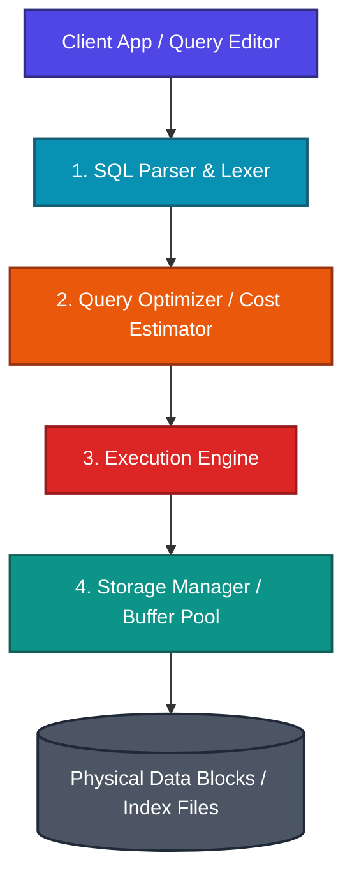

### 1. SQL Architecture & Command Categories

Imagine a busy international airport terminal.
*   **The Parser**: The check-in desk checking if your passport is valid and your ticket is formatted correctly.
*   **The Query Optimizer**: The flight dispatcher calculating 5 different routes to the destination (indexes, nested loops, hash joins) and choosing the one with the lowest cost.
*   **The Execution Engine**: The actual pilot flying the plane and accessing the physical cargo bays.



#### SQL Command Categories: Foundations vs. Furniture
SQL commands are divided into distinct categories based on their operational domain:
*   **DDL (Data Definition Language)**: *Analogy: Designing and building the physical house.* Pouring the concrete foundations and building walls. DDL commands auto-commit instantly; you can't undo (rollback) concrete once it's dry. Commands: `CREATE`, `ALTER`, `DROP`, `TRUNCATE`.
*   **DML (Data Manipulation Language)**: *Analogy: Moving furniture inside the rooms.* Moving chairs and tables. You can change your mind and reset the arrangement (`ROLLBACK`) until you finalize the layout (`COMMIT`). Commands: `SELECT`, `INSERT`, `UPDATE`, `DELETE`.
*   **DCL (Data Control Language)**: Managing permissions. Commands: `GRANT`, `REVOKE`.
*   **TCL (Transaction Control Language)**: Managing DML transactional states. Commands: `COMMIT`, `ROLLBACK`, `SAVEPOINT`.

---

### 2. Schema Design, Constraints & Data Types

#### Integrity Constraints
Constraints are rules enforced on columns by the RDBMS engine at the schema level to maintain data integrity:
*   **PRIMARY KEY**: Uniquely identifies each row. Enforces `UNIQUE` and `NOT NULL` implicitly. Only one primary key is allowed per table. Automatically creates a clustered (or primary) index.
*   **FOREIGN KEY**: Establishes a parent-child relationship. Enforces referential integrity by ensuring the value in the child column matches a primary key in the parent table.
    *   `ON DELETE CASCADE`: Deleting the parent row automatically deletes all matching child rows.
    *   `ON DELETE SET NULL`: Deleting the parent row sets the child's foreign key column to `NULL`.
    *   `ON DELETE RESTRICT` (Default): Blocks the parent row deletion if child records exist.
*   **UNIQUE**: Ensures all values in a column are distinct. Allows multiple `NULL` values (since `NULL != NULL` in SQL).
*   **NOT NULL**: Prevents storing empty or unknown (`NULL`) values in a column.
*   **CHECK**: Validates that all values in a column satisfy a boolean condition (e.g., `CHECK (salary > 0)`).
*   **DEFAULT**: Inserts a predefined value if no value is explicitly supplied during an `INSERT` statement.

---

### 3. Querying, Filtering & The Null Trap

#### The Null Trap: Mystery Boxes
In SQL, `NULL` represents the absence of a value (unknown). It is not equal to zero, a blank string, or even another `NULL`.
*   **Analogy**: A sealed box containing unknown contents. Comparing `box == 10` returns `UNKNOWN`. Comparing `boxA == boxB` is also `UNKNOWN` (you don't know if the boxes have the same thing). Thus, to check if a box is empty/unknown, you must scan the box directly (`IS NULL`).

```sql
-- WRONG: Will return 0 rows because nothing equals NULL
SELECT * FROM employees WHERE manager_id = NULL;

-- CORRECT: Replaces comparison with IS NULL operator
SELECT * FROM employees WHERE manager_id IS NULL;
```

---

### 4. Grouping & SQL Execution Order

#### SQL Execution Order: Preparing a Party List
Even though you write `SELECT` first, the database engine processes queries in a completely different sequence:

```
Written Order       Evaluation Order (Logical Execution)
1. SELECT        ►   1. FROM (Choose tables & join streams)
2. FROM          ►   2. WHERE (Filter individual rows)
3. WHERE         ►   3. GROUP BY (Group rows into piles)
4. GROUP BY      ►   4. HAVING (Filter groups / aggregates)
5. HAVING        ►   5. SELECT (Produce final columns & evaluate aliases)
6. ORDER BY      ►   6. DISTINCT (De-duplicate rows)
7. LIMIT/OFFSET  ►   7. ORDER BY (Sort final output rows)
                 ►   8. LIMIT / FETCH (Limit output count)
```

> [!IMPORTANT]
> Because `WHERE` (step 2) runs before `SELECT` (step 5), you **cannot** reference a column alias defined in the `SELECT` clause within the `WHERE` clause.
> E.g., `SELECT salary * 12 AS annual_sal FROM employees WHERE annual_sal > 50000` will fail.

<Quiz question="Why does the query `SELECT dept_id, AVG(salary) AS avg_sal FROM employees WHERE avg_sal > 50000 GROUP BY dept_id` fail?" options={["You cannot group by dept_id without indexing it.","WHERE is evaluated before SELECT, so the alias 'avg_sal' does not yet exist when WHERE is executed. Also, WHERE cannot filter on aggregates.","HAVING must be written before GROUP BY.","SELECT must contain only aggregates."]} answerIndex={1}>
According to SQL's logical execution order, `WHERE` is processed at step 2, while the `SELECT` clause (which defines the alias `avg_sal`) is not processed until step 5. Consequently, the alias is unknown to the `WHERE` clause. Additionally, aggregate functions (like `AVG`) cannot be used in a `WHERE` clause; they must be filtered in the `HAVING` clause.
</Quiz>

---

### 5. JOINs & Subqueries

#### Join Algorithms: Speed Dating
*   **Nested Loops Join**: For each row in the outer table, scan the inner table. *Analogy: For every guest in row A, walk down row B looking for matches.* Efficient only if row A is tiny.
*   **Hash Join**: Build a hash table in memory from the smaller input, then scan the larger input to find matches. *Analogy: Take all guests in row A and group them into color-coded rooms based on their hobbies. Then, have guests in row B walk straight to the matching color room.* Extremely fast for large, unindexed datasets.
*   **Sort-Merge Join**: Sort both datasets on the join keys, then scan them in parallel. *Analogy: Line up both rows by height first, then walk down both rows in parallel, matching pairs of equal height.*

```
       INNER JOIN                      LEFT JOIN                     RIGHT JOIN
   ┌───────┬───────┐               ┌───────┬───────┐              ┌───────┬───────┐
   │       │███████│               │███████│███████│              │       │███████│
   │ Table │███████│ Table         │███████│███████│ Table        │ Table │███████│ Table
   │   A   │███████│   B           │███████│███████│   B          │   A   │███████│   B
   │       │███████│               │███████│       │              │       │███████│
   └───────┴───────┘               └───────┴───────┘              └───────┴───────┘
     Only Overlap                    All A + Overlap                All B + Overlap
```

---

### 6. Window Functions & Analytical SQL

Window functions perform calculations across a set of table rows that are related to the current row. Unlike `GROUP BY`, which collapses rows, window functions preserve the original row structure.
*   **Analogy**: A moving camera lens. The lens focuses on a specific slice of the table (the partition) and performs calculations, but leaves the entire table detail visible.

```sql
-- Calculate employee salary rank within their department
SELECT emp_name, dept_id, salary,
       RANK() OVER (PARTITION BY dept_id ORDER BY salary DESC) AS sal_rank
FROM employees;
```

*   `PARTITION BY`: Divides the rows into groups (the window scope).
*   `ORDER BY`: Sorts the rows inside each partition.
*   `RANK()` vs. `DENSE_RANK()`:
    *   `RANK()`: Leaves gaps on ties (e.g. `1, 2, 2, 4`).
    *   `DENSE_RANK()`: No gaps on ties (e.g. `1, 2, 2, 3`).

---

### 7. Performance Optimization & Indexing

#### Indexes: The Textbook Index
*   **Clustered Index**: *Analogy: A phone book sorted alphabetically.* The physical data pages are sorted on disk based on the index key. There can be only one clustered index per table.
*   **Non-Clustered Index**: *Analogy: The index at the back of a textbook.* A separate data structure containing keys and direct pointers (row IDs) to the actual page locations.

#### Query execution plans
Use `EXPLAIN PLAN` to see the optimizer's decisions:
*   *Table Scan*: Scanning every single page of the table on disk. High cost.
*   *Index Seek*: Navigating the index tree directly to locate matching keys. Low cost.

---

### 8. Database Normalization (1NF to BCNF)

Normalization is the process of organizing database tables to reduce redundancy and dependency. *Analogy: Organizing your closet. Instead of putting all socks, shirts, and shoes in one massive pile, you put them in labeled drawers to avoid mess.*

*   **1NF**: Atomic values only (no lists or comma-separated values in cells).
*   **2NF**: In 1NF, and all non-key columns must depend on the *entire* primary key (removes partial dependencies).
*   **3NF**: In 2NF, and all non-key columns must depend *only* on the primary key, not on other non-key columns (removes transitive dependencies).
*   **BCNF (Boyce-Codd Normal Form)**: A stronger version of 3NF. For every functional dependency `A -> B`, `A` must be a superkey.

---

### 9. Transaction Management & Isolation Levels

A transaction is a single unit of database work. It must satisfy **ACID** properties:
*   **Atomicity**: All operations succeed, or all fail.
*   **Consistency**: The database transitions from one valid state to another.
*   **Isolation**: Transactions running concurrently do not interfere with each other.
*   **Durability**: Committed data is saved permanently, even during crashes.

#### Isolation Levels & Concurrency Anomalies
*   *Dirty Read*: Reading uncommitted data from another transaction.
*   *Non-Repeatable Read*: Reading the same row twice inside a transaction and getting different values because another transaction modified it.
*   *Phantom Read*: Running the same query twice inside a transaction and getting a different number of rows because another transaction inserted new rows.

| Isolation Level | Dirty Read | Non-Repeatable Read | Phantom Read |
| --- | --- | --- | --- |
| **Read Uncommitted** | Yes | Yes | Yes |
| **Read Committed** | No | Yes | Yes |
| **Repeatable Read** | No | No | Yes |
| **Serializable** | No | No | No |

---

### 10. Conceptual Quizzes

<Quiz question="What is the result of vertical margins on two adjacent block elements (top margin 30px and bottom margin 40px)?" options={["A combined gap of 70px.","A combined gap of 10px.","The margins collapse, resulting in a single gap of 40px (the larger value).","The elements overlap."]} answerIndex={2}>
Vertical margins between adjacent block elements collapse. The browser uses only the larger margin value (40px in this case), rather than adding them together.
</Quiz>

<Quiz question="What happens if a set contains a NULL value during a `NOT IN` evaluation (e.g., `x NOT IN (1, 2, NULL)`)?" options={["It matches other values and ignores NULL.","It always evaluates to UNKNOWN, returning zero results.","It throws a compile error.","It behaves like an INNER JOIN."]} answerIndex={1}>
In SQL, `x NOT IN (1, 2, NULL)` evaluates as `x != 1 AND x != 2 AND x != NULL`. Because any comparison against `NULL` yields `UNKNOWN`, the overall logical condition evaluates to `UNKNOWN`, returning zero matching rows.
</Quiz>

---

### 11. Practice Problems

<Problem title="Problem 1: Department Salary Ranks">
<ProblemDescription>
Given an `employees` table containing `emp_id`, `emp_name`, `dept_id`, and `salary`.
Write a query to find the top 2 highest-paid employees in each department. If there are ties, there should be no gaps in the rankings.
</ProblemDescription>
<ProblemSolution>
This query uses the `DENSE_RANK()` window function:

```sql
SELECT emp_name, dept_id, salary
FROM (
  SELECT emp_name, dept_id, salary,
         DENSE_RANK() OVER (PARTITION BY dept_id ORDER BY salary DESC) AS rnk
  FROM employees
) ranked_emps
WHERE rnk <= 2;
```
</ProblemSolution>
</Problem>