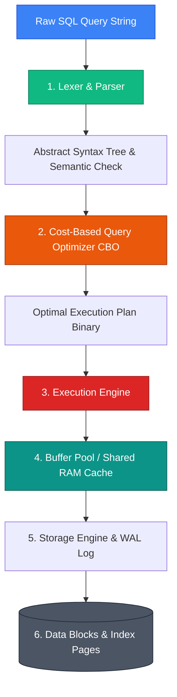

## 🏛️ SQL Engine Pipeline Architecture

When an application submits a SQL query string to a Relational Database Management System (RDBMS), the engine does not immediately fetch data from disk. Instead, it executes a multi-stage compilation and execution pipeline:



### 1. SQL Parser & Lexer
* **Lexical Analysis**: Breaks down the query string into basic tokens (keywords like `SELECT`, identifiers like table names, operators like `=`).
* **Syntax Checking**: Verifies that keywords and structure follow SQL grammar rules.
* **Semantic Analysis**: Checks database metadata (data dictionary) to confirm that requested tables and columns exist, and that the executing user has access privileges.

### 2. Cost-Based Query Optimizer (CBO)
* Generates multiple execution strategies (permutations of index scans, full table scans, join algorithms like Hash Join vs Nested Loop).
* Calculates estimated **I/O cost** and **CPU cost** for each plan using database statistics (table statistics, histogram distributions, index cardinalities).
* Outputs the cheapest execution plan.

### 3. Execution Engine & Storage Manager
* Executes the physical plan instructions step-by-step.
* Queries the **Buffer Pool** (shared memory cache). If data blocks are present in RAM, they are read instantly (Buffer Cache Hit). If missing, the Storage Manager issues synchronous block reads to disk pages.

---

## 🏷️ SQL Command Categories: Foundations vs. Furniture

SQL commands are classified into four distinct functional families based on their scope and state management:

```
                                  SQL Commands Taxonomy
                                            │
        ┌───────────────────┬───────────────┴───────────────┬───────────────────┐
        ▼                   ▼                               ▼                   ▼
     DDL                 DML                             DCL                 TCL
  (Definition)      (Manipulation)                    (Control)         (Transactions)
 CREATE, ALTER,    SELECT, INSERT,                  GRANT, REVOKE      COMMIT, ROLLBACK,
 DROP, TRUNCATE    UPDATE, DELETE                                         SAVEPOINT
```

### 1. DDL (Data Definition Language)
* **Analogy**: *Designing and building the physical house foundation.* Pouring concrete and building support columns. Once poured, you cannot undo concrete with a simple command.
* **Key Commands**: `CREATE`, `ALTER`, `DROP`, `TRUNCATE`.
* **Behavior**: Operations alter database catalog metadata. All DDL statements **auto-commit** implicitly in most engines (Oracle, MySQL). You cannot issue `ROLLBACK` to undo a `DROP TABLE`.

> [!WARNING]
> `DELETE FROM table_name` vs `TRUNCATE TABLE table_name`:
> - `DELETE`: A DML operation that deletes rows one-by-one, logging every deleted row in the Undo/Redo log. Reversible via `ROLLBACK`.
> - `TRUNCATE`: A DDL operation that instantly deallocates data pages on disk and resets the high-water mark. Extremely fast, but irreversible.

### 2. DML (Data Manipulation Language)
* **Analogy**: *Arranging and moving furniture inside rooms.* Moving chairs and tables around. You can experiment with layouts (`INSERT`, `UPDATE`) and revert to the previous arrangement (`ROLLBACK`) until you officially sign off on the design (`COMMIT`).
* **Key Commands**: `SELECT`, `INSERT`, `UPDATE`, `DELETE`.

### 3. DCL (Data Control Language)
* Manages authorization and operational privileges on database schema objects.
* **Key Commands**: `GRANT SELECT, INSERT ON employees TO HR_USER;`, `REVOKE DELETE ON employees FROM HR_USER;`.

### 4. TCL (Transaction Control Language)
* Manages atomic transactional units of work for DML operations.
* **Key Commands**: `COMMIT`, `ROLLBACK`, `SAVEPOINT sp1;`.

---

## ❓ Conceptual Quizzes

<Quiz question="Which component of the RDBMS is responsible for choosing whether to perform a Full Table Scan or an Index Scan?" options={["The SQL Lexer", "The Cost-Based Query Optimizer (CBO)", "The Storage Engine Buffer Pool", "The Transaction Manager"]} answerIndex={1}>
The **Cost-Based Query Optimizer (CBO)** analyzes database statistics and index metadata to evaluate candidate execution plans and selects the plan with the lowest estimated I/O and CPU cost.
</Quiz>

<Quiz question="Why does running ROLLBACK fail to recover data after executing a TRUNCATE TABLE command?" options={["TRUNCATE is a DML statement that bypasses memory.", "TRUNCATE is a DDL statement that automatically commits data page deallocations immediately.", "TRUNCATE encrypts the data pages.", "ROLLBACK only works on SELECT statements."]} answerIndex={1}>
`TRUNCATE` is a **DDL** command. DDL operations automatically issue implicit `COMMIT` calls before and after execution, altering system catalog metadata and deallocating physical disk pages permanently.
</Quiz>

---

## 💻 Practice Problems

<Problem title="Problem: Fast Cleanup of Staging Tables">
<ProblemDescription>
You are tasked with clearing out a massive 50-million-row `staging_sales` table every night before loading fresh batch data. Using `DELETE FROM staging_sales` causes log buffer overflow and takes 45 minutes. Write the optimal SQL command to clear the table in sub-second time.
</ProblemDescription>
<ProblemSolution>
Use the DDL `TRUNCATE` statement:

```sql
-- DDL deallocates data pages instantly without row-by-row undo logging
TRUNCATE TABLE staging_sales;
```
</ProblemSolution>
</Problem>
