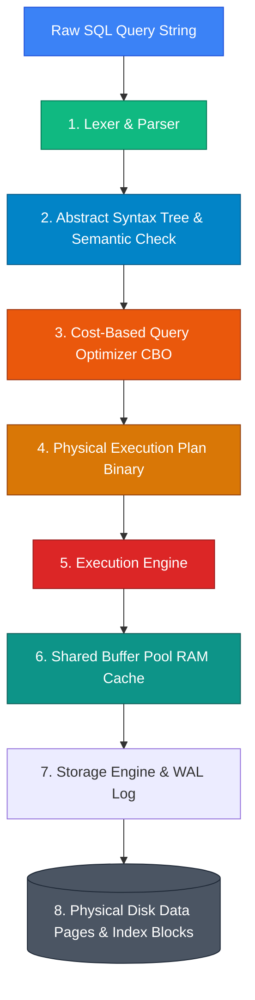

## 🏛️ SQL Engine Pipeline Architecture

When an application submits a SQL query string to a Relational Database Management System (RDBMS) like PostgreSQL, MySQL, or Oracle, the engine does not immediately read data files from disk. Instead, it executes a multi-stage compilation, optimization, and execution pipeline:

* **Analogy**: *A High-Tech Michelin-Star Restaurant Kitchen.*
  1. **Client / SQL Query**: The Customer placing an order ticket with the Waiter.
  2. **Lexer & Parser**: The Maître d' checking the order ticket for spelling errors and proper grammar.
  3. **AST & Semantic Check**: The Pantry Manager verifying that requested ingredients (tables, columns) exist in stock and that the customer has privileges to order them.
  4. **Cost-Based Query Optimizer (CBO)**: The Executive Head Chef calculating candidate cooking workflows (Index Scan vs Full Table Scan, Hash Join vs Nested Loop) to pick the fastest prep strategy.
  5. **Execution Engine**: The Line Cooks executing the binary plan instructions step-by-step.
  6. **Buffer Pool (RAM Cache)**: The Prep Countertop for immediate access to frequently used ingredients.
  7. **Storage Engine & Disk**: The Walk-In Deep Freezer storing ingredients permanently on physical shelves.
  8. **Write-Ahead Log (WAL)**: The Kitchen Order Ledger recording every order sequentially before cooking begins.



---

### 1. Lexical, Syntactic, and Semantic Analysis

- **Lexical Analysis (Lexing)**: Breaks down the continuous raw SQL string into discrete lexical tokens (`SELECT`, `FROM`, `WHERE`, `employees`, `=`, `100`).
- **Syntactic Parsing**: Validates that token arrangements conform to SQL grammar rules. Generates an **Abstract Syntax Tree (AST)** representation of the query.
- **Semantic Analysis**: Queries the database **Data Dictionary / Catalog** metadata to verify:
  1. Do target tables and columns actually exist?
  2. Are data types compatible with the specified operators (e.g., preventing integer additions to date strings)?
  3. Does the authenticated user possess necessary security privileges (`SELECT`, `UPDATE`) on the referenced schema objects?

---

### 2. Cost-Based Query Optimizer (CBO)

Because SQL is declarative, there can be thousands of physical execution paths to retrieve the exact same result set. The **Cost-Based Query Optimizer (CBO)** evaluates permutations of access methods (Full Table Scan vs B-Tree Index Scan) and join algorithms (Nested Loop, Hash Join, Sort-Merge Join).

```
                        CBO Decision Pipeline
                                  │
    ┌─────────────────────────────┼─────────────────────────────┐
    ▼                             ▼                             ▼
Candidate Plan 1              Candidate Plan 2              Candidate Plan 3
Full Table Scan +             Index Scan +                  Bitmap Index Scan +
Nested Loop Join              Hash Join                     Hash Join
Estimated Cost: 14500         Estimated Cost: 420           Estimated Cost: 1200
                                  │
                                  ▼
                     Selected Optimal Plan Binary
                       (Lowest Estimated Cost)
```

The CBO estimates cost using database statistics (table row count, block counts, average row width, and column cardinality histogram distribution data):

```
Estimated Cost = (Page Reads × W_io) + (Tuple Checks × W_cpu)
```

Where `W_io` is the disk page I/O weight penalty (typically `1.0` for random disk reads or `0.1` for sequential reads in RAM) and `W_cpu` is the CPU evaluation cost per tuple (`0.01`).

---

### 3. Execution Engine, Buffer Pool & Write-Ahead Logging (WAL)

- **Execution Engine**: Reads the binary plan operators top-down (Volcano Iterator Model: `open()`, `next()`, `close()`), requesting data blocks from the Storage Manager.
- **Buffer Pool**: A allocated region of shared RAM memory that caches 8KB data pages read from disk.
  - **Buffer Cache Hit**: If requested data pages exist in the Buffer Pool, data is returned instantly at RAM speeds (nanoseconds).
  - **Buffer Cache Miss**: Synchronous read request is issued to disk storage to load data pages into the Buffer Pool, evicting cold pages using LRU (Least Recently Used) algorithms.
- **Dirty Pages & Checkpointing**: When data is modified (`UPDATE`), changes are applied directly to RAM pages in the Buffer Pool, marking them **Dirty**. A background process periodically flushes Dirty Pages from RAM to disk (**Checkpointing**).
- **Write-Ahead Logging (WAL)**: To guarantee Durability before dirty pages are written to disk, every state change is recorded sequentially into the non-volatile **Write-Ahead Log (WAL / Redo Log)** on disk *before* confirming `COMMIT` to the client.

---

## 🏷️ SQL Command Categories: Foundations vs. Furniture

SQL commands are classified into four distinct functional families based on operational scope and transaction persistence:

```
                                  SQL Command Taxonomy
                                            │
        ┌───────────────────┬───────────────┴───────────────┬───────────────────┐
        ▼                   ▼                               ▼                   ▼
      DDL                 DML                             DCL                 TCL
   (Definition)      (Manipulation)                    (Control)         (Transactions)
  CREATE, ALTER,    SELECT, INSERT,                  GRANT, REVOKE      COMMIT, ROLLBACK,
  DROP, TRUNCATE    UPDATE, DELETE                                         SAVEPOINT
```

### 1. DDL (Data Definition Language)
* **Analogy**: *Pouring the concrete foundations and building columns of a house.* Once poured, structural concrete cannot be nudged or undone with a simple wave of a hand.
* **Key Commands**: `CREATE`, `ALTER`, `DROP`, `TRUNCATE`.
* **Behavior**: Alters system dictionary catalog metadata. In most database engines (Oracle, MySQL), DDL operations execute implicit commits immediately before and after execution. DDL operations **cannot be rolled back** via `ROLLBACK`.

> [!WARNING]
> **Deep Dive: `DELETE` vs `TRUNCATE` vs `DROP`**:
> - `DELETE FROM table_name`: A **DML** statement. Scans rows, deletes records one-by-one, writes Undo/Redo log records for every single deleted tuple, and fires `DELETE` triggers. Slow for massive tables, but reversible via `ROLLBACK`.
> - `TRUNCATE TABLE table_name`: A **DDL** statement. Immediately deallocates data pages on disk, resets the High-Water Mark (HWM) and auto-increment sequence, bypasses row-level triggers, and logs minimal page deallocations. Sub-second execution, but irreversible.
> - `DROP TABLE table_name`: A **DDL** statement. Completely destroys table definition catalog entries and deallocates all physical data blocks permanently.

```sql
-- DML: Deletes specific rows, generates undo logging, fires triggers
DELETE FROM employees WHERE status = 'TERMINATED';

-- DDL: Deallocates all physical table data pages instantly
TRUNCATE TABLE staging_employees;

-- DDL: Destroys table schema and contents permanently
DROP TABLE legacy_employees;
```

---

### 2. DML (Data Manipulation Language)
* **Analogy**: *Arranging and moving furniture inside rooms.* Moving chairs and tables around. You can experiment with room layouts (`INSERT`, `UPDATE`, `DELETE`) and revert to your original room setup (`ROLLBACK`) until you officially sign off on the design (`COMMIT`).
* **Key Commands**: `SELECT`, `INSERT`, `UPDATE`, `DELETE`, `MERGE`.

---

### 3. DCL (Data Control Language)
* **Analogy**: *Issuing keycards and security clearance badges.*
* **Key Commands**: `GRANT`, `REVOKE`.
* **Behavior**: Modifies internal database access control lists (ACLs) and security permissions instantly.

```sql
-- Grant read-only access on customer table to reporting role
GRANT SELECT ON customers TO reporting_user;

-- Revoke write privileges from guest role
REVOKE INSERT, UPDATE, DELETE ON orders FROM guest_user;
```

---

### 4. TCL (Transaction Control Language)
* **Analogy**: *Creating system restore points during a major OS software update.*
* **Key Commands**: `COMMIT`, `ROLLBACK`, `SAVEPOINT`.

```sql
BEGIN TRANSACTION;
  UPDATE accounts SET balance = balance - 500 WHERE account_id = 101;
  SAVEPOINT payment_done;
  
  UPDATE accounts SET balance = balance + 500 WHERE account_id = 202;
  -- If step 2 fails, rollback to savepoint without losing step 1
  -- ROLLBACK TO payment_done;
COMMIT;
```

---

## ❓ Conceptual Quizzes

<Quiz question="Which component of the RDBMS is responsible for choosing whether to perform a Full Table Scan or an Index Scan?" options={["The SQL Lexer", "The Cost-Based Query Optimizer (CBO)", "The Storage Engine Buffer Pool", "The Transaction Manager"]} answerIndex={1}>
The **Cost-Based Query Optimizer (CBO)** analyzes database statistics and index metadata to evaluate candidate execution plans and selects the plan with the lowest estimated I/O and CPU cost.
</Quiz>

<Quiz question="Why does running ROLLBACK fail to recover data after executing a TRUNCATE TABLE command in MySQL/Oracle?" options={["TRUNCATE is a DML statement that bypasses memory.", "TRUNCATE is a DDL statement that automatically issues implicit COMMIT calls and deallocates data pages.", "TRUNCATE encrypts the data pages.", "ROLLBACK only works on SELECT statements."]} answerIndex={1}>
`TRUNCATE` is a **DDL** command. DDL operations automatically issue implicit `COMMIT` calls before and after execution, altering system catalog metadata and deallocating physical disk pages permanently.
</Quiz>

<Quiz question="What is the purpose of the Write-Ahead Log (WAL) in database architecture?" options={["To speed up SELECT query execution times.", "To record state modifications sequentially to disk before dirty RAM pages are committed, guaranteeing Durability.", "To cache index nodes in CPU L1 cache.", "To format SQL query output into JSON."]} answerIndex={1}>
The **Write-Ahead Log (WAL)** ensures Durability (ACID) by sequentially writing transaction delta records to non-volatile disk storage before a commit is acknowledged, allowing crash recovery if power fails before Dirty Buffer Pool pages are flushed.
</Quiz>

---

## 💻 Practice Problems

<Problem title="Problem: Sub-Second Staging Table Cleanup">
<ProblemDescription>
You maintain an ETL pipeline that loads 20 million rows into a `staging_orders` table every hour. Using `DELETE FROM staging_orders` takes 12 minutes, causes high disk I/O, and inflates the transaction log file by 15 GB. Write the optimal SQL command to clear the table in sub-second time without transaction log bloat.
</ProblemDescription>
<ProblemSolution>
Use the DDL `TRUNCATE TABLE` statement:

```sql
-- DDL deallocates data pages instantly without row-by-row undo logging
TRUNCATE TABLE staging_orders;
```
</ProblemSolution>
</Problem>

<Problem title="Problem: Partial Transaction Recovery with Savepoints">
<ProblemDescription>
Write a TCL transaction block that deducts $1,000 from `account_A`, sets a savepoint named `after_deduct`, attempts to credit `account_B`, and if an error occurs, rolls back *only* the credit to `account_B` while preserving the deduction on `account_A`.
</ProblemDescription>
<ProblemSolution>
```sql
BEGIN TRANSACTION;

-- Step 1: Deduct from account A
UPDATE accounts SET balance = balance - 1000 WHERE account_id = 'A';

-- Step 2: Establish savepoint boundary
SAVEPOINT after_deduct;

-- Step 3: Attempt credit to account B
UPDATE accounts SET balance = balance + 1000 WHERE account_id = 'B';

-- If validation fails for account B, rollback selectively to savepoint:
-- ROLLBACK TO SAVEPOINT after_deduct;

COMMIT;
```
</ProblemSolution>
</Problem>
