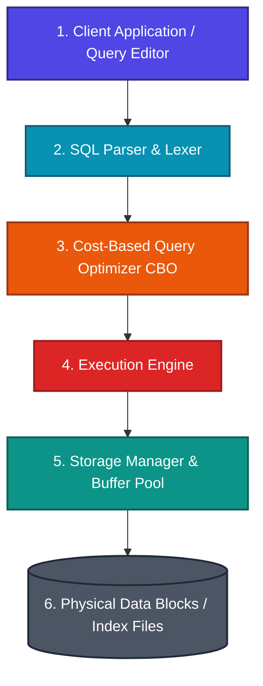

Structured Query Language (SQL) is the universal standard declarative language used to manage, query, and manipulate relational databases. Unlike imperative programming languages where you instruct the computer *how* to process data step-by-step, SQL allows you to describe *what* data you want, leaving the underlying database engine to calculate the optimal retrieval pathway.

---

## 🗺️ SQL Learning Modules & Navigation Roadmap

Explore our structured SQL modules below. Each module provides deep architectural insights, physical data layout diagrams, query optimization strategies, and real-world database design practices.

| Module | Core Topics | Key Focus & Engineering Concepts | Read Time |
| :--- | :--- | :--- | :--- |
| **[1. Architecture & DDL/DML](./01-architecture-and-ddl-dml/sql-engine-architecture)** | Parser, Query Optimizer, Execution Engine, DDL vs DML vs DCL vs TCL, Constraints & Normalization (1NF–BCNF) | Internal database pipeline, auto-commit rules, integrity constraints, and schema decomposition | ~15 mins |
| **[2. Querying & Joins](./02-querying-joins-and-nulls/execution-order-and-null-trap)** | Execution Order, The NULL Trap (3-Valued Logic), JOIN Algorithms (Nested Loops, Hash Join, Sort-Merge) | Query execution order vs written order, NULL comparison hazards, and join algorithm mechanics | ~20 mins |
| **[3. Window Functions & Analytics](./03-window-functions-and-analytics/window-functions-and-ranking)** | `OVER()`, `PARTITION BY`, `RANK()`, `DENSE_RANK()`, `LAG()`/`LEAD()`, `GROUPING SETS`, `CUBE`, `ROLLUP` | Preserving row-level detail with window frames, analytical reporting, and multidimensional aggregation | ~20 mins |
| **[4. Performance & Transactions](./04-performance-indexing-and-transactions/indexing-and-query-tuning)** | Clustered vs Non-Clustered Indexes, B-Tree structure, `EXPLAIN PLAN`, ACID Isolation Levels, Concurrency Anomalies | Query tuning, eliminating table scans, index sargability, and transaction isolation locks | ~25 mins |

---

## ⚡ Quick Reference & Comparison Matrices

### 1. SQL Command Categories

| Category | Full Name | Operational Purpose | Key Commands | Transactional Behavior |
| :--- | :--- | :--- | :--- | :--- |
| **DDL** | Data Definition Language | Defines and alters physical database schema structures | `CREATE`, `ALTER`, `DROP`, `TRUNCATE` | Auto-commits instantly; cannot be rolled back |
| **DML** | Data Manipulation Language | Modifies, queries, and manages data inside tables | `SELECT`, `INSERT`, `UPDATE`, `DELETE` | Transactional; reversible via `ROLLBACK` until `COMMIT` |
| **DCL** | Data Control Language | Manages access rights and permissions on objects | `GRANT`, `REVOKE` | Applied immediately to database privilege registry |
| **TCL** | Transaction Control Language | Controls transactional boundary and state persistence | `COMMIT`, `ROLLBACK`, `SAVEPOINT` | Manages atomic DML work units |

---

### 2. Transaction Isolation Levels vs. Anomalies

| Isolation Level | Dirty Read | Non-Repeatable Read | Phantom Read | Concurrency Performance |
| :--- | :--- | :--- | :--- | :--- |
| **Read Uncommitted** | Permitted | Permitted | Permitted | Highest Throughput (No Read Locks) |
| **Read Committed** (Default in PostgreSQL/Oracle) | Prevented | Permitted | Permitted | High Throughput |
| **Repeatable Read** (Default in MySQL InnoDB) | Prevented | Prevented | Permitted (Prevented in InnoDB MVCC) | Balanced |
| **Serializable** | Prevented | Prevented | Prevented | Lowest Throughput (Strict Locking / Serialization) |

---

## ❓ Self-Assessment Knowledge Check

<Quiz question="In standard SQL, why does a query fail when attempting to use a column alias defined in the SELECT clause inside the WHERE clause?" options={["Column aliases are only allowed in ORDER BY clauses.", "The database engine processes WHERE (step 2) before SELECT (step 5) during logical execution, so the alias does not exist yet.", "WHERE clauses only work on indexed integer primary keys.", "Aliases require the AS keyword to be usable in filtering."]} answerIndex={1}>
According to SQL's logical execution order, the `FROM` clause is processed first, followed by `WHERE` (step 2). The `SELECT` clause (step 5), which defines the alias, has not yet been evaluated, making the alias unknown to the `WHERE` clause.
</Quiz>

<Quiz question="What is the key difference between RANK() and DENSE_RANK() window functions when evaluating tied rows?" options={["RANK() throws an error on ties, whereas DENSE_RANK() defaults to NULL.", "RANK() leaves gaps in rank numbers following a tie, while DENSE_RANK() assigns consecutive integers with no gaps.", "DENSE_RANK() only works on string data types.", "RANK() collapses tied rows into a single summary output."]} answerIndex={1}>
`RANK()` skips rank numbers after a tie (e.g., tied at 2 results in 1, 2, 2, 4), whereas `DENSE_RANK()` generates consecutive rankings without skipping numbers (e.g., 1, 2, 2, 3).
</Quiz>

---

## 🚀 Get Started

Jump directly into **[Module 1: Architecture & Schema Design](./01-architecture-and-ddl-dml/sql-engine-architecture)** to master SQL engine internals, parser stages, and constraint enforcement!
