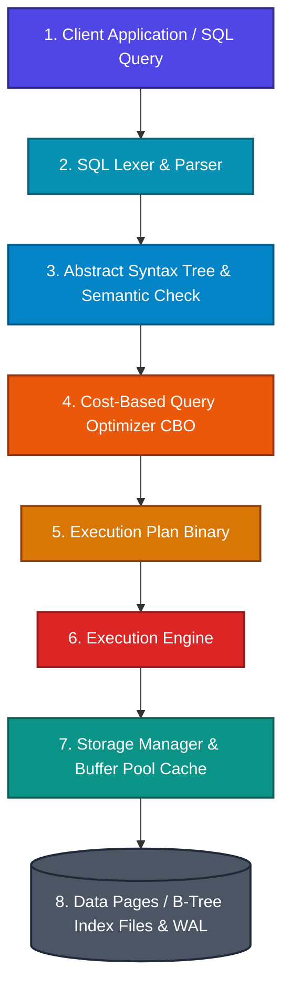

Structured Query Language (SQL) is the universal declarative standard used to manage, query, and manipulate relational databases. Unlike imperative programming languages (where you instruct the computer *how* to process data line-by-line), SQL allows you to declare *what* data you require, leaving the underlying database engine to calculate the optimal retrieval pathway.

* **Analogy**: *Ordering at a High-End Restaurant.* You tell the waiter (SQL query) "I want a medium-rare ribeye with grilled asparagus" (*what* you want). You do not go into the kitchen and instruct the chef which burner to ignite, what pan to select, or how many seconds to sear each side (*how* to implement it). The executive head chef (Cost-Based Query Optimizer) calculates the optimal preparation steps.

---

## 🗺️ SQL Learning Modules & Navigation Roadmap

Explore our structured SQL modules below. Each module provides deep architectural insights, physical data layout diagrams, query optimization strategies, and real-world database design practices.

| Module | Core Topics | Key Focus & Engineering Concepts | Read Time |
| :--- | :--- | :--- | :--- |
| **[1. Architecture & DDL/DML](./01-architecture-and-ddl-dml/sql-engine-architecture)** | Parser, AST, CBO, Buffer Pool, WAL, DDL vs DML vs DCL vs TCL, Constraints & Normalization (1NF–BCNF) | Internal database compilation pipeline, auto-commit rules, integrity constraints, and schema decomposition | ~15 mins |
| **[2. Querying & Joins](./02-querying-joins-and-nulls/execution-order-and-null-trap)** | 10-Step Execution Order, The NULL Trap (3-Valued Logic), JOIN Algorithms (Nested Loops, Hash Join, Sort-Merge), Subqueries, Recursive CTEs | Logical vs written execution sequence, NULL comparison hazards, join memory mechanics, and hierarchical trees | ~20 mins |
| **[3. Window Functions & Analytics](./03-window-functions-and-analytics/window-functions-and-ranking)** | `OVER()`, `PARTITION BY`, Window Frames (`ROWS`/`RANGE`), `RANK()`, `DENSE_RANK()`, `LAG()`/`LEAD()`, `GROUPING SETS`, `CUBE`, `ROLLUP` | Preserving row-level detail with window frames, analytical reporting, running totals, and multidimensional aggregation | ~20 mins |
| **[4. Performance & Transactions](./04-performance-indexing-and-transactions/indexing-and-query-tuning)** | B-Tree Clustered vs Non-Clustered Indexes, Leftmost Prefix Rule, Covering Indexes (`INCLUDE`), Sargability, `EXPLAIN ANALYZE`, MVCC, ACID Isolation Levels, Concurrency Anomalies, Deadlocks | Query tuning, eliminating full table scans, index sargability, transaction isolation locks, and write skew | ~25 mins |
| **[5. Advanced Objects & JSONB](./05-advanced-objects-json-and-partitioning/jsonb-views-and-partitioning)** | JSON/JSONB Operators (`->`, `@>`), GIN Indexing, Virtual Views vs Materialized Views, Table Partitioning (Range/List/Hash), Partition Pruning, Stored Procedures & Triggers | Semi-structured data processing, materialized view caching, big data table partitioning, and database automation | ~20 mins |

---

## ⚡ Quick Reference & Comparison Matrices

### 1. SQL Command Categories Taxonomy

| Category | Full Name | Operational Purpose | Key Commands | Transactional Behavior |
| :--- | :--- | :--- | :--- | :--- |
| **DDL** | Data Definition Language | Defines, alters, and drops physical database catalog structures | `CREATE`, `ALTER`, `DROP`, `TRUNCATE` | Auto-commits instantly; irreversible via `ROLLBACK` |
| **DML** | Data Manipulation Language | Queries, inserts, updates, and deletes row data inside tables | `SELECT`, `INSERT`, `UPDATE`, `DELETE` | Transactional; reversible via `ROLLBACK` until `COMMIT` |
| **DCL** | Data Control Language | Manages access authorization rights and privileges on schema objects | `GRANT`, `REVOKE` | Applied immediately to database security registry |
| **TCL** | Transaction Control Language | Manages transaction boundaries, savepoints, and state persistence | `COMMIT`, `ROLLBACK`, `SAVEPOINT` | Controls atomic boundaries for DML work units |

---

### 2. Join Execution Algorithms Comparison

| Algorithm | Best For | Time Complexity | Memory Requirements | Driver Table Requirement |
| :--- | :--- | :--- | :--- | :--- |
| **Nested Loop Join** | Small datasets or queries with highly selective indexed outer rows | $O(M \times N)$ without index; $O(M \log N)$ indexed | $O(1)$ minimal RAM buffer | Prefers smaller outer dataset |
| **Hash Join** | Large un-indexed datasets with equality join predicates (`=`) | $O(M + N)$ build & probe phases | $O(M)$ proportional to smaller table hash table | Fits smaller table in `work_mem` hash table |
| **Sort-Merge Join** | Large datasets already sorted on join keys or explicit range predicates | $O(M \log M + N \log N)$ (or $O(M+N)$ if pre-sorted) | Requires RAM buffer for sorting blocks | Ideal when join output requires sorted ordering |

---

### 3. Transaction Isolation Levels vs. Anomalies

| Isolation Level | Dirty Read | Non-Repeatable Read | Phantom Read | Serialization Anomaly / Write Skew | Concurrency Engine Mechanism |
| :--- | :--- | :--- | :--- | :--- | :--- |
| **Read Uncommitted** | Permitted | Permitted | Permitted | Permitted | No read locks acquired |
| **Read Committed** (Default PostgreSQL/Oracle) | Prevented | Permitted | Permitted | Permitted | Statement-level snapshot; short-term read locks |
| **Repeatable Read** (Default MySQL InnoDB) | Prevented | Prevented | Permitted (Prevented in InnoDB MVCC) | Permitted | Transaction-level snapshot; long-term read locks |
| **Serializable** | Prevented | Prevented | Prevented | Prevented | Strict Predicate Locking or SSI (Serializable Snapshot Isolation) |

---

## ❓ Self-Assessment Knowledge Check

<Quiz question="In standard SQL, why does a query fail when attempting to use a column alias defined in the SELECT clause inside the WHERE clause?" options={["Column aliases are only allowed in ORDER BY clauses.", "The database engine processes WHERE (step 4) before SELECT (step 7) during logical execution, so the alias does not exist yet.", "WHERE clauses only work on indexed integer primary keys.", "Aliases require the AS keyword to be usable in filtering."]} answerIndex={1}>
According to SQL's logical execution order, the `FROM` clause is processed first (step 1), followed by `WHERE` (step 4). The `SELECT` clause (step 7), which defines the alias, has not yet been evaluated, making the alias unknown to the `WHERE` clause.
</Quiz>

<Quiz question="What is the key difference between RANK() and DENSE_RANK() window functions when evaluating tied rows?" options={["RANK() throws an error on ties, whereas DENSE_RANK() defaults to NULL.", "RANK() leaves gaps in rank numbers following a tie, while DENSE_RANK() assigns consecutive integers with no gaps.", "DENSE_RANK() only works on string data types.", "RANK() collapses tied rows into a single summary output."]} answerIndex={1}>
`RANK()` skips rank numbers after a tie (e.g., tied at 2 results in 1, 2, 2, 4), whereas `DENSE_RANK()` generates consecutive rankings without skipping numbers (e.g., 1, 2, 2, 3).
</Quiz>

<Quiz question="Why is a GIN (Generalized Inverted Index) preferred over a B-Tree index for querying JSONB documents with containment operators (@>)?" options={["B-Tree indexes cannot be built on text or binary data.", "B-Tree indexes index entire scalar values in a sorted order, whereas GIN indexes unpack internal JSON keys and array elements into inverted lookups.", "GIN indexes require 90% less disk space than B-Trees.", "GIN indexes automatically execute full table scans."]} answerIndex={1}>
A B-Tree index indexes the scalar binary blob of the JSON document as a whole. A GIN index decomposes the internal key-value pairs and array elements inside the JSONB structure, allowing instant inverted index lookups for containment queries (`@>`).
</Quiz>

---

## 🚀 Get Started

Jump directly into **[Module 1: Architecture & Schema Design](./01-architecture-and-ddl-dml/sql-engine-architecture)** to master SQL engine internals, parser compilation stages, cost-based optimization, and schema constraints!
