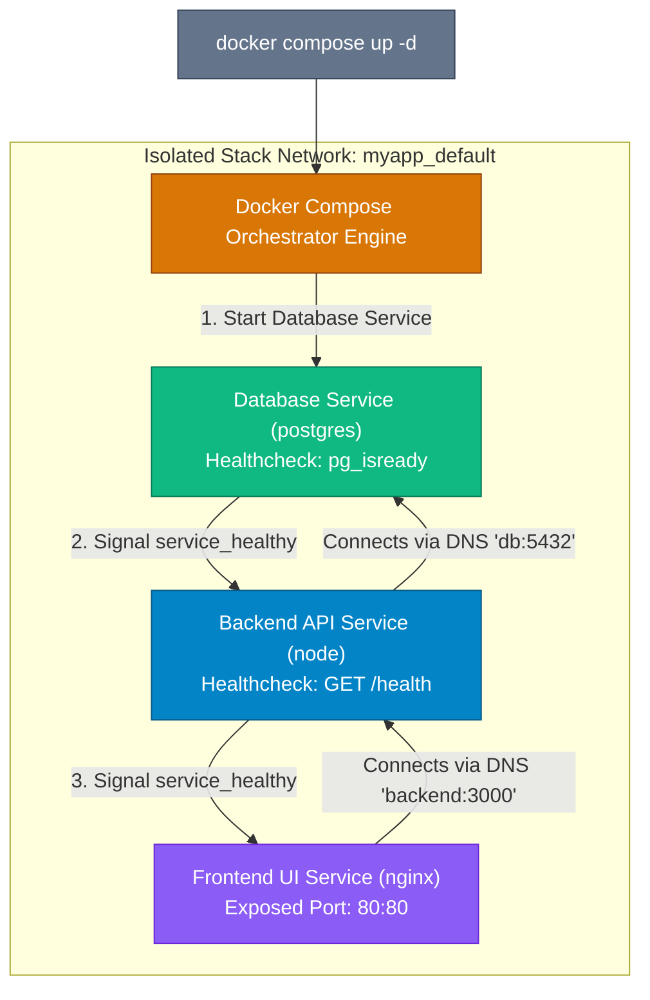

## High-Level Concept Definition & Real-World Analogy

**Docker Compose** is a multi-container orchestration tool that defines and runs complex, multi-service application stacks using a single declarative YAML configuration manifest (`docker-compose.yml`).

### Core Architectural Features
*   **Declarative Infrastructure**: Defines containers, networks, volumes, environment variables, and resource quotas in a version-controlled YAML specification.
*   **Deterministic Dependency Ordering**: Manages startup/shutdown order using `depends_on` coupled with `healthcheck` status probes.
*   **Automatic Stack Isolation**: Creates isolated project networks automatically, enabling services to discover each other via internal DNS service names.

### Real-World Analogy: The Symphony Conductor & Stage Production Crew

To visualize Docker Compose multi-container orchestration, consider a **Symphony Conductor and Stage Production Crew**:

*   **`docker-compose.yml` Manifest**: The **Master Musical Score & Stage Script**. Defines which instruments (`services`) play, what volume lockers (`volumes`) they use, and what audio cables (`networks`) connect them.
*   **Docker Compose CLI (`docker compose up`)**: The **Symphony Conductor**. Raises the baton and signals all musicians to take the stage in synchronized order.
*   **Service Dependency (`depends_on: service_healthy`)**: The **Stage Lighting Cue**. The lead singer (`Web App`) refuses to step onto stage until the drummer (`Database`) finishes setting up and signals readiness (`healthcheck: PASS`).
*   **Healthcheck Probe (`healthcheck`)**: The **Backstage Sound Engineer Test**. Periodically asks the microphone: *"Testing 1, 2, 3..."* (`curl -f http://localhost:8080/health`). If silent, marks performer UNHEALTHY!
*   **Isolated Project Network**: A **Dedicated Backstage Intercom Channel**. The brass section talks to percussion without interference from main theater speakers.



---

## Structured Module Roadmap

| Module | Core Topics | Key Focus & Engineering Concepts | Read Time |
| :--- | :--- | :--- | :--- |
| **Manifest Architecture** | `services`, `networks`, `volumes`, `environment` | Declarative YAML Spec, Variable Substitution (`.env`), Inheritance | 5 min |
| **Healthchecks & Dependencies** | `depends_on`, `condition: service_healthy`, `test` | Active Probing, Preventing Race Conditions, Failure Recovery | 5 min |
| **Network & Storage Isolation** | Custom Networks, Internal DNS, Multi-Tier | Tiered Network Separation, Database Isolation, Volume Mapping | 4 min |
| **Production Resource Quotas** | `deploy.resources.limits`, Restart Policies | CPU/RAM Quotas, OOM Prevention, Automatic Container Restarts | 5 min |

---

## Quick Reference & Comparison Matrices

### 1. Docker Compose Directives & Operational Taxonomy Matrix

| Directive Key | Functional Role | Operational Behavior & Engine Action |
| :--- | :--- | :--- |
| **`services`** | Defines container workloads | Specifies image, build context, environment, and runtime flags per container. |
| **`depends_on`** | Controls startup/shutdown sequence | Delays starting dependent service until prerequisite matches condition (`service_healthy`). |
| **`healthcheck`** | Probes active container health | Executes test command periodically; transitions container status `healthy` / `unhealthy`. |
| **`networks`** | Configures network topologies | Attaches services to custom bridge networks; enables internal DNS resolution. |
| **`volumes`** | Configures storage persistency | Mounts named volumes or bind mounts into specified service paths. |
| **`deploy.resources`** | Enforces resource limits | Constrains maximum CPU fraction (`cpus: '0.5'`) and RAM allocation (`memory: 512M`). |

### 2. Container Restart Policies Comparison Matrix

| Restart Policy | Container Exit Code 0 (Clean) | Container Exit Code != 0 (Crash) | Host Reboot Behavior |
| :--- | :--- | :--- | :--- |
| **`no`** *(Default)* | Does not restart | Does not restart | Does not restart |
| **`always`** | Restarts immediately | Restarts immediately | Restarts container on host boot |
| **`on-failure`** | Does not restart | Restarts (up to max retries) | Does not restart |
| **`unless-stopped`** | Does not restart | Restarts immediately | Restarts on host boot unless explicitly stopped |

---

## Architectural Deep-Dive & Engineering Concepts

### Production Multi-Container Manifest (`docker-compose.yml`)

A production-ready stack with database healthcheck probes, network tier isolation, and resource quotas:

```yaml
version: '3.8'

services:
  # -----------------------------------------------------------
  # 1. DATABASE SERVICE (Tier 1: Data Storage)
  # -----------------------------------------------------------
  db:
    image: postgres:16-alpine
    container_name: production-db
    restart: unless-stopped
    environment:
      POSTGRES_DB: app_db
      POSTGRES_USER: app_user
      POSTGRES_PASSWORD_FILE: /run/secrets/db_password
    secrets:
      - db_password
    volumes:
      - postgres_data:/var/lib/postgresql/data
    networks:
      - backend-net
    # Active Healthcheck Probe
    healthcheck:
      test: ["CMD-SHELL", "pg_isready -U app_user -d app_db"]
      interval: 5s
      timeout: 3s
      retries: 5
      start_period: 10s
    deploy:
      resources:
        limits:
          cpus: '1.0'
          memory: 1024M

  # -----------------------------------------------------------
  # 2. BACKEND API SERVICE (Tier 2: Application Logic)
  # -----------------------------------------------------------
  api:
    build:
      context: .
      dockerfile: Dockerfile
    container_name: production-api
    restart: unless-stopped
    environment:
      NODE_ENV: production
      DB_HOST: db # Internal DNS resolution by service name!
      DB_PORT: 5432
    networks:
      - backend-net
      - frontend-net
    # Wait for DB to be HEALTHY (Not just started!)
    depends_on:
      db:
        condition: service_healthy
    healthcheck:
      test: ["CMD", "curl", "-f", "http://localhost:3000/health"]
      interval: 10s
      timeout: 3s
      retries: 3
    deploy:
      resources:
        limits:
          cpus: '0.5'
          memory: 512M

  # -----------------------------------------------------------
  # 3. REVERSE PROXY FRONTEND (Tier 3: Ingress Traffic)
  # -----------------------------------------------------------
  proxy:
    image: nginx:alpine
    container_name: production-proxy
    restart: unless-stopped
    ports:
      - "80:80"
      - "443:443"
    volumes:
      - ./nginx.conf:/etc/nginx/conf.d/default.conf:ro
    networks:
      - frontend-net
    depends_on:
      api:
        condition: service_healthy

# -------------------------------------------------------------
# ISOLATED NETWORKS & VOLUMES SPECIFICATION
# -------------------------------------------------------------
networks:
  backend-net:
    internal: true # Air-gapped network: No outward internet access!
  frontend-net:

volumes:
  postgres_data:

secrets:
  db_password:
    file: ./secrets/db_password.txt
```

<Callout type="warning">
**The `depends_on` Race Condition Trap**  
Writing `depends_on: [db]` merely waits for the database container *process* to start. PostgreSQL takes 5–10 seconds to initialize socket connections! If the API connects immediately, it crashes. Always pair `depends_on` with `condition: service_healthy` and an active `healthcheck` probe.
</Callout>

---

## Interactive Self-Assessment Checkpoints

<Quiz 
  question="Why is `depends_on: [db]` insufficient by itself to prevent a Web API service from crashing on startup when connecting to a PostgreSQL database container?" 
  options={[
    "Because `depends_on` deletes the database container.", 
    "Because `depends_on` only waits for the database container process to launch, NOT for PostgreSQL to initialize sockets and accept connections. Paired `healthcheck` probes are required.", 
    "Because Compose requires all services to run in Python.", 
    "Because Docker Compose cannot manage database containers."
  ]} 
  answerIndex={1}
>
  Option B is correct. Startup race condition mechanics:
  * `depends_on` (simple list format) checks container process launch state.
  * PostgreSQL takes several seconds to run initialization scripts and open port `5432`.
  * Using `depends_on` with `condition: service_healthy` ensures the API waits until `pg_isready` healthcheck returns exit code 0.
</Quiz>

<Quiz 
  question="How does Docker Compose enable the `api` service to connect to the `db` service using the hostname 'db' (`DB_HOST=db`) without hardcoding IP addresses?" 
  options={[
    "Compose automatically edits `/etc/hosts` files on developer computers.", 
    "Compose creates an isolated project network with an embedded DNS server that automatically resolves service names to active container IP addresses.", 
    "Compose routes all traffic through public cloud DNS servers.", 
    "Compose converts service names into MAC addresses."
  ]} 
  answerIndex={1}
>
  Option B is correct. Embedded DNS discovery:
  * Compose creates a project bridge network (e.g. `myapp_default`).
  * Embedded DNS server (`127.0.0.11`) registers service names as hostnames, resolving `db` to `172.x.x.x` dynamically.
</Quiz>

<Quiz 
  question="What security advantage does setting `internal: true` on a custom Compose network provide for backend database containers?" 
  options={[
    "It encrypts all hard drives using AES-256.", 
    "It creates an air-gapped network with zero outbound internet access, preventing database containers from leaking data or communicating outside host networks.", 
    "It accelerates CPU processing speeds.", 
    "It automatically backs up data to AWS S3."
  ]} 
  answerIndex={1}
>
  Option B is correct. Air-gapped network security:
  * `internal: true` isolates the network from external gateway interfaces.
  * Prevents compromised database containers from making outbound connections to malicious external servers.
</Quiz>

<Problem title="Problem: Deploying and Monitoring a Multi-Container Compose Stack">
<ProblemDescription>
Write the terminal command pipeline to launch a multi-container stack defined in `docker-compose.yml` in detached mode, inspect service logs, verify container health states, and perform a graceful teardown.
</ProblemDescription>
<ProblemSolution>
Execute the standard Docker Compose v2 lifecycle management CLI commands:

```bash
# 1. Validate docker-compose.yml syntax and configuration
$ docker compose config

# 2. Launch all services in background detached mode (rebuilding images if modified)
$ docker compose up -d --build

# 3. Display status and active healthcheck states of running stack services
$ docker compose ps

# 4. Stream real-time logs for the API service specifically
$ docker compose logs -f api

# 5. Execute a command inside a running service container
$ docker compose exec db pg_isready -U app_user -d app_db

# 6. Gracefully stop and remove containers, networks, and ephemeral volumes
$ docker compose down -v
```
</ProblemSolution>
</Problem>
