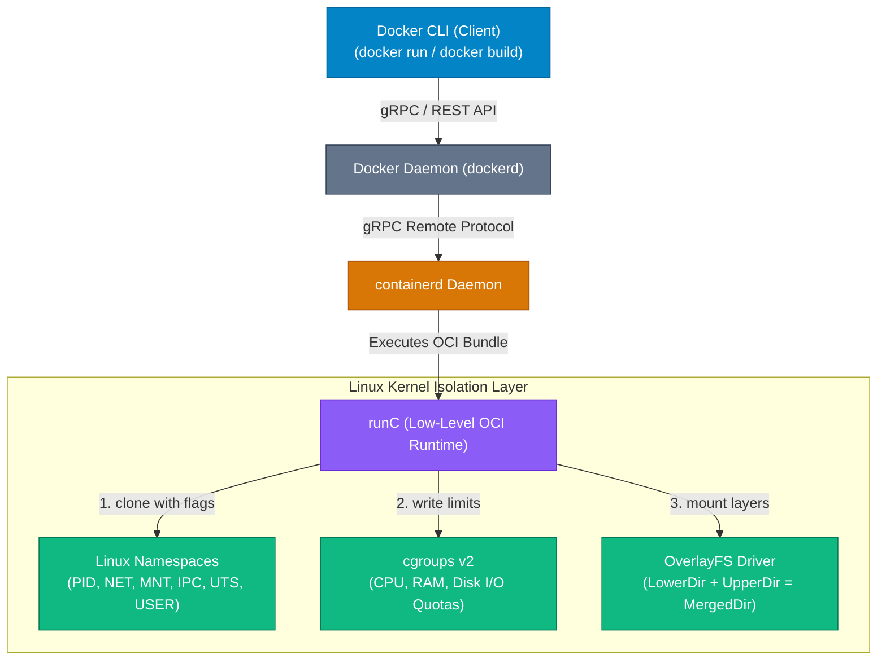

## High-Level Concept Definition & Real-World Analogy

The **Docker Engine** is a client-server application built on top of modular OCI-compliant (Open Container Initiative) container runtimes and low-level Linux kernel isolation primitives.

### Core Architectural Components
*   **Docker Daemon (`dockerd`)**: High-level REST API service managing images, volumes, networks, and container lifecycles.
*   **`containerd`**: OCI-compliant core container execution daemon handling image transfer, storage, and container supervision.
*   **`runC`**: Low-level lightweight OCI CLI tool that directly interacts with the Linux kernel to create and run containers.
*   **Kernel Isolation Primitives**: Namespaces (visibility), cgroups v2 (resource quotas), and OverlayFS (storage driver).

### Real-World Analogy: The Autonomous Prefab Apartment Complex

To visualize Docker Engine architecture, consider an **Autonomous Prefab Apartment Complex**:

*   **Docker Client (`docker`)**: The **Resident Intercom Keypad**. Takes resident orders (`docker run`) and relays requests to management.
*   **Docker Daemon (`dockerd`)**: The **General Building Manager**. Translates tenant requests into building operations, coordinates security, utilities, and room blueprints.
*   **`containerd`**: The **Chief Modular Construction Supervisor**. Supervises apartment assembly, fetches prefabricated room materials, and maintains room status.
*   **`runC`**: The **Hydraulic Construction Crane Engine**. Does the low-level physical heavy lifting to bolt down a room, attach utility pipes, and seal the door.
*   **Linux Namespaces**: **One-Way Tinted Glass Windows**. Ensures occupants in Apartment 101 cannot peek into or access Apartment 102.
*   **Control Groups (cgroups v2)**: **Smart Utility Circuit Breakers**. Limits how many kilowatts of power (CPU) or gallons of water (RAM) an apartment can consume per hour.
*   **OverlayFS**: **Stackable Prefab Floor Panels**. Combines modular read-only floor layers into a unified living space.



---

## Structured Module Roadmap

| Module | Core Topics | Key Focus & Engineering Concepts | Read Time |
| :--- | :--- | :--- | :--- |
| **Daemon & Runtime Architecture** | `dockerd`, `containerd`, `runC`, OCI Spec | Modular Container Stack, gRPC Protocol, Shim Process Management | 5 min |
| **Linux Kernel Namespaces** | `pid`, `net`, `mnt`, `ipc`, `uts`, `user` | Process Isolation, Network Stack Isolation, User Mapping Security | 5 min |
| **Control Groups (cgroups v2)** | CPU Quotas, Memory Limits, OOM Killer | Resource Throttling, Unified Hierarchy, Memory Exhaustion Handling | 4 min |
| **OverlayFS Storage Driver** | LowerDir, UpperDir, WorkDir, MergedDir | Copy-on-Write (CoW) Mechanics, Image Layer Merging, Write Overhead | 4 min |

---

## Quick Reference & Comparison Matrices

### 1. The 6 Core Linux Kernel Namespaces Isolation Matrix

| Namespace Flag | Kernel Subsystem | What it Isolates Inside Container | Security & Operational Impact |
| :--- | :--- | :--- | :--- |
| **`CLONE_NEWPID`** | Process IDs (`pid`) | Container processes receive isolated PIDs (`PID 1` inside container). | Container processes cannot view or signal host processes. |
| **`CLONE_NEWNET`** | Network Stack (`net`) | Network interfaces, IP routing tables, `iptables` rules, socket ports. | Container gets dedicated virtual loopback and `eth0` interface. |
| **`CLONE_NEWNS`** | Mount Points (`mnt`) | Filesystem mount point tree and directory structures. | Container root `/` is decoupled from host filesystem root. |
| **`CLONE_NEWIPC`** | Inter-Process Comm (`ipc`) | System V IPC objects and POSIX message queues. | Prevents shared memory segment access between containers. |
| **`CLONE_NEWUTS`** | Hostname & Domain (`uts`) | Hostname and NIS domain name settings. | Container sets custom hostname without modifying host hostname. |
| **`CLONE_NEWUSER`** | User & Group IDs (`user`) | Maps container `root` (UID 0) to unprivileged host UID. | Prevents container root breakouts from gaining host root privileges. |

### 2. OverlayFS Layer Directory Architecture Taxonomy

| OverlayFS Directory | Mutability State | Layer Contents & Operational Role |
| :--- | :--- | :--- |
| **`LowerDir`** | Read-Only (Immutable) | The stacked read-only Docker image layers containing OS libraries and code. |
| **`UpperDir`** | Read-Write (Mutable) | The thin writable container layer holding runtime modifications, new files, and logs. |
| **`WorkDir`** | Internal Engine Use | Used internally by Linux kernel to prepare atomic Copy-on-Write modifications. |
| **`MergedDir`** | Virtual Unified View | The unified mount point exposed to container processes as the root `/` filesystem. |

---

## Architectural Deep-Dive & Engineering Concepts

### OverlayFS Copy-on-Write (CoW) Engine Mechanics

OverlayFS eliminates file duplication across containers by sharing read-only `LowerDir` image layers:

```text
[ Container Process Virtual View: MergedDir ]
  ├── /app/server.js  <-- Read from UpperDir (Modified)
  ├── /usr/bin/node   <-- Read from LowerDir (Shared Read-Only)
  └── /etc/alpine-release <-- Read from LowerDir (Shared Read-Only)

[ Physical Disk Layout ]
  ├── UpperDir  (Writable Container Layer) : [/app/server.js]
  └── LowerDir  (Read-Only Image Layers)   : [/usr/bin/node, /etc/alpine-release]
```

### Copy-on-Write (CoW) Execution Steps
1.  **Read Operation**: When a process reads `/usr/bin/node`, OverlayFS reads directly from the read-only `LowerDir`. Zero copy overhead!
2.  **Write Operation**: When a process modifies `/etc/config.json` existing in `LowerDir`, OverlayFS intercepts the write, copies `/etc/config.json` up into `UpperDir` (Copy-on-Write), and applies modifications to the `UpperDir` copy.
3.  **Delete Operation**: When a process deletes a file from `LowerDir`, OverlayFS creates a special **whiteout character device** in `UpperDir` to mask the file from the merged view.

<Callout type="warning">
**Performance Trade-off: High I/O Heavy Databases on OverlayFS**  
Copy-on-Write introduces disk latency during initial file writes. Never run high-throughput databases (PostgreSQL, MySQL, Redis) directly on the container's OverlayFS `UpperDir` layer! Always use **Named Volumes** or **Bind Mounts** to bypass OverlayFS and write directly to host storage.
</Callout>

---

## Interactive Self-Assessment Checkpoints

<Quiz 
  question="What is the architectural role of `runC` in the Docker Engine execution pipeline?" 
  options={[
    "It manages container networking DNS records.", 
    "It is a low-level, lightweight OCI CLI tool that directly invokes Linux kernel system calls (clone, unshare) to instantiate containers.", 
    "It converts Dockerfiles into Python scripts.", 
    "It monitors remote GitHub repository branches."
  ]} 
  answerIndex={1}
>
  Option B is correct. Execution pipeline responsibilities:
  * `dockerd`: REST API and high-level management.
  * `containerd`: Image management and container supervision.
  * `runC`: Interacts directly with Linux kernel primitives to launch containers, exiting immediately after process initialization (`containerd-shim` takes over monitoring).
</Quiz>

<Quiz 
  question="How does the Linux `CLONE_NEWUSER` namespace enhance container security?" 
  options={[
    "It encrypts all container user passwords using AES-256.", 
    "It allows a process to run with UID 0 (root) inside the container while mapping to a non-privileged user ID (e.g. UID 10001) on the host system.", 
    "It prevents containers from connecting to the internet.", 
    "It forces all container processes to execute in C++."
  ]} 
  answerIndex={1}
>
  Option B is correct. User Namespace Isolation:
  * Maps internal container `root` (UID 0) to a high unprivileged UID on the host.
  * If an attacker breaks out of the container filesystem, they hold zero root privileges on the underlying host kernel.
</Quiz>

<Quiz 
  question="What happens in OverlayFS when a process inside a container modifies a file residing in a read-only `LowerDir` layer?" 
  options={[
    "The modification fails with a Read-Only Filesystem error.", 
    "OverlayFS performs a Copy-on-Write (CoW) operation, copying the file to the writable `UpperDir` layer before applying changes.", 
    "OverlayFS modifies the original Docker image layer permanently for all containers.", 
    "The container restarts automatically."
  ]} 
  answerIndex={1}
>
  Option B is correct. Copy-on-Write (CoW) logic:
  * Original `LowerDir` image layers remain 100% immutable.
  * Modified file is copied up to `UpperDir` (container layer) where writes occur, masking the original file in `MergedDir`.
</Quiz>

<Problem title="Problem: Inspecting OverlayFS Layer Mount Points in Runtime">
<ProblemDescription>
Write a Linux command sequence using `docker inspect` and `mount` to inspect the exact `LowerDir`, `UpperDir`, `WorkDir`, and `MergedDir` host filesystem paths for a running container.
</ProblemDescription>
<ProblemSolution>
Query container graph driver inspect data and verify mount points:

```bash
# 1. Run a test container
$ docker run -d --name overlay-demo alpine sleep 3600

# 2. Extract OverlayFS directory paths via docker inspect
$ docker inspect overlay-demo --format '{{ json .GraphDriver.Data }}' | jq .

# Example Output:
# {
#   "LowerDir": "/var/lib/docker/overlay2/ab12.../diff",
#   "UpperDir": "/var/lib/docker/overlay2/cd34.../diff",
#   "WorkDir":  "/var/lib/docker/overlay2/cd34.../work",
#   "MergedDir": "/var/lib/docker/overlay2/cd34.../merged"
# }

# 3. Create a file inside container and verify it appears in host UpperDir!
$ docker exec overlay-demo touch /app-created-file.txt
$ UPPER_DIR=$(docker inspect overlay-demo --format '{{ .GraphDriver.Data.UpperDir }}')
$ ls -la $UPPER_DIR/app-created-file.txt
# Output: Shows the file physically created inside host UpperDir layer!
```
</ProblemSolution>
</Problem>
