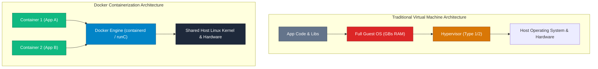

## High-Level Concept Definition & Real-World Analogy

**Docker** is an open-source containerization platform that enables developers to package applications and their complete dependency trees into standardized, isolated execution environments called **Containers**.

### Core Architectural Features
*   **OS-Level Virtualization**: Shares the host operating system kernel across containers instead of running full guest OS instances.
*   **Environment Parity**: Eliminates the "works on my machine" bug by bundling binaries, libraries, configuration, and runtime dependencies together.
*   **Sub-Second Startup**: Launches isolated process environments in milliseconds with near-zero CPU/RAM virtualization overhead.

### Real-World Analogy: Intermodal Shipping Containers & Prefab Apartments

To visualize containerization versus hardware virtualization, consider the **Intermodal Freight Shipping Revolution**:

*   **Pre-Docker Era (Custom Cargo Handling)**: Shipping loose bananas, sacks of coffee, and wooden barrels required custom manual loading for every ship, train, and truck platform.
*   **Virtual Machines (Complete Houses Transported)**: Shipping an entire furnished house (complete with its own foundation, plumbing, and electrical generators) inside a cargo ship just to deliver a toaster.
*   **Docker Container (Standardized Intermodal ISO Crate)**: A **Standardized Steel Crate**. Standard dimensions, corner locks, and lifting hooks (`Docker CLI / OCI Spec`). Ships (`Linux Host Kernel`) carry thousands of crates without caring what payload lives inside!
*   **Docker Image**: A **Factory Blueprint & Stencil Spec**. Read-only architectural specs detailing exact room layouts and furniture placements.
*   **Docker Engine**: The **Automated Crane & Loading Dock**. Instantiates active physical containers from read-only blueprint specs.



---

## Structured Module Roadmap

| Module | Core Topics | Key Focus & Engineering Concepts | Read Time |
| :--- | :--- | :--- | :--- |
| **[Docker Engine Architecture](./docker-engine-architecture)** | `dockerd`, `containerd`, `runC`, Namespaces, cgroups v2, OverlayFS | Linux Kernel Isolation Primitives, Copy-on-Write Storage Drivers | 18 min |
| **[Dockerfile & Image Optimization](./dockerfiles-and-images)** | Immutability, Layer Caching, Multi-Stage Builds, Distroless | Minimizing Attack Surface, Cache Layer Hashing, `CMD` vs `ENTRYPOINT` | 16 min |
| **[Networking, Storage & Volumes](./container-networking-and-volumes)** | Bridge, Host, Overlay, NAT, Named Volumes vs Bind Mounts | Network Driver Isolation, `iptables` Routing, Persistent Storage | 17 min |
| **[Docker Compose & Orchestration](./docker-compose-and-orchestration)** | `docker-compose.yml`, Healthchecks, Dependencies, Resource Limits | Multi-Container Application Stacks, Production Resource Quotas | 19 min |

---

## Quick Reference & Comparison Matrices

### 1. Virtual Machines vs. Docker Containers Comparison Matrix

| Architectural Dimension | Virtual Machines (KVM, VMware, ESXi) | Docker Containers |
| :--- | :--- | :--- |
| **Virtualization Level** | Hardware-Level Abstraction (Hypervisor) | OS Kernel-Level Abstraction |
| **Guest OS Requirement** | Mandatory Full Guest OS (GBs Disk/RAM) | No Guest OS (Shares Host Linux Kernel) |
| **Startup Latency** | Minutes (Boots virtual BIOS & Kernel) | Milliseconds (Forks isolated process) |
| **Storage Footprint** | Gigabytes (10 GB - 50 GB per VM) | Megabytes (5 MB - 500 MB per image) |
| **CPU/RAM Performance** | 5% - 15% Hypervisor Overhead | Near Native (< 1% Kernel Overhead) |
| **Process Isolation** | Hardware-Enforced Ring 0 Memory Isolation | Linux Kernel Namespaces + cgroups |
| **Portability Index** | Moderate (Large OVA/VMDK image sizes) | Maximum (Lightweight OCI Container Images) |

### 2. Containerization Use-Case Taxonomy

| Operational Requirement | Recommended Architecture | Key Technical Justification |
| :--- | :--- | :--- |
| **Microservices Backend** | Docker Containers | Fast startup, low memory footprint per instance, easy horizontal autoscaling. |
| **Legacy Multi-OS Monolith** | Virtual Machines | Requires kernel-level OS modifications or legacy Windows/Linux kernel driver bindings. |
| **CI/CD Build Pipelines** | Docker Containers | Ephemeral build agents created in milliseconds and destroyed immediately after testing. |
| **Multi-Tenant Security Hardening** | VMs or MicroVMs (Firecracker) | Hard hardware virtualization boundary required when running untrusted user code. |

---

## CLI Command Masterclass: System Diagnostics & Maintenance

### 1. `docker info` & `docker system df`

*   **Mental Model**: Queries high-level Docker Daemon (`dockerd`) status, driver configuration, and storage utilization.

| Command & Flag | Operational Purpose |
| :--- | :--- |
| `docker info` | Displays active storage driver (OverlayFS), cgroup driver (`systemd`), and total container count. |
| `docker system df` | Summarizes disk space consumed by images, containers, local volumes, and build cache. |
| `docker system df -v` | **Verbose Mode**: Breaks down disk usage line-by-line for every individual container and layer. |

```bash
# Production Disk Usage Inspection
$ docker system df
```

---

### 2. `docker system prune`

*   **Mental Model**: Reclaims disk space by purging stopped containers, dangling build caches, and unreferenced networks/images.

```bash
# Safe Prune: Purges stopped containers and dangling images
$ docker system prune

# Aggressive Production Cleanup (Clears unused images and unattached volumes)
$ docker system prune -a --volumes -f
```

---

## Architectural Deep-Dive & Engineering Concepts

### The Three Pillars of Container Isolation

Docker container isolation relies on three foundational Linux kernel primitives:

*   **1. Linux Namespaces (Process Isolation)**: Restricts what a process can **see**. Isolates Process IDs (`pid`), Network Interfaces (`net`), Filesystem Mount Points (`mnt`), IPC (`ipc`), Hostnames (`uts`), and User IDs (`user`).
*   **2. Control Groups / cgroups v2 (Resource Quotas)**: Restricts what a process can **consume**. Enforces strict upper limits on CPU execution time, RAM memory usage, Disk I/O bandwidth, and network throughput.
*   **3. UnionFS / OverlayFS (Storage Layering)**: Combines multiple read-only image layers with a single thin read-write container layer into a unified virtual filesystem using Copy-on-Write (CoW).

---

## Interactive Self-Assessment Checkpoints

<Quiz 
  question="Why do Docker containers start up in milliseconds while Virtual Machines take minutes to boot?" 
  options={[
    "Because Docker containers use GPU memory instead of RAM.", 
    "Because containers do not boot a new guest operating system kernel; they simply fork isolated process groups directly on the already-running host Linux kernel.", 
    "Because containers delete all temporary files before starting.", 
    "Because Docker containers run exclusively inside web browsers."
  ]} 
  answerIndex={1}
>
  Option B is correct. Key startup mechanics:
  * **VMs**: Must emulate virtual hardware, execute BIOS initialization, load a guest OS kernel into memory, and initialize system services (systemd).
  * **Containers**: Fork a process on the host kernel using `clone()` with namespace flags, executing in milliseconds.
</Quiz>

<Quiz 
  question="Which Linux kernel feature is responsible for restricting the maximum amount of RAM memory a Docker container can consume?" 
  options={[
    "Linux Namespaces", 
    "Control Groups (cgroups)", 
    "OverlayFS Storage Driver", 
    "iptables NAT Routing"
  ]} 
  answerIndex={1}
>
  Option B is correct. Kernel isolation roles:
  * **Namespaces**: Control process visibility (what a container can see).
  * **Control Groups (cgroups)**: Enforce resource allocation quotas (what a container can consume: RAM, CPU, I/O).
</Quiz>

<Quiz 
  question="What happens if a process running inside a container exceeds its configured `memory` cgroup limit?" 
  options={[
    "The host operating system crashes immediately.", 
    "The Linux kernel Out-Of-Memory (OOM) Killer terminates the container process (Exit Code 137).", 
    "Docker automatically expands host RAM capacity.", 
    "The container slows down but continues running indefinitely."
  ]} 
  answerIndex={1}
>
  Option B is correct. OOM Killer behavior:
  * When a container's memory consumption hits its `cgroup` threshold, the kernel's OOM Killer intervenes and kills the memory-exceeding process.
  * Docker reports container status as `Exited (137)`.
</Quiz>

<Problem title="Problem: Inspecting Container Resource Allocation vs Host OS">
<ProblemDescription>
Write a Linux terminal command sequence to verify that a running container is executing as a standard process group on the host kernel, and inspect its assigned cgroup memory limit directly from the host filesystem.
</ProblemDescription>
<ProblemSolution>
Locate the container process ID (PID) on the host and inspect `/proc/<PID>/cgroup`:

```bash
# 1. Run a background Nginx container
$ docker run -d --name test-nginx --memory="256m" nginx:alpine

# 2. Find the host Process ID (PID) of the container's main process
$ HOST_PID=$(docker inspect --format '{{ .State.Pid }}' test-nginx)
$ echo "Host Process ID: $HOST_PID"

# 3. Inspect host process tree (shows Nginx running as a standard host process!)
$ ps aux | grep $HOST_PID

# 4. Read memory limit from cgroups v2 directly on the host filesystem
$ cat /sys/fs/cgroup/docker/$(docker inspect --format '{{ .Id }}' test-nginx)/memory.max
# Output: 268435456 (256 MB in bytes!)
```
</ProblemSolution>
</Problem>
