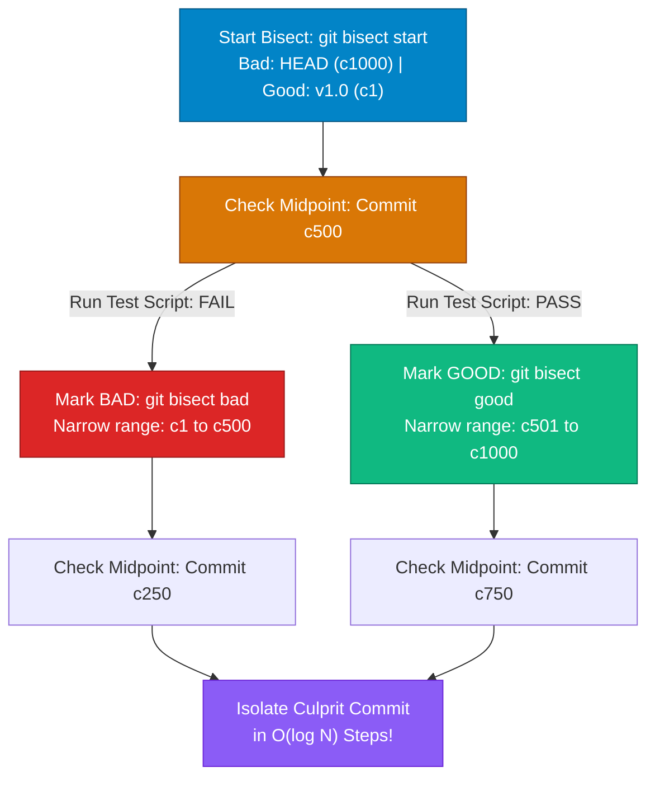

## High-Level Concept Definition & Real-World Analogy

**Production Troubleshooting and Recovery** in Git provides diagnostic tools and recovery workflows for isolating regressions, restoring corrupted states, and managing multi-branch work.

### Core Architectural Features
*   **Logarithmic Bug Isolation (`git bisect`)**: Runs a binary search (O(log N)) across commit history to isolate regression-introducing commits.
*   **Multi-Directory Worktrees (`git worktree`)**: Enables concurrent checkouts of multiple branches on disk using a single `.git` object store.
*   **Detached HEAD Resolution**: Tools for anchoring floating commit nodes back onto named branch references.

### Real-World Analogy: The Crime Scene Forensic Investigation Unit

To visualize advanced Git troubleshooting, consider a **Crime Scene Forensic Investigation Unit**:

*   **`git bisect`**: A **Binary Search Crime Scene Interrogation**. Isolates a guilty event across 1,000 commits by checking event 500 first. If clean, jumps to 750. Isolates the culprit commit in ~10 steps (`log2(1000)`).
*   **`git worktree`**: **Multi-Room Parallel Evidence Labs**. Unlocks a second laboratory room (`git worktree add`) connected to the central evidence vault (`.git`), allowing concurrent branch work without re-cloning.
*   **Detached HEAD**: A **Floating Drone Camera**. Floating over an historical commit hologram. New snapshots taken while detached float unanchored until a new branch note is attached.
*   **`git stash`**: A **Temporary Evidence Locker Drawer**. Shelves uncommitted workspace files into a locker drawer to clear your desk for an urgent context switch.



---

## Structured Module Roadmap

| Module | Core Topics | Key Focus & Engineering Concepts | Read Time |
| :--- | :--- | :--- | :--- |
| **`git bisect` Binary Search** | `start`, `good`, `bad`, `run`, O(log N) | Automated Regression Isolation, Test Script Execution Pipeline | 5 min |
| **Git Worktrees Architecture** | `git worktree add`, `.git/worktrees/` | Parallel Branch Checkouts, Shared `.git` Store, Zero-Clone Footprint | 4 min |
| **Detached HEAD Resolution** | Floating HEAD, Temporary Branches | Re-attaching References, Recovering Un-branched Commits | 4 min |
| **Advanced Stash & Cherry-Pick** | `stash push/pop/apply`, `cherry-pick` | Stash Stack Mechanics (`stash@{0}`), Selective Commit Grafting | 4 min |

---

## Quick Reference & Comparison Matrices

### 1. Git Advanced Diagnostics & Isolation Tools Matrix

| Command Tool | Primary Engineering Objective | Execution Complexity | Unique Advantage |
| :--- | :--- | :--- | :--- |
| **`git bisect`** | Isolate bug-introducing commit in revision history | O(log N) Binary Search | Supports automated test execution scripts (`git bisect run <script>`). |
| **`git worktree`** | Checkout multiple branches simultaneously on disk | O(1) Instant Setup | Shares single `.git` object store; eliminates multiple repository clones. |
| **`git cherry-pick`** | Apply specific single commit patch to active branch | O(1) Single Graft | Selectively ports hotfixes without merging entire branch histories. |
| **`git stash`** | Temporarily shelve uncommitted working directory changes | O(1) Stack Operations | Cleans workspace instantly to switch context without creating junk commits. |

### 2. Emergency Recovery Scenarios Taxonomy

| Disaster Scenario | Root Cause | Immediate Recovery Command Pipeline |
| :--- | :--- | :--- |
| **Accidental `git reset --hard`** | Overwrote HEAD and Index to an old commit | Locate lost SHA in `git reflog`, then run `git reset --hard <SHA>`. |
| **Committed on Detached HEAD** | Created commits while HEAD was pointing directly to a SHA | Create a branch at current detached state: `git switch -c <new-branch-name>`. |
| **Accidental Branch Deletion** | Executed `git branch -D feature` prematurely | Find branch tip SHA in `git reflog`, then run `git branch feature <SHA>`. |
| **Corrupted Working Directory** | Modified 50 files; want to reset workspace to clean state | Run `git restore .` (or `git reset --hard HEAD` + `git clean -fd`). |

---

## Architectural Deep-Dive & Engineering Concepts

### 1. Automated Regression Hunting with `git bisect run`

Automating bug isolation using a test script across commits:

```bash
# 1. Start bisect session
$ git bisect start

# 2. Mark current HEAD as BAD
$ git bisect bad HEAD

# 3. Mark last known good tag as GOOD
$ git bisect good v2.4.0

# 4. Automate execution using a test script!
# Exit Code 0 = GOOD (PASS), Exit Code 1-127 = BAD (FAIL)
$ git bisect run npm test
```

### 2. Multi-Branch Parallel Workspaces via `git worktree`

Shared `.git` object store model for concurrent directory checkouts:

```text
/mnt/workspace/kdev-notes/              <-- Main Directory (.git/ lives here)
├── src/
└── content/

/mnt/workspace/kdev-notes-hotfix/       <-- Linked Worktree (.git file points to main .git)
├── src/
└── content/
```

```bash
# 1. Add linked worktree directory checked out to "hotfix/security"
$ git worktree add ../kdev-notes-hotfix hotfix/security

# 2. Work in hotfix directory independently without switching main workspace
$ cd ../kdev-notes-hotfix
$ git status

# 3. Remove linked worktree directory when finished
$ cd ../kdev-notes
$ git worktree remove ../kdev-notes-hotfix
```

<Callout type="tip">
**Why `git worktree` Saves Disk Space and RAM**  
Cloning a 5 GB repository 3 times consumes 15 GB of disk space. Creating linked worktrees via `git worktree add` consumes **zero extra object space**, because all worktrees read from the single original `.git/objects` database.
</Callout>

---

## Interactive Self-Assessment Checkpoints

<Quiz 
  question="How many manual testing steps does `git bisect` require to isolate a bug across a revision range of 1,024 commits?" 
  options={[
    "1,024 steps.", 
    "512 steps.", 
    "Approximately 10 steps (log2(1024) = 10).", 
    "1 step."
  ]} 
  answerIndex={2}
>
  Option C is correct. Binary search complexity:
  * For 1,024 commits, `log2(1024) = 10` evaluation steps maximum to pinpoint the bug.
</Quiz>

<Quiz 
  question="What happens if a developer creates new commits while in a 'Detached HEAD' state and then switches to another branch without creating a new branch reference?" 
  options={[
    "The new commits are automatically pushed to GitHub.", 
    "The new commits become unreferenced 'floating' nodes in the DAG and will eventually be permanently deleted by `git gc` unless a branch reference is attached.", 
    "Git converts the commits into files in the root folder.", 
    "The workspace is locked permanently."
  ]} 
  answerIndex={1}
>
  Option B is correct. Detached HEAD mechanics:
  * Commits created while detached are unreferenced (dangling).
  * Switching branches leaves them floating in `.git/objects`. Rescue them via `git reflog` before `git gc` prunes them.
</Quiz>

<Quiz 
  question="What is the primary architectural advantage of using `git worktree add` over cloning a repository multiple times into different folders?" 
  options={[
    "Worktrees disable Git security checks.", 
    "Worktrees share a single central `.git` object database across multiple active workspace directories on disk, saving disk space and eliminating fetch duplication.", 
    "Worktrees automatically translate code between Python and Java.", 
    "Worktrees run exclusively inside Docker containers."
  ]} 
  answerIndex={1}
>
  Option B is correct. Linked Worktree benefits:
  * Shares `.git/objects` and `.git/refs` across workspace folders.
  * Permits simultaneous checkouts of different branches without re-cloning repository history.
</Quiz>

<Problem title="Problem: Recovering Commits Created on Detached HEAD">
<ProblemDescription>
You spent 2 hours fixing code while in a Detached HEAD state, created 2 commits (`a1b2c3d` and `e5f6g7h`), and then accidentally ran `git checkout main`. Your new commits disappeared from `git log`. Walk through the commands to locate and recover your work into a new branch `feature/recovered-work`.
</ProblemDescription>
<ProblemSolution>
Locate the tip commit SHA using `git reflog` and create a named branch attached to that SHA:

```bash
# Step 1: Inspect reflog to locate the commit SHA created while detached
$ git reflog

# Step 2: Create a new branch named 'feature/recovered-work' pointing to commit e5f6g7h
$ git branch feature/recovered-work e5f6g7h

# Step 3: Switch to the newly created branch
$ git switch feature/recovered-work

# Step 4: Verify that history is intact!
$ git log -n 2
```
</ProblemSolution>
</Problem>
