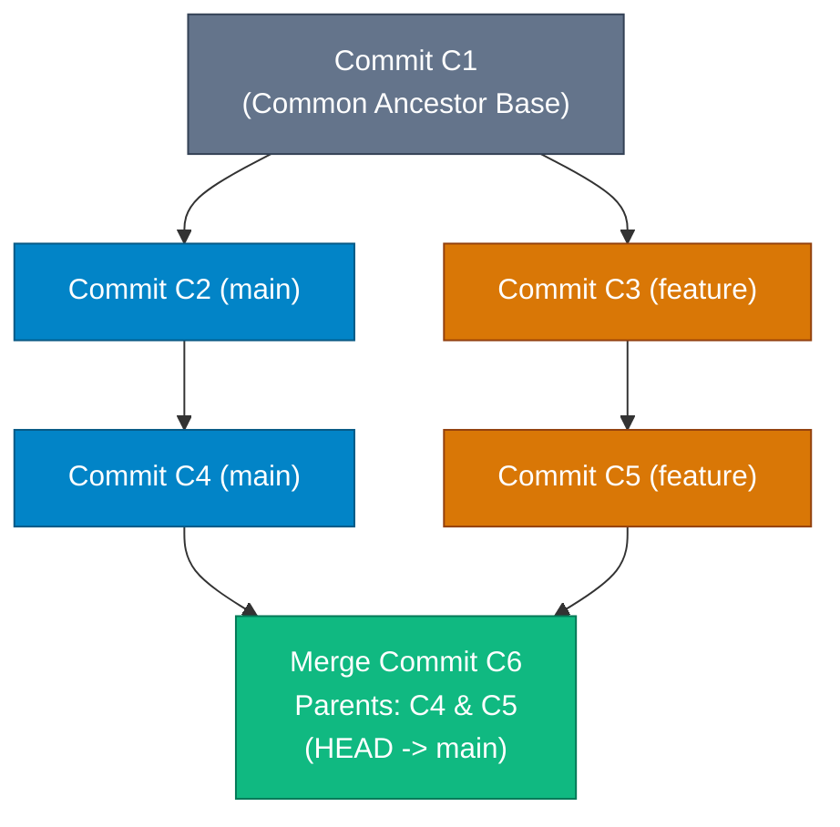

## High-Level Concept Definition & Real-World Analogy

**Branching and Merging** constitute the core concurrency engine of Git.

### Core Architectural Features
*   **Lightweight Pointer Branches**: A branch is a 41-byte reference file (`.git/refs/heads/<branch>`) holding a 40-character commit SHA-1 hash.
*   **Isolated Streams of History**: Allows parallel development features to diverge without affecting the primary `main` branch.
*   **3-Way Merge Engine**: Computes diffs relative to the Best Common Ancestor commit using the high-speed ORT merge engine.

### Real-World Analogy: Railway Track Switches & Junction Integrations

To visualize branching and merging mechanics, consider a **Railway Track System with Switches and Junctions**:

*   **Main Branch (`main`)**: The **Main Express Track Line** where primary trains (commits) roll forward sequentially.
*   **Feature Branch (`feature/auth`)**: A **Parallel Siding Loop Switch**. The track switch flips, allowing a train to branch onto a parallel siding to build features without blocking main line traffic.
*   **Fast-Forward Merge**: An **Accelerated Track Extension**. The main line extends straight forward to catch up with where the siding train reached.
*   **3-Way Merge**: A **Railway Track Junction Join**. Both main and siding tracks built new sections simultaneously; a new junction station (Merge Commit) is built joining two incoming tracks.
*   **Merge Conflict**: A **Track Alignment Blockade**. Two workers modified the exact same rail section differently, requiring an engineer to resolve the alignment.



---

## Structured Module Roadmap

| Module | Core Topics | Key Focus & Engineering Concepts | Read Time |
| :--- | :--- | :--- | :--- |
| **Branch Reference Architecture** | `.git/refs/heads/`, `HEAD` Pointer | Pointer Offset Operations, Detached HEAD States, Symbol References | 4 min |
| **Fast-Forward vs. 3-Way Merge** | Linear History, `--no-ff`, Common Ancestors | Ancestor Graphs, 2-Parent Merge Commits, Linearizing History | 4 min |
| **Merge Engine Mechanics** | Recursive Engine vs. ORT Engine | Best Common Ancestor Computation, Virtual Merges, Renames | 4 min |
| **Conflict Resolution Pipeline** | Conflict Markers, Base/Ours/Theirs | `<<<<<<<`, `=======`, `>>>>>>>`, `git merge --abort`, 3-Way Diff | 4 min |

---

## Quick Reference & Comparison Matrices

### 1. Git Merge Strategies Comparison Matrix

| Merge Strategy | Engine Trigger Condition | Parent Commits Created | Linear History Preserved? | Typical Production Use Case |
| :--- | :--- | :--- | :--- | :--- |
| **Fast-Forward (`--ff`)** | Target branch has zero new commits since divergence | 1 Parent (Pointers updated) | Yes | Short-lived topic branches caught up with main |
| **No Fast-Forward (`--no-ff`)** | Forced via flag even if linear | 2 Parents (Explicit Merge Commit) | No | Preserving explicit feature release boundaries |
| **3-Way Merge (`ort` / `recursive`)** | Target and source branches have both diverged | 2 Parents (Explicit Merge Commit) | No | Standard multi-developer feature branch integrations |
| **Squash Merge (`--squash`)** | Explicit flag specified | 1 Parent (Single combined commit) | Yes | Cleaning up noisy 20-commit WIP PRs into 1 commit |

### 2. The 3-Way Merge Diff Logic Matrix

| Line State in Base (Ancestor) | Line State in Ours (`main`) | Line State in Theirs (`feature`) | 3-Way Engine Decision | Result in Merged Code |
| :--- | :--- | :--- | :--- | :--- |
| `foo = 1;` | `foo = 1;` | `foo = 1;` | No changes made | `foo = 1;` |
| `foo = 1;` | `foo = 2;` | `foo = 1;` | Ours modified; Theirs untouched | `foo = 2;` (Auto-Merged) |
| `foo = 1;` | `foo = 1;` | `foo = 99;` | Theirs modified; Ours untouched | `foo = 99;` (Auto-Merged) |
| `foo = 1;` | `foo = 2;` | `foo = 99;` | **Both modified differently** | **MERGE CONFLICT** |

---

## CLI Command Masterclass: Branching & Merging

### 1. `git branch` & `git switch`

*   **Mental Model**: `git branch` manipulates 41-byte text reference files under `.git/refs/heads/`. `git switch` moves the `.git/HEAD` cursor pointer to a target branch file.

| Command & Flag | Operational Purpose |
| :--- | :--- |
| `git branch -a` | Lists all local and remote-tracking branches (`refs/remotes/origin/`). |
| `git switch -c <name>` | Creates a new branch and instantly flips HEAD cursor to it (replaces `git checkout -b`). |
| `git branch -d <name>` | Safe branch deletion (refuses if branch has unmerged commits). |
| `git branch -D <name>` | **Force Delete**: Deletes branch reference file regardless of merge status. |

---

### 2. `git merge` & `git diff`

*   **Mental Model**: `git merge` executes the 3-Way ORT engine to integrate commit trees. `git diff` calculates line-by-line diffs between tree snapshots.

```bash
# 1. Force Fast-Forward Merge Only (Fails if branch diverged!)
$ git merge --ff-only feature/login

# 2. Force explicit 2-Parent Merge Commit
$ git merge --no-ff feature/payments

# 3. Abort a paused merge conflict cleanly
$ git merge --abort

# 4. View Staged Diffs prepared in Index
$ git diff --staged
```

---

## Interactive Self-Assessment Checkpoints

<Quiz 
  question="Why is a 3-Way Merge able to automatically resolve file updates that a simple 2-Way file comparison tool cannot?" 
  options={[
    "Because 3-Way Merges upload files to cloud servers for AI analysis.", 
    "Because a 3-Way Merge uses the common ancestor commit as a baseline to determine which specific branch introduced a line modification.", 
    "Because 3-Way Merges delete all old files automatically.", 
    "Because 3-Way Merges only run on Linux operating systems."
  ]} 
  answerIndex={1}
>
  Option B is correct. Operational advantage:
  * Incorporates Common Ancestor ($Base$) to compute $(Ours - Base)$ and $(Theirs - Base)$.
  * If $Ours$ changed a line while $Theirs$ matches $Base$, Git knows $Ours$ introduced an intentional update and applies it without prompting.
</Quiz>

<Quiz 
  question="What is the operational result of executing `git merge --no-ff feature` on a linear branch sequence where a fast-forward merge was possible?" 
  options={[
    "Git aborts the merge with an error.", 
    "Git forces the creation of an explicit Merge Commit node with 2 parent commit pointers, preserving the visual feature branch boundary in log graphs.", 
    "Git deletes the feature branch completely.", 
    "Git squashes all commits into 1 single commit."
  ]} 
  answerIndex={1}
>
  Option B is correct. `--no-ff` behavior:
  * Overrides fast-forward pointer sliding.
  * Forces creation of a 2-parent Merge Commit, recording the explicit feature integration boundary in DAG history.
</Quiz>

<Quiz 
  question="What state is the Git repository in immediately after a merge conflict occurs during `git merge`?" 
  options={[
    "The repository automatically deletes the conflicting files.", 
    "The merge is paused, conflict markers are written into workspace files, and the index holds unmerged stage entries (Stage 1: Base, Stage 2: Ours, Stage 3: Theirs).", 
    "The repository resets all local branches to the remote server state.", 
    "The HEAD pointer is permanently broken."
  ]} 
  answerIndex={1}
>
  Option B is correct. Conflict state mechanics:
  * Merge is paused; conflict markers (`<<<<<<<`) are written to files.
  * Index holds 3 stage entries (`1` for Base, `2` for Ours, `3` for Theirs). Developer must resolve, `git add`, and `git commit`.
</Quiz>

<Problem title="Problem: Resolving a Merge Conflict and Completing the Merge Pipeline">
<ProblemDescription>
You executed `git merge feature/payments` while on `main`, but Git halted with a merge conflict in `src/Config.java`. Walk through the exact command sequence to inspect the conflict, resolve it, and finalize the merge commit.
</ProblemDescription>
<ProblemSolution>
Follow the standardized merge conflict resolution workflow:

```bash
# Step 1: Check status to identify conflicting files and stage states
$ git status

# Step 2: Inspect 3-way diff between Base, Ours, and Theirs
$ git diff src/Config.java

# Step 3: Open src/Config.java in an editor and manually resolve markers:
# Remove <<<<<<<, =======, >>>>>>> lines and keep valid production code!

# Step 4: Stage the resolved file to move index out of unmerged state
$ git add src/Config.java

# Step 5: Finalize the merge commit
$ git commit -m "Merge branch 'feature/payments' into main - Resolved Config.java conflict"
```
</ProblemSolution>
</Problem>
