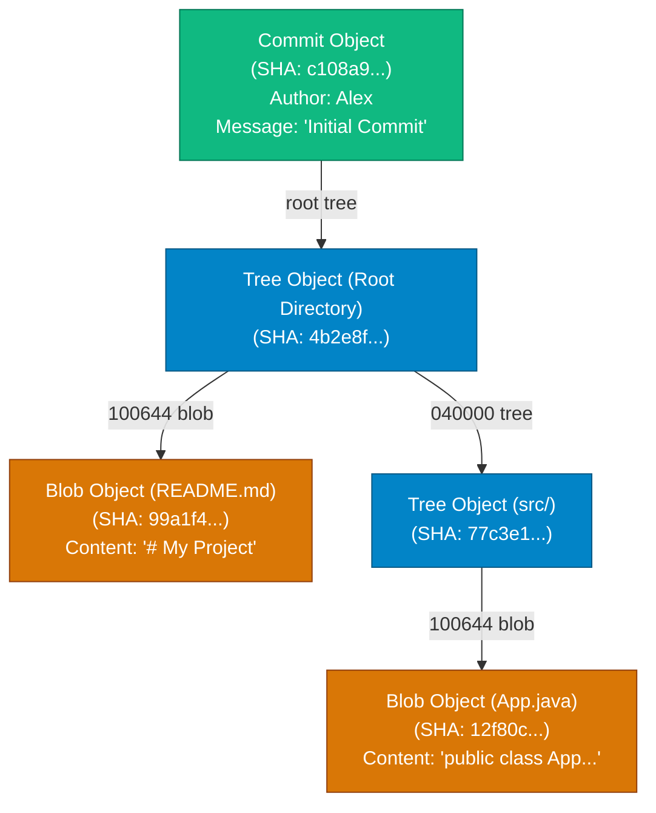

## High-Level Concept Definition & Real-World Analogy

The **Git Object Model** is the underlying key-value storage engine residing inside the `.git/objects/` directory.

### Core Architectural Features
*   **Four Primitive Object Types**: Blobs (file data), Trees (directories), Commits (snapshots), and Annotated Tags (markers).
*   **zlib Compression**: Every object is compressed using zlib deflate and addressed by a 40-character hex SHA-1 key.
*   **Cryptographic Chain**: DAG links prevent undetected modifications to historical commits or file contents.

### Real-World Analogy: The Immutable Museum Vault Archive

To visualize Git's object model internals, consider an **Immutable Museum Vault Archive**:

*   **Blob Object**: A **Sealed Canvas Document** storing raw paint and ink content, independent of room location or frame label.
*   **Tree Object**: An **Exhibition Hall Blueprint Ledger** listing paintings (`Blobs`), wall positions, permissions, and filenames (`"index.html"`).
*   **Commit Object**: An **Official Archival Snapshot Log** recording: *"Curator Alex Mercer photographed Exhibition Hall Blueprint 8f3a2b. Parent: 1a2b3c."*
*   **Loose Objects (`.git/objects/xx/`)**: **Individual Glass Display Cases** storing newly committed objects.
*   **Packfiles (`.git/objects/pack/`)**: **Hydraulic Storage Crates** compressing thousands of loose cases into delta-encoded packs (`git gc`).



---

## Structured Module Roadmap

| Module | Core Topics | Key Focus & Engineering Concepts | Read Time |
| :--- | :--- | :--- | :--- |
| **`.git` Directory Anatomy** | `HEAD`, `config`, `index`, `objects/`, `refs/` | Filesystem Anatomy, Pointer Files, Binary Staging Cache Layout | 4 min |
| **Object Types Deep-Dive** | Blobs, Trees, Commits, Annotated Tags | Headers, Null-byte Delimiters, Binary Format Specification | 5 min |
| **Hashing & Storage Mechanics** | SHA-1 / SHA-256, zlib Compression | Content-Addressable Storage, Loose Object Disk Layout (`objects/xx/`) | 4 min |
| **Packfiles & Delta Storage** | Loose vs. Packfile, `git gc`, Sliding Window | Off-Pack Delta Compression, Memory Optimization, Pack Index (`.idx`) | 5 min |

---

## Quick Reference & Comparison Matrices

### 1. `.git` Directory Internal Anatomy Matrix

| Path Location | File Format | Operational Purpose |
| :--- | :--- | :--- |
| **`.git/HEAD`** | Plain Text File | Points to the currently active branch ref (e.g. `ref: refs/heads/main`). |
| **`.git/index`** | Binary File | The Staging Area binary cache mapping workspace files to object SHA hashes. |
| **`.git/objects/`** | Directory Tree | Object database storing loose objects (`/xx/xxx...`) and packfiles (`/pack/`). |
| **`.git/refs/heads/`** | Directory of Files | Local branch pointers (each file contains a 40-character commit SHA-1 hash). |
| **`.git/refs/tags/`** | Directory of Files | Tag references (lightweight tags store commit SHAs; annotated tags store tag object SHAs). |
| **`.git/config`** | INI Text File | Repository-specific configuration settings (remote URLs, branch tracking, user identity). |
| **`.git/logs/`** | Text Logs | Reflog transaction logs tracking historical HEAD and reference movements. |

### 2. Loose Objects vs. Packfiles Comparison Matrix

| Metric / Feature | Loose Objects (`.git/objects/xx/`) | Packfiles (`.git/objects/pack/pack-*.pack`) |
| :--- | :--- | :--- |
| **Storage Structure** | Individual zlib-compressed file per object | Consolidated binary file containing thousands of objects |
| **Creation Trigger** | Created immediately on `git add` / `git commit` | Created during `git gc`, `git push`, or `git repack` |
| **Compression Method** | Whole-file `zlib` compression | Sliding window delta-compression (stores byte diffs) |
| **Disk I/O Performance** | High inode usage; slower for large repositories | Fast reading via memory-mapped index file (`.idx`) |
| **Addressing Lookup** | Direct path lookup (`.git/objects/55/7db03...`) | Binary search in `.idx` index file to offset pointer in `.pack` |

---

## Architectural Deep-Dive & Engineering Concepts

### 1. Raw Binary Inspection of a Git Commit

Dissecting the byte structure of a Git commit object via plumbing commands:

```bash
# 1. Get current HEAD commit SHA
$ git rev-parse HEAD
c108a9f318d18b329431e21e428f522301988942

# 2. Inspect object size and header
$ git cat-file -s HEAD
248

# 3. Read raw decompressed commit contents
$ git cat-file -p HEAD
tree 4b2e8f0a1b2c3d4e5f6a7b8c9d0e1f2a3b4c5d6e
parent 99f1a2b3c4d5e6f7a8b9c0d1e2f3a4b5c6d7e8f9
author Alex Mercer <alex@example.com> 1776100000 +0000
committer Alex Mercer <alex@example.com> 1776100000 +0000

Feature: Implement order validation pipeline
```

```text
+-------------------------------------------------------------------------------+
| Commit Object Internal Layout                                                 |
+-------------------------------------------------------------------------------+
| Header  : "commit 248\0"                                                       |
| Payload : tree 4b2e8f0a1b2c3d4e5f6a7b8c9d0e1f2a3b4c5d6e                        |
|           parent 99f1a2b3c4d5e6f7a8b9c0d1e2f3a4b5c6d7e8f9                     |
|           author Alex Mercer <alex@example.com> 1776100000 +0000              |
|           committer Alex Mercer <alex@example.com> 1776100000 +0000           |
|                                                                               |
|           Feature: Implement order validation pipeline                        |
+-------------------------------------------------------------------------------+
```

<Callout type="info">
**Author vs. Committer Metadata**  
Git tracks two identity fields:
*   **Author**: The developer who wrote the code changes (`GIT_AUTHOR_NAME`).
*   **Committer**: The developer/CI bot who applied or rebased the commit into the branch (`GIT_COMMITTER_NAME`).
During `git rebase` or `git cherry-pick`, Author metadata is preserved while Committer metadata is updated to your identity.
</Callout>

### 2. Packfile Delta Compression Engine Mechanics

To optimize disk footprint, Git consolidates loose objects into packfiles using sliding-window delta compression:

```text
Loose Objects Storage (In-Efficient)
File v1 (1 MB) -> [Loose Object 1: 1 MB]
File v2 (1 MB) -> [Loose Object 2: 1 MB] (only 1 line changed!)
Total Size: 2 MB

Packfile Delta Storage (Hyper-Efficient)
[Packfile: 1.001 MB]
 ├── Base Object (v2): 1 MB
 └── Delta Object (v1): Pointer to v2 + 1 KB diff instruction ("Delete line 40")
```

```bash
# Manually Trigger Packfile Garbage Collection
$ git gc --aggressive --prune=now
Enumerating objects: 12500, done.
Counting objects: 100% (12500/12500), done.
Delta compression using up to 16 threads
Compressing objects: 100% (4500/4500), done.
Writing objects: 100% (12500/12500), done.
Total 12500 (delta 7800), reused 0 (delta 0)
```

---

## Interactive Self-Assessment Checkpoints

<Quiz 
  question="Where does Git store the text name of a file (e.g., 'main.py') in its internal object database?" 
  options={[
    "Inside the Blob object header.", 
    "Inside the Tree object containing the directory list.", 
    "Inside the Commit object log message.", 
    "Inside .git/config file."
  ]} 
  answerIndex={1}
>
  Option B is correct. Storage breakdown:
  * **Blobs**: Store raw un-named file contents.
  * **Trees**: Store filenames, permissions, and matching Blob/sub-Tree SHA-1 hashes.
</Quiz>

<Quiz 
  question="What is the operational purpose of the binary `.git/index` file?" 
  options={[
    "To store user password credentials.", 
    "To serve as a fast binary cache (Staging Area) bridging the Working Directory and the Git Object Database (.git/objects).", 
    "To hold compressed Git log text.", 
    "To mirror the remote GitHub repository state."
  ]} 
  answerIndex={1}
>
  Option B is correct. Staging Mechanics:
  * Running `git add` writes raw file content into `.git/objects` as a Blob.
  * `.git/index` records the path, mode, timestamp, and Blob SHA hash.
</Quiz>

<Quiz 
  question="Why does running `git gc` (Garbage Collection) dramatically decrease repository disk size while improving command execution speed?" 
  options={[
    "Because `git gc` deletes all branches except main.", 
    "Because `git gc` compresses individual loose objects into consolidated Packfiles (.pack) using sliding-window delta compression and creates a binary lookup index (.idx).", 
    "Because `git gc` uploads all historical commits to remote cloud storage.", 
    "Because `git gc` converts all C++ files to Java."
  ]} 
  answerIndex={1}
>
  Option B is correct. Optimization details:
  * Compresses loose objects into `.pack` files using delta encoding.
  * Generates `.idx` binary index files for fast $O(1)$ memory-mapped offset lookups.
</Quiz>

<Problem title="Problem: Manually Constructing a Commit Object via Plumbing Commands">
<ProblemDescription>
Using low-level Git plumbing commands (`git hash-object`, `git mktree`, `git commit-tree`), construct a valid Git commit object manually without using high-level `git add` or `git commit`.
</ProblemDescription>
<ProblemSolution>
Execute the plumbing pipeline to write a blob, construct a tree, and commit the tree:

```bash
# Step 1: Create a Blob object from string input and write to .git/objects
$ BLOB_SHA=$(echo "hello world" | git hash-object -w --stdin)
$ echo "Blob SHA: $BLOB_SHA"

# Step 2: Construct a Tree object containing the blob mapped to "hello.txt"
$ TREE_SHA=$(printf "100644 blob $BLOB_SHA\thello.txt\n" | git mktree)
$ echo "Tree SHA: $TREE_SHA"

# Step 3: Create a Commit object pointing to the new Tree SHA
$ COMMIT_SHA=$(echo "Initial manual plumbing commit" | git commit-tree $TREE_SHA)
$ echo "New Commit SHA: $COMMIT_SHA"

# Step 4: Update main branch pointer to the new Commit SHA
$ git update-ref refs/heads/main $COMMIT_SHA

# Step 5: Verify via standard porcelain git log!
$ git log -n 1
```
</ProblemSolution>
</Problem>
