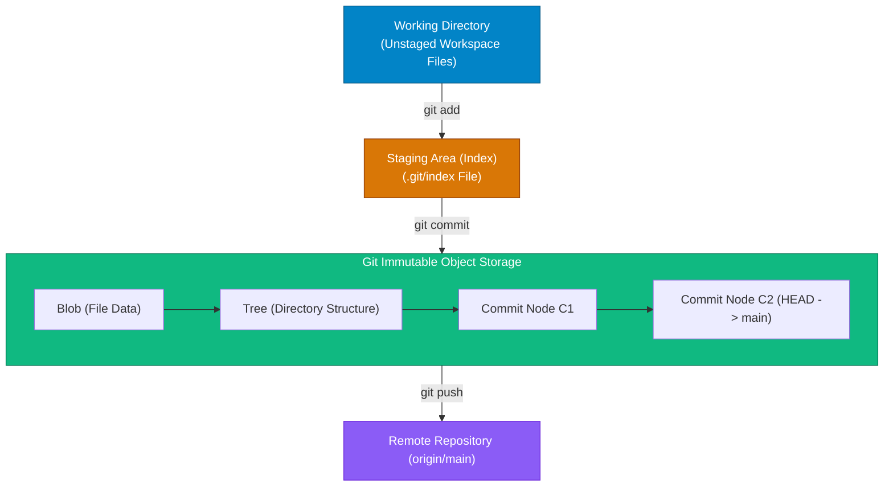

## High-Level Concept Definition & Real-World Analogy

**Git** is a distributed, content-addressable version control system (DVCS) designed by Linus Torvalds to manage codebase history using a Directed Acyclic Graph (DAG) of immutable snapshots.

### Core Architectural Features
*   **Content-Addressable Storage**: Every file, directory, and commit is indexed by a 160-bit SHA-1 (or 256-bit SHA-256) cryptographic hash key.
*   **Full Distributed Repositories**: Every local clone maintains a complete, independent copy of the repository database and commit history.
*   **Immutable DAG Topology**: Commit nodes form an immutable, append-only Directed Acyclic Graph.

### Real-World Analogy: The Multiverse Reality Vault & Quantum Library

To visualize Git's distributed architecture and graph mechanics, consider a **Multiverse Reality Vault and Quantum Library**:

*   **Repository DAG**: A **Branching Multiverse Timeline Map**. Each commit is an immutable universe state. Timelines can split into alternate futures (branches) and merge back together.
*   **Commit Object**: A **Quantum Multiverse Hologram Unit**. A single sealed glass sphere containing a complete 3D snapshot of the entire universe at an exact millisecond.
*   **Branch (`refs/heads/main`)**: A **Sticky Note Bookmark**. A branch is a tiny 41-byte text file containing a pointer hash stuck onto a specific hologram sphere.
*   **HEAD Pointer**: A **Laser Cursor Beam**. Points to the exact timeline universe hologram your workspace is currently living in.
*   **Staging Area (Index)**: A **Photographer's Preview Studio Workbench**. Where you arrange props and files before pressing the shutter button to create an immutable commit.
*   **Remote (`origin`)**: A **Parallel Archive Tower**. A separate vault in another location (e.g., GitHub) synchronized over network protocols (`push` / `fetch`).



---

## Structured Module Roadmap

| Module | Core Topics | Key Focus & Engineering Concepts | Read Time |
| :--- | :--- | :--- | :--- |
| **[Git Internals & Object Model](./git-internals)** | Blobs, Trees, Commits, Tags, `.git` Layout, SHA-1 Hashing | Content-Addressable Storage, Loose Objects vs. Packfiles, zlib Compression | 18 min |
| **[Branching & Merging Mechanics](./branching-merging)** | Fast-Forward, 3-Way Merge, Common Ancestors, Merge Conflicts | Pointer Offsets, Base/Ours/Theirs Math, ORT Merge Engine Architecture | 16 min |
| **[Rebasing & History Rewriting](./rebasing-history-rewriting)** | `rebase -i`, Reflog, Commit Squashing, Reset Modes | Commit Replay Engine, Soft vs. Mixed vs. Hard Resets, Reflog Safety Net | 20 min |
| **[Advanced Troubleshooting](./advanced-troubleshooting)** | `git bisect`, Worktrees, Detached HEAD, Garbage Collection | Binary Bug Isolation, Multi-Checkout Worktrees, `git gc` Housekeeping | 17 min |

---

## Quick Reference & Comparison Matrices

### 1. Centralized VCS vs. Distributed Content-Addressable VCS Matrix

| Architectural Feature | Centralized VCS (SVN, Perforce) | Distributed Content-Addressable VCS (Git) |
| :--- | :--- | :--- |
| **Data Storage Paradigm** | Delta / File-Diff Stream over Time | Full Repository Snapshot Object Graph (DAG) |
| **Key Addressing Scheme** | Incremental Revision Numbers (`r101`, `r102`) | Cryptographic Hash (SHA-1 / SHA-256 Object Keys) |
| **Network Dependence** | High (Requires central server for commits/logs) | Zero (All commits, branches, and histories are local) |
| **Branching Cost Index** | Heavy (Copies server directories; expensive) | Zero Overhead (Creates a 41-byte text file pointer) |
| **Integrity Verification** | Server database integrity checks | Cryptographic DAG hashes (Tamper-evident chain) |
| **Storage Compression** | Server-side delta compression | Client-side zlib compression + Delta Packfiles |

### 2. Git Core Object Taxonomy Matrix

| Object Type | Byte Header Marker | Primary Purpose & Structural Payload | Internal Pointer Targets |
| :--- | :--- | :--- | :--- |
| **Blob** | `blob <size>\0` | Stores raw file binary content. Completely agnostic of filename or path locations. | None (Leaf node in DAG) |
| **Tree** | `tree <size>\0` | Represents a directory structure. Maps file mode permissions, filenames, and SHA hashes. | Points to child Blobs or sub-Trees |
| **Commit** | `commit <size>\0` | Represents a repository snapshot. Contains root Tree hash, parent commit hash(es), author, committer, and log message. | Points to 1 root Tree and 0+ Parent Commits |
| **Annotated Tag** | `tag <size>\0` | Permanent named marker attached to a specific commit. Contains tagger signature, GPG keys, and message. | Points directly to a specific Commit object |

---

## Architectural Deep-Dive & Engineering Concepts

### Content-Addressable Storage Engine Mechanics

Git identifies objects strictly by their cryptographic hash key calculated over the object's header and content byte payload:

```text
SHA-1 Hash = SHA1(type + " " + size + "\0" + content)
```

```bash
# Demonstrating Content-Addressable Hashing in Bash
$ echo -en "blob 12\0Hello World\n" | sha1sum
557db03de997c86a4a028e1ebd3a1ceb225be238
```

### Deduplication Engine Mechanics
*   **Content-Based Addressing**: If two identical 50 MB files exist in different directories (`/assets/video1.mp4` and `/docs/copy.mp4`), Git stores **only one single Blob object** inside `.git/objects/55/7db03...`.
*   **Directory Mapping**: Tree objects map distinct filenames to the exact same SHA-1 hash key, drastically reducing repository disk footprint.

```text
Tree Object (/src)
  ├── 100644 blob 557db03de997c86a4a028e1ebd3a1ceb225be238    video1.mp4
  └── 100644 blob 557db03de997c86a4a028e1ebd3a1ceb225be238    copy.mp4
```

<Callout type="info">
**Why Commit Hashes Change When You Amend Log Messages**  
Because a Commit object includes its parent commit hash, root tree hash, author timestamp, and commit message string inside its payload, altering even a single character in a commit message changes the resulting SHA-1 hash key completely. This causes a cascade where all child commits downstream receive new parent SHA hashes.
</Callout>

---

## Interactive Self-Assessment Checkpoints

<Quiz 
  question="Why is creating a new branch in Git an O(1) operation taking less than 1 millisecond, regardless of repository size?" 
  options={[
    "Because Git creates a full zip archive copy of the repository in background system threads.", 
    "Because a Git branch is simply a 41-byte plain text file containing a 40-character SHA-1 hash pointing to an existing commit node.", 
    "Because Git compresses all files using GPU hardware acceleration.", 
    "Because Git branches are stored in remote cloud databases."
  ]} 
  answerIndex={1}
>
  Option B is correct. Branch pointer mechanics:
  * A branch is a text reference file (`.git/refs/heads/<branchname>`) holding a 40-character SHA-1 hex string.
  * Creating a branch writes 41 bytes to disk, executing in constant O(1) time regardless of repository size.
</Quiz>

<Quiz 
  question="What happens when two completely identical files with different filenames are added to Git staging area?" 
  options={[
    "Git creates two separate Blob objects with unique hashes based on filenames.", 
    "Git creates a single Blob object for the identical byte content and creates two Tree entries pointing to that same SHA-1 hash.", 
    "Git throws a filename collision error.", 
    "Git converts the second file into a symlink automatically."
  ]} 
  answerIndex={1}
>
  Option B is correct. Content-addressable behavior:
  * Blobs store raw bytes untethered from filenames.
  * Matching byte sequences yield identical SHA-1 hashes, resulting in a single Blob object referenced twice by Tree entries.
</Quiz>

<Quiz 
  question="What is the primary operational distinction between Git's Working Directory, Index (Staging Area), and Repository DAG?" 
  options={[
    "The Working Directory is on disk; the Index is in RAM; the Repository DAG is on GitHub.", 
    "The Working Directory is your live editable workspace; the Index is the binary snapshot preview file (.git/index); the Repository DAG is the immutable object database history (.git/objects).", 
    "The Index contains branch names; the Working Directory contains commit logs.", 
    "They are identical names for the same folder."
  ]} 
  answerIndex={1}
>
  Option B is correct. Environment roles:
  * **Working Directory**: Live editable workspace files.
  * **Index (`.git/index`)**: Binary staging cache tracking prepared changes.
  * **Repository DAG (`.git/objects`)**: Immutable zlib-compressed object database.
</Quiz>

<Problem title="Problem: Inspecting Low-Level Git Object Database">
<ProblemDescription>
You are tasked with manually inspecting the underlying Git object type and raw decoded contents of a commit reference `HEAD` without using high-level commands like `git log` or `git show`. Write the low-level porcelain/plumbing commands to accomplish this.
</ProblemDescription>
<ProblemSolution>
Use Git plumbing commands `git cat-file -t` (object type) and `git cat-file -p` (pretty-print content):

```bash
# 1. Print object type of HEAD (Output: commit)
$ git cat-file -t HEAD

# 2. Print pretty-printed decoded payload of HEAD
$ git cat-file -p HEAD

# 3. Inspect the root directory Tree object referenced by the commit
$ git cat-file -p 8f3a2b1c4e9f7d0a6b5c4d3e2f1a0b9c8d7e6f5a
```
</ProblemSolution>
</Problem>
