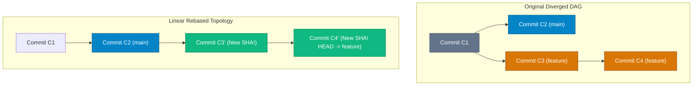

## High-Level Concept Definition & Real-World Analogy

**Rebasing and History Rewriting** represent Git's capabilities for modifying, combining, reordering, or re-parenting commit nodes within the DAG.

### Core Architectural Features
*   **Linear History Creation**: `git rebase` replays commits onto the tip of another branch, eliminating unnecessary 2-parent merge commits.
*   **Commit Mutation**: Every replayed commit receives a new parent SHA-1, producing a brand new object key.
*   **Interactive Refactoring**: `git rebase -i` permits squashing WIP commits, rewording logs, and dropping unwanted commits.

### Real-World Analogy: The Movie Film Editing & Snipping Room

To visualize rebasing and history rewriting, consider a **Movie Film Editing and Snipping Room**:

*   **Original Commit Graph**: Raw camera footage containing out-of-order scenes, microphone mishaps, and false starts.
*   **`git rebase main`**: **Snipping the Film Strip**. Snipping a feature scene strip off an old scene 10 roll and splicing it onto the end of scene 45 for continuous play.
*   **`git rebase -i` (Interactive Rebase)**: The **Editing Light Table**. Arranging film frames to merge takes (`squash`), edit lines (`reword`), or discard scenes (`drop`).
*   **Git Reset (`--soft`, `--mixed`, `--hard`)**: **Rewinding the Film Projector Deck**:
    *   `--soft`: Rewinds projector 3 scenes; actors stay in costume (`Index` & `Working Directory` preserved).
    *   `--mixed`: Rewinds projector and resets actor costumes (`Index` cleared; `Working Directory` preserved).
    *   `--hard`: Rewinds projector, clears stage, and wipes script notes (`Index` & `Working Directory` reset).
*   **Git Reflog**: The **CCTV Recording of the Editing Room Floor**. Records every floor location so discarded film strips can be recovered.



---

## Structured Module Roadmap

| Module | Core Topics | Key Focus & Engineering Concepts | Read Time |
| :--- | :--- | :--- | :--- |
| **Rebase Mechanics** | Replay Engine, SHA Hash Mutation | Linearization, Patch Applicator, Re-parenting Commit Nodes | 5 min |
| **Interactive Rebase Toolkit** | `rebase -i`, `pick`, `squash`, `fixup`, `drop` | Cleaning WIP Commits, Reword, Edit, Atomic PR Structuring | 5 min |
| **Reset Modes Deep-Dive** | `--soft`, `--mixed`, `--hard` | HEAD Pointer Movement vs. Index vs. Working Directory State | 5 min |
| **Reflog & Emergency Safety Net** | `git reflog`, `git reset --hard HEAD@{n}` | Recovering Deleted Commits, Reference Transaction Logs | 5 min |

---

## Quick Reference & Comparison Matrices

### 1. Git Reset Modes State Taxonomy Matrix

| Reset Command Parameter | HEAD Pointer Moved? | Index (Staging Area) Updated? | Working Directory Files Modified? | Primary Production Use Case |
| :--- | :--- | :--- | :--- | :--- |
| **`git reset --soft HEAD~1`** | Yes (Moved back) | No (Staged changes remain) | No (Workspace untouched) | Re-committing changes with modified commit messages. |
| **`git reset --mixed HEAD~1`** *(Default)* | Yes (Moved back) | Yes (Un-stages changes) | No (Workspace untouched) | Un-staging files to selectively re-stage granular commits. |
| **`git reset --hard HEAD~1`** | Yes (Moved back) | Yes (Cleared) | **YES (Overwritten to target commit)** | Discarding uncommitted local experiments completely. |

### 2. Interactive Rebase Command Glossary Matrix

| Rebase Action Code | Short Code | Operational Meaning | DAG Impact |
| :--- | :--- | :--- | :--- |
| **`pick`** | `p` | Retain and apply commit as-is | Re-applies commit with a new parent SHA |
| **`reword`** | `r` | Retain commit content, edit log message | Re-applies commit with modified commit message string |
| **`edit`** | `e` | Pause rebase loop at this commit for editing | Halts rebase; allows code editing or splitting |
| **`squash`** | `s` | Combine commit into previous commit; merge messages | Merges code with previous commit; prompts for combined message |
| **`fixup`** | `f` | Combine commit into previous commit; discard message | Merges code into previous commit; discards current message log |
| **`drop`** | `d` | Remove commit completely from history | Deletes commit node from replayed DAG sequence |

---

## Architectural Deep-Dive & Engineering Concepts

### The Golden Rule of Rebasing

<Callout type="caution">
**Golden Rule of Rebasing**:  
**Never rebase commits that have already been pushed to a shared public remote branch.**  
`git rebase` generates new SHA-1 hashes for replayed commits. Rebasing public commits forces team members' local DAGs out of sync, causing duplicate commit chains and complex merge conflicts upon pulling.
</Callout>

### Interactive Rebase Instruction Execution (`git rebase -i`)

Executing interactive rebase over local commits:

```bash
# Launch interactive rebase for the last 4 commits
$ git rebase -i HEAD~4
```

```text
# Interactive Rebase Instruction File
pick a1b2c3d Fix typo in payment validator
squash e5f6g7h Add unit tests for payment validator
fixup i9j0k1l WIP work on payments
reword m2n3o4p Refactor payment gateway architecture
```

*   **Step 1**: Commit `a1b2c3d` is picked as base.
*   **Step 2**: Commit `e5f6g7h` is squashed into `a1b2c3d` (combines code and prompts for combined message).
*   **Step 3**: Commit `i9j0k1l` is fixed up into `a1b2c3d` (combines code and discards WIP message).
*   **Step 4**: Commit `m2n3o4p` is reworded (opens editor to update log text).

### Emergency Commit Recovery via Reflog

If `git reset --hard` accidentally discards commits, objects remain stored temporarily. Git logs all pointer movements in `.git/logs/HEAD` (**Reflog**):

```bash
# 1. Inspect Reference Transaction Log
$ git reflog
7a8b9c0 (HEAD -> main) HEAD@{0}: reset: moving to HEAD~5
1088abc HEAD@{1}: commit: Implement real-time notifications
4410def HEAD@{2}: commit: Add database indexing strategy

# 2. Rescue lost commit by resetting HEAD to its Reflog position!
$ git reset --hard HEAD@{1}
HEAD is now at 1088abc Implement real-time notifications
```

---

## Interactive Self-Assessment Checkpoints

<Quiz 
  question="Why does executing `git rebase main` on a feature branch produce new commit SHA hashes even if the file code content is identical to before?" 
  options={[
    "Because Git re-encrypts all files using random AES passwords.", 
    "Because a Commit SHA hash is calculated over its parent commit SHA hash; changing the base parent node alters the commit payload, generating a completely new SHA-1 key.", 
    "Because Git updates the repository version number on every rebase.", 
    "Because rebasing converts Git repositories into SVN repositories."
  ]} 
  answerIndex={1}
>
  Option B is correct. Re-parenting mechanics:
  * Commit objects contain a `parent <SHA>` header.
  * Rebasing attaches commits to a new parent commit SHA, producing new SHA-1 hashes ($C'$).
</Quiz>

<Quiz 
  question="What is the precise functional difference between `git reset --soft HEAD~1` and `git reset --hard HEAD~1`?" 
  options={[
    "`--soft` deletes local files; `--hard` preserves files.", 
    "`--soft` moves the HEAD pointer back 1 commit while leaving your Index and Working Directory changes intact; `--hard` moves HEAD back and completely overwrites both Index and Working Directory to match the target commit.", 
    "`--soft` only works on GitHub; `--hard` works locally.", 
    "They perform the exact same operation."
  ]} 
  answerIndex={1}
>
  Option B is correct. Reset scope:
  * `--soft`: Moves HEAD pointer back; retains staged changes in Index and Working Directory.
  * `--hard`: Moves HEAD pointer back and overwrites Index and Working Directory.
</Quiz>

<Quiz 
  question="How does `git reflog` allow developers to recover commits that were accidentally lost after a `git reset --hard`?" 
  options={[
    "Reflog downloads lost files from GitHub backups.", 
    "Reflog tracks every single historical movement of the HEAD pointer in .git/logs/HEAD, allowing developers to locate unreferenced commit SHA hashes and reset back to them.", 
    "Reflog uses machine learning to rewrite broken code.", 
    "Reflog converts deleted commits into zip files."
  ]} 
  answerIndex={1}
>
  Option B is correct. Reflog tracking:
  * Records reference movements in `.git/logs/HEAD`. Unreferenced commits remain stored for 90 days before garbage collection.
</Quiz>

<Problem title="Problem: Squashing Messy Feature Branch Commits Before Pull Request">
<ProblemDescription>
You have 3 WIP commits on your local branch `feature/cart`:
- `a1b2c3d`: "WIP cart feature"
- `e5f6g7h`: "fix bug"
- `i9j0k1l`: "done cart"

Squash these 3 commits into 1 single clean atomic commit titled `"Feature: Add shopping cart checkout pipeline"` using interactive rebase.
</ProblemDescription>
<ProblemSolution>
Execute interactive rebase for the last 3 commits and use `pick` + `fixup`:

```bash
# Step 1: Start interactive rebase for last 3 commits
$ git rebase -i HEAD~3

# Step 2: In the instruction file, set the 2nd and 3rd commits to fixup:
# pick a1b2c3d WIP cart feature
# fixup e5f6g7h fix bug
# fixup i9j0k1l done cart

# Step 3: Amend the single remaining commit message
$ git commit --amend -m "Feature: Add shopping cart checkout pipeline"

# Step 4: Verify linear log graph
$ git log -n 1
```
</ProblemSolution>
</Problem>
