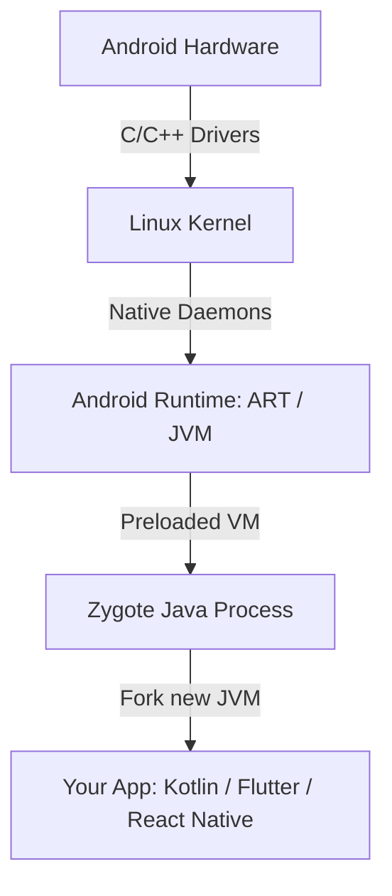

### 1\. Welcome to the Museum: Why Java on Android is a Dinosaur

To be completely honest, Java wasn't even the standard when I was learning Android development—it was already on its way out. It is great that most developers have moved on, yet here you are, visiting this page to read about Java in Android development. So please, do yourself a favor and move on to Kotlin. But before you close this tab, you should know that there are still a few core things under the hood that rely entirely on Java—things you can't escape even if you are building in Flutter or React Native.

Let's be clear: **Google does not want you writing Java for new Android apps.** They declared a "Kotlin-First" approach in 2019, and the modern UI framework, Jetpack Compose, does not even support Java. If you write your Android app in Java today, you are essentially signing up for a high-carb diet of getters, setters, semi-colons, and verbose inner classes.

#### The Verbosity Tax: Java vs Kotlin

To understand why the industry fled from Java, look at how both languages create a simple data holder (`User` profile):

```java
// Java: A monument of repetitive typing (30+ lines)
public class User {
    private final String id;
    private final String name;

    public User(String id, String name) {
        this.id = id;
        this.name = name;
    }

    public String getId() { return id; }
    public String getName() { return name; }

    @Override
    public boolean equals(Object o) {
        if (this == o) return true;
        if (o == null || getClass() != o.getClass()) return false;
        User user = (User) o;
        return Objects.equals(id, user.id) && Objects.equals(name, user.name);
    }

    @Override
    public int hashCode() {
        return Objects.hash(id, name);
    }
}
```

And here is the exact same functionality in Kotlin:

```kotlin
// Kotlin: Concise, readable, and compiles to the exact same bytecode structures
data class User(val id: String, val name: String)
```

Writing Java means writing code that is 70% boilerplate and 30% actual logic. Every extra line of boilerplate you type is another line your fingers will resent you for.

<Callout type="error" title="💀 The NullPointerException (NPE) Ritual">
In Java, any object reference can be `null` at any time. To write safe Java, you are forced to scatter defensive null checks (`if (user != null)`) everywhere, cluttering your logic. If you miss one check, your app crashes with the infamous `java.lang.NullPointerException` at runtime.
</Callout>

<Quiz question={"Which of the following is the main reason developers have migrated from Java to Kotlin for Android UI development?"} options={["Java code cannot run on modern Android devices", "Java has been completely deprecated and removed from the Android SDK compiler", "Kotlin eliminates boilerplate, enforces null-safety at compile time, and is the exclusive language for Jetpack Compose", "Java does not support network connections"]} answerIndex={2}>
While Java is still supported by the runtime, Google's modern Android libraries (such as Jetpack Compose) are built exclusively in and for Kotlin. Kotlin's compile-time safety and conciseness solve the massive verbosity and null-safety issues of Java.
</Quiz>

---

### 2\. The Inconvenient Truth: Android is Java Under the Hood

Now that we have successfully roasted Java, here is the terrifying plot twist: **Java is the Undead Emperor of Android.** You can run, but you cannot hide.

You can paint your UI in Dart (Flutter) or JavaScript (React Native), but the under-the-hood reality is that Android is an operating system built on a Java foundation. The core framework APIs that manage windows, process inputs, handle battery usage, and interface with system services are written in Java.

#### The Android Bootstrapping Pipeline

When an Android device boots up, it starts a core process called **Zygote**. Zygote is a pre-warmed Java Virtual Machine (the Android Runtime, or **ART**) that has all core Android framework Java classes pre-loaded into memory.



When you tap your app icon, the OS forks the Zygote process, creating a new, isolated JVM instance specifically for your application. Whether your app's code started as Kotlin, Dart, or JS, it is running inside an environment built to execute Java-compatible bytecode.

<Callout type="info" title="💡 Bytecode Interoperability">
Kotlin does not bypass Java; it compiles down to the exact same JVM-compatible class file structures. At the bytecode level, the Android Runtime cannot tell the difference between a class written in Java and one written in Kotlin.
</Callout>

<Quiz question={"What is the 'Zygote' process in the Android operating system?"} options={["A background thread that garbage-collects unused variables", "A pre-warmed Java Virtual Machine (ART) process from which all application processes are forked", "The compiler that translates Dart into C++", "An encryption tool to protect APK files"]} answerIndex={1}>
Zygote is a core Android process that starts at boot. It initializes a Java Virtual Machine (ART) and preloads standard Android framework classes, allowing the OS to quickly spawn new apps by forking Zygote instead of booting a new JVM from scratch.
</Quiz>

---

### 3\. The Cross-Platform Illusion: Flutter & React Native Bridges

Cross-platform developers love to claim: *"I don't need to know Java, I code entirely in Dart/JS!"*

This is a developer fantasy. Dart and Javascript are sandbox runtimes. They do not have magical access to the phone's physical hardware. Dart cannot talk directly to the camera, the Bluetooth chip, or query the battery status. The Flutter engine does not contain native drivers for Samsung or Pixel hardware.

To talk to the physical device, cross-platform frameworks use **Bridges** or **Platform Channels**.

#### The Platform Channel Flow

When a Flutter app requests the device's battery level, it must send a message across a binary bridge to the native Android container. That container is—you guessed it—a Java or Kotlin class running on the main JVM thread.

```
+------------------+                   +--------------------+
|   Flutter Dart   | --"getBattery"--> |  Java/Kotlin Host  |
|  (User UI Layer) | <-- [ 78% Value] - | (Android SDK APIs) |
+------------------+                   +--------------------+
```

If you write a Flutter or React Native plugin to access a new device sensor, you will have to write Java/Kotlin code that hooks into the Android SDK. Here is what the Java side of a Flutter Platform Channel receiver looks like:

```java
package com.example.mycrossplatformapp;

import android.content.Context;
import android.os.BatteryManager;
import androidx.annotation.NonNull;
import io.flutter.embedding.android.FlutterActivity;
import io.flutter.embedding.engine.FlutterEngine;
import io.flutter.plugin.common.MethodChannel;

public class MainActivity extends FlutterActivity {
    private static final String CHANNEL = "samples.flutter.dev/battery";

    @Override
    public void configureFlutterEngine(@NonNull FlutterEngine flutterEngine) {
        super.configureFlutterEngine(flutterEngine);
        
        // Setup the message channel that listens to Dart calls
        new MethodChannel(flutterEngine.getDartExecutor().getBinaryMessenger(), CHANNEL)
            .setMethodCallHandler(
                (call, result) -> {
                    if (call.method.equals("getBatteryLevel")) {
                        int batteryLevel = getBatteryLevel();
                        if (batteryLevel != -1) {
                            result.success(batteryLevel); // Send data back to Dart
                        } else {
                            result.error("UNAVAILABLE", "Battery level not available.", null);
                        }
                    } else {
                        result.notImplemented();
                    }
                }
            );
    }

    private int getBatteryLevel() {
        BatteryManager batteryManager = (BatteryManager) getSystemService(Context.BATTERY_SERVICE);
        return batteryManager.getIntProperty(BatteryManager.BATTERY_PROPERTY_CAPACITY);
    }
}
```

So even if you write cross-platform apps, when the abstraction leaks or a plugin breaks, you are forced to dive into Java/Kotlin code to fix the bridge.

<Quiz question={"How does a Flutter app access native Android hardware features like GPS or Bluetooth?"} options={["Dart compiles directly into low-level microchip assembly instructions", "It sends messages over Platform Channels to a host Java/Kotlin class that calls the Android SDK APIs", "It queries the database directly using SQL commands", "By embedding HTML5 web views inside the layout"]} answerIndex={1}>
Cross-platform runtimes rely on bridges (like Flutter's Platform Channels). The Dart/JS code sends serialized messages to a host JVM class written in Java or Kotlin, which handles calling the actual Android system APIs.
</Quiz>

---

### 4\. Build System Revenge: Gradle & the JDK

You decided to write a React Native app so you could stay in the comfortable world of JavaScript. You type `npm run android` and lean back. Suddenly, your terminal screen erupts into a waterfall of red text ending in:

`java.lang.NullPointerException` or `Gradle build failed with exit code 1`.

Welcome to Java's ultimate revenge: **The Build Pipeline**.

Modern Android apps, regardless of whether they are React Native, Flutter, Kotlin, or Java, use **Gradle** as their build automation tool. Gradle is written in Java and runs on the **Java Development Kit (JDK)**.

```
npm run android 
   |
   v
Launches Gradle Daemon (JVM process)
   |
   v
Executes build.gradle configuration tasks
   |
   v
Compiles assets & dependencies using JDK
```

If you do not understand the Java ecosystem, you will get stuck when:
- Your local Java version (`JAVA_HOME`) is incompatible with the version expected by Gradle.
- A third-party React Native library throws a Java compilation error during build because of JDK version mismatches.
- The build process runs out of memory, requiring JVM heap size configurations (`-XX:MaxMetaspaceSize`).

You cannot escape Java because Java builds your application.

<Callout type="warn" title="📋 JDK Management">
Always ensure your `JAVA_HOME` environment variable points to a JDK version supported by both your Gradle wrapper and target Android SDK. Mismatched Java paths are the number one cause of broken native builds.
</Callout>

---

### 5\. Core Android Concepts Born in Java

The architectural design of Android was established back when Java was the only language option. As a result, several core Android features are fundamentally shaped by Java rules.

#### The AndroidManifest.xml

Every Android app must declare its components in the `AndroidManifest.xml` file. The OS inspects this XML at installation to identify entry points. Every component registered in the manifest points to a native Java/Kotlin class:

```xml
<manifest xmlns:android="http://schemas.android.com/apk/res/android"
    package="com.example.myapp">
    
    <!-- Every Activity is a Java class inheriting from android.app.Activity -->
    <application
        android:name=".MyApplicationClass" 
        android:icon="@mipmap/ic_launcher">
        
        <activity
            android:name=".MainActivity"
            android:exported="true">
            <intent-filter>
                <action android:name="android.intent.action.MAIN" />
                <category android:name="android.intent.category.LAUNCHER" />
            </intent-filter>
        </activity>
        
    </application>
</manifest>
```

#### JNI: The C++ Bridge

What if you want to write a high-performance game engine (like Unity) in C++? You still can't bypass Java.

The Android OS does not expose direct access to kernel elements to user-space C++ code. The C++ code must communicate using the **Java Native Interface (JNI)**. To render a frame, read touch screen data, or play audio, the native C++ code must register JNI bindings and handshake with Android's Java classes.

<Quiz question={"Why must React Native and Flutter projects still include an AndroidManifest.xml and a MainActivity class?"} options={["Because the Android OS requires a compiled Java/Kotlin entry point and component registration to launch any application process", "To translate Javascript syntax into CSS styles", "It is a legacy configuration that has no impact on modern builds", "To authenticate user logins on the Play Store"]} answerIndex={0}>
The Android operating system only understands how to start applications by launching registered Java components. Cross-platform builds generate an underlying native wrapper (including an AndroidManifest and a dummy `MainActivity` class) so the OS can load and run the app.
</Quiz>

---

### 6\. Sarcastic Survival Guide: If You Must Write Java

If you find yourself stranded in a legacy codebase and must write Java, use these strategies to keep your code clean and prevent your app from crashing:

#### Defensive Programming (Null Protection)

Since Java won't check null safety for you, use annotations and utilities:

```java
import androidx.annotation.NonNull;
import androidx.annotation.Nullable;
import java.util.Optional;

public class ProfileService {
    
    // 1. Explicitly document intent using annotations
    public void updateUser(@NonNull User user, @Nullable String nickname) {
        // 2. Perform manual checks to fail-fast
        Objects.requireNonNull(user, "User cannot be null");
        
        // 3. Use Optional for handling nullable fields elegantly
        Optional<String> optName = Optional.ofNullable(nickname);
        optName.ifPresent(name -> System.out.println(name.trim()));
    }
}
```

#### Avoid Memory Leaks with Inner Classes

Never use non-static inner classes inside Activities if they perform background operations:

```java
public class MyActivity extends Activity {
    
    // BAD: Inner class holds implicit reference to MyActivity. 
    // If the task runs for 60 seconds and the user leaves, the Activity leaks!
    class BadTask extends AsyncTask<Void, Void, Void> { ... }
    
    // GOOD: Static nested class does not hold outer reference
    static class GoodTask extends AsyncTask<Void, Void, Void> {
        // Use WeakReference if you must access the activity context
        private final WeakReference<MyActivity> activityRef;
        
        GoodTask(MyActivity activity) {
            this.activityRef = new WeakReference<>(activity);
        }
    }
}
```

<Callout type="error" title="⚠️ AsyncTask is Deprecated">
If you are still writing or maintaining `AsyncTask` in Java, stop immediately. It was deprecated in Android 11. Use executor services, RxJava, or migrate the file to Kotlin to use Coroutines.
</Callout>

---

### 7\. Key Facts to Remember (The Sarcastic Truth)

- **Java on Android is legacy**: Google’s modern APIs are designed Kotlin-First.
- **You cannot escape Java**: The Android OS framework itself is built on Java.
- **Your build system runs on Java**: Gradle and the compiler toolchains depend on a JDK.
- **Flutter and React Native are wrapping Java**: Under every cross-platform app lies a native Java process spawned from the Zygote VM.
- **JNI is the gatekeeper**: Low-level C++ engines still handshake with Java classes to interact with the OS.
