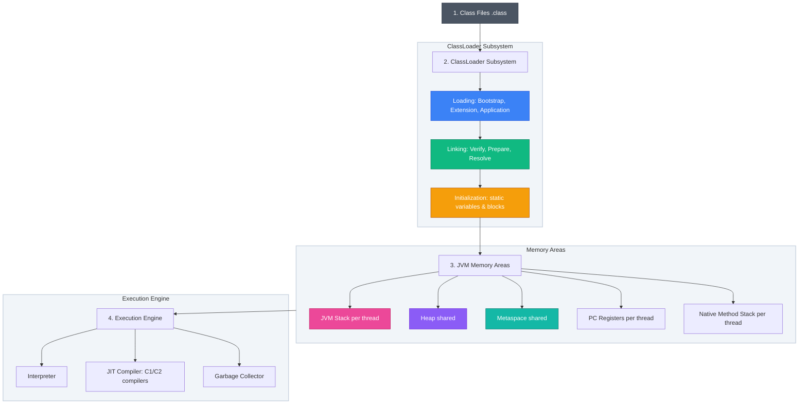
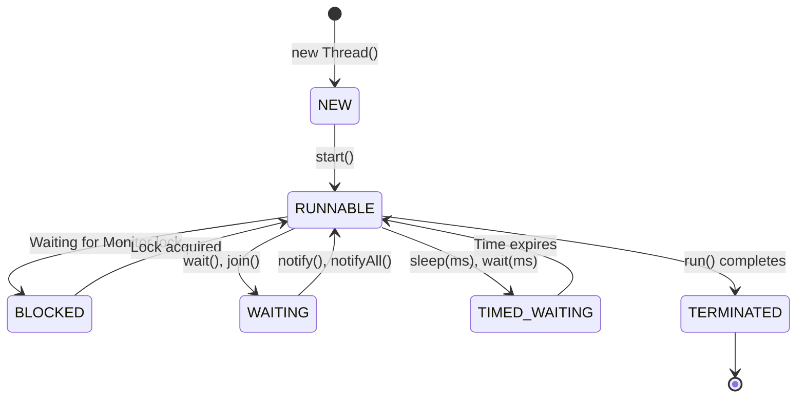

### 1. JVM Architecture & Run-Time Environments

Imagine you write a recipe in English (`.java`). Instead of translating it directly to French or Japanese (native OS machine codes) which would limit where it can be cooked, you translate it into a universal cooking language called **Kitchen Esperanto** (`.class` bytecode). Then, any restaurant in the world that has a head chef who speaks Kitchen Esperanto (the **Java Virtual Machine / JVM**) can execute the recipe exactly. This is Java's core philosophy: **"Write Once, Run Anywhere" (WORA)**.



#### The Kitchen Box: JDK vs. JRE vs. JVM
Think of these three core terms as a set of nested boxes:
*   **JVM (Java Virtual Machine)**: The actual stove. It heats the pots, cooks the food, and runs the bytecode. *Analogy: The car engine.*
*   **JRE (Java Runtime Environment)**: The stove + the prep counters + the pre-stocked pantry (standard library classes). Enough to *run* compiled Java programs. *Analogy: The engine + wheels + fuel.*
*   **JDK (Java Development Kit)**: The entire kitchen setup + chef's knife set + recipe compiler (`javac`). Required to *write and compile* Java applications. *Analogy: The entire car manufacturing factory.*

#### The ClassLoader: Delivery and Quality Control
The ClassLoader is the delivery team and quality control inspector of the JVM kitchen:
1.  **Loading**: The delivery truck arrives with raw ingredients (`.class` files). The JVM locates them using a delegation hierarchy:
    *   *Bootstrap ClassLoader*: Loads core libraries (e.g. `java.lang.*`) from standard JDK folders. Written in native C/C++.
    *   *Platform ClassLoader*: Loads platform-specific extensions.
    *   *Application ClassLoader*: Loads the project's custom code classes.
2.  **Linking**: The prep cooks set up the kitchen:
    *   *Verification*: The inspector checks the ingredients to make sure they aren't spoiled or poisoned (malformed bytecode).
    *   *Preparation*: Lays out clean bowls on the counter and assigns standard default names (zeroes out memory, setting fields to `0`, `null`, or `false`).
    *   *Resolution*: Replaces label descriptions (like "Sugar") with direct pointers to the actual jar on the shelf (memory addresses).
3.  **Initialization**: The chef turns on the stove, running static blocks and setting static variables to their custom starting values.

#### The JIT Compiler: The Automated Sauce Machine
*   **Interpreter**: Reads bytecode and executes it line-by-line. It starts running instantly, but processes slowly.
*   **JIT (Just-In-Time) Compiler**: A master head chef who notices a line cook making the same sauce 100 times. Instead of letting them read the recipe book every time, the chef records their actions, builds a fast-running automated mixing machine (native machine code), and runs that instead.
*   **Tiered Compilation**:
    *   *Level 0*: Interpreter runs the code.
    *   *Levels 1-3 (C1 Compiler)*: Quickly compiles code with basic optimizations.
    *   *Level 4 (C2 Compiler)*: Deeply compiles and optimizes frequently run code paths.

#### JVM Memory: Scratchpads, Countertops, and Bookcases
*   **JVM Stack (Per-Thread)**: The chef's quick-reference write-and-erase clipboard. Fast, temporary memory. Each method call pushes a **Frame** onto the stack containing local variables and intermediate calculations. When the method finishes, the page is ripped off the clipboard and thrown away.
*   **Heap Area (Shared)**: The main central prep table. A large, shared memory pool where all physical objects, class instances, and arrays sit.
*   **Metaspace (Shared)**: The library bookcase. Located in native OS memory (not the heap). Stores class metadata and static method blueprints.
*   **Garbage Collection (GC)**: A cleanup crew that wanders around the prep table (Heap). Starting at **GC Roots** (active stacks and static fields), they trace all connected reference lines. If they find an ingredient bowl on the table that has no path to a recipe card, they clear it away.
    *   *G1 (Garbage-First)*: Divides the table into equal zones and cleans the dirtiest zones first.
    *   *ZGC (Z Garbage Collector)*: A low-latency collector that cleans concurrently with application threads, keeping pause times under 1 millisecond.

<Quiz question="Which ClassLoader is responsible for loading standard JDK classes and is written in native C/C++?" options={["Application ClassLoader","Platform ClassLoader","Bootstrap ClassLoader","System ClassLoader"]} answerIndex={2}>
The Bootstrap ClassLoader is the root ClassLoader. It is written in native code and loads core JDK runtime classes.
</Quiz>

---

### 2. Primitive vs. Reference Types & Memory Behavior

#### Data Types: Loose Coins vs. Safety Deposit Box Keys
In Java, data is stored in two distinct ways:
*   **Primitives**: Loose bills carried directly in your pocket. They store the actual raw values directly in the memory slot.
*   **References**: A key containing a room number. The variable doesn't hold the object itself; it holds the memory address pointing to the object on the Heap.

| Type | Bit Size | Default Value | Range / Memory Detail | Analogy |
| --- | --- | --- | --- | --- |
| `byte` | 8 bits | `0` | -128 to 127 | A tiny storage box |
| `short` | 16 bits | `0` | -32,768 to 32,767 | A medium drawer |
| `int` | 32 bits | `0` | -2.14B to 2.14B | A standard filing cabinet |
| `long` | 64 bits | `0L` | Very large numbers (requires `L` suffix) | A shipping container |
| `float` | 32 bits | `0.0f` | ~7 decimal digits (requires `f` suffix) | Standard measuring cup |
| `double`| 64 bits | `0.0` | ~15 decimal digits | High-precision scale |
| `char` | 16 bits | `\u0000` | Single Unicode character (single quotes `'A'`) | A single letter stamp |
| `boolean`| ~1 bit | `false` | `true` or `false` | A simple light switch |
| `Object`| 32/64 bits| `null` | Memory address pointer (points to the Heap) | A key containing a room number |

#### Class Fields vs. Local Variables
*   **Class Fields (Instance Variables)**: Stored on the heap as part of an object. When the object is created, the JVM zeroes out the allocated memory, automatically initializing fields to their default values (e.g. `0`, `null`, `false`). *Analogy: A newly built kitchen cabinet. It comes pre-stocked with basic default settings to keep things clean.*
*   **Local Variables**: Declared inside methods and stored on the stack. **Local variables do not receive default values.** The compiler throws a compilation error if you attempt to read a local variable before explicitly initializing it. *Analogy: A blank sticky note. You must write on it before reading it; the compiler won't let you read a blank note.*

```java
class Room {
    int number; // Class field: defaults to 0
    
    void enter() {
        int keyCard; // Local variable: no default!
        // System.out.println(keyCard); // COMPILE ERROR: keyCard may not have been initialized
    }
}
```

#### Wrapper Classes: Egg Cartons & The Supermarket Cache
*   **Autoboxing**: Wrapping a raw egg (primitive `int`) into a protective carton box (wrapper `Integer`).
*   **Unboxing**: Taking the egg out of the carton box.
*   **Integer Cache**: A row of pre-boxed standard envelopes numbered -128 to 127 sitting on the post office shelf. Instead of folding a new box every time, you just grab the pre-boxed one if the value fits:

```java
Integer a = 100;
Integer b = 100;
System.out.println(a == b); // Prints: true (points to the same cached object)

Integer c = 200;
Integer d = 200;
System.out.println(c == d); // Prints: false (outside cache range; comparison checks reference address)
System.out.println(c.equals(d)); // Prints: true (compares values)
```

> [!WARNING]
> Unboxing a `null` wrapper reference (e.g. converting a `null` `Integer` to an `int`) throws a `NullPointerException` at runtime.

<Quiz question="What is the output of: `Integer x = 127; Integer y = 127; System.out.println(x == y);`?" options={["false","true","NullPointerException","Compile error"]} answerIndex={1}>
The value `127` falls within the default Integer cache pool range (`-128` to `127`), so `x` and `y` reference the same cached object.
</Quiz>

---

### 3. String Architecture & Memory Optimization

#### Immutability: Permanent Marker on Granite
Strings in Java are immutable. Once created on the heap, their contents cannot be changed.
*   **Analogy**: Writing with a permanent marker on a block of granite. If you want to change the text, you cannot edit the existing block; you must carve a completely new block of granite.

```java
String msg = "Hello";
msg.toUpperCase(); // Creates a new String "HELLO", but discards it because it's not assigned!
System.out.println(msg); // Prints: "Hello" (original remains unchanged)

msg = msg.toUpperCase(); // Re-assigns the reference to the new string
System.out.println(msg); // Prints: "HELLO"
```

*   **Why is String immutable?**
    1.  *Security*: Prevents database connection strings or file path strings from being modified dynamically by unauthorized code.
    2.  *String Pool*: Reuses identical string literals to save heap memory.
    3.  *Hash Code Caching*: The hash code is calculated and cached on creation, making string lookups in HashMaps fast.

#### The String Pool: The Shared Quote Catalog
The String Pool is a shared central library of standard placards. If two rooms need the placard "Welcome", the manager points them to the same placard in the lobby rather than carving two separate ones.
*   **Literal Creation**: Creating a string using double quotes (`"Hello"`) checks the String Pool first. If the string exists, Java returns the cached reference.
*   **New Keyword**: Using `new String("Hello")` bypasses the pool and creates a new object on the heap, wasting memory.
*   **Compile-time vs. Runtime**: Concatenating literals (`"A" + "B"`) is optimized by the compiler into a single string (`"AB"`), which goes into the pool. Concatenating variables (`"A" + s1`) is evaluated at runtime, producing a new object on the heap outside the pool.

```java
String a = "Test";
String b = "Test";
String c = new String("Test");

System.out.println(a == b); // true (same pooled object)
System.out.println(a == c); // false (c is a new object on the heap)
System.out.println(a.equals(c)); // true (compares contents)
```

#### String vs. StringBuilder vs. StringBuffer
*   **String**: Immutable. Slow for loops because modifying a string creates new temporary objects.
*   **StringBuilder**: Mutable. A dry-erase whiteboard. Modifies characters in-place using an internal character array buffer. Fast but **not thread-safe**.
*   **StringBuffer**: Mutable. Similar to `StringBuilder`, but all operations are thread-safe and synchronized, making it slower.

---

### 4. Advanced Object-Oriented Programming (OOP)

#### Classes & Objects: Cookie Cutters vs. Cookies
*   **Class**: A cookie cutter. It defines the shape, size, and layout, but isn't a cookie itself.
*   **Object**: The actual cookies cut from the dough sitting on the countertop (Heap).

#### Constructors & Chaining: Foundation Before Paint
*   **Constructor Chaining**: Every subclass constructor must call a parent constructor (`super(...)`) or another constructor in the same class (`this(...)`) as its very first statement. If you omit this call, the compiler automatically inserts `super()` to initialize parent class fields first.
*   **Analogy**: When building a house, you must build the foundation (parent constructor) before adding the walls (subclass constructor).

#### Access Modifiers: Privacy Gates
*   `private`: The owner's locked safe. Accessible only inside the declaring class.
*   `default` (no modifier): Shared only among family members living in the same house (package).
*   `protected`: Inherited family heirlooms passed only to direct children (subclasses) and package members.
*   `public`: A billboard on the street. Accessible by any code in the system.

#### Polymorphism: Swiss Army Knives & Family Business Recipes
*   **Method Overloading (Static)**: Multiple methods in the same class share the name but have different signatures (parameter types/counts). Resolved by the compiler at compile-time. *Analogy: A multi-tool pocket knife. The same tool ("cut") works differently depending on the material (paper vs wood).*
*   **Method Overriding (Dynamic)**: A subclass provides a custom implementation of a method declared in its parent class. Resolved by the JVM at runtime. *Analogy: A child taking over the family business. The parent has a recipe for "cookBarbecue". The child inherits the method but overrides it to use a modern smoker instead of charcoal.*
*   **Dynamic Method Dispatch**: The JVM invokes the overridden method based on the actual object type at runtime, not the reference type:
    ```java
    Animal pet = new Cat();
    pet.makeSound(); // Invokes Cat's makeSound() method at runtime
    ```

#### Abstraction: Framed Houses & Electrical Outlets
*   **Abstract Class**: A partially framed house. It has actual wooden support structures and pipe fixtures (state and instance fields), but you cannot live in it (instantiate it) until you finish building it.
*   **Interface**: An electrical outlet wall spec standard. It has no physical wiring of its own, but it guarantees that anything that matches the prongs (implements the methods) can plug in and get power.

| Feature | Abstract Class | Interface (Modern Java 9+) |
| --- | --- | --- |
| **Inheritance** | Single inheritance only (`extends`) | Multiple inheritance allowed (`implements`) |
| **Instance Fields** | Yes (can declare private/protected state) | No (variables are implicitly `public static final` constants) |
| **Methods** | Can have private, protected, abstract, or final methods | Can have abstract, `default`, `static`, or `private` methods |

#### sealed Classes & Interfaces: The Restricted Guest List
Sealed classes restrict which subclasses are allowed to extend them. *Analogy: A restricted guest list for a VIP lounge. Only specified invitees can gain access.*

```java
// Permits only Employee and Guest to extend User
public sealed class User permits Employee, Guest {}

public final class Employee extends User {}
public non-sealed class Guest extends User {}
```

#### Records: Sealed Snack Packs
Records are final, value-based classes that automatically generate private final fields, getters, `equals()`, `hashCode()`, and `toString()`. *Analogy: A pre-packaged vending machine snack. It comes sealed, tamper-proof, and holds fixed values.*

```java
public record Book(String title, double price) {
    // Compact constructor for validation
    public Book {
        if (price < 0) throw new IllegalArgumentException("Price cannot be negative");
    }
}
```

---

### 5. Generics & PECS Rule

Generics act as labeled shipping crates. Instead of shipping a box of random items (`List`), you label the box "Bananas Only" (`List<Banana>`) so the customs agent can prevent mistakes before execution.

#### Type Erasure: The Post-Office Label Removal
To maintain backward compatibility with older Java code, Java implements generics using **Type Erasure**. The compiler uses generic type parameters for compile-time safety checks, but removes them when generating bytecode. In the compiled code, type parameters are replaced with their upper bound (or `Object` if unbound), and casts are added automatically where needed. *Analogy: The post office inspects the label at the desk, but removes the label and routes the box as a standard container once it is loaded on the truck.*

```java
// What you write:
List<String> list = new ArrayList<>();
list.add("Hello");
String s = list.get(0);

// What compiles under the hood:
List list = new ArrayList();
list.add("Hello");
String s = (String) list.get(0);
```

#### PECS (Producer Extends, Consumer Super): The Customs Scanner
PECS is a food safety scanner rule for generic collections:

*   **Producer Extends (`? extends T`)**: Use this when you only **read** from the collection. The collection *produces* data. You can read elements as type `T` safely, but you cannot write to it (except `null`) because the compiler cannot guarantee the exact subclass. *Analogy: A box of unknown items that are guaranteed to inherit from Fruit. You can safely read from it. But you cannot add anything to it, because the customs agent doesn't know if this is a box of Apples-only or Grapes-only, and wants to avoid mixing them.*
*   **Consumer Super (`? super T`)**: Use this when you only **write** to the collection. The collection *consumers* data. You can write elements of type `T` safely, but reads only return generic `Object` references. *Analogy: A disposal bin labeled for Fruit and its parent classes. You can safely throw Apples into it.*

```java
public class CollectionUtils {
    // Producer Extends: reads numbers from list
    public static double sum(List<? extends Number> list) {
        double total = 0.0;
        for (Number n : list) {
            total += n.doubleValue(); // Safe to read as Number
        }
        // list.add(10); // COMPILE ERROR: Cannot write to a producer
        return total;
    }

    // Consumer Super: writes integers to list
    public static void addInts(List<? super Integer> list) {
        list.add(10); // Safe to write Integer
        // Object item = list.get(0); // Reading only returns Object
    }
}
```

<Quiz question="Which PECS wildcard should you use if you want to write elements of type T to a collection?" options={["`? extends T`","`? super T`","`T`","`?`"]} answerIndex={1}>
`? super T` represents a Consumer collection, allowing you to write elements of type `T` safely.
</Quiz>

---

### 6. Java Collections Framework Internals

#### Lists: ArrayList vs. LinkedList
*   **ArrayList**: Backed by a contiguous array.
    *   *Analogy*: An expanding row of lockers. Super fast to open locker #12 (`O(1)` random access), but if you want to insert a new locker in the middle, you have to slide all subsequent lockers down the row (`O(n)` shift).
    *   *Resizing Math*: When the array fills up, it allocates a new array that is 50% larger:
        `newCapacity = oldCapacity + (oldCapacity >> 1)`
*   **LinkedList**: Implemented as a doubly-linked list.
    *   *Analogy*: A chain of paperclips. Each paperclip links to the next. You can easily unclip one in the middle and insert another in `O(1)` time, but to find the 50th clip you have to trace the chain from the beginning (`O(n)` traversal).

#### Map Internals: HashMap
HashMap stores key-value pairs using hashing.

*   **Index Calculation**:
    `Index = (n - 1) & hash(key)`
    where `n` is the bucket array capacity (always a power of 2).
*   **Collisions**: When multiple keys map to the same bucket index, they are stored as a singly-linked list.
*   **Treeification**: If a bucket's linked list grows past `TREEIFY_THRESHOLD = 8` and the map's total capacity is at least `MIN_TREEIFY_CAPACITY = 64`, HashMap converts the linked list into a **Red-Black Tree** to keep search times `O(log n)` instead of `O(n)`.
    *   *Analogy*: A massive mail sorting room with numbered bins. When mail arrives, the postmaster runs the recipient's name through a hash calculator to get a bin number. If too many letters pile up in one bin, they are placed in a folders cabinet (Red-Black Tree) to make searching fast.

```
                  HashMap Bucket Structure
  ┌────────────────────────────────────────────────────────┐
  │ Hash Index = (n - 1) & hash(key)                      │
  │ [Bucket 0] ──► Node1(K,V) ──► Node2(K,V)               │
  │ [Bucket 1] ──► null                                    │
  │ [Bucket 2] ──► Red-Black Tree (if bucket has > 8 nodes)│
  └────────────────────────────────────────────────────────┘
```

#### ConcurrentHashMap: Individual Lock Boxes
*   Avoids global locks using a segment-free design.
*   Uses **CAS (Compare-And-Swap)** instructions to safely insert new nodes into empty buckets.
*   Locks only the first node in the bucket's list using `synchronized` blocks when collisions occur.
    *   *Analogy*: A bank vault with individual safety deposit boxes. Instead of locking the main vault door (global synchronization), security only locks the specific box being edited, allowing other customers to access their boxes simultaneously.

---

### 7. Multithreading & Concurrent Programming

Imagine hiring multiple chefs to work in the same kitchen. It speeds up cooking, but if two chefs try to write to the same recipe card at the same time, or fight over the blender, chaos ensues. Concurrency tools are the kitchen rules that keep the chefs working together safely.

#### Thread States
A Java thread can exist in one of several states:



#### Memory Visibility & volatile
*   **The Issue**: Each CPU core has its own local cache. If Chef A updates a shared variable, Chef B running on a different core may read their local cached value instead of the updated value.
*   **The Solution**: Declaring a variable as `volatile` forces all reads and writes to go directly to main memory, bypassing CPU caches.
    *   *Analogy*: A giant digital scoreboard on the kitchen wall. Every time a chef changes a number, it updates on the screen immediately for everyone to see, instead of them writing it down in their private notebook (CPU cache).

> [!IMPORTANT]
> `volatile` only guarantees **visibility**, not **atomicity**. For compound operations (like `count++`, which involves a read, modify, and write step), use locks or atomic variables.

#### synchronization: The Freezer Key
*   `synchronized`: Guarantees that only one thread can execute a block of code at a time.
    *   *Analogy*: A single key to the walk-in freezer. Only one chef can hold the key (monitor lock) and enter the freezer at a time.

#### ExecutorService: The Standby Line Cooks
*   Instead of hiring a new line cook for every incoming ticket (which causes overhead), you keep a pool of 5 standby line cooks (Thread Pool) and assign tickets to them as they become free.

#### CompletableFuture: Takeout Pager
*   **CompletableFuture**: Supports building asynchronous task pipelines with non-blocking callbacks.
    *   *Analogy*: Ordering takeout. You get a pager token. While the food is cooking (async), you can go run other errands. When the pager buzzes (future completes), you pick up the food and trigger the next step.

```java
CompletableFuture.supplyAsync(() -> fetchProductPrice("laptop"))
    .thenApply(price -> applyDiscount(price))
    .thenAccept(finalPrice -> System.out.println("Price: " + finalPrice))
    .exceptionally(ex -> {
        System.err.println("Error: " + ex.getMessage());
        return null;
    });
```

---

### 8. Modern Functional Java: Streams & Lambdas

The Streams API acts like a factory assembly line. Raw parts (source data) are placed on a conveyor belt. They pass through sorters (filter) and paint booths (map) without stopping, until they land in a shipping crate (terminal operation).

```
  Source Data ──► filter() ──► map() ──► collect() (Terminal)
  [Conveyor Belt]  (Lazy)      (Lazy)    (Triggers execution)
```

*   **Intermediate Operations**: Lazy operations that process elements and return a new Stream (e.g. `filter()`, `map()`, `sorted()`). They do not run until a terminal operation is called.
*   **Terminal Operations**: Execute the stream pipeline and return a result or void (e.g. `collect()`, `reduce()`, `forEach()`).
*   **Short-Circuiting**: Stops processing elements once a condition is met (e.g., `limit(n)`, `findFirst()`).

```java
List<String> results = items.stream()
    .filter(s -> s.startsWith("A")) // Intermediate (Lazy)
    .map(String::toUpperCase)       // Intermediate (Lazy)
    .limit(2)                       // Intermediate (Short-Circuit)
    .collect(Collectors.toList());  // Terminal (Executes stream)
```

---

### 9. Exception Handling Framework

#### Checked vs. Unchecked: Weather Alerts vs. Banana Peels
*   **Checked Exceptions**: A weather alert before a flight. You *must* check it and have a backup plan (try-catch) or the airport won't let you take off (compile error). Used for recoverable scenarios (e.g., `IOException`).
*   **Unchecked Exceptions**: Stepping on a banana peel (`RuntimeException`). It is unexpected, and you don't write a backup plan for every step, but you can try to catch your balance if it happens.

```
                    Throwable Hierarchy
                       ┌───────────┐
                       │ Throwable │
                       └─────┬─────┘
                ┌────────────┴────────────┐
          ┌─────▼─────┐             ┌─────▼─────┐
          │   Error   │             │ Exception │
          └───────────┘             └─────┬─────┘
                               ┌──────────┴──────────┐
                         ┌─────▼─────┐         ┌─────▼────────────┐
                         │ Checked   │         │ RuntimeException │
                         │ Exception │         │   (Unchecked)    │
                         └───────────┘         └──────────────────┘
```

*   **try-with-resources**: Automatically closes any class implementing `AutoCloseable` when the try block exits, preventing resource leaks:
    ```java
    try (BufferedReader br = new BufferedReader(new FileReader("data.txt"))) {
        System.out.println(br.readLine());
    } catch (IOException e) {
        System.err.println("Error: " + e.getMessage());
    }
    ```

---

### 10. Conceptual Quizzes

<Quiz question="What is the difference between JRE and JDK?" options={["JRE runs bytecode; JDK contains compiler tools to write and compile Java code.","JDK is only for mobile applications.","JRE is the Native Stack; JDK is the Metaspace.","They are the same."]} answerIndex={0}>
The JRE provides the environment to run compiled Java files. The JDK contains compile and debug tools (like `javac`) needed by developers to write code.
</Quiz>

<Quiz question="Where are objects and class instances stored in JVM memory?" options={["JVM Stack","Metaspace","Heap Area","PC Register"]} answerIndex={2}>
All class objects, array references, and active instances reside in the shared Heap Area.
</Quiz>

<Quiz question="What does an uninitialized local integer variable default to in a Java method?" options={["0","null","It does not receive a default value; referencing it throws a compile error.","false"]} answerIndex={2}>
Local variables in methods have no default values. The compiler flags any attempt to read them before initialization as a compile error.
</Quiz>

<Quiz question="Why does `String a = &quot;A&quot;; String b = &quot;A&quot;; System.out.println(a == b);` print `true`?" options={["Because String is a primitive type.","Because they are cached in the String Pool and share the same memory reference.","Because of Type Erasure.","Because strings are mutable."]} answerIndex={1}>
Literal strings are cached in the String Pool. Both variables point to the same cached instance, so `==` evaluates to `true`.
</Quiz>

<Quiz question="What is the time complexity of looking up a key in a HashMap under a worst-case scenario with a high number of collisions?" options={["O(1)","O(n)","O(log n)","O(n log n)"]} answerIndex={2}>
If a bucket exceeds 8 colliding elements, the HashMap converts the linked list to a Red-Black Tree, yielding a worst-case lookup complexity of `O(log n)`.
</Quiz>

<Quiz question="Which keyword ensures that a variable is always read from and written to main memory, bypassing CPU caches?" options={["`synchronized`","`volatile`","`final`","`transient`"]} answerIndex={1}>
`volatile` guarantees memory visibility by forcing reads and writes directly to main memory, bypassing local CPU caches.
</Quiz>

<Quiz question="What is the rule for calling `super()` or `this()` in a constructor?" options={["They can be called anywhere in the constructor.","They must be the first statement in the constructor.","They are only allowed in static methods.","They cannot be called in subclass constructors."]} answerIndex={1}>
Constructor calls (`super()` or `this()`) must be the very first statement in a constructor to ensure parent class state is initialized before subclass code runs.
</Quiz>

<Quiz question="What happens to generic type parameters during Java compilation?" options={["They are converted to native pointers at runtime.","They are removed by the compiler (Type Erasure) to maintain backward compatibility with older code.","They are stored in Metaspace.","They cause runtime performance overhead."]} answerIndex={1}>
Type Erasure removes type parameters during compilation, replacing them with their upper bound or `Object`, which maintains backward compatibility.
</Quiz>

---

### 11. Practice Problems

<Problem title="Problem 1: Custom Thread-Safe Blocking Queue">
<ProblemDescription>
Implement a thread-safe generic blocking queue `CustomBlockingQueue<T>` with:
1. A fixed capacity bounds check initialized via constructor.
2. A blocking `enqueue(T item)` method: if the queue is full, the calling thread must block until space becomes available.
3. A blocking `dequeue()` method: if the queue is empty, the calling thread must block until an item is added.
4. Implement using standard `synchronized`, `wait()`, and `notifyAll()` coordination. Do not use classes from `java.util.concurrent`.
</ProblemDescription>
<ProblemSolution>
The blocking queue uses a linked list for storage, protecting updates using a monitor lock:

```java
import java.util.LinkedList;
import java.util.Queue;

public class CustomBlockingQueue<T> {
    private final Queue<T> queue = new LinkedList<>();
    private final int capacity;

    public CustomBlockingQueue(int capacity) {
        if (capacity <= 0) {
            throw new IllegalArgumentException("Capacity must be positive");
        }
        this.capacity = capacity;
    }

    // Add item to queue, blocking if capacity limit is reached
    public synchronized void enqueue(T item) throws InterruptedException {
        while (queue.size() == capacity) {
            // Wait until dequeue makes space
            wait();
        }
        queue.add(item);
        // Wake up waiting dequeue threads
        notifyAll();
    }

    // Remove item from queue, blocking if queue is empty
    public synchronized T dequeue() throws InterruptedException {
        while (queue.isEmpty()) {
            // Wait until enqueue adds an item
            wait();
        }
        T item = queue.poll();
        // Wake up waiting enqueue threads
        notifyAll();
        return item;
    }

    public synchronized int size() {
        return queue.size();
    }
}
```
</ProblemSolution>
</Problem>

<Problem title="Problem 2: Custom Hashing Map Implementation">
<ProblemDescription>
Write a custom simplified Map implementation `SimpleHashMap<K, V>`. The class must:
1. Support standard operations: `put(K key, V value)`, `get(K key)`, and `size()`.
2. Map hash values to a bucket array index.
3. Handle bucket hash collisions using a singly-linked list chain structure.
4. Rescale (rehash) the internal table when the load factor exceeds `0.75`.
</ProblemDescription>
<ProblemSolution>
This implementation uses bucket chaining and rehashing when resizing is required:

```java
public class SimpleHashMap<K, V> {
    
    // Hash Node structure
    private static class Entry<K, V> {
        final K key;
        V value;
        Entry<K, V> next;

        Entry(K key, V value) {
            this.key = key;
            this.value = value;
        }
    }

    private Entry<K, V>[] table;
    private int size;
    private static final int INITIAL_CAPACITY = 16;
    private static final double LOAD_FACTOR_THRESHOLD = 0.75;

    @SuppressWarnings("unchecked")
    public SimpleHashMap() {
        table = new Entry[INITIAL_CAPACITY];
    }

    private int getBucketIndex(K key, int capacity) {
        if (key == null) return 0;
        // Keep index within array bounds
        return Math.abs(key.hashCode()) % capacity;
    }

    public int size() {
        return this.size;
    }

    public V get(K key) {
        int index = getBucketIndex(key, table.length);
        Entry<K, V> current = table[index];
        while (current != null) {
            if (current.key == key || (current.key != null && current.key.equals(key))) {
                return current.value;
            }
            current = current.next;
        }
        return null;
    }

    public void put(K key, V value) {
        int index = getBucketIndex(key, table.length);
        Entry<K, V> current = table[index];
        
        // Update value if key already exists
        while (current != null) {
            if (current.key == key || (current.key != null && current.key.equals(key))) {
                current.value = value;
                return;
            }
            current = current.next;
        }

        // Key doesn't exist; insert new node at the head of the bucket chain
        Entry<K, V> newEntry = new Entry<>(key, value);
        newEntry.next = table[index];
        table[index] = newEntry;
        size++;

        // Resize array if capacity exceeds load threshold
        if ((double) size / table.length >= LOAD_FACTOR_THRESHOLD) {
            resize();
        }
    }

    @SuppressWarnings("unchecked")
    private void resize() {
        int newCapacity = table.length * 2;
        Entry<K, V>[] newTable = new Entry[newCapacity];

        // Rehash all entries into the new table
        for (Entry<K, V> head : table) {
            Entry<K, V> current = head;
            while (current != null) {
                Entry<K, V> nextNode = current.next;
                int newIndex = getBucketIndex(current.key, newCapacity);
                
                // Insert node at head of new bucket list
                current.next = newTable[newIndex];
                newTable[newIndex] = current;
                
                current = nextNode;
            }
        }
        table = newTable;
    }
}
```
</ProblemSolution>
</Problem>

<Problem title="Problem 3: Product Streams Query Tool">
<ProblemDescription>
Write a method using Java Streams to process a `List<Product>` (where `Product` contains `category`, `price`, and `name` fields).
The method must:
1. Filter out products with a price less than or equal to $10.0$.
2. Group the remaining products by their `category`.
3. Find the most expensive product in each category.
4. Return a `Map<String, Optional<Product>>` containing the results.
</ProblemDescription>
<ProblemSolution>
This query uses `Collectors.groupingBy` with a downstream collector:

```java
import java.util.Comparator;
import java.util.List;
import java.util.Map;
import java.util.Optional;
import java.util.stream.Collectors;

public class ProductQuerySystem {

    public record Product(String name, String category, double price) {}

    public static Map<String, Optional<Product>> getMostExpensiveByCategory(List<Product> products) {
        return products.stream()
            // 1. Filter out cheap products
            .filter(p -> p.price() > 10.0)
            // 2. Group by category and find the max price
            .collect(Collectors.groupingBy(
                Product::category,
                Collectors.maxBy(Comparator.comparingDouble(Product::price))
            ));
    }
}
```
</ProblemSolution>
</Problem>

<Problem title="Problem 4: Transaction Handling Framework">
<ProblemDescription>
Create a robust checked exception transaction framework:
1. Define a checked exception class `TransactionException` containing an error code.
2. Define a database helper class containing a mock transaction runner: `public void execute(double amount) throws TransactionException`.
3. If the amount is negative, throw `TransactionException` with error code `ERR_INVALID_AMOUNT`.
4. Run the method inside a client class using the `try-with-resources` pattern.
</ProblemDescription>
<ProblemSolution>
Here is the checked exception declaration and AutoCloseable transaction helper:

```java
// 1. Custom Checked Exception
public class TransactionException extends Exception {
    private final String errorCode;

    public TransactionException(String message, String errorCode) {
        super(message);
        this.errorCode = errorCode;
    }

    public String getErrorCode() {
        return errorCode;
    }
}

// 2. AutoCloseable Transaction Service
public class TransactionService implements AutoCloseable {
    
    public void execute(double amount) throws TransactionException {
        if (amount < 0) {
            throw new TransactionException("Transaction amount must be positive", "ERR_INVALID_AMOUNT");
        }
        System.out.println("Processing transaction: $" + amount);
    }

    @Override
    public void close() {
        System.out.println("Closing database connection resources.");
    }
}

// 3. Client execution
public class TransactionClient {
    public static void runTransaction(double amount) {
        // try-with-resources automatically invokes close() on resources
        try (TransactionService service = new TransactionService()) {
            service.execute(amount);
        } catch (TransactionException e) {
            System.err.println("Transaction Failed (" + e.getErrorCode() + "): " + e.getMessage());
        }
    }
}
```
</ProblemSolution>
</Problem>

<Problem title="Problem 5: PECS Pattern Generic Data Repository">
<ProblemDescription>
Create a generic container class `DataRepository<T>` that stores a List of elements of type `T`.
Implement two methods demonstrating the PECS (Producer Extends, Consumer Super) wildcard rules:
1. `public void copyFrom(List<? extends T> source)`: Copy all elements from a source list into the repository (repository acts as a consumer, source list acts as a producer).
2. `public void copyTo(List<? super T> destination)`: Copy all elements from the repository into a destination list (repository acts as a producer, destination list acts as a consumer).
</ProblemDescription>
<ProblemSolution>
Here is the PECS container class implementing bounded wildcard operations:

```java
import java.util.ArrayList;
import java.util.List;

public class DataRepository<T> {
    private final List<T> data = new ArrayList<>();

    public void add(T item) {
        data.add(item);
    }

    public List<T> getData() {
        return new ArrayList<>(data); // Return copy to preserve encapsulation
    }

    // 1. Producer Extends: Reads from source list
    public void copyFrom(List<? extends T> source) {
        for (T item : source) {
            data.add(item); // Allowed to read as type T and write to local list
        }
        // source.add(null); // Compile Error: Writing to a producer list is not allowed
    }

    // 2. Consumer Super: Writes to destination list
    public void copyTo(List<? super T> destination) {
        for (T item : data) {
            destination.add(item); // Allowed to write type T elements to destination
        }
        // Object element = destination.get(0); // Only Object reference reads are safe here
    }
}
```
</ProblemSolution>
</Problem>