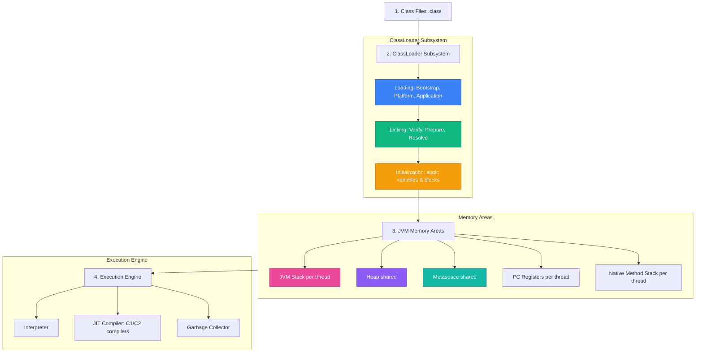

### 1. JVM Overview & The WORA Philosophy

The **Java Virtual Machine (JVM)** is an abstract computing machine that enables a computer to run a Java program. Java's core philosophy—**"Write Once, Run Anywhere" (WORA)**—is realized because the Java compiler (`javac`) compiles human-readable code into standardized **bytecode (`.class`)**, which the target operating system's JVM interprets and compiles into native CPU instructions.

---

### 2. JDK vs. JRE vs. JVM

*   **JVM (Java Virtual Machine)**: The execution engine that executes bytecode instructions. It handles memory allocation, garbage collection, and thread scheduling.
*   **JRE (Java Runtime Environment)**: Includes the JVM plus the standard Java Class Libraries (`java.base`, `java.util`, `java.io`, etc.) required to execute compiled Java applications.
*   **JDK (Java Development Kit)**: A full-featured software development environment containing the JRE, compiler (`javac`), debugger (`jdb`), archiver (`jar`), and documentation generation tools (`javadoc`).

---

### 3. ClassLoader Subsystem Delegation

The ClassLoader subsystem loads class files into memory using a delegation model:

1.  **Loading**: Finds `.class` files on disk or network using three primary classloaders:
    *   **Bootstrap ClassLoader**: Loads core system classes (from `java.base` module like `java.lang.Object`). Written in native C/C++.
    *   **Platform ClassLoader**: Loads platform-specific extension modules.
    *   **Application ClassLoader**: Loads user-defined application classes from the classpath.
2.  **Linking**:
    *   **Verification**: Ensures bytecode complies with JVM security specifications and is not corrupted or tampered with.
    *   **Preparation**: Allocates memory for static fields and initializes them to default zeroed values (`0`, `null`, `false`).
    *   **Resolution**: Replaces symbolic references in the constant pool with direct memory references.
3.  **Initialization**: Executes static initializers (`static { ... }`) and assigns explicit values to static variables.

---

### 4. The JIT Compiler & Tiered Compilation

The JVM uses a hybrid execution approach combining interpretation and compilation:

*   **Interpreter**: Reads and executes bytecode instructions line-by-line instantly upon startup, but executes relatively slowly.
*   **JIT (Just-In-Time) Compiler**: Compiles frequently executed "hot spots" (methods or loops executed thousands of times) into native machine code for direct CPU execution.
*   **Tiered Compilation**:
    *   *Level 0*: Interpreted bytecode execution.
    *   *Level 1–3 (C1 / Client Compiler)*: Performs fast compilation with light optimizations.
    *   *Level 4 (C2 / Server Compiler)*: Performs aggressive, high-level optimizations (inlining, escape analysis, loop unrolling) for maximum throughput.

---

### 5. Runtime Memory Structure

*   **JVM Stack (Per-Thread)**: Stores activation frames for method calls. Each frame contains local variables, operand stacks, and frame data. Destroyed when the method returns.
*   **Heap Area (Shared)**: The primary memory pool where all class instances, arrays, and objects reside. Managed by Garbage Collection.
*   **Metaspace (Shared)**: Located in native OS memory (since Java 8, replacing PermGen). Stores class metadata, method blueprints, and constant pools.
*   **Program Counter (PC) Register (Per-Thread)**: Keeps track of the currently executing JVM instruction address.
*   **Native Method Stack (Per-Thread)**: Contains state for native C/C++ JNI (Java Native Interface) method invocations.

---

<Quiz question="Which component of the JVM compiles frequently executed 'hot spot' code into native machine code?" options={["The ClassLoader Subsystem","The Interpreter","The JIT Compiler","The PC Register"]} answerIndex={2}>
The Just-In-Time (JIT) Compiler identifies hot spots during runtime and translates bytecode into optimized native machine code.
</Quiz>
