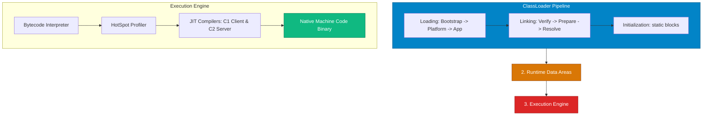

## 🏛️ Java Virtual Machine (JVM) Core Architecture

The **JVM** is an abstract virtual computing machine that executes compiled Java Bytecode (`.class`). It abstracts away underlying operating system CPU architectures, managing memory allocation, thread execution, and native OS system calls automatically.

* **Analogy**: *An Automated Factory Power Plant & Assembly Line.*
  - **ClassLoader Subsystem**: The Factory Loading Dock receiving raw component blueprints (`.class` files) and unpacking them into the facility.
  - **Runtime Memory Data Areas**: The Factory Floor containing dedicated assembly zones (Heap, Stack, Metaspace).
  - **Interpreter**: A manual line worker reading assembly instructions line-by-line out loud.
  - **JIT Compiler (C1 / C2)**: An automated industrial robotic arm that observes frequently repeated manual tasks ("Hot Spots") and permanently welds high-speed native machinery to replace the manual worker!



---

## 🚚 The ClassLoader Subsystem & Parent Delegation Model

Java classes are not loaded into memory all at once. The **ClassLoader** dynamically loads, links, and initializes `.class` files into JVM Metaspace memory on demand when first referenced.

### The 3-Tier ClassLoader Delegation Hierarchy

```
                   Bootstrap ClassLoader (C++ Native / lib/modules)
                                  ▲
                                  │ (Delegates Parent First)
                   Platform ClassLoader (Ext / Module System)
                                  ▲
                                  │ (Delegates Parent First)
                   Application ClassLoader (Classpath / User App)
```

1. **Bootstrap ClassLoader**: Loaded in C/C++ native code. Loads core Java runtime classes (`java.base`, `java.lang.Object`, `String`).
2. **Platform ClassLoader**: Loads platform extension modules.
3. **Application / System ClassLoader**: Loads user application classes located on the application classpath (`-classpath` or `-jar`).

> [!IMPORTANT]
> **Parent Delegation Principle**:
> When a ClassLoader receives a request to load class `foo.Bar`, it **must delegate** the search to its parent ClassLoader first before looking locally. This prevents malicious applications from overriding core security classes like `java.lang.String`!

---

### Class Loading Phases: Load, Link, Initialize

```java
// Inspecting ClassLoader Hierarchy in Code
public class ClassLoaderDemo {
    public static void main(String[] args) {
        // App ClassLoader
        ClassLoader appClassLoader = ClassLoaderDemo.class.getClassLoader();
        System.out.println("App ClassLoader: " + appClassLoader);

        // Platform ClassLoader (Parent of App)
        ClassLoader platformClassLoader = appClassLoader.getParent();
        System.out.println("Platform ClassLoader: " + platformClassLoader);

        // Bootstrap ClassLoader (Parent of Platform - returns null in Java API)
        ClassLoader bootstrapClassLoader = platformClassLoader.getParent();
        System.out.println("Bootstrap ClassLoader: " + bootstrapClassLoader);
    }
}
```

1. **Loading**: Reads binary byte arrays from disk/network and converts them into a `java.lang.Class` object in Metaspace.
2. **Linking**:
   - **Verification**: Checks bytecode structural validity to ensure memory safety and prevent stack corruption.
   - **Preparation**: Allocates memory for static fields and initializes them to default zero-values (`0`, `null`, `false`).
   - **Resolution**: Resolves symbolic reference names in the Constant Pool into direct memory pointers.
3. **Initialization**: Executes static initializer blocks (`static { ... }`) and assigns explicit initial static variable values.

---

## ⚡ Execution Engine: Interpreter vs. JIT Compilers

The JVM uses **Tiered Compilation** to balance fast application startup speed with maximum long-term execution throughput:

```
                            Tiered Compilation Pipeline
                                         │
        ┌────────────────────────────────┼────────────────────────────────┐
        ▼                                ▼                                ▼
  Interpreter (Tier 0)            C1 Compiler (Tier 1-3)            C2 Compiler (Tier 4)
Executes bytecode line-by-line   Compiles hot code quickly         Aggressive optimizations
Fast startup; low CPU efficiency  Light optimizations (inlining)  (Loop unrolling, Escape Analysis)
```

1. **Interpreter (Tier 0)**: Executes bytecode instructions line-by-line immediately upon JVM launch.
2. **C1 Client Compiler (Tiers 1-3)**: Compiles method bytecode into native machine code rapidly with basic optimizations (method inlining) when method invocation counters cross warm thresholds.
3. **C2 Server Compiler (Tier 4)**: When HotSpot profiler detects heavily executed methods ("Hot Spots"), C2 applies aggressive optimizations:
   - **Escape Analysis**: Determines if an object allocated inside a method escapes its scope. If not, it allocates the object on the CPU **Stack** or in registers, eliminating Garbage Collection overhead!
   - **Loop Unrolling & Vectorization**: Unrolls loops to execute SIMD CPU hardware instructions.

---

## ❓ Conceptual Quizzes

<Quiz question="Why does the JVM ClassLoader enforce the Parent Delegation Model when loading classes?" options={["To speed up file reads from disk.", "To prevent security vulnerabilities where custom user code attempts to override core system classes like java.lang.String.", "To eliminate the need for Garbage Collection.", "To force all classes to compile into C binary."]} answerIndex={1}>
The **Parent Delegation Model** ensures that class requests bubble up to the Bootstrap ClassLoader first. This guarantees that core trusted system runtime classes (`java.lang.Object`, `java.lang.String`) are always loaded from the secure JDK runtime, preventing unauthorized overriding.
</Quiz>

<Quiz question="What performance optimization is enabled by JVM Escape Analysis inside the C2 JIT Compiler?" options={["It encrypts bytecode files.", "It allows objects that do not escape a method's scope to be allocated on the thread Stack instead of the Heap, avoiding GC overhead.", "It increases Metaspace size by 200%.", "It disables multi-threading."]} answerIndex={1}>
**Escape Analysis** analyzes object scope. If an object does not escape a method, the C2 compiler optimizes memory allocation by placing the object's fields directly onto the thread **Stack** (or CPU registers), bypassing Heap allocation and completely eliminating GC overhead for that instance.
</Quiz>

---

## 💻 Practice Problems

<Problem title="Problem: ClassLoader Hierarchy Inspection">
<ProblemDescription>
Write a standalone Java program that prints the ClassLoader instance associated with `java.lang.String`, `java.sql.Date`, and your custom application class.
</ProblemDescription>
<ProblemSolution>
```java
public class ClassLoaderInspector {
    public static void main(String[] args) {
        // Core Java Class (Loaded by Bootstrap ClassLoader -> outputs null)
        System.out.println("String ClassLoader: " + String.class.getClassLoader());

        // SQL Class (Loaded by Platform ClassLoader)
        System.out.println("SQL Date ClassLoader: " + java.sql.Date.class.getClassLoader());

        // Custom Class (Loaded by Application ClassLoader)
        System.out.println("Custom ClassLoader: " + ClassLoaderInspector.class.getClassLoader());
    }
}
```
</ProblemSolution>
</Problem>
