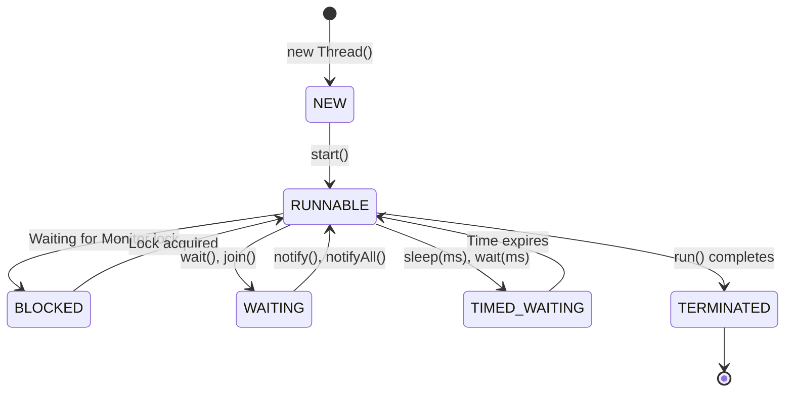

### 1. Thread States & Lifecycle

A Java thread transitions through distinct states during execution:



---

### 2. The Java Memory Model (JMM) & `volatile`

The **Java Memory Model (JMM)** defines how threads interact through main memory and local CPU caches.

*   **Visibility**: CPU cores cache variables in L1/L2/L3 hardware caches. If Thread A modifies a variable, Thread B running on another core may read stale cached values.
*   **The `volatile` Keyword**: Guarantees **visibility** by forcing reads and writes directly to main memory, bypassing local CPU caches. It establishes a *happens-before* relationship.

> [!IMPORTANT]
> `volatile` guarantees visibility but **does not guarantee atomicity** for compound operations (e.g., `count++`).

---

### 3. Thread Synchronization & Locks

*   **`synchronized`**: Obtains an intrinsic monitor lock on an object or class. Only one thread can execute a synchronized block at a time.
*   **`ReentrantLock`**: Explicit lock implementation providing advanced features:
    *   Timed lock polling (`tryLock(timeout, unit)`).
    *   Interruptible lock acquisition.
    *   Fair lock queuing policies.

---

### 4. ExecutorService & Thread Pools

Managing raw threads manually creates significant OS kernel overhead. The `ExecutorService` framework reuses a pool of worker threads.

```java
import java.util.concurrent.ExecutorService;
import java.util.concurrent.Executors;

public class ThreadPoolDemo {
    public static void main(String[] args) {
        // Create a fixed thread pool of 4 worker threads
        ExecutorService executor = Executors.newFixedThreadPool(4);

        for (int i = 0; i < 10; i++) {
            final int taskId = i;
            executor.submit(() -> {
                System.out.println("Executing Task " + taskId + " on " + Thread.currentThread().getName());
            });
        }

        executor.shutdown(); // Gracefully shutdown pool
    }
}
```

<Quiz question="What memory guarantee does the volatile keyword provide in Java?" options={["Guarantees atomic execution of compound statements like count++.","Guarantees immediate visibility across threads by forcing reads and writes directly to main memory.","Prevents garbage collection of the volatile variable.","Allocates the variable in Metaspace."]} answerIndex={1}>
`volatile` forces all variable reads and writes to communicate directly with main memory, guaranteeing visibility across threads.
</Quiz>
