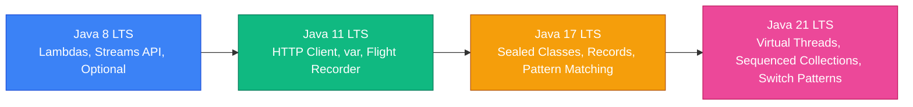

### 1. Java Feature Evolution Matrix



---

### 2. Pattern Matching for `switch` (Java 21+)

Pattern matching simplifies type extraction inside `switch` statements:

```java
public class PatternSwitchDemo {
    public static String processResponse(Object obj) {
        return switch (obj) {
            case null -> "Received Null";
            case Integer i -> "Integer value: " + i;
            case String s -> "String length: " + s.length();
            case UserProfile(String user, String email, int age) -> "User: " + user; // Record pattern
            default -> "Unknown Type: " + obj.toString();
        };
    }
}
```

---

### 3. Sequenced Collections (Java 21+)

Introduces unified interfaces (`SequencedCollection`, `SequencedSet`, `SequencedMap`) for collections with a defined encounter order, providing `addFirst()`, `addLast()`, `getFirst()`, `getLast()`, and `reversed()`.

<Quiz question="Which Java version introduced Virtual Threads and Sequenced Collections as standard features?" options={["Java 8","Java 11","Java 17","Java 21"]} answerIndex={3}>
Java 21 LTS finalized Virtual Threads (Project Loom), Sequenced Collections, and Pattern Matching for switch.
</Quiz>
