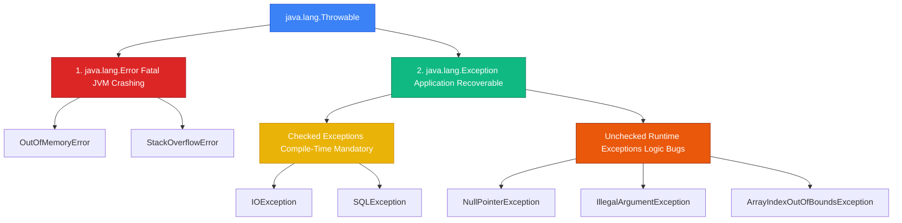

## ⚡ Exception Architecture & `Throwable` Hierarchy

An **Exception** is an event that disrupts the normal execution flow of a Java application. All exception classes in Java inherit from the **`java.lang.Throwable`** superclass:

* **Analogy**: *An Electrical Circuit Fuse Box & Emergency Responders.*
  - **`java.lang.Error`**: Structural building damage (e.g., Earthquake or Power Grid Blackout). Application code cannot catch or recover from errors.
  - **Checked Exceptions**: Mandatory Fire Safety Inspection Permits. The compiler requires you to show proof of a fire extinguisher (`try-catch` or `throws`) *before* you can open for business!
  - **Unchecked Runtime Exceptions**: Tripping over a loose wire in the office. Bugs caused by improper application code logic (`NullPointerException`, `IndexOutOfBoundsException`).



---

## 🆚 Checked Exceptions vs. Unchecked Runtime Exceptions

| Attribute | Checked Exceptions (`Exception`) | Unchecked Exceptions (`RuntimeException`) |
| :--- | :--- | :--- |
| **Compiler Enforcement** | **Mandatory**. Must catch or declare via `throws` signature | **Optional**. Compiler does not enforce handling |
| **Root Cause** | Recoverable environmental conditions (Missing file, Network drop) | Programmatic logic bugs (`null` dereference, invalid index) |
| **Common Examples** | `IOException`, `SQLException`, `ClassNotFoundException` | `NullPointerException`, `IllegalArgumentException`, `ArithmeticException` |

---

## 🔀 Modern Switch Expressions (Java 14+)

Java 14 introduced clean **Switch Expressions** featuring arrow syntax (`->`), yield returns, and exhaustiveness checking:

```java
public class SwitchExpressionDemo {
    public static String getDayType(String day) {
        // Switch as an expression returning a value directly!
        return switch (day.toUpperCase()) {
            case "MONDAY", "TUESDAY", "WEDNESDAY", "THURSDAY", "FRIDAY" -> "Weekday";
            case "SATURDAY", "SUNDAY" -> "Weekend";
            default -> {
                System.out.println("Validating unexpected input: " + day);
                yield "Unknown Day";
            }
        };
    }

    public static void main(String[] args) {
        System.out.println("Friday is a: " + getDayType("Friday"));
    }
}
```

---

## 🧹 Automatic Resource Management: `try-with-resources`

Before Java 7, closing file streams or database connections required verbose `finally` blocks. Java 7 introduced **`try-with-resources`**, which automatically closes any resource implementing the **`java.lang.AutoCloseable`** interface:

```java
import java.io.BufferedReader;
import java.io.FileReader;
import java.io.IOException;

public class ResourceCleanupDemo {
    public static void main(String[] args) {
        // AutoCloseable resource instantiated inside try header
        try (BufferedReader reader = new BufferedReader(new FileReader("config.txt"))) {
            String line = reader.readLine();
            System.out.println("Config Read: " + line);
        } catch (IOException e) {
            System.err.println("File I/O Error: " + e.getMessage());
        } 
        // reader.close() is automatically invoked HERE in reverse allocation order!
    }
}
```

---

## 🛠️ Creating Custom Domain Exceptions

```java
// Custom Unchecked Business Exception
public class InsufficientFundsException extends RuntimeException {
    private final double requestedAmount;

    public InsufficientFundsException(String message, double requestedAmount) {
        super(message);
        this.requestedAmount = requestedAmount;
    }

    public double getRequestedAmount() {
        return requestedAmount;
    }
}
```

---

## ❓ Conceptual Quizzes

<Quiz question="What is the key difference between Checked and Unchecked Exceptions in Java?" options={["Checked exceptions run faster.", "Checked exceptions are verified at compile-time by javac, requiring explicit try-catch or throws clauses; Unchecked exceptions extend RuntimeException and represent logic bugs.", "Unchecked exceptions crash the OS.", "Checked exceptions only work on arrays."]} answerIndex={1}>
**Checked exceptions** (extending `Exception`) are checked by the compiler, requiring explicit `try-catch` blocks or `throws` method signatures. **Unchecked exceptions** (extending `RuntimeException`) represent application logic bugs and do not force compile-time handling.
</Quiz>

<Quiz question="Which interface must a resource class implement to be compatible with try-with-resources syntax?" options={["java.io.Serializable", "java.lang.AutoCloseable", "java.lang.Runnable", "java.util.Cloneable"]} answerIndex={1}>
Any resource used inside a `try-with-resources` header must implement the **`java.lang.AutoCloseable`** (or `java.io.Closeable`) interface, which declares the `close()` method invoked automatically upon exiting the try block.
</Quiz>

---

## 💻 Practice Problems

<Problem title="Problem: Custom AutoCloseable Database Connection Simulation">
<ProblemDescription>
Create a class `FakeDbConnection` that implements `AutoCloseable`. Instantiate it inside a `try-with-resources` block in `main()` to demonstrate automatic resource closure.
</ProblemDescription>
<ProblemSolution>
```java
public class FakeDbConnection implements AutoCloseable {
    public FakeDbConnection() {
        System.out.println("DB Connection Opened.");
    }

    public void executeQuery(String sql) {
        System.out.println("Executing SQL: " + sql);
    }

    @Override
    public void close() {
        System.out.println("DB Connection Closed Automatically!");
    }

    public static void main(String[] args) {
        try (FakeDbConnection conn = new FakeDbConnection()) {
            conn.executeQuery("SELECT * FROM users");
        } // close() is called automatically here!
    }
}
```
</ProblemSolution>
</Problem>
