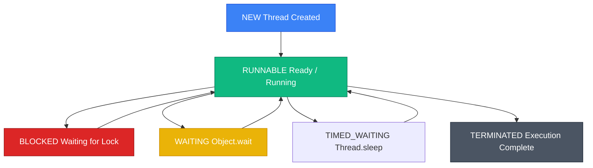

## 🚦 Java Thread Lifecycle & Execution

A **Thread** is the smallest unit of concurrent execution managed by the operating system kernel.

* **Analogy**: *Multi-Lane Highway & Dual-Custody Bank Vault Locks.*
  - **Single Threading**: A single-lane road with 1 car driving at a time.
  - **Multithreading**: A 4-lane highway with 4 cars driving side-by-side concurrently.
  - **`volatile`**: An emergency broadcast banner displayed across all lane monitors simultaneously, ensuring every driver sees updated weather conditions instantly without relying on old cached dashboard mirrors.
  - **`synchronized`**: A dual-custody bank vault lock. Only 1 security guard carrying the key card (Monitor Lock) can enter the vault at a time; all other guards must wait in line (`BLOCKED`).



---

## 🧠 Java Memory Model (JMM) & `volatile` Visibility

The **Java Memory Model (JMM)** defines the specification for how threads interact through shared main RAM memory vs private CPU L1/L2 caches.

```
                           Java Memory Model (JMM)
                                      │
    Thread 1 (CPU Core 1)                        Thread 2 (CPU Core 2)
  ┌───────────────────────┐                    ┌───────────────────────┐
  │ Local Cache (x = 5)   │                    │ Local Cache (x = 5)   │
  └───────────┬───────────┘                    └───────────┬───────────┘
              │                                            │
              └───────────────► Main RAM ◄─────────────────┘
                              (Shared x = 10)
```

### The `volatile` Keyword: Memory Visibility & Ordering
When a field is declared **`volatile`**:
1. **Visibility Guarantee**: Flushes writes directly to shared Main RAM memory immediately, bypassing CPU L1/L2 caches, guaranteeing that subsequent reads by other threads see the updated value instantly.
2. **Happens-Before Relationship**: Prevents CPU instruction reordering across the memory barrier.

> [!CAUTION]
> **`volatile` is NOT Atomic**:
> `volatile` guarantees **visibility**, but it does **NOT** guarantee atomicity! Executing `volatileCount++` is still a 3-step non-atomic read-modify-write operation prone to race conditions. Use `AtomicInteger` for atomic increments!

---

## 🔒 Intrinsic Locks (`synchronized`) vs. `ReentrantLock`

| Metric | Intrinsic Lock (`synchronized`) | Explicit Lock (`ReentrantLock`) |
| :--- | :--- | :--- |
| **Lock Acquisition** | Automatic block-scoped acquisition & release | Manual `lock.lock()` and `lock.unlock()` in `finally` |
| **Interruptibility** | Cannot interrupt a thread waiting for lock | Supports `lockInterruptibly()` |
| **Fairness Policy** | Unfair lock acquisition | Supports **Fair Lock** queue (`new ReentrantLock(true)`) |
| **Try Lock** | Not supported | Supports `tryLock(timeout, timeUnit)` |

```java
import java.util.concurrent.locks.ReentrantLock;

public class ReentrantLockDemo {
    private final ReentrantLock lock = new ReentrantLock();
    private int counter = 0;

    public void increment() {
        lock.lock(); // Explicit Lock Acquisition
        try {
            counter++;
        } finally {
            lock.unlock(); // Always release in finally block!
        }
    }
}
```

---

## ⚛️ Atomic Classes & CAS Operations (`AtomicInteger`)

Atomic classes (`AtomicInteger`, `AtomicReference`) achieve lock-free thread safety using CPU hardware-level **CAS (Compare-And-Swap)** instructions:

```java
import java.util.concurrent.atomic.AtomicInteger;

public class AtomicCounterDemo {
    // Lock-free thread-safe atomic counter
    private final AtomicInteger count = new AtomicInteger(0);

    public void increment() {
        // Uses hardware-level CAS loop: compareAndSet(expected, update)
        count.incrementAndGet();
    }

    public int getCount() {
        return count.get();
    }
}
```

---

## ❓ Conceptual Quizzes

<Quiz question="What memory guarantee does the volatile keyword provide in Java?" options={["It makes all operations atomic.", "It guarantees memory visibility by flushing writes to shared Main RAM immediately and enforcing a happens-before ordering barrier.", "It encrypts variable values.", "It converts threads into virtual threads."]} answerIndex={1}>
The **`volatile`** keyword guarantees **memory visibility** by flushing writes directly to shared Main RAM (bypassing CPU L1/L2 caches) and enforcing a **`happens-before`** memory barrier to prevent instruction reordering.
</Quiz>

<Quiz question="Why is it mandatory to call ReentrantLock.unlock() inside a finally block?" options={["To speed up JIT compilation.", "To guarantee that the lock is released even if an unhandled exception occurs inside the try block, preventing thread deadlocks.", "ReentrantLock automatically closes files.", "Because javac throws a syntax error otherwise."]} answerIndex={1}>
Calling **`lock.unlock()` inside a `finally` block** guarantees that the explicit lock is reliably deallocated even if an exception is thrown inside the critical section, preventing catastrophic application thread deadlocks.
</Quiz>

---

## 💻 Practice Problems

<Problem title="Problem: Lock-Free Thread-Safe Counter Benchmark">
<ProblemDescription>
Write a program where 10 concurrent threads each increment a shared `AtomicInteger` counter 1,000 times using an `ExecutorService`, and print the final counter value (expecting 10,000).
</ProblemDescription>
<ProblemSolution>
```java
import java.util.concurrent.ExecutorService;
import java.util.concurrent.Executors;
import java.util.concurrent.TimeUnit;
import java.util.concurrent.atomic.AtomicInteger;

public class AtomicBenchmark {
    public static void main(String[] args) throws InterruptedException {
        AtomicInteger counter = new AtomicInteger(0);
        ExecutorService executor = Executors.newFixedThreadPool(10);

        for (int i = 0; i < 10; i++) {
            executor.submit(() -> {
                for (int j = 0; j < 1000; j++) {
                    counter.incrementAndGet(); // Atomic CAS increment
                }
            });
        }

        executor.shutdown();
        executor.awaitTermination(5, TimeUnit.SECONDS);

        System.out.println("Final Thread-Safe Counter Value: " + counter.get());
    }
}
```
</ProblemSolution>
</Problem>
