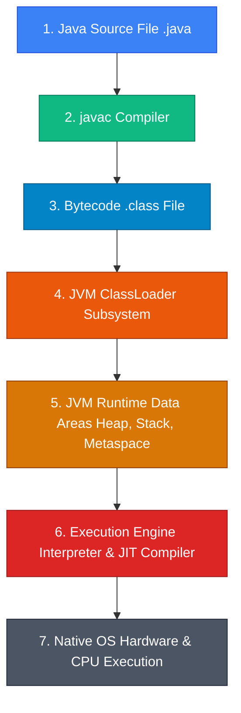

Java is an object-oriented, class-based, strongly-typed programming language engineered around the foundational paradigm: *"Write Once, Run Anywhere"* (WORA). Rather than compiling source code into platform-dependent native machine code, Java compiles source code (`.java`) into intermediate **Bytecode** (`.class`), which is executed, optimized, and garbage-collected inside the **Java Virtual Machine (JVM)** runtime environment.

* **Analogy**: *An Automated Industrial Power Plant & Universal Adaptor.*
  - **Java Source Code (`.java`)**: Architectural blueprints drawn by engineers.
  - **Bytecode (`.class`)**: Universal standardized component specifications.
  - **JVM (Java Virtual Machine)**: The specialized heavy-duty factory machinery installed in different countries (Windows, Linux, macOS) that reads standard component specifications and builds the product locally.
  - **Garbage Collector**: Automated robotic maintenance janitors constantly sweeping the factory floor, recycling unused parts (dead objects) into raw material memory.

---

## 🗺️ Java Learning Modules & Navigation Roadmap

Explore our 12 structured, analogy-driven Java modules below. Each module provides technical mechanics, memory layout diagrams, performance tuning strategies, and enterprise production practices.

| Module | Core Topics | Key Focus & Engineering Concepts | Read Time |
| :--- | :--- | :--- | :--- |
| **[1. JVM Architecture](./01-jvm-architecture-and-execution-engine/jvm-architecture)** | ClassLoader, Interpreter, JIT C1/C2, Tiered Compilation | Loading/Linking stages, bytecode verification, and dynamic hotspot optimization | ~15 mins |
| **[2. JVM Memory & GC](./02-jvm-memory-and-garbage-collection/memory-and-gc)** | Heap (Eden, Survivor, Old), Stack, Metaspace, G1GC, ZGC | Memory allocation, GC roots, Stop-the-World pauses, and tuning flags | ~20 mins |
| **[3. Primitives & Memory](./03-primitives-types-and-memory/primitives-and-wrappers)** | 8 Primitives, Object Wrappers, Auto-boxing, NullPointer Hazards | Primitive vs reference storage, memory overhead, and value semantics | ~12 mins |
| **[4. Strings & String Pool](./04-strings-mutability-and-string-pool/strings-and-string-pool)** | String Immutability, String Constant Pool (SCP), Text Blocks | Memory deduplication, `intern()`, and `StringBuilder` thread safety | ~12 mins |
| **[5. Control Flow & Exceptions](./05-control-flow-and-exceptions/control-flow-and-exceptions)** | Switch Expressions, Throwable, Checked vs Unchecked, `try-with-resources` | Error propagation, stack traces, and automatic resource management | ~15 mins |
| **[6. OOP, Interfaces & Polymorphism](./06-oop-semantics-interfaces-and-polymorphism/oop-and-polymorphism)** | Encapsulation, Inheritance, Overloading/Overriding, Interfaces | Method dispatching, `default`/`static` methods, and polymorphic behavior | ~18 mins |
| **[7. Records & Sealed Classes](./07-records-and-sealed-classes/records-and-sealed-classes)** | Java 14+ `record`, Java 17 `sealed` & `permits`, Pattern Matching | Data carrier classes, immutable DTOs, and restricted class hierarchies | ~15 mins |
| **[8. Generics & Type Erasure](./08-generics-and-type-erasure/generics-and-type-erasure)** | Generics `<T>`, Wildcards (`? extends`, `? super`), PECS Rule | Type safety, compile-time type erasure, and bridge methods | ~18 mins |
| **[9. Collections Internals](./09-collections-framework-internals/collections-internals)** | ArrayList, LinkedList, HashMap, ConcurrentHashMap, Sequenced Collections | Hash bucket indexing, treeification at threshold 8, CAS locks, and Java 21 APIs | ~22 mins |
| **[10. Multithreading & JMM](./10-multithreading-jmm-and-locks/multithreading-and-locks)** | Java Memory Model (JMM), `volatile`, `synchronized`, ReentrantLock | Thread safety, `happens-before` guarantees, and CAS atomic operations | ~22 mins |
| **[11. Executors & Virtual Threads](./11-async-executors-and-virtual-threads/executors-and-virtual-threads)** | ExecutorService, CompletableFuture, Virtual Threads (Project Loom) | High-concurrency I/O, carrier thread mounting, and structured concurrency | ~25 mins |
| **[12. Streams, Spring Boot & Patterns](./12-streams-spring-boot-and-design-patterns/streams-spring-boot-patterns)** | Lambdas, Streams API, Spring Boot IoC/DI, GoF Design Patterns | Functional pipelines, Dependency Injection, and enterprise architecture patterns | ~25 mins |

---

## ⚡ Quick Reference & Comparison Matrices

### 1. JDK vs JRE vs JVM Ecosystem Comparison

| Component | Full Name | Included Contents | Primary Operational Role |
| :--- | :--- | :--- | :--- |
| **JVM** | Java Virtual Machine | Interpreter, JIT Compilers, Garbage Collector, Memory Managers | Executes compiled Bytecode (`.class`) on target host operating system |
| **JRE** | Java Runtime Environment | JVM + Standard Class Libraries (`java.base`, `rt.jar`) | Minimum runtime requirement to **run** compiled Java applications |
| **JDK** | Java Development Kit | JRE + Development Tools (`javac`, `jdb`, `jcmd`, `jar`) | Complete toolkit required to **compile, debug, and package** Java software |

---

### 2. Concurrency: Platform Threads vs. Virtual Threads (Java 21 Project Loom)

| Feature Metric | Platform Threads (`java.lang.Thread`) | Virtual Threads (Project Loom Java 21) |
| :--- | :--- | :--- |
| **OS Thread Ratio** | 1 : 1 (1 Java thread maps to 1 OS Kernel thread) | M : N (Millions of Virtual threads multiplexed over Carrier threads) |
| **Memory Footprint** | Heavy (~1 MB stack RAM pre-allocated per thread) | Lightweight (~1 KB dynamic stack frame RAM allocated on Heap) |
| **Creation Cost** | Expensive (~1 millisecond kernel context switch) | Sub-microsecond (instantiated like standard Java objects) |
| **Max Capacity Limit** | ~2,000 to 5,000 threads before OOM OS thread crash | 1,000,000+ concurrent active threads |
| **Blocking I/O Handling** | Blocks OS Kernel thread during network/disk I/O | Unmounts virtual thread from Carrier thread during blocking I/O |

---

## ❓ Self-Assessment Knowledge Check

<Quiz question="What happens internally in Java 8+ when a bucket in a HashMap exceeds a bucket count of 8 entries and total map capacity exceeds 64?" options={["The HashMap throws an OutOfMemoryError.", "The linked list in that bucket is converted into a Red-Black Tree, reducing lookup time from O(N) to O(log N).", "The HashMap automatically deletes old entries.", "The entire HashMap is converted into a Vector."]} answerIndex={1}>
In Java 8+, when a single hash bucket experiences high hash collisions containing more than **8 entries** (and total table capacity $\ge 64$), the bucket's internal linked list is transformed (**treeified**) into a **Red-Black Tree**, improving worst-case search complexity from $O(N)$ to $O(\log N)$.
</Quiz>

<Quiz question="Why does the PECS rule (Producer Extends, Consumer Super) guide generic wildcard usage in Java collections?" options={["PECS guarantees that all collections run in C native mode.", "Extends (? extends T) allows reading items from a collection (Producer), while Super (? super T) allows writing items into a collection (Consumer).", "PECS disables type erasure at runtime.", "Extends converts lists into arrays."]} answerIndex={1}>
The **PECS rule** dictates: use `? extends T` when you only **read** (produce) items from a collection (ensuring items are at least of type `T`), and use `? super T` when you only **write** (consume) items into a collection (ensuring the collection can accept type `T`).
</Quiz>

---

## 🚀 Get Started

Jump directly into **[Module 1: JVM Architecture & Execution Engine](./01-jvm-architecture-and-execution-engine/jvm-architecture)** to master classloading, bytecode execution, and JIT compiler mechanics!
