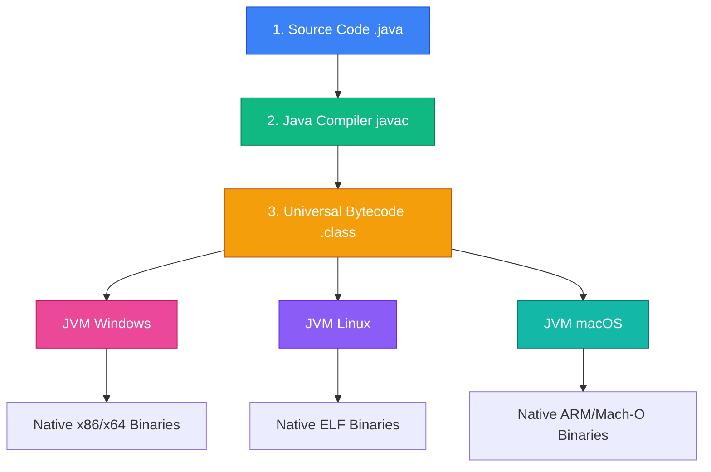
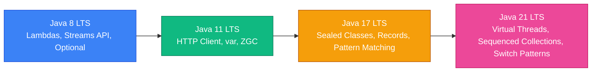

Java is one of the most battle-tested, high-performance, and scalable programming languages in enterprise software engineering. Built around the core philosophy of **"Write Once, Run Anywhere" (WORA)**, Java compiles source code into platform-independent **bytecode (`.class`)**, which executes on the **Java Virtual Machine (JVM)**.

---

## 🗺️ Learning Modules & Navigation Roadmap

Explore our structured, highly scalable modules below. Each module provides deep technical insights, memory diagrams, code examples, common pitfalls, and real-world engineering practices.

| Module | Core Topics | Key Takeaways & Focus | Read Time |
| :--- | :--- | :--- | :--- |
| **[1. Core Java & JVM](./01-core-fundamentals/jvm-architecture-and-memory)** | ClassLoader, JIT Compiler, JVM Memory (Stack/Heap/Metaspace), Primitives, String Pool, Exceptions | Deep understanding of memory allocation, bytecode execution, and exception safety | ~15 mins |
| **[2. OOP & Collections](./02-oop-and-type-system/oop-semantics-records-sealed)** | Polymorphism, Sealed Classes, Records, Generics & PECS Rule, HashMap & Red-Black Tree Internals | Mastery over type hierarchy, immutable data carriers, generic bounds, and hashing math | ~20 mins |
| **[3. Concurrency & GC](./03-concurrency-and-performance/multithreading-and-jmm)** | Java Memory Model (JMM), `volatile`, Locks, CompletableFuture, Virtual Threads (Project Loom), GC Collectors | Building high-throughput non-blocking systems, thread safety, and sub-millisecond GC tuning | ~25 mins |
| **[4. Modern Java & Ecosystem](./04-modern-java-and-ecosystem/streams-api-and-functional)** | Functional Streams API, Lambdas, Java 8 to 21 Evolution (Pattern Matching, Switch Expressions), Spring Boot | Writing clean declarative code and enterprise microservices architecture | ~20 mins |
| **[5. Patterns & Interviews](./05-patterns-and-interviews/design-patterns-in-java)** | Gang of Four Design Patterns, Custom Thread-Safe Data Structures, HashMap Implementation, System Pitfalls | Real-world problem solving and senior technical interview readiness | ~30 mins |

---

## ⚡ Quick Reference & Comparison Matrix

### 1. Stack vs. Heap Allocation

| Aspect | The JVM Stack (Per-Thread) | The Heap Area (Shared Pool) |
| :--- | :--- | :--- |
| **Data Stored** | Method frames, primitive local variables, reference pointers | Physical object instances, class instances, array contents |
| **Lifetime** | Tied to method execution frame (LIFO allocation) | Managed by Garbage Collector until unreachable |
| **Access Speed** | Ultra-fast (CPU cache friendly, contiguous memory allocation) | Fast, but subject to pointer dereferencing & GC overhead |
| **Thread Safety** | Inherently thread-safe (isolated per thread) | Requires synchronization (`volatile`, locks, CAS atomic operations) |

---

### 2. Threading Evolution: Traditional vs. Virtual Threads (Project Loom)

| Dimension | Platform / OS Threads | Virtual Threads (Java 21+) |
| :--- | :--- | :--- |
| **OS Mapping** | 1:1 wrapper around OS kernel thread | M:N carrier thread mapping managed entirely by JVM |
| **Memory Footprint** | ~1 MB stack per thread | ~200 Bytes stack frame allocation |
| **Creation Cost** | High (kernel syscall overhead, max thousands per JVM) | Near-zero (millions of threads per JVM instance) |
| **Ideal Workload** | CPU-bound intensive math / encryption tasks | I/O-bound blocking calls (DB queries, REST HTTP calls) |

---

### 3. Key Java Evolution Milestones (Java 8 ➡️ 21)

---

## ❓ Self-Assessment Knowledge Check

<Quiz question="What happens when an unboxed null Integer reference is assigned to a primitive int variable?" options={["The primitive int defaults to 0.","A NullPointerException is thrown at runtime.","The code fails to compile.","The memory allocation is redirected to Metaspace."]} answerIndex={1}>
Autoboxing and unboxing invoke `.intValue()` under the hood. Invoking a method on a `null` wrapper reference triggers a `NullPointerException`.
</Quiz>

<Quiz question="Which garbage collector in modern Java is designed for low-latency concurrent cleanup with pause times under 1 millisecond?" options={["Serial GC","Parallel GC","ZGC (Z Garbage Collector)","G1 GC"]} answerIndex={2}>
**ZGC (Z Garbage Collector)** is a low-latency, scalable garbage collector designed to execute memory cleanup concurrently with application threads, keeping pause times below 1ms even on multi-terabyte heaps.
</Quiz>

---

## 🚀 Get Started

Jump directly into **[Module 1: Core Java & JVM Architecture](./01-core-fundamentals/jvm-architecture-and-memory)** to begin exploring Java memory models, ClassLoader mechanics, and runtime optimizations!
